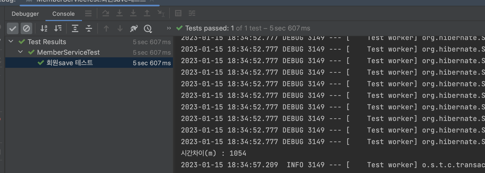
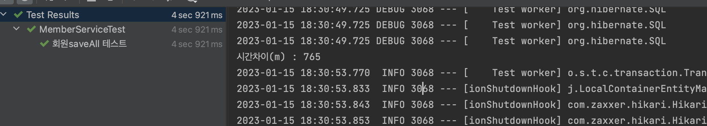
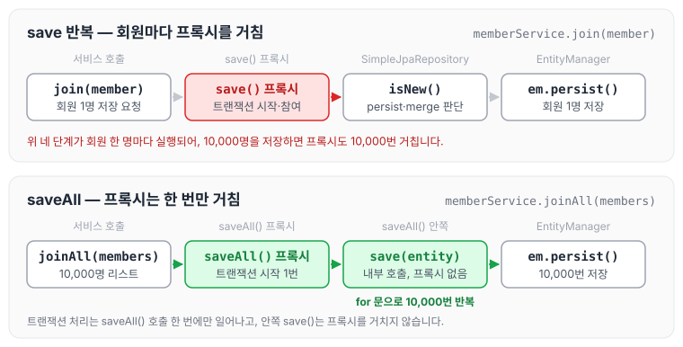

오늘은 JPA를 공부하다가 궁금해진 save와 saveAll의 성능 차이에 대해 정리하도록 하겠습니다.

두 방식 모두 테스트 코드를 작성하고, 저장에 걸리는 시간을 측정해 비교하였습니다. 측정해 보니 saveAll이 save보다 1.25배에서 최대 2배 정도 빨랐습니다. 그 이유는 아래 테스트 코드와 함께 설명하겠습니다.

## save

회원 10,000명을 `save`로 한 명씩 저장하는 테스트입니다.

```java
@Test
    @DisplayName("회원save 테스트")
    public void 회원save톄스트() {
        int memberCount = 10000;

        long beforeTime = System.currentTimeMillis();
        for (int i = 0; i < memberCount; i++) {
            Member member = Member.createMember("typark"+i, 40);
            memberService.join(member);
        }
        long afterTime = System.currentTimeMillis();
        long secDiffTime = (afterTime - beforeTime); //두 시간에 차 계산
        System.out.println("시간차이(m) : "+secDiffTime); // 1026
    }
```

테스트는 아래 순서로 진행합니다.

1. 회원 수를 10,000으로 정합니다.
2. 회원 저장을 시작하기 전에 시스템 시간을 기록합니다.
3. 회원 10,000명을 한 명씩 저장합니다.
4. 저장이 끝난 뒤 시스템 시간을 기록합니다.
5. 저장 후 시간에서 저장 전 시간을 빼서 총 걸린 시간을 구합니다.

실행 결과는 아래와 같습니다.



## saveAll

이번에는 회원 10,000명을 리스트에 담은 뒤 `saveAll`로 한 번에 저장합니다.

```java
@Test
    @DisplayName("회원saveAll 테스트")
    public void 회원saveAll테스트() {
        int memberCount = 10000;
        List<Member> members = new ArrayList<>();

        long beforeTime = System.currentTimeMillis();
        for (int i = 0; i < memberCount; i++) {
            Member member = Member.createMember("typark"+i, 40);
            members.add(member);
        }
        memberService.joinAll(members);
        long afterTime = System.currentTimeMillis();
        long secDiffTime = (afterTime - beforeTime); //두 시간에 차 계산
        System.out.println("시간차이(m) : "+secDiffTime); // 750
    }
```

테스트는 아래 순서로 진행합니다.

1. 회원 수를 10,000으로 정합니다.
2. 회원 저장을 시작하기 전에 시스템 시간을 기록합니다.
3. 회원 10,000명을 리스트에 담습니다.
4. 리스트를 `saveAll` 함수에 넘겨 저장합니다.
5. 저장이 끝난 뒤 시스템 시간을 기록합니다.
6. 저장 후 시간에서 저장 전 시간을 빼서 총 걸린 시간을 구합니다.

실행 결과는 아래와 같습니다.



## 결과

결과를 보면 save보다 saveAll이 더 빠른 것을 알 수 있습니다. 이런 차이가 생기는 이유를 두 함수의 내부 코드로 살펴보겠습니다.

### save 내부 함수

```java
	@Transactional
	@Override
	public <S extends T> S save(S entity) {

		Assert.notNull(entity, "Entity must not be null.");

		if (entityInformation.isNew(entity)) {
			em.persist(entity);
			return entity;
		} else {
			return em.merge(entity);
		}
	}
```

`save` 함수는 `@Transactional`로 감싸져 있으며, 이는 스프링의 프록시를 기반으로 동작합니다. 즉 `save`를 호출하면 프록시가 호출을 먼저 가로채서 트랜잭션을 처리한 뒤, 실제 객체의 `save` 함수를 실행합니다. 함수 안에서는 새로운 엔티티인지(`isNew`) 판단해서 `persist` 또는 `merge`를 호출하는데, 이 판단 기준은 [스프링 데이터 JPA는 어떻게 동작하는가](../data-jpa-internals/)에 정리하였습니다.

프록시에 대한 설명은 [11장 시스템 (2)](../clean-code-ch12-systems-2/)를 참고합니다.

### saveAll 내부 함수

```java
	@Transactional
	@Override
	public <S extends T> List<S> saveAll(Iterable<S> entities) {

		Assert.notNull(entities, "Entities must not be null!");

		List<S> result = new ArrayList<>();

		for (S entity : entities) {
			result.add(save(entity));
		}

		return result;
	}
```

`saveAll` 함수도 `@Transactional`로 감싸져 있지만, 안에서는 같은 객체의 `save` 함수를 직접 호출합니다. 같은 객체 안에서 호출하면 프록시를 거치지 않기 때문에, 회원마다 프록시가 트랜잭션을 처리하던 과정이 없어지고 `saveAll`을 호출할 때 한 번만 처리됩니다. 그래서 save를 반복해서 호출하는 것보다 효율적으로 동작합니다.

같은 객체 안에서 호출하면 프록시를 거치지 않는 현상은 [[Java] @Transactional 롤백 안 되는 원인 [프록시]](../transaction-rollback-proxy/)에서도 다루었습니다.

두 방식이 프록시를 거치는 횟수를 비교하면 아래와 같습니다.



save를 반복하면 회원 한 명마다 프록시를 거치고, saveAll은 처음 한 번만 프록시를 거친 뒤 안쪽에서 save를 직접 호출합니다.

## 마무리

오늘은 save와 saveAll의 차이점에 대해 정리하였습니다. 많은 양의 데이터를 저장할 때는 saveAll을 활용하는 것이 좀 더 효율적일 것 같습니다.

참조 : [[Spring Data JPA] save와 saveAll의 성능 차이에 대한 실험과 결과!(스프링 프록시, @Transactional)](https://sas-study.tistory.com/388)
