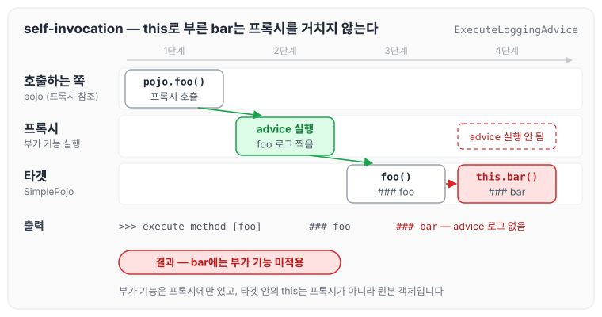
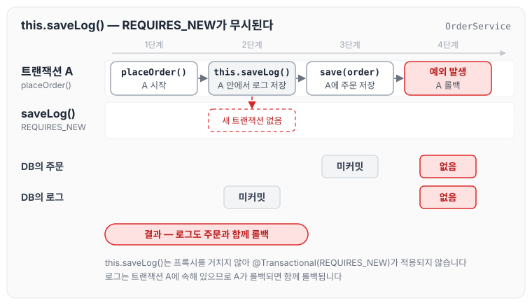
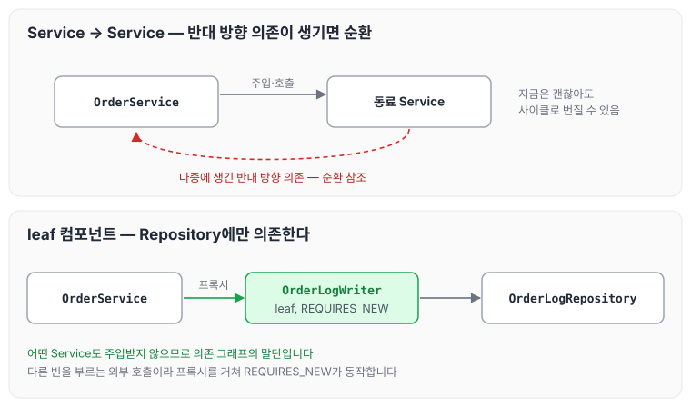
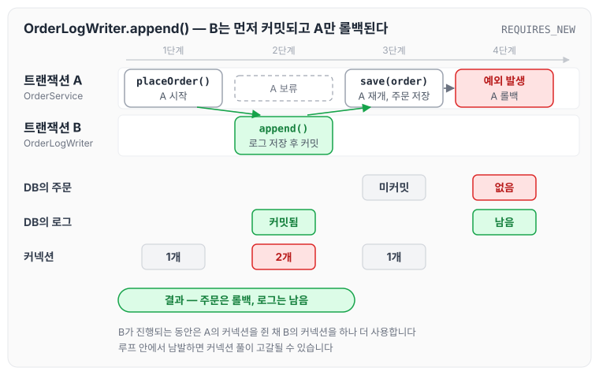

이전에 [실무에서 잘못 사용하고 있던 Transaction](../transaction-misuse/)과 [@Transactional 롤백 안 되는 원인 [프록시]](../transaction-rollback-proxy/)에서 같은 클래스 안의 호출로 트랜잭션이 적용되지 않는 문제에 대해 작성하였습니다.

같은 클래스 안에서 메서드가 자기 자신을 `this.메서드()`로 호출하면, 그 메서드에 붙은 `@Transactional`은 동작하지 않습니다. 이를 self-invocation 문제라고 부릅니다. Spring AOP는 원본 객체를 프록시로 감싸서 트랜잭션 같은 부가 기능을 프록시에만 넣어 두는데, 내부 호출(`this`)은 그 프록시를 거치지 않기 때문입니다. (프록시가 정확히 어떻게 동작하고 어떻게 만들어지는지는 별도 글에서 다루겠습니다.)

오늘은 self-invocation이 실무에서 `@Transactional`, 특히 `REQUIRES_NEW`를 사용할 때 어떤 문제를 만드는지와 이를 해결하는 방법을 정리하도록 하겠습니다.

## 1. self-invocation이란

먼저 현상부터 확인해 보겠습니다. `foo()`가 같은 클래스의 `bar()`를 호출하는 객체가 있습니다.

```java
public class SimplePojo implements Pojo {

    @Override
    public void foo() {
        log.info("### foo");
        bar();              // this.bar()
    }

    @Override
    public void bar() {
        log.info("### bar");
    }
}
```

그리고 메서드를 호출하기 전에 메서드 이름을 찍는 부가 기능(advice)을 준비합니다. `>>> execute method [...]` 로그를 찍는 것이 이 객체입니다.

```java
@Slf4j
public class ExecuteLoggingAdvice implements MethodInterceptor {

    @Override
    public Object invoke(MethodInvocation invocation) throws Throwable {
        log.info(">>> execute method [{}]", invocation.getMethod().getName());  // 부가 기능
        return invocation.proceed();   // 실제 타겟 메서드 호출
    }
}
```

이제 `SimplePojo`를 프록시로 감싸면서 `ExecuteLoggingAdvice`를 등록합니다.

```java
ProxyFactory factory = new ProxyFactory(new SimplePojo());
factory.addInterface(Pojo.class);
factory.addAdvice(new ExecuteLoggingAdvice());   // ★ 로그 advice 등록

Pojo pojo = (Pojo) factory.getProxy();
pojo.foo();
```

`foo()`를 호출하면 `foo`와 `bar` 모두 advice 로그가 찍힐 것 같지만, 실제로는 `foo`만 찍히고 `bar`는 찍히지 않습니다.

```text
>>> execute method [foo]
### foo
### bar                       ← advice 없이 그냥 실행됨
```

프록시를 거친 `foo()`에는 부가 기능이 적용되었지만, `foo()` 안에서 호출한 `bar()`에는 적용되지 않았습니다. 이것이 self-invocation입니다. 호출 흐름을 그리면 아래와 같습니다.



그림에서 프록시를 거치는 호출은 `pojo.foo()` 한 번뿐입니다. 타겟 안에서 부른 `bar()`는 타겟 객체 안에서 바로 실행되므로 advice 로그가 남지 않습니다.

부가 기능은 프록시에만 들어 있고, 원본 타겟 객체는 자기를 감싼 프록시가 있다는 것을 알지 못합니다. 그래서 타겟 메서드 안에서 `this.bar()`를 호출하면, `this`는 프록시가 아니라 원본 객체이므로 부가 기능을 거칠 방법이 없습니다. 이것이 프록시 기반 AOP의 구조적인 한계입니다.

> Spring 공식 문서도 같은 설명을 합니다. 호출이 타겟 객체에 도달한 이후 그 객체가 `this.bar()`처럼 자기 자신을 호출하면, 그 호출은 프록시가 아니라 `this` 참조에 대해 일어나므로 advice가 적용될 기회가 없습니다.

## 2. 실무에서 문제가 되는 지점: @Transactional과 REQUIRES_NEW

self-invocation이 가장 크게 문제가 되는 곳은 트랜잭션 전파 옵션, 특히 `REQUIRES_NEW`입니다.

`REQUIRES_NEW`는 기존 트랜잭션이 있어도 그 트랜잭션을 잠시 보류(suspend)하고, 완전히 독립된 새 트랜잭션을 시작하는 옵션입니다. 대표적인 용도는 "메인 로직은 실패하면 롤백하되, 시도 이력이나 로그는 무조건 남기고 싶은" 경우입니다.

그런데 아래처럼 작성하면 의도와 반대의 결과가 나옵니다.

```java
@Service
@RequiredArgsConstructor
public class OrderService {
    private final OrderRepository orderRepository;
    private final OrderLogRepository orderLogRepository;

    @Transactional
    public void placeOrder(Order order) {
        saveLog(order.getId(), "주문 처리 시작");   // this.saveLog() 내부 호출!
        orderRepository.save(order);
        if (order.getAmount() <= 0) {
            throw new IllegalStateException("잘못된 금액");
        }
    }

    @Transactional(propagation = Propagation.REQUIRES_NEW)   // 붙어있어도 무시됨
    public void saveLog(Long orderId, String message) {
        orderLogRepository.save(new OrderLog(orderId, message));
    }
}
```

`this.saveLog()`는 내부 호출이라 프록시를 거치지 않으므로, `REQUIRES_NEW`가 무시된 채 `placeOrder`의 트랜잭션 안에서 실행됩니다. 결국 예외가 발생하면 로그도 주문과 함께 롤백되어 사라집니다. 따로 남기고 싶었던 로그가 같이 사라지는 것입니다.



그림처럼 로그 저장과 주문 저장이 모두 트랜잭션 A 하나에 묶여 있기 때문에, A가 롤백되면 두 데이터가 함께 사라집니다.

한 가지 헷갈리기 쉬운 점이 있습니다. `OrderLogRepository`가 `JpaRepository`를 상속했다면, 구현체인 `SimpleJpaRepository.save`에는 자체 `@Transactional`이 붙어 있습니다. 다만 기본 전파 속성인 `REQUIRED`로 동작하기 때문에, 이 예제처럼 `placeOrder`의 트랜잭션이 진행 중이면 그 트랜잭션에 참여하고 함께 롤백됩니다. 반면 트랜잭션이 없는 메서드에서 `this.saveLog()`로 내부 호출하면 `SimpleJpaRepository.save`가 자체 트랜잭션으로 저장하고 커밋하기 때문에 `REQUIRES_NEW`가 동작하는 것처럼 보일 수 있지만, 이는 의도한 `REQUIRES_NEW` 트랜잭션이 아니라 JPA 구현체 내부 트랜잭션 덕분입니다. 어노테이션은 그대로 붙어 있는데 동작하지 않으니 디버깅도 까다롭습니다.

## 3. 해결 방법

`@Transactional` 메서드는 반드시 프록시를 거쳐 호출되어야 동작합니다. 이 조건을 만족시키는 방법 중 정석인 하위 레이어 컴포넌트 분리 방법을 정리하겠습니다.

### 3-1. 정석: 하위 레이어 컴포넌트로 분리

`REQUIRES_NEW` 메서드를 다른 빈으로 분리하면, 그 빈의 프록시를 거치는 외부 호출이 되어 정상적으로 동작합니다.

이때 분리한 빈을 동료 `Service`로 두고 `Service → Service`로 호출하면, 지금은 괜찮더라도 나중에 반대 방향 의존이 생겨 순환 참조로 이어질 수 있습니다. 그래서 분리 대상은 Repository에만 의존하는 하위 레이어 컴포넌트(leaf)로 두는 것이 안전합니다. 의존 그래프의 말단이므로 구조적으로 순환이 생길 수 없습니다.



위쪽처럼 서비스끼리 서로를 주입받기 시작하면 순환이 생길 수 있지만, 아래쪽의 `OrderLogWriter`는 `OrderLogRepository`만 주입받기 때문에 의존이 다시 서비스로 돌아오지 않습니다. 코드는 아래와 같습니다.

```java
@Service
@RequiredArgsConstructor
public class OrderService {
    private final OrderRepository orderRepository;
    private final OrderLogWriter orderLogWriter;   // ★ 하위 leaf 컴포넌트

    @Transactional
    public void placeOrder(Order order) {
        orderLogWriter.append(order.getId(), "주문 처리 시작");  // 다른 빈 호출 → 프록시 거침
        orderRepository.save(order);
        if (order.getAmount() <= 0) {
            throw new IllegalStateException("잘못된 금액");
        }
    }
}

// 오직 Repository에만 의존하는 leaf 컴포넌트. 어떤 Service도 주입받지 않는다.
@Component
@RequiredArgsConstructor
public class OrderLogWriter {
    private final OrderLogRepository orderLogRepository;

    @Transactional(propagation = Propagation.REQUIRES_NEW)   // ★ 이제 진짜 발동
    public void append(Long orderId, String message) {
        orderLogRepository.save(new OrderLog(orderId, message));
    }
}
```

동작 결과는 아래와 같습니다.

1. `placeOrder`가 트랜잭션 A를 시작합니다.
2. `orderLogWriter.append()`가 A를 잠시 보류하고 새 트랜잭션 B를 시작합니다. 로그를 저장한 뒤 B를 즉시 커밋하고 A를 재개합니다.
3. `orderRepository.save(order)`는 A에 속합니다.
4. 예외가 발생하면 A가 롤백되어 주문은 사라집니다.
5. 로그(B)는 이미 커밋되었으므로 DB에 남습니다.

이 과정을 트랜잭션 A와 B로 나누어 그리면 아래와 같습니다.



그림에서 B가 커밋된 뒤에 A가 롤백되므로 주문만 사라지고 로그는 남습니다. 또한 B가 진행되는 동안에는 A의 커넥션을 쥔 채 B의 커넥션을 하나 더 사용한다는 점도 확인할 수 있습니다.

책임을 분리하면서 self-invocation도 자연스럽게 사라지고, leaf로 두었기 때문에 순환 참조 걱정도 없습니다. 대부분의 경우 이 방법이면 충분합니다. (참고로 `OrderLogWriter`가 어떤 서비스도 주입받지 않는 한 사이클은 생기지 않고, 생성자 주입을 사용하므로 혹시 사이클이 생기더라도 Spring이 기동 시점에 에러로 알려 줍니다.)

### 3-2. 주의: REQUIRES_NEW의 커넥션 점유

`REQUIRES_NEW`는 바깥 트랜잭션을 보류한 채 새 커넥션으로 동작하기 때문에, 그 순간에는 커넥션을 2개 동시에 점유합니다. 로그를 한 번 찍는 정도면 괜찮지만, 루프 안에서 남발하면 커넥션 풀이 고갈되고, 최악의 경우 여러 스레드가 바깥 트랜잭션의 커넥션을 쥔 채 안쪽 트랜잭션의 커넥션을 기다리는 데드락도 발생할 수 있습니다. 커넥션 풀 설정은 [DBCP](../dbcp/)에서 정리하였습니다. `REQUIRES_NEW`는 꼭 독립 커밋이 필요한 지점에만 좁게 사용하는 것이 좋습니다.

또한 의도가 "주문 성공·실패와 무관하게 이력을 남긴다"가 아니라 "커밋된 후에만 후속 작업(알림 발송 등)을 한다"라면, `REQUIRES_NEW`보다 `@TransactionalEventListener(phase = AFTER_COMMIT)`가 더 적합합니다. 커밋 이후에 이벤트를 처리하는 흐름은 [이벤트](../ddd-event/)에서도 다루었습니다. 용도를 구분해서 선택하는 것이 좋습니다.

## 마무리

내용을 요약하자면 아래와 같습니다.

- self-invocation은 타겟 객체에서 `this.~~()`로 자기 자신을 호출할 때 발생합니다. 부가 기능은 프록시에만 있는데, 내부 호출은 프록시를 거치지 않기 때문입니다.
- 트랜잭션, 특히 `REQUIRES_NEW`에서 가장 크게 문제가 됩니다. 어노테이션이 아무 경고 없이 무시되어 의도와 반대의 결과가 나옵니다.
- 해결의 핵심은 `@Transactional` 메서드가 반드시 프록시를 거쳐 호출되어야 한다는 것입니다. 하위 leaf 컴포넌트로 분리하는 방법(정석) 외에 TransactionTemplate, AspectJ 같은 방법도 있어 상황에 맞게 선택하면 되며, 대부분은 하위 컴포넌트 분리만으로 충분합니다. 이때 분리한 빈은 Repository에만 의존하는 leaf로 두어 순환 참조를 피합니다.

오늘은 self-invocation 문제가 생기는 원리와, `REQUIRES_NEW`를 쓸 때 이를 하위 컴포넌트 분리로 해결하는 방법에 대해 정리하였습니다. 결국 가장 좋은 방법은 self-invocation 상황 자체를 만들지 않도록 객체의 책임을 분리하고 외부 호출로 설계하는 것 같습니다. 트랜잭션도 깔끔하게 잡히고 코드 구조도 좋아지는 방향이지 않을까 싶습니다.

참조 : [Spring Framework 공식 문서 — Understanding AOP Proxies](https://docs.spring.io/spring-framework/reference/core/aop/proxying.html), [https://woodcock.tistory.com/30](https://woodcock.tistory.com/30)
