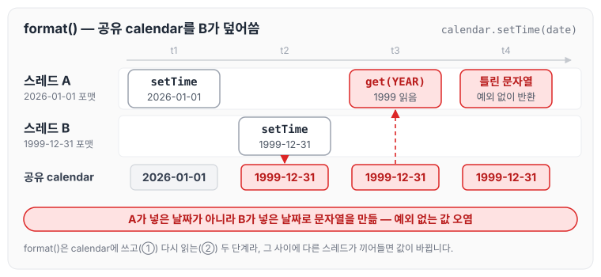
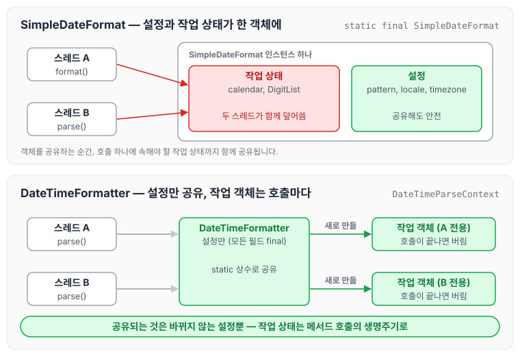
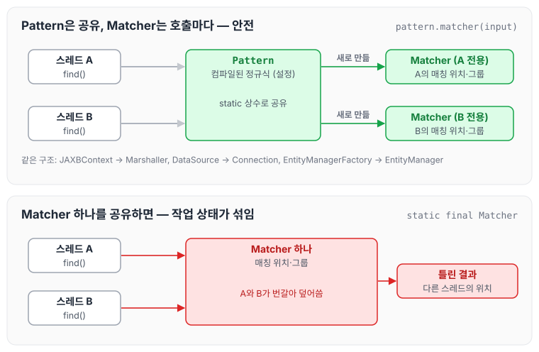
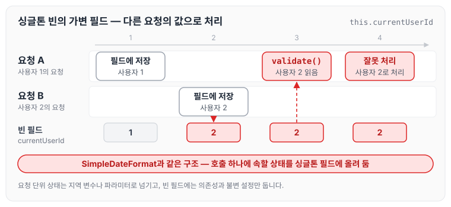
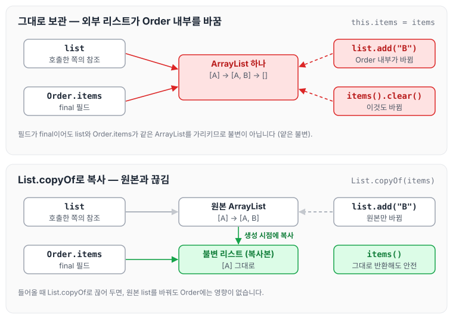

이전에 [Java 기준 멀티스레드와 레이스 컨디션](../multithread-race-condition/)에 대해 작성하였습니다. 그 글에서는 여러 스레드가 공유 변수를 동시에 바꿀 때 실행 순서에 따라 결과가 달라지는 문제를 다뤘는데, 같은 문제가 JDK의 `SimpleDateFormat`에서도 발생합니다.

저희 서비스에서는 날짜 변환 유틸 클래스인 DateUtil에서 `SimpleDateFormat`을 사용하고 있었습니다. 그런데 날짜를 변환하는 과정에서 중간중간 ArrayIndexOutOfBoundsException이 발생하였습니다. 예외가 매번 나는 것이 아니라 간헐적으로 발생해 원인을 찾기가 어려웠습니다. 증상을 추적해 보니, 하나의 `SimpleDateFormat`을 여러 스레드가 함께 사용하고 있던 것이 원인이었습니다.

오늘은 `SimpleDateFormat`을 여러 스레드가 함께 사용할 때 ArrayIndexOutOfBoundsException이 발생하는 원인과 그 근본 원인, 같은 유형의 다른 사례들, 그리고 이런 문제를 피하는 방법인 불변 객체에 대해 정리하도록 하겠습니다.

## 1. SimpleDateFormat의 ArrayIndexOutOfBoundsException

먼저 서비스에서 만난 예외부터 살펴보겠습니다. DateUtil에서 발생한 ArrayIndexOutOfBoundsException처럼, 이 예외는 대부분 하나의 `SimpleDateFormat` 인스턴스를 여러 스레드가 동시에 사용해서 발생합니다. `SimpleDateFormat`은 thread-safe하지 않기 때문에, 동시 접근으로 내부 상태가 꼬이면 배열 인덱스가 범위를 벗어나 예외가 발생합니다.

### 내부에 공유되는 가변 상태

`SimpleDateFormat`(정확히는 부모 클래스인 `DateFormat`)은 인스턴스 필드로 가변 객체를 가지고 있습니다.

```java
public abstract class DateFormat extends Format {
    protected Calendar calendar;          // 날짜 계산용 작업 공간
    protected NumberFormat numberFormat;  // 숫자 파싱/포맷용 (DecimalFormat)
    ...
}
```

`format()`과 `parse()`는 호출할 때마다 지역 변수를 새로 만들지 않고, 이 필드들을 작업 공간처럼 재사용합니다. 메서드 하나가 실행되는 동안 필드를 쓰고, 읽고, 다시 쓰는 여러 단계가 이어지는데, 그 사이에 다른 스레드가 끼어들면 서로의 중간 상태를 덮어쓰게 됩니다.

### format()에서 생기는 일

`format()`은 아래와 같이 공유 `calendar`에 날짜를 넣은 뒤, 그 값을 다시 읽어 문자열을 만듭니다.

```java
calendar.setTime(date);   // ① 공유 calendar에 날짜 세팅
// ② calendar.get(YEAR), get(MONTH)... 로 문자열 조립
```

두 스레드가 동시에 `format()`을 호출하면 다음과 같은 순서가 생길 수 있습니다.

| 시점 | 스레드 A | 스레드 B |
|---|---|---|
| t1 | `setTime(2026-01-01)` | |
| t2 | | `setTime(1999-12-31)` |
| t3 | `get(YEAR)` → 1999 | |

위 순서를 시간 축에 펼치면 아래와 같습니다.



A는 예외 없이 틀린 날짜 문자열을 반환합니다. 이처럼 `format()` 쪽은 예외보다 조용한 값 오염이 많기 때문에 더 위험합니다.

### parse()에서 생기는 일 — AIOOBE의 정체

`parse()`는 숫자를 읽을 때 `numberFormat`(실제로는 `DecimalFormat`)을 사용하고, 그 안에는 `DigitList`가 있습니다.

```java
final class DigitList {
    char[] digits;   // 파싱 중인 숫자의 자릿수들
    int count;       // 지금까지 채운 자릿수 개수
    int decimalAt;

    void append(char digit) {
        if (count == digits.length) {   // 꽉 찼으면 배열 확장
            digits = Arrays.copyOf(digits, count * 2);
        }
        digits[count++] = digit;
    }
}
```

`digits`와 `count`는 항상 짝이 맞아야 합니다. 두 스레드가 이 객체를 공유하면 다음과 같은 일이 생깁니다.

1. A가 `count == digits.length` 검사를 통과합니다. 배열이 아직 꽉 차지 않았으니 확장하지 않습니다.
2. 그 사이 B가 append해서 `count`가 배열 길이까지 올라갑니다.
3. A가 `digits[count++]`를 실행하는데, 이제 `count`가 배열 길이와 같습니다. 그래서 ArrayIndexOutOfBoundsException이 발생합니다.

아래 그림은 배열 길이가 4이고 `count`가 3인 상태에서 시작한 경우의 예시입니다.

![스레드 A가 길이 검사를 통과한 뒤 스레드 B가 append로 count를 배열 길이까지 올려, A의 digits[count++]가 범위를 벗어나는 순서](images/02_digitlist-check-then-act.svg)

반대 방향도 있습니다. A가 `count`만큼 `digits`를 읽어 long으로 변환하는 도중(`DigitList.getLong()`, `fitsIntoLong()` 등)에 B가 `count = 0`으로 초기화하거나 배열을 교체하면 인덱스와 배열이 어긋납니다.

즉, 검사(check)와 사용(act) 사이에 다른 스레드가 상태를 바꾸는 **check-then-act 경쟁 조건**입니다. 스택트레이스에 `java.text.DigitList`나 `DecimalFormat.parse`가 보이는 이유가 이것입니다.

### 같은 원인의 다른 증상

같은 원인으로 아래와 같은 증상도 나타납니다.

- `NumberFormatException: multiple points`, `For input string: ""` 등 숫자 파싱 오류
- 예외 없이 엉뚱한 날짜 반환 (가장 발견하기 어려움)
- 로컬이나 단위 테스트에서는 재현되지 않고 트래픽이 몰릴 때만 간헐적으로 발생

저희가 원인을 찾기 어려웠던 것도 예외가 간헐적으로만 발생했기 때문이었습니다.

### 흔한 발생 지점

가장 흔하게 볼 수 있는 형태는 아래와 같습니다.

```java
@Component
public class SomeConverter {
    private static final SimpleDateFormat SDF = new SimpleDateFormat("yyyyMMdd"); // ❌
    public Date convert(String s) throws ParseException { return SDF.parse(s); }
}
```

Spring 빈은 기본이 싱글톤이므로, `static`이 없어도 인스턴스 필드 하나를 모든 요청 스레드가 공유합니다. Kafka 컨슈머 동시 처리나 병렬 스트림에서도 같은 문제가 생깁니다.

저희 DateUtil도 위 코드처럼 `SimpleDateFormat` 하나를 여러 스레드가 함께 사용하는 공유 구조였습니다.

### 해결 방법

가장 먼저 고려할 방법은 `java.time.DateTimeFormatter`로 교체하는 것입니다. `DateTimeFormatter`는 불변 객체라 thread-safe하며, static 상수로 공유해도 안전합니다.

```java
private static final DateTimeFormatter FMT = DateTimeFormatter.ofPattern("yyyyMMdd");

LocalDate d = LocalDate.parse("20261023", FMT);
String s = d.format(FMT);
```

레거시 `Date`가 꼭 필요하다면 `Date.from(...toInstant())`, `date.toInstant().atZone(zone)`으로 경계에서만 변환합니다.

`Date` API를 당장 바꿀 수 없다면 아래 방법을 사용할 수 있습니다.

- ThreadLocal로 스레드별 인스턴스를 유지합니다. 동작은 하지만, 스레드풀 환경에서는 객체가 계속 남는다는 점을 알고 사용해야 합니다.
  ```java
  private static final ThreadLocal<SimpleDateFormat> SDF =
      ThreadLocal.withInitial(() -> new SimpleDateFormat("yyyyMMdd"));
  ```
- 메서드 안에서 매번 `new`로 생성합니다. 생성 비용은 대부분의 서비스에서 체감되지 않습니다.
- `synchronized`로 감쌉니다. 안전하지만 처리량이 많은 곳에서는 병목이 됩니다.
- commons-lang3의 `FastDateFormat`을 사용합니다. thread-safe한 대체재입니다.

## 2. 근본 원인

근본 원인을 요약하자면, 설정(패턴)과 작업 중 상태(계산 공간)를 같은 객체에 섞어 담았고, 그 객체가 공유해도 되는 것처럼 보이도록 설계되었다는 점입니다. 이를 설계, 동시성, 사용 세 가지 층으로 나누어 살펴보겠습니다.

### 설계 층: 왜 작업 공간을 필드에 두었는지

`SimpleDateFormat`은 JDK 1.1(1997년) 시절의 클래스입니다. 당시에는 객체 생성과 GC 비용이 비쌌기 때문에, `Calendar`와 `DecimalFormat`을 매번 만들지 않고 인스턴스에 하나씩 두고 재사용하였습니다. 단일 스레드 기준으로는 합리적인 성능 최적화였습니다.

그 결과 성격이 다른 두 종류의 데이터가 한 객체에 들어가게 되었습니다.

| 종류 | 예 | 성격 |
|---|---|---|
| 설정 | pattern, locale, timezone | 한 번 정하면 안 바뀜, 공유해도 안전 |
| 작업 상태 | `calendar` 필드값, `DigitList`의 `digits`/`count` | 호출마다 바뀜, 호출 하나에만 속해야 함 |

작업 상태는 원래 메서드 호출 하나의 생명주기에 속해야 합니다. 지역 변수였다면 각 스레드 스택에 따로 생겼을 것입니다. 이를 **객체의 생명주기**로 끌어올렸기 때문에, 객체를 공유하는 순간 작업 상태까지 함께 공유됩니다. 이것이 가장 밑바닥의 원인입니다.

게다가 `Calendar` 자체도 가변 객체입니다. `set()`은 내부 필드를 바꾸고, `get()`은 내부 재계산(`complete()`)으로 또 상태를 바꿉니다. 가변 객체 위에 가변 상태를 쌓은 구조입니다.

### 동시성 층: 왜 깨지는지

공유 가변 상태가 깨지는 이유는 동시성의 세 가지 조건이 하나도 보장되지 않기 때문입니다. 원자성과 가시성은 [Java 기준 멀티스레드와 레이스 컨디션](../multithread-race-condition/)에서 다룬 `counter++` 예제와 같은 문제입니다.

- 원자성(atomicity)이 없습니다. `format()`은 "calendar 쓰기 → 필드 읽기 → 문자열 조립"이라는 복합 연산이고, `append()`도 "길이 검사 → 쓰기 → count 증가"로 나뉩니다. 단계 사이에 다른 스레드가 끼어들 수 있습니다.
- 가시성(visibility)이 없습니다. `volatile`이나 `synchronized`가 없으므로, 한 스레드가 쓴 값이 다른 스레드에 언제 보일지 보장되지 않습니다. 캐시에 남은 오래된 값을 읽을 수 있습니다.
- 순서(ordering)가 보장되지 않습니다. happens-before 관계가 없으니 JIT와 CPU가 명령을 재배치할 수 있습니다. 다른 스레드에게는 `digits` 교체보다 `count` 변경이 먼저 보일 수 있습니다.

동시성 버그는 공유, 가변, 동기화 없음 세 가지가 모두 성립할 때 생기고, 하나만 빠져도 안전합니다. `SimpleDateFormat`은 세 가지가 모두 성립합니다.

### 사용 층: 왜 개발자들이 공유하게 되는지

Javadoc에 "Date formats are not synchronized"라고 명시되어 있는데도 같은 버그가 반복되는 이유는, 겉모습과 실제 성질이 다르기 때문입니다.

- 생성자에 패턴 문자열만 넘기니 불변 설정 객체처럼 보입니다. `Pattern.compile()` 결과처럼 상수로 두고 싶어집니다.
- 생성 비용이 있으니 재사용하라는 성능 조언과 맞아떨어집니다.
- `format()`, `parse()`가 setter가 아니라 순수 함수처럼 보입니다.
- 단일 스레드 테스트에서는 재현되지 않아 틀린 사용법이 검증을 통과합니다.

### java.time의 해결 방식

근본 원인이 설정과 작업 상태가 섞여 있다는 점이었기 때문에, `DateTimeFormatter`는 둘을 분리하였습니다.

- `DateTimeFormatter`는 설정만 담은, 모든 필드가 final인 불변 객체입니다.
- 파싱할 때마다 `DateTimeParseContext` 같은 작업용 객체를 호출 단위로 새로 만들고 버립니다. 작업 상태가 메서드 호출의 생명주기로 돌아왔습니다.
- 결과물인 `LocalDate`, `ZonedDateTime`도 불변입니다.

두 방식을 나란히 놓으면 아래와 같습니다.



위쪽은 스레드 A와 B가 같은 작업 상태를 건드리고, 아래쪽은 각 호출이 자기 작업 객체만 사용합니다. 공유되는 것은 바뀌지 않는 설정뿐입니다.

현대 JVM에서는 짧게 사는 객체의 할당이 매우 쌉니다(TLAB 할당, young GC). TLAB 할당 방식은 [JVM TLAB](../jvm-tlab/)에 정리하였습니다. 1997년식 재사용 최적화의 이득은 거의 사라졌고, 그 대가였던 thread-safety 문제만 남아 있었기 때문에 설계를 바꾼 것입니다.

## 3. 같은 유형의 다른 사례들

`SimpleDateFormat`과 같은 유형의 문제는 다른 클래스에서도 자주 볼 수 있습니다. 공통점은 공유해도 될 것처럼 보이지만, 내부에 호출 단위의 가변 상태를 들고 있는 객체라는 점입니다.

### java.text 패밀리

| 클래스 | 문제 |
|---|---|
| `DecimalFormat`, `NumberFormat` | 내부 `DigitList` 공유. 금액 포맷용 static 상수가 흔한 발생 지점 |
| `MessageFormat`, `ChoiceFormat` | 내부 Format 객체들의 문제를 그대로 물려받음 |
| `Calendar`, `GregorianCalendar` | 그 자체가 가변 객체. 공유 시 `set`/`get`이 섞임 |

### ‘공장은 안전, 제품은 위험’ 패턴

무거운 설정을 담은 객체는 thread-safe하지만, 그 객체가 만들어 내는 작업 객체는 thread-safe하지 않은 구조입니다.

| 공유해도 됨 (설정/공장) | 공유하면 안 됨 (작업 객체) |
|---|---|
| `Pattern` | `Matcher` |
| `JAXBContext` | `Marshaller`, `Unmarshaller` |
| `DocumentBuilderFactory`* | `DocumentBuilder`, `Transformer`, `XPath` |
| `DataSource` | `Connection`, `Statement`, `ResultSet` |
| `EntityManagerFactory` | `EntityManager`, Hibernate `Session` |
| `JedisPool` | `Jedis` |

\* XML Factory 계열은 thread-safe가 공식적으로 보장되지 않으므로, 설정을 마친 뒤 읽기 전용으로만 사용하는 것이 안전합니다.

`Pattern`/`Matcher`가 교과서적인 예입니다. `Pattern`은 컴파일된 정규식(설정)이라 static 상수로 두고, `Matcher`는 매칭 위치·그룹 같은 작업 상태를 가지므로 매번 `pattern.matcher(input)`으로 만듭니다.



위쪽처럼 공장(`Pattern`)만 공유하고 제품(`Matcher`)은 호출마다 만들면 안전합니다. 아래쪽처럼 제품을 공유하면 `SimpleDateFormat`과 같은 문제가 생깁니다.

### 상태를 가진 엔진 객체: 암호화·해시

암호화·해시 객체도 아래와 같이 static 상수로 두는 실수가 흔합니다.

```java
// ❌ 흔한 실수
private static final MessageDigest SHA256 = MessageDigest.getInstance("SHA-256");

public String hash(String s) {
    return HexFormat.of().formatHex(SHA256.digest(s.getBytes()));
}
```

`MessageDigest`, `Cipher`, `Mac`, `Signature`는 `update()`로 누적하고 `doFinal()`/`digest()`로 마무리하는 스트리밍 상태 기계입니다. 스레드가 섞이면 서로의 데이터가 한 해시에 합쳐집니다. 예외 없이 틀린 해시나 깨진 암호문이 나오는 경우가 많아 늦게 발견됩니다.

해결 방법은 호출마다 `getInstance()`로 새로 만들거나(생각보다 비용이 크지 않습니다) ThreadLocal을 사용하는 것입니다. 반면 `SecretKeySpec` 같은 키 객체는 불변이라 공유해도 됩니다.

### 컬렉션

| 대상 | 동시 접근 시 증상 |
|---|---|
| `ArrayList` | 동시 `add` 중 AIOOBE(DigitList와 같은 크기 검사-쓰기 경쟁), null 원소, 원소 유실 |
| `HashMap` | Java 7: resize 중 순환 리스트로 CPU 100% 무한 루프. Java 8+: 데이터 유실, TreeNode 변환 꼬임으로 `ClassCastException` |
| `StringBuilder` | 내용 섞임, AIOOBE |

static `HashMap` 캐시가 흔한 발생 지점입니다. 이 경우 `ConcurrentHashMap`이나 Caffeine 같은 캐시를 사용합니다.

### 클라이언트 라이브러리

| 라이브러리 | thread-safe | thread-safe 아님 |
|---|---|---|
| Kafka | `KafkaProducer` | `KafkaConsumer` |
| Redis | Lettuce 커넥션 | Jedis 인스턴스 |
| Jackson | `ObjectMapper`(설정 완료 후), `ObjectReader`/`ObjectWriter` | 사용 중 `ObjectMapper` 설정 변경 |
| Gson | `Gson` | — |

`KafkaConsumer`는 좋은 설계의 예입니다. 다른 스레드에서 접근하면 조용히 깨지지 않고 즉시 `ConcurrentModificationException`을 던집니다. Jackson의 `ObjectReader`/`ObjectWriter`는 java.time과 같은 방식으로 해결합니다. 불변이고, 설정을 바꾸면 새 객체를 반환합니다.

### 가장 흔한 형태: 싱글톤 빈의 가변 필드

실무에서 가장 흔하게 볼 수 있는 형태는 아래와 같은 싱글톤 빈의 가변 필드입니다.

```java
@Service
public class OrderService {
    private Long currentUserId;                          // ❌ 요청마다 바뀌는 값
    private List<String> errors = new ArrayList<>();     // ❌

    public void process(Request req) {
        this.currentUserId = req.getUserId();
        validate(req);    // 내부에서 currentUserId, errors 사용
        ...
    }
}
```

`SimpleDateFormat`과 같은 구조입니다. 호출 하나에 속해야 할 상태를 싱글톤 필드에 올려 두었기 때문에, 결과적으로 다른 사용자의 ID로 처리되는 사고가 납니다.



요청 단위 상태는 지역 변수나 파라미터로 넘기고, 빈 필드에는 의존성과 불변 설정만 둡니다.

### 판별 체크리스트

공유해도 되는 객체인지 판단할 때는 아래 순서로 확인합니다.

1. Javadoc에서 "thread-safe" / "not synchronized"를 확인합니다. 명시가 없으면 안전하지 않다고 가정합니다.
2. 여러 단계로 상태를 누적하는 메서드가 있는지 봅니다. `update`, `append`, `set` 후 `get`, `reset`이 있으면 거의 확실히 위험합니다.
3. 공장/설정인지 작업 객체인지 구분합니다. `getInstance()`, `newXxx()`, `createXxx()`로 만들어지는 쪽은 대개 작업 객체입니다.
4. 불변이 아니면 공유하지 않습니다. 모든 필드가 final이고 변경 시 새 객체를 반환하는 API라면 안전합니다.

## 4. 불변 객체

불변 객체(immutable object)는 생성된 이후 내부 상태가 절대 바뀌지 않는 객체입니다. JPA의 값 타입을 불변으로 만들어야 하는 이유는 [값 타입 공유와 불변 객체](../jpa-immutable-value-types/)에서도 정리한 적이 있습니다.

### 왜 안전한지

불변 객체는 동시성 버그의 조건인 공유, 가변, 동기화 없음 중 "가변"을 아예 없앱니다.

- 원자성 문제가 없습니다. 쓰기가 없으니 쓰는 도중에 끼어드는 상황 자체가 없습니다. 동시에 읽기만 하는 것은 언제나 안전합니다.
- 가시성·순서 문제를 JMM이 해결합니다. final field semantics에 따라, 생성자가 끝나면 final 필드에 쓴 값은 그 객체 참조를 본 모든 스레드에게 동기화 없이도 올바르게 보이도록 보장됩니다. 일반 필드에는 이 보장이 없습니다. 따라서 필드를 `final`로 선언하는 것은 스타일이 아니라 **동작 보장**의 문제입니다.

그 밖의 장점은 아래와 같습니다.

- 방어할 필요가 없습니다. 넘기고, 반환하고, 캐시에 넣어도 안전합니다.
- HashMap 키·HashSet 원소로 안전합니다. 가변 객체를 키로 넣은 뒤 필드를 바꾸면 hashCode가 달라져 다시는 찾을 수 없습니다.
- 추론하기 쉽습니다. 생성 시점 검증을 통과하면 평생 유효합니다.
- 자유롭게 공유·캐싱할 수 있습니다. `Integer.valueOf(-128~127)` 캐시, String 상수 풀, `BigDecimal.ZERO`가 가능한 이유입니다.

### 만드는 규칙

불변 객체는 다음과 같이 구성할 수 있습니다.

```java
public final class Money {                          // ① 상속 금지
    private final BigDecimal amount;                // ② private final 필드
    private final Currency currency;

    public Money(BigDecimal amount, Currency currency) {
        if (amount == null || amount.signum() < 0)  // 생성 시점에 검증
            throw new IllegalArgumentException("invalid amount");
        this.amount = amount;
        this.currency = currency;
    }

    public BigDecimal amount() { return amount; }   // ③ setter 없음

    public Money plus(Money other) {                // ④ 변경은 새 객체 반환
        return new Money(amount.add(other.amount), currency);
    }
}
```

1. 클래스를 `final`로 선언합니다. 하위 클래스가 가변 필드를 추가하거나 메서드를 오버라이드해 불변성을 깰 수 있기 때문입니다. private 생성자 + 정적 팩토리도 방법입니다.
2. 모든 필드를 `private final`로 둡니다. 재할당 금지 + JMM 보장.
3. 상태를 바꾸는 메서드를 두지 않습니다.
4. 변경이 필요하면 새 객체를 반환합니다. `String.concat`, `BigDecimal.add`, `LocalDate.plusDays`가 이 방식입니다. `withXxx` 이름의 "wither" 패턴도 많이 사용합니다.
5. 가변 필드는 방어적 복사를 합니다. (아래 ‘가장 흔한 함정’ 참고)
6. 생성자에서 `this`를 밖으로 흘리지 않습니다. 생성이 끝나기 전의 객체가 다른 스레드에 노출되면 final 보장이 깨집니다.

### 가장 흔한 함정: final ≠ 불변

`final`은 참조를 바꿀 수 없다는 뜻이지, 참조 대상의 내용을 바꿀 수 없다는 뜻이 아닙니다.

```java
public final class Order {
    private final List<String> items;
    private final Date createdAt;

    public Order(List<String> items, Date createdAt) {
        this.items = items;           // ❌ 외부 리스트를 그대로 보관
        this.createdAt = createdAt;   // ❌ Date는 가변 객체
    }
    public List<String> items() { return items; }  // ❌ 내부 리스트를 그대로 노출
}

List<String> list = new ArrayList<>(List.of("A"));
Order order = new Order(list, new Date());
list.add("B");               // order 내부가 바뀜
order.items().clear();       // 이것도 바뀜
```

필드가 전부 final인데도 불변이 아닙니다. 이것을 **얕은 불변**(shallow immutability)이라고 합니다. 따라서 값이 들어올 때와 나갈 때 모두 차단해야 합니다.

```java
public Order(List<String> items, Instant createdAt) {
    this.items = List.copyOf(items);   // 들어올 때 복사 + 불변 리스트로
    this.createdAt = createdAt;        // Date 대신 불변인 Instant
}
public List<String> items() { return items; }  // 이미 불변이라 그대로 반환해도 안전
```

두 생성자를 비교하면 아래와 같습니다.



위쪽은 `list`와 `Order.items`가 같은 `ArrayList`를 가리키기 때문에 어느 쪽에서 바꿔도 `Order` 내부가 바뀝니다. 아래쪽은 생성 시점에 복사한 불변 리스트를 들고 있으므로, 원본 `list`를 바꿔도 `Order`에는 영향이 없습니다.

| 방법 | 성질 |
|---|---|
| `Collections.unmodifiableList(list)` | 뷰(view). 래퍼를 통한 수정만 막고, 원본이 바뀌면 그대로 반영된다. |
| `List.copyOf(list)`, `List.of(...)` | 복사본. 원본과 완전히 끊긴 진짜 불변. null 원소 불허. |

불변 객체의 필드에는 `copyOf`를 사용합니다. 원소 자체가 가변(`List<Date>` 등)이면 원소는 여전히 공유되므로, 원소도 불변 타입으로 고릅니다. 배열은 불변으로 만들 수 없으니 `clone()`으로 복사하거나 List로 바꿉니다.

### Java 17의 record

record는 final 클래스, private final 필드, 접근자, `equals`/`hashCode`/`toString`을 자동으로 만들어 줍니다.

```java
public record Money(BigDecimal amount, Currency currency) {
    public Money {                                   // compact 생성자: 검증용
        if (amount.signum() < 0) throw new IllegalArgumentException();
    }
    public Money plus(Money o) { return new Money(amount.add(o.amount), currency); }
}
```

다만 record도 얕은 불변입니다. 방어적 복사는 직접 해야 합니다.

```java
public record Order(List<String> items) {
    public Order {
        items = List.copyOf(items);   // compact 생성자에서 재할당 가능
    }
}
```

배열 컴포넌트는 특히 주의해야 합니다. 방어적 복사 문제에 더해, record의 `equals`가 배열을 참조로 비교하므로 내용이 같아도 다른 객체로 취급됩니다.

### 쓰는 쪽의 흔한 실수: 반환값 무시

불변 객체를 사용하는 쪽에서는 아래와 같이 반환값을 무시하는 실수가 자주 생깁니다.

```java
LocalDate date = LocalDate.of(2026, 10, 23);
date.plusDays(1);                 // ❌ 아무 일도 안 일어남
date = date.plusDays(1);          // ✅

BigDecimal total = BigDecimal.ZERO;
total.add(price);                 // ❌
total = total.add(price);         // ✅
```

IntelliJ의 "Result of method call ignored" 경고, Error Prone, SpotBugs 등이 이 패턴을 잡아 줍니다.

### 성능에 대한 오해와 실제

불변 객체는 변경할 때마다 새 객체를 만들기 때문에 성능을 걱정하는 경우가 있습니다. 실제로는 아래와 같습니다.

- 현대 JVM에서 짧게 사는 객체는 TLAB 할당과 young GC 덕분에 매우 쌉니다. ([JVM TLAB](../jvm-tlab/) 참고)
- JIT의 escape analysis는 메서드 밖으로 나가지 않는 객체를 힙에 만들지 않기도 합니다.
- 불변 객체는 공유가 자유로워 캐싱으로 오히려 생성 수를 줄일 수 있습니다. (정적 팩토리 `valueOf`, `of`)

실제로 문제가 되는 것은 루프 안에서 큰 객체를 단계별로 조립할 때입니다(반복문 안의 `String +=`). 이때는 가변 동반 클래스(`String`에 대한 `StringBuilder`)나 빌더 패턴을 사용합니다. 즉, 지역 범위에서는 가변으로 조립하고 완성된 결과만 불변으로 내보냅니다.

### 실무 적용 범위

| 대상 | 불변으로? | 비고 |
|---|---|---|
| DTO, API 요청/응답 | 적합 (record 추천) | Jackson 2.12 이상에서 record 역직렬화 지원 |
| 값 객체(Money, 기간, 좌표 등) | 가장 적합 | DDD의 Value Object = 불변 객체 |
| `@ConfigurationProperties` | 적합 | 생성자 바인딩/record로 실행 중 설정 변경 사고 방지 |
| Kafka 메시지 페이로드 | 적합 | 컨슈머 스레드 간 공유 안전 |
| 캐시에 넣는 값 | 강력 추천 | 꺼낸 객체 수정으로 인한 캐시 오염 방지 |
| JPA 엔티티 | 어려움 | 기본 생성자, 프록시용 비 final 클래스, dirty checking 요구 |

JPA 엔티티는 불변으로 만들기 어렵기 때문에 아래와 같은 차선책을 사용합니다.

- setter 대신 의미 있는 도메인 메서드(`changePrice()` 등)로만 상태 변경
- 엔티티 안의 값 묶음은 불변 `@Embeddable` 값 객체로 분리
- 읽기 전용 엔티티는 Hibernate `@Immutable` 사용

임베디드 값 타입을 여러 엔티티가 공유할 때 생기는 부작용과 불변으로 설계하는 방법은 [값 타입 공유와 불변 객체](../jpa-immutable-value-types/)에 정리하였습니다.

## 5. 핵심 원칙

지금까지의 내용을 하나의 원칙으로 정리하자면, 공유되는 객체에는 불변 설정만 두고 가변 작업 상태는 호출 범위에 가두는 것입니다.

- `SimpleDateFormat`의 AIOOBE는 이 원칙이 깨진 결과입니다. 호출 단위의 임시 상태(`Calendar`, `DigitList`)를 객체 필드에 올려 두었고, 동기화도 없었습니다.
- `Matcher`, `MessageDigest`, `Cipher`, `HashMap`, 싱글톤 빈의 가변 필드 모두 같은 구조의 문제입니다.
- `DateTimeFormatter`, `Pattern`, `ObjectReader`, record 기반 DTO는 이 원칙을 지킨 설계입니다.
- 불변 객체를 만들 때는 `final` 클래스, `private final` 필드, setter 없음, 새 객체 반환, 방어적 복사를 지킵니다. record도 얕은 불변이라는 점을 기억해야 합니다.

## 마무리

오늘은 서비스의 DateUtil에서 간헐적으로 발생한 ArrayIndexOutOfBoundsException을 계기로, `SimpleDateFormat`에서 이 예외가 발생하는 원인과 그 근본 원인, 같은 유형의 다른 사례들, 그리고 불변 객체를 만드는 규칙에 대해 정리하였습니다. 처음에는 원인을 찾기 어려웠는데, 정리하고 나니 이런 예외를 만났을 때 공유 객체의 내부 상태를 먼저 의심해 봐야 한다는 것을 알 수 있었습니다.

상수로 두고 재사용하고 싶어지는 객체를 볼 때, 내부에 호출 단위의 작업 상태를 들고 있는지 먼저 확인하는 습관을 들이면 같은 유형의 문제를 미리 피할 수 있을 것 같습니다.
