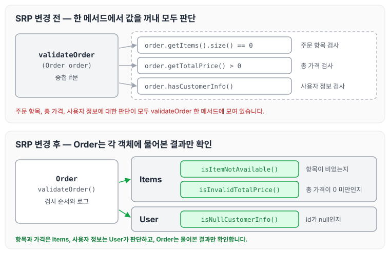
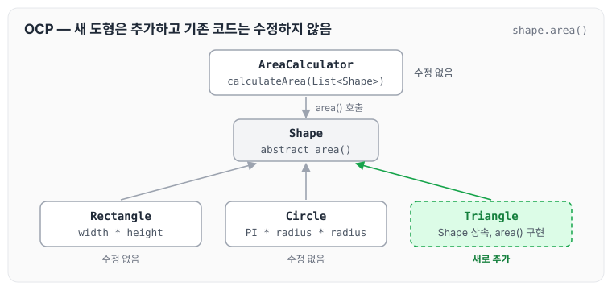
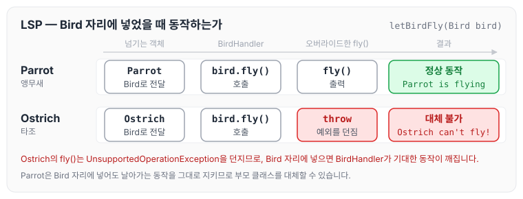
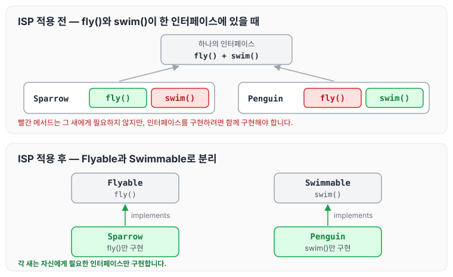
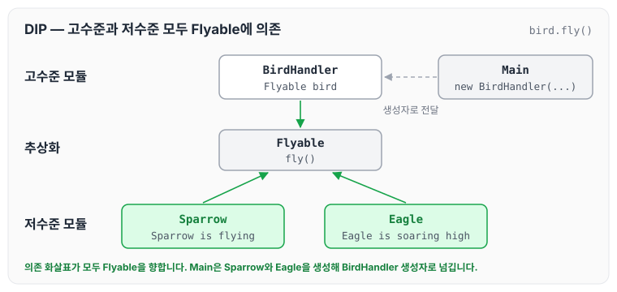

오늘은 객체 지향 설계의 다섯 가지 원칙인 SOLID에 대해 정리하도록 하겠습니다. SOLID는 [객체 지향 설계와 스프링](../spring-core-oop-design/)에서 스프링을 배우기 위한 토대로도 정리하였는데, 이번 글에서는 원칙마다 Java 예제 코드를 함께 살펴보겠습니다.

SOLID를 요약하자면 아래와 같습니다.

- S - Single Responsibility Principle (SRP) : 클래스는 단 하나의 책임만 가져야 합니다.
- O - Open/Closed Principle (OCP) : 소프트웨어 엔티티는 확장에는 열려 있어야 하지만 수정에는 닫혀 있어야 합니다.
- L - Liskov Substitution Principle (LSP) : 자식 클래스는 부모 클래스가 쓰이는 자리에 대신 넣어도 동작해야 합니다.
- I - Interface Segregation Principle (ISP) : 하나의 일반적인 인터페이스보다는 여러 개의 구체적인 인터페이스가 더 좋습니다.
- D - Dependency Inversion Principle (DIP) : 고수준 모듈은 저수준 모듈에 의존해서는 안 되며, 둘 다 추상화에 의존해야 합니다.

## S - Single Responsibility Principle (SRP)

SRP는 클래스가 단 하나의 책임만 가져야 한다는 원칙입니다. [10장 클래스](../clean-code-ch10-classes/)에서는 이를 클래스나 모듈을 변경할 이유가 하나, 단 하나뿐이어야 한다고 설명합니다.

아래는 주문의 유효성을 검사하는 메서드입니다.

```java
public boolean validateOrder(Order order) {
    if (order.getItems().size() == 0) {
        log.info("주문 항목이 없습니다.");
        return false;
    } else {
        if (order.getTotalPrice() > 0) {
            if (!order.hasCustomerInfo()) {
                log.info("사용자 정보가 없습니다.");
                return false;
            } else {
                return true;
            }
        } else if (!(order.getTotalPrice() > 0)) {
            log.info("올바르지 않은 총 가격입니다.");
            return false;
        }
    }
    return true;
}
```

위 코드는 클래스 전체가 아니라 메서드만 작성되어 있지만, 주문 항목, 총 가격, 사용자 정보의 유효성 검사를 모두 한 메서드에서 `Order`의 값을 꺼내 진행하는 것이 과연 단 하나의 책임인지 의문이 들었습니다.

그래서 `Item`, `Items`, `User`, `Order` 각 객체에 역할과 책임을 부여하고, 유효한 값인지 물어보면 각 객체가 응답한 값만 확인하면 된다고 생각하여 아래와 같이 설계하였습니다.

### Item

```java
@Getter
public class Item {
    private Long id;
    private String name;
    private BigDecimal price;

    @Builder
    public Item(Long id, String name, BigDecimal price) {
        this.id = id;
        this.name = name;
        this.price = price;
    }
}
```

### Items

`Items`는 주문 항목 목록을 감싸고, 항목이 비어 있는지와 총 가격이 올바른지를 판단합니다.

```java
public class Items {
    private final List<Item> itemList;

    public Items(List<Item> itemList) {
        this.itemList = List.copyOf(itemList);
    }

    boolean isItemNotAvailable() {
        return CollectionUtils.isEmpty(itemList);
    }

    public boolean isInvalidTotalPrice() {
        return calculateTotalPrice().compareTo(BigDecimal.ZERO) < 0;
    }
    
    private BigDecimal calculateTotalPrice() {
        return itemList.stream()
                .map(Item::getPrice)
                .reduce(BigDecimal.ZERO, BigDecimal::add);
    }
}
```

### User

`User`는 사용자 정보가 비어 있는지를 판단합니다.

```java
package com.webtoonrank.demo.core.domain.user;

import lombok.Builder;
import lombok.Getter;

import java.util.Objects;

@Getter
public class User {
    private Long id;
    private String name;

    @Builder
    public User(Long id, String name) {
        this.id = id;
        this.name = name;
    }

    public boolean isNullCustomerInfo() {
        return Objects.isNull(id);
    }

}
```

### Order

`Order`는 직접 값을 계산하지 않고 `Items`와 `User`에게 물어본 결과만 확인합니다.

```java
@Slf4j
@Getter
public class Order {
    private Items items;
    private User user;

    @Builder
    public Order(Items items, User user) {
        this.items = items;
        this.user = user;
    }

    public boolean validateOrder() {
        if (items.isItemNotAvailable()) {
            log.info("주문 항목이 없습니다.");
            return false;
        }

        if (items.isInvalidTotalPrice()) {
            log.info("올바르지 않은 총 가격입니다.");
            return false;
        }

        if (user.isNullCustomerInfo()) {
            log.info("사용자 정보가 없습니다.");
            return false;
        }

        return true;
    }
}
```

변경 전후의 검사 흐름을 그림으로 나타내면 아래와 같습니다.



변경 후에는 항목과 가격에 대한 판단은 `Items`, 사용자 정보에 대한 판단은 `User`가 맡고, `Order`는 검사 순서와 로그만 남게 됩니다.

## O - Open/Closed Principle (OCP)

OCP는 소프트웨어 엔티티가 확장에는 열려 있어야 하지만 수정에는 닫혀 있어야 한다는 원칙입니다.

- 기존 코드를 수정하지 않고도 새로운 기능을 추가할 수 있어야 합니다.

```java
abstract class Shape {
    public abstract double area();
}

class Rectangle extends Shape {
    private double width;
    private double height;

    public Rectangle(double width, double height) {
        this.width = width;
        this.height = height;
    }

    @Override
    public double area() {
        return width * height;
    }
}

class Circle extends Shape {
    private double radius;

    public Circle(double radius) {
        this.radius = radius;
    }

    @Override
    public double area() {
        return Math.PI * radius * radius;
    }
}

class AreaCalculator {
    public static double calculateArea(List<Shape> shapes) {
        double totalArea = 0;
        for (Shape shape : shapes) {
            totalArea += shape.area();
        }
        return totalArea;
    }
}
```

- `Shape` 클래스
    - 추상 클래스 `Shape`는 모든 도형의 기본 형태를 정의합니다. 여기서 `area()` 메서드는 각 도형의 면적을 계산하는 추상 메서드로 선언되어 있습니다. 즉 여러 도형 클래스가 공통으로 구현해야 하는 메서드를 정의합니다.
- `Rectangle`, `Circle` 클래스
    - `Rectangle`과 `Circle` 클래스는 `Shape` 클래스를 상속받아 각 도형에 맞는 면적 계산 로직을 구현합니다. 두 클래스는 `Shape`의 추상 메서드인 `area()`를 오버라이드하여 자신의 면적을 계산합니다.
    - 새 도형을 추가하고 싶다면, 예를 들어 `Triangle` 클래스를 추가할 수 있습니다. 이 경우 `Triangle` 클래스는 `Shape`를 상속받고 `area()` 메서드를 구현하면 됩니다. 기존의 `Rectangle`이나 `Circle` 클래스는 수정할 필요가 없습니다.
- `AreaCalculator` 클래스
    - `AreaCalculator` 클래스는 `List<Shape>`를 인자로 받아 각 도형의 면적을 계산하여 총합을 반환합니다. 이 클래스는 `Shape` 타입의 객체만 처리하기 때문에 새로운 도형을 추가하더라도 기존의 `AreaCalculator` 클래스를 그대로 사용할 수 있습니다.

`Triangle`을 추가할 때 무엇이 바뀌고 무엇이 그대로인지 그림으로 나타내면 아래와 같습니다.



새로 작성하는 코드는 `Triangle` 하나이고, `AreaCalculator`, `Rectangle`, `Circle`은 수정하지 않습니다.

## L - Liskov Substitution Principle (LSP)

LSP는 자식 클래스가 부모 클래스가 쓰이는 자리에 대신 들어가도 동작해야 한다는 원칙입니다.

```java
class Bird {
    public void fly() {
        System.out.println("Flying");
    }
}

class Parrot extends Bird {
    @Override
    public void fly() {
        // 추가적인 메서드나 속성을 구현할 수 있습니다.
        System.out.println("Parrot is flying");
    }
}

class Ostrich extends Bird {
    @Override
    public void fly() {
        throw new UnsupportedOperationException("Ostrich can't fly!");
    }
}

class BirdHandler {
    public void letBirdFly(Bird bird) {
        bird.fly();
    }
}
```

`BirdHandler`는 `Bird`를 받아 `fly()`를 호출합니다. `Parrot`을 넘기면 날아가지만, `Ostrich`는 `fly()`를 오버라이드해 `UnsupportedOperationException`을 던지기 때문에 `Bird` 자리에 넣으면 `BirdHandler`가 기대한 동작이 깨집니다. 이처럼 자식 클래스가 부모 클래스를 대체하지 못하면 LSP를 위반한 것입니다.



## I - Interface Segregation Principle (ISP)

ISP는 하나의 일반적인 인터페이스보다 여러 개의 구체적인 인터페이스가 더 좋다는 원칙입니다.

```java
interface Flyable {
    void fly();
}

interface Swimmable {
    void swim();
}

class Sparrow implements Flyable {
    @Override
    public void fly() {
        System.out.println("Sparrow is flying");
    }
}

class Penguin implements Swimmable {
    @Override
    public void swim() {
        System.out.println("Penguin is swimming");
    }
}
```

- ISP는 인터페이스를 클라이언트의 필요에 맞게 분리하는 원칙입니다.
- 새의 경우 `Flyable`과 `Swimmable`로 나누어, 각 새가 필요하지 않은 메서드를 구현하지 않도록 했습니다.
- 이를 통해 각 클래스는 자신의 특성에 맞는 기능만 구현하게 되어 코드의 유연성, 가독성, 유지보수성을 높일 수 있습니다. ISP를 준수하면 각 인터페이스가 명확한 책임을 가지게 되어 소프트웨어의 구조가 더 나아집니다.

인터페이스를 나누기 전과 나눈 후를 비교하면 아래와 같습니다.



## D - Dependency Inversion Principle (DIP)

DIP는 고수준 모듈이 저수준 모듈에 의존해서는 안 되며, 둘 다 추상화에 의존해야 한다는 원칙입니다.

```java
interface Flyable {
    void fly();
}

class Sparrow implements Flyable {
    @Override
    public void fly() {
        System.out.println("Sparrow is flying");
    }
}

class Eagle implements Flyable {
    @Override
    public void fly() {
        System.out.println("Eagle is soaring high");
    }
}

class BirdHandler {
    private Flyable bird;

    public BirdHandler(Flyable bird) {
        this.bird = bird;
    }

    public void letBirdFly() {
        bird.fly();
    }
}

// 사용 예
public class Main {
    public static void main(String[] args) {
        Flyable sparrow = new Sparrow();
        BirdHandler sparrowHandler = new BirdHandler(sparrow);
        sparrowHandler.letBirdFly();

        Flyable eagle = new Eagle();
        BirdHandler eagleHandler = new BirdHandler(eagle);
        eagleHandler.letBirdFly();
    }
}
```

`BirdHandler`와 `Sparrow`, `Eagle`이 모두 `Flyable`에 의존하는 구조를 그림으로 나타내면 아래와 같습니다.



- 유연성: 새로운 비행 가능한 새(예: `Penguin`, 만약 비행 기능을 추가한다고 가정)를 추가할 때, 기존의 `BirdHandler` 클래스를 수정할 필요 없이 새로운 클래스를 구현하고 `Flyable` 인터페이스를 사용하면 됩니다.
- 테스트 용이성: `Flyable` 인터페이스를 구현한 Mock 클래스를 만들어 유닛 테스트를 수행할 수 있습니다. 예를 들어, 비행하는 대신 특정 로직을 테스트하기 위해 Mock 비행 클래스를 만들 수 있습니다.
- 낮은 결합도: `BirdHandler`는 구체적인 비행 가능한 새 클래스에 의존하지 않기 때문에, 변경 사항이 있을 때 그 영향을 최소화합니다.

## 마무리

오늘은 SRP, OCP, LSP, ISP, DIP 다섯 가지 SOLID 원칙에 대해 예제 코드와 함께 정리하였습니다. 원칙마다 따로 정리했지만, DIP 예제에서 새로운 새를 추가해도 `BirdHandler`를 수정하지 않는 것처럼 다섯 원칙이 서로 이어져 있는 것 같습니다.
