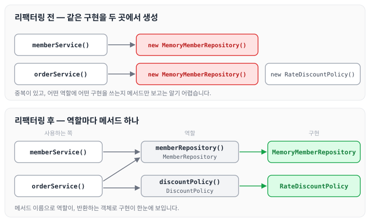
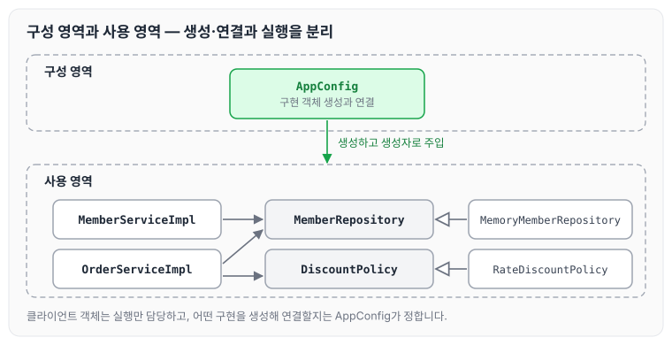

이전에 [예제 만들기](../spring-core-example/)에 대해 작성하였습니다. 이번에는 그 글에서 만든 AppConfig를 리팩터링해 역할과 구현이 한눈에 드러나도록 정리하고, 그 과정에서 지켜지는 SOLID 원칙에 대해 정리하도록 하겠습니다.

## AppConfig 리팩터링이 필요한 이유

현재 AppConfig를 보면 중복이 있고, 역할에 따른 구현이 잘 보이지 않습니다. `memberService()`와 `orderService()`가 각각 `new MemoryMemberRepository()`를 호출하고 있고, 어떤 역할에 어떤 구현을 쓰는지 메서드 이름만으로는 드러나지 않습니다. 이 부분을 한눈에 보이도록 수정해 보겠습니다.

## AppConfig 코드 리팩터링

```java
package hello.core;

import hello.core.discout.DiscountPolicy;
import hello.core.discout.RateDiscountPolicy;
import hello.core.member.MemberRepository;
import hello.core.member.MemberService;
import hello.core.member.MemberServiceImpl;
import hello.core.member.MemoryMemberRepository;
import hello.core.order.OrderService;
import hello.core.order.OrderServiceImpl;

public class AppConfig {

    public MemberService memberService() {
        return new MemberServiceImpl(memberRepository());
    }

    public OrderService orderService() {
        return new OrderServiceImpl(memberRepository(), discountPolicy());
    }

    public MemberRepository memberRepository() {
        return new MemoryMemberRepository();
    }

    public DiscountPolicy discountPolicy() {
        return new RateDiscountPolicy();
    }
}
```

리팩터링 전과 후를 비교하면 아래와 같습니다.



`memberRepository()`와 `discountPolicy()`처럼 역할마다 메서드를 하나씩 두면, 메서드 이름으로 역할이 보이고 반환하는 객체로 구현이 보입니다.

이렇게 코드를 사용 영역과 구성 영역으로 분리하였습니다. 두 영역의 관계는 아래와 같습니다.



## 리팩터링으로 얻은 장점

- 중복 코드를 제거하고 리팩터링하면서, 구현이 어떻게 되어 있는지 한눈에 확인할 수 있고 어떻게 동작하는지도 짐작할 수 있게 되었습니다.
- OCP: 구성 영역과 사용 영역을 분리함으로써 구성 영역에서는 확장이 쉬워지고, 사용 영역은 수정에 닫혀 있게 설계되었습니다.
- SRP: 구현 객체를 생성하고 연결하는 책임은 AppConfig가 담당하고, 클라이언트 객체는 실행하는 책임만 담당합니다.
- DIP: 클라이언트 코드가 추상화 인터페이스에만 의존하도록 변경되었습니다.

## 마무리

오늘은 AppConfig를 리팩터링해 구성 영역과 사용 영역을 분리하고, 그 과정에서 지켜지는 OCP, SRP, DIP에 대해 정리하였습니다. 구성과 사용 영역을 분리해 소스 코드의 확장은 쉽게, 수정에는 닫혀 있게 만들었기 때문에 기획자의 정책이 바뀌어도 언제든지 대응할 수 있는 구조가 되었습니다. 스프링이 어떻게 탄생했는지에 한 걸음 더 다가선 것 같습니다. 다음 글에서는 [스프링 빈으로 전환하기](../spring-core-bean-conversion/)에 대해 정리하도록 하겠습니다.

> 이 글은 인프런 김영한 님의 [스프링 핵심 원리 — 기본편](https://www.inflearn.com/course/스프링-핵심-원리-기본편)을 들으며 정리한 노트입니다.
