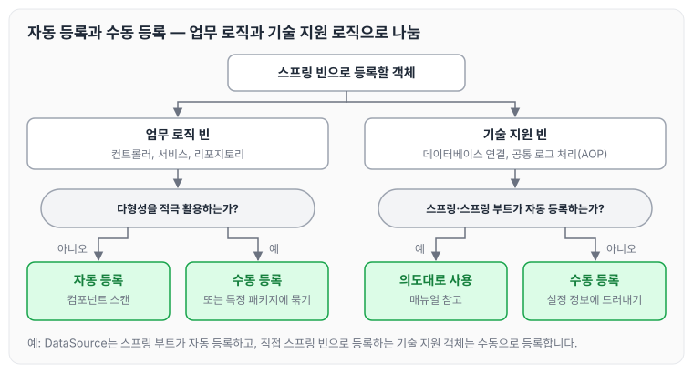

이전에 [의존관계 주입 애노테이션 직접 만들기](../spring-core-custom-annotation/)에 대해 작성하였습니다. 지금까지 컴포넌트 스캔과 자동 의존관계 주입, `@Bean`을 이용한 수동 등록을 함께 살펴보았는데, 이번에는 실무에서 자동 등록과 수동 등록을 어떤 기준으로 나누어 사용하는지 정리하도록 하겠습니다.

## 편리한 자동 기능을 기본으로 사용하기

스프링이 나오고 시간이 갈수록 점점 자동을 선호하는 추세입니다.

- 스프링은 `@Component`뿐만 아니라 `@Controller`, `@Service`, `@Repository`처럼 계층에 맞추어 일반적인 애플리케이션 로직을 자동으로 스캔할 수 있도록 지원합니다.
- 거기에 더해서 최근 스프링 부트는 컴포넌트 스캔을 기본으로 사용하고, 스프링 부트의 다양한 스프링 빈들도 조건이 맞으면 자동으로 등록하도록 설계되어 있습니다.

## 수동 빈 등록은 언제 사용하면 좋을까

애플리케이션은 크게 업무 로직과 기술 지원 로직으로 나눌 수 있습니다.

- 업무 로직 빈: 웹을 지원하는 컨트롤러, 핵심 비즈니스 로직이 있는 서비스, 데이터 계층의 로직을 처리하는 리포지토리 등이 모두 업무 로직입니다. 보통 비즈니스 요구사항을 개발할 때 추가되거나 변경됩니다.
- 기술 지원 빈: 기술적인 문제나 공통 관심사(AOP)를 처리할 때 주로 사용됩니다. 데이터베이스 연결이나 공통 로그 처리처럼 업무 로직을 지원하기 위한 하부 기술이나 공통 기술들입니다.

애플리케이션에 광범위하게 영향을 미치는 기술 지원 객체는 수동 빈으로 등록해서 설정 정보에 바로 나타나게 하는 것이 유지보수하기 좋습니다.

이 글에서 다루는 기준을 순서대로 그리면 아래와 같습니다.



업무 로직은 자동 등록을 기본으로 하고, 다형성을 활용하는 경우와 직접 등록하는 기술 지원 객체는 수동 등록으로 설정 정보에 드러나게 합니다.

## 다형성을 적극 활용하는 비즈니스 로직

비즈니스 로직 중에서 다형성을 적극 활용할 때는 수동 빈으로 등록하거나, 자동으로 등록하더라도 특정 패키지에 같이 묶어 두는 것이 좋습니다. 코드를 보았을 때 어떤 빈들이 있는지 바로 이해할 수 있어야 하기 때문입니다. 이 부분을 별도의 설정 정보로 만들고 수동으로 등록하면 다음과 같습니다.

```java
@Configuration
public class DiscountPolicyConfig {

 @Bean
 public DiscountPolicy rateDiscountPolicy() {
 	return new RateDiscountPolicy();
 }
 @Bean
 public DiscountPolicy fixDiscountPolicy() {
 	return new FixDiscountPolicy();
 }
}
```

설정 정보만 봐도 빈의 이름은 물론이고 어떤 빈들이 주입될지 한눈에 파악할 수 있습니다.

그래도 빈 자동 등록을 사용하고 싶다면, 파악하기 좋게 `DiscountPolicy`의 구현 빈들만 따로 특정 패키지에 모아 둡니다.

## 스프링과 스프링 부트가 자동으로 등록하는 빈

참고로 스프링과 스프링 부트가 자동으로 등록하는 수많은 빈들은 예외입니다. 이런 부분들은 스프링 자체를 잘 이해하고 스프링의 의도대로 잘 사용하는 것이 중요합니다.

스프링 부트의 경우 `DataSource` 같은 데이터베이스 연결에 사용하는 기술 지원 로직까지 내부에서 자동으로 등록하는데, 이런 부분은 매뉴얼을 잘 참고해서 스프링 부트가 의도한 대로 편리하게 사용하면 됩니다.

반면에 스프링 부트가 아니라 직접 기술 지원 객체를 스프링 빈으로 등록한다면, 수동으로 등록해서 명확하게 드러내는 것이 좋습니다.

## 마무리

오늘은 스프링 빈의 자동 등록과 수동 등록을 어떤 기준으로 나누어 사용하는지 정리하였습니다. 배치 기준은 업무 로직과 기술 지원 로직으로 나눌 수 있고, 업무 로직은 보통 자동으로 빈을 등록하지만 다형성을 많이 사용하는 빈은 수동으로 빼도 좋을 것 같습니다.

다음 글에서는 [빈 생명주기 콜백](../spring-core-bean-lifecycle/)에 대해 정리하도록 하겠습니다.

> 이 글은 인프런 김영한 님의 [스프링 핵심 원리 — 기본편](https://www.inflearn.com/course/스프링-핵심-원리-기본편)을 들으며 정리한 노트입니다.
