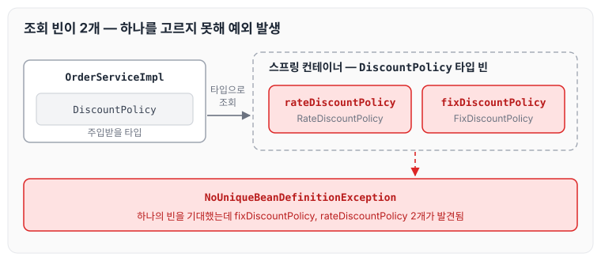
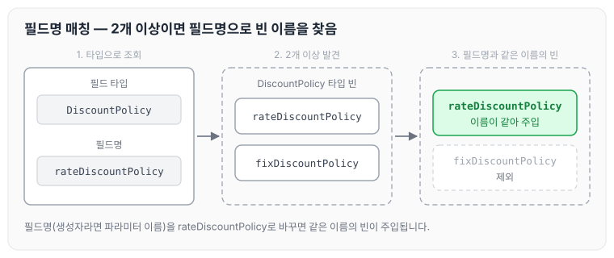
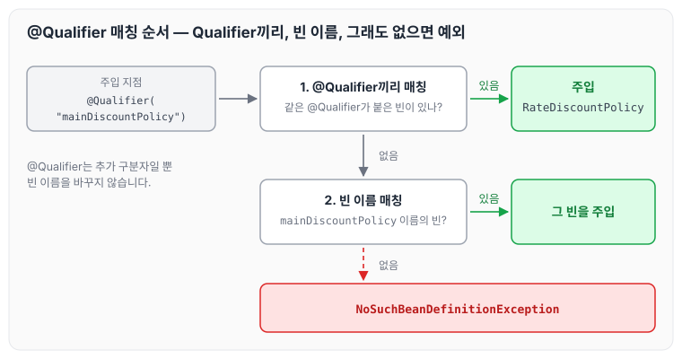
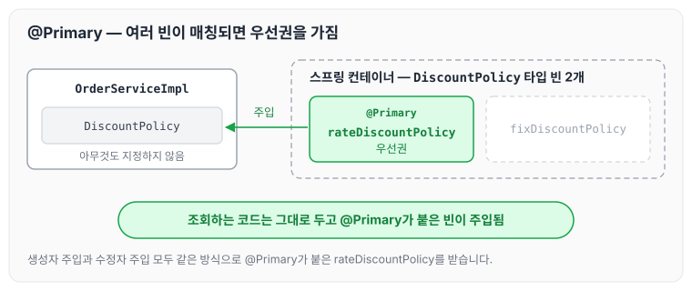
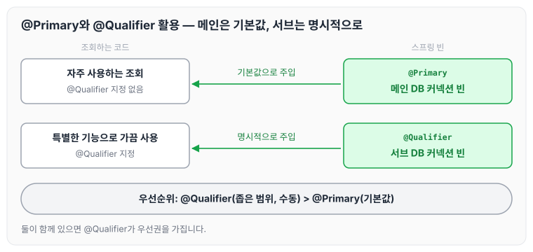

이전에 [생성자 주입을 선택해야 하는 이유](../spring-core-constructor-injection/)에 대해 작성하였습니다. 오늘은 `@Autowired`로 조회한 빈이 2개 이상일 때 발생하는 충돌과, 이를 해결하는 필드명 매칭, `@Qualifier`, `@Primary`에 대해 정리하도록 하겠습니다.

## 조회 빈이 2개 이상일 때 생기는 문제

`@Autowired`는 타입(Type)으로 빈을 조회합니다. 따라서 같은 인터페이스를 구현한 클래스 여러 개에 `@Component`를 붙이면 언제든지 충돌이 발생할 수 있습니다.

아래 예를 살펴보겠습니다. `OrderServiceImpl`은 `DiscountPolicy`를 주입받고, `RateDiscountPolicy`와 `FixDiscountPolicy`는 둘 다 `DiscountPolicy`를 구현하며 `@Component`가 붙어 있습니다.

```java
package hello.core.order;

import hello.core.discount.DiscountPolicy;
import hello.core.member.*;
import lombok.RequiredArgsConstructor;
import org.springframework.stereotype.Component;

@Component
@RequiredArgsConstructor
public class OrderServiceImpl implements OrderService{
    private final MemberRepository memberRepository;
    private final DiscountPolicy discountPolicy;

/*@Autowired
    public OrderServiceImpl(MemberRepository memberRepository, DiscountPolicy discountPolicy) {
        this.memberRepository = memberRepository;
        this.discountPolicy = discountPolicy;
    }*/
@Override
    public Order createOrder(Long memberId, String itemName, int itemPrice) {
        Member newMember = memberRepository.findById(memberId);
        int discountPrice = discountPolicy.discount(newMember, itemPrice);

        return new Order(memberId, itemName, itemPrice, discountPrice);
    }

// 테스트 용도
public MemberRepository getMemberRepository() {
        return memberRepository;
    }
}
```

```java
package hello.core.discount;

import hello.core.member.Grade;
import hello.core.member.Member;
import org.springframework.context.annotation.ComponentScan;
import org.springframework.stereotype.Component;

@Component
public class RateDiscountPolicy implements DiscountPolicy{

    ...
}
```

```java
package hello.core.discount;

import hello.core.member.Grade;
import hello.core.member.Member;

@Component
public class FixDiscountPolicy implements DiscountPolicy {
    private int discountFixAmount = 1000;

   ...
}
```

위와 같이 의존관계 자동 주입이 걸려 있으면 `DiscountPolicy` 타입의 빈이 2개이므로 충돌이 발생합니다(`NoUniqueBeanDefinitionException`). 오류 메시지도 하나의 빈을 기대했는데 `fixDiscountPolicy`와 `rateDiscountPolicy` 2개가 발견되었다고 알려 줍니다.



이때 주입받는 타입을 하위 타입으로 지정할 수도 있지만, 하위 타입으로 지정하는 것은 DIP를 위배하고 유연성이 떨어집니다.

조회 대상 빈이 2개 이상일 때 해결 방법은 아래와 같습니다.

- `@Autowired` 필드명 매칭
- `@Qualifier`끼리 매칭 → 빈 이름 매칭
- `@Primary` 사용

## 해결 방법 1 — @Autowired 필드명 매칭

`@Autowired`는 타입 매칭을 시도한 후 빈이 2개 이상이면 필드명이나 파라미터 이름으로 빈 이름을 매칭합니다.

아래 예시에서는 `DiscountPolicy`를 구현한 두 클래스(`FixDiscountPolicy`와 `RateDiscountPolicy`)에 둘 다 `@Component`를 붙였지만, 필드명을 `rateDiscountPolicy`로 바꿨기 때문에 2개가 발견된 뒤 필드명과 이름이 같은 `rateDiscountPolicy`가 주입됩니다.

```java
package hello.core.order;

import hello.core.discount.DiscountPolicy;
import hello.core.member.*;
import lombok.RequiredArgsConstructor;
import org.springframework.stereotype.Component;

@Component
@RequiredArgsConstructor
public class OrderServiceImpl implements OrderService{
    private final MemberRepository memberRepository;
    private final DiscountPolicy rateDiscountPolicy;// 필드명을 수정

	...
}
```

정리하면 타입 조회 → 2개 이상 발견 → 필드명과 매칭되는 빈 연결 순서로 동작합니다.



## 해결 방법 2 — @Qualifier 사용

`@Qualifier`는 추가 구분자를 붙여 주는 방법입니다. 주입할 때 추가적인 방법을 제공하는 것이지 빈 이름을 변경하는 것은 아닙니다.

1) 빈을 등록할 때 `@Qualifier`를 붙여 줍니다.

```java
@Component
@Qualifier("mainDiscountPolicy")
public class RateDiscountPolicy implements DiscountPolicy {}
```

```java
@Component
@Qualifier("fixDiscountPolicy")
public class FixDiscountPolicy implements DiscountPolicy {}
```

2) 주입할 때 `@Qualifier`를 붙이고 등록한 이름을 적어 줍니다.

```java
@Autowired
public OrderServiceImpl(MemberRepository memberRepository,
						@Qualifier("mainDiscountPolicy") DiscountPolicy discountPolicy) {
     this.memberRepository = memberRepository;
     this.discountPolicy = discountPolicy;
}
```

정리하면 `@Qualifier`끼리 매칭 → 빈 이름 매칭 → 둘 다 없으면 `NoSuchBeanDefinitionException` 발생 순서로 동작합니다.



## 해결 방법 3 — @Primary 설정

`@Primary`는 우선순위를 정하는 방법입니다. `@Autowired`로 주입할 때 여러 빈이 매칭되면 `@Primary`가 붙은 빈이 우선권을 가집니다.

1) 빈을 등록할 때 `@Primary`를 붙여 줍니다.

```java
@Component
@Primary
public class RateDiscountPolicy implements DiscountPolicy {}

@Component
public class FixDiscountPolicy implements DiscountPolicy {}
```

2) 사용 코드는 아래와 같습니다.

```java
//생성자
@Autowired
public OrderServiceImpl(MemberRepository memberRepository, DiscountPolicy discountPolicy) {
    this.memberRepository = memberRepository;
    this.discountPolicy = discountPolicy;
}

//수정자
@Autowired
public DiscountPolicy setDiscountPolicy(DiscountPolicy discountPolicy) {
    return discountPolicy;
}
```

코드를 실행하면 `@Primary`를 붙인 빈이 주입되는 것을 확인할 수 있습니다.



## @Primary와 @Qualifier 활용

그렇다면 `@Primary`와 `@Qualifier` 중 어떤 것을 사용하면 좋을지 고민이 될 수 있습니다. `@Qualifier`의 단점은 주입받을 때 아래와 같이 모든 코드에 `@Qualifier`를 붙여 줘야 한다는 점입니다.

```java
@Autowired
public OrderServiceImpl(MemberRepository memberRepository, @Qualifier("mainDiscountPolicy") DiscountPolicy discountPolicy) {
    this.memberRepository = memberRepository;
    this.discountPolicy = discountPolicy;
}
```

두 방법을 함께 쓰는 예를 들어 보겠습니다.

- 코드에서 자주 사용하는 메인 데이터베이스의 커넥션을 획득하는 스프링 빈이 있고,
- 코드에서 특별한 기능으로 가끔 사용하는 서브 데이터베이스의 커넥션을 획득하는 스프링 빈이 있다고 가정해 보겠습니다.
- 메인 데이터베이스의 커넥션을 획득하는 스프링 빈은 `@Primary`를 적용해서 조회하는 곳에서 `@Qualifier` 지정 없이 편리하게 조회하고,
- 서브 데이터베이스 커넥션 빈을 획득할 때는 `@Qualifier`를 지정해서 명시적으로 획득하는 방식으로 사용하면 코드를 깔끔하게 유지할 수 있습니다.
- 물론 이때 메인 데이터베이스의 스프링 빈을 등록할 때 `@Qualifier`를 지정해 주는 것도 상관없습니다.

### 우선순위

`@Primary`는 기본값처럼 동작하고, `@Qualifier`는 매우 상세하게 동작합니다. 둘이 함께 있을 때 스프링은 자동보다는 수동이, 넓은 범위의 선택권보다는 좁은 범위의 선택권이 우선순위가 높습니다. 따라서 여기서도 `@Qualifier`가 우선권을 가집니다.

위의 메인·서브 데이터베이스 예와 우선순위를 함께 그리면 아래와 같습니다.



`@Qualifier`를 지정한 곳만 서브 데이터베이스 빈을 받고, 나머지는 모두 `@Primary`인 메인 데이터베이스 빈을 받습니다.

## 마무리

오늘은 `@Component`로 등록한 같은 타입의 빈이 2개 이상이어서 충돌이 났을 때 대처하는 방법에 대해 정리하였습니다. 강의에서 무엇보다 중요했던 것은 애매한 것보다 확실한 것을 사용해야 한다는 점이었습니다. 예를 들어 `@Qualifier`끼리 매칭하고 없을 때 빈 이름으로 매칭한다고 해서 빈 이름만으로 등록하면, 추후 발생하는 오류를 찾기가 더 힘들어질 수 있을 것 같습니다.

다음 글에서는 [의존관계 주입 애노테이션 직접 만들기](../spring-core-custom-annotation/)에 대해 정리하도록 하겠습니다.

> 이 글은 인프런 김영한 님의 [스프링 핵심 원리 — 기본편](https://www.inflearn.com/course/스프링-핵심-원리-기본편)을 들으며 정리한 노트입니다.
