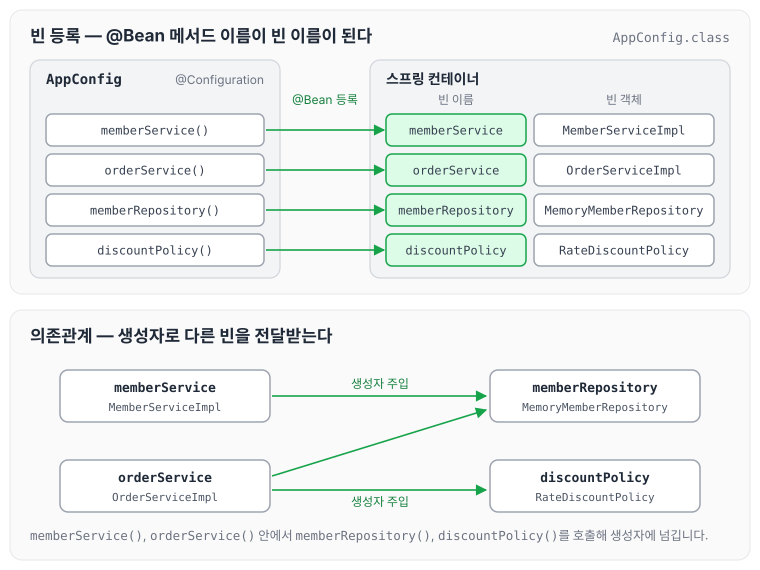
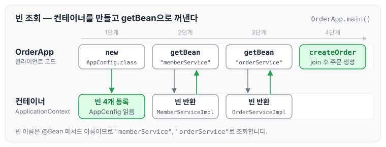

이전에 [AppConfig 리팩터링](../spring-core-appconfig-refactor/)에 대해 작성하였습니다. 지금까지는 순수한 자바 코드만으로 DI를 적용했는데, 오늘은 이 코드를 스프링으로 전환하는 과정을 정리하도록 하겠습니다.

## AppConfig.java 수정

AppConfig를 스프링 설정으로 바꾸려면 아래 두 애노테이션을 사용합니다.

- `@Configuration` : 스프링에게 설정 정보를 제공합니다.
- `@Bean` : 해당 메서드가 반환하는 객체를 스프링 컨테이너에 빈으로 등록합니다.

AppConfig 클래스에 `@Configuration`을 붙이고, 각 메서드에 `@Bean`을 붙이면 아래와 같습니다.

```java
package hello.core;

import hello.core.discout.DiscountPolicy;
import hello.core.discout.RateDiscountPolicy;
import hello.core.member.MemberRepository;
import hello.core.member.MemberService;
import hello.core.member.MemberServiceImpl;
import hello.core.member.MemoryMemberRepository;
import hello.core.order.OrderService;
import hello.core.order.OrderServiceImpl;
import org.springframework.context.annotation.Bean;
import org.springframework.context.annotation.Configuration;

@Configuration
public class AppConfig {

    @Bean
    public MemberService memberService() {
        return new MemberServiceImpl(memberRepository());
    }

    @Bean
    public OrderService orderService() {
        return new OrderServiceImpl(memberRepository(), discountPolicy());
    }

    @Bean
    public MemberRepository memberRepository() {
        return new MemoryMemberRepository();
    }

    @Bean
    public DiscountPolicy discountPolicy() {
        return new RateDiscountPolicy();
    }
}
```

실행했을 때 로그를 보면 스프링 라이브러리가 먼저 등록되고, 그다음 `@Bean`이 붙은 메서드 이름으로 빈이 스프링 컨테이너에 등록되는 것을 확인할 수 있습니다. 위 코드에서 등록되는 빈과 서로의 의존관계를 그림으로 나타내면 아래와 같습니다.



빈 이름은 메서드 이름인 `memberService`, `orderService`, `memberRepository`, `discountPolicy`가 되고, 빈 객체는 각 메서드가 반환한 구현 객체가 됩니다. `memberService`와 `orderService`는 생성자를 통해 `memberRepository`, `discountPolicy`를 전달받습니다.

## 스프링 컨테이너에 등록된 빈을 조회합니다

이제 직접 AppConfig를 생성해서 객체를 꺼내는 대신, 스프링 프레임워크가 제공하는 클래스를 통해 DI가 적용된 객체를 사용할 수 있습니다.

- `ApplicationContext`를 스프링 컨테이너라고 합니다.
- `ApplicationContext`는 인터페이스입니다.
- 아래 코드에서는 `AnnotationConfigApplicationContext`에 AppConfig를 넘겨, 애노테이션 기반의 설정 클래스를 사용하겠다고 선언하였습니다.

```java
package hello.core;

import hello.core.member.Grade;
import hello.core.member.Member;
import hello.core.member.MemberService;
import hello.core.member.MemberServiceImpl;
import hello.core.order.Order;
import hello.core.order.OrderService;
import hello.core.order.OrderServiceImpl;
import org.springframework.context.ApplicationContext;
import org.springframework.context.annotation.AnnotationConfigApplicationContext;

public class OrderApp {
    public static void main(String[] args) {

        ApplicationContext applicationContext = new AnnotationConfigApplicationContext(AppConfig.class);
        MemberService memberService = applicationContext.getBean("memberService", MemberService.class);
        OrderService orderService = applicationContext.getBean("orderService", OrderService.class);

        Long memberId = 1L;
        Member memberA = new Member(memberId, "memberA", Grade.VIP);
        memberService.join(memberA);

        Order order = orderService.createOrder(memberId,"itemA", 100000);

        System.out.println("Order = " + order.toString());
    }
}
```

`OrderApp`이 실행되는 순서를 그림으로 나타내면 아래와 같습니다.



`getBean()`에는 빈 이름과 타입을 함께 넘깁니다. 빈 이름은 앞에서 본 것처럼 `@Bean` 메서드의 이름이므로, `"memberService"`와 `"orderService"`로 조회합니다.

## 마무리

오늘은 순수 자바 코드로 작성했던 AppConfig를 `@Configuration`과 `@Bean`으로 전환하고, `ApplicationContext`에서 빈을 조회해 사용하는 방법에 대해 정리하였습니다. 아직 순수 자바로 구현했던 것을 스프링으로 옮기는 중이며, 스프링 컨테이너에 빈을 등록할 때 주의할 점도 이어서 자세히 알아보려고 합니다. 다음 글에서는 [BeanFactory와 ApplicationContext](../spring-core-beanfactory/)에 대해 정리하도록 하겠습니다.

> 이 글은 인프런 김영한 님의 [스프링 핵심 원리 — 기본편](https://www.inflearn.com/course/스프링-핵심-원리-기본편)을 들으며 정리한 노트입니다.
