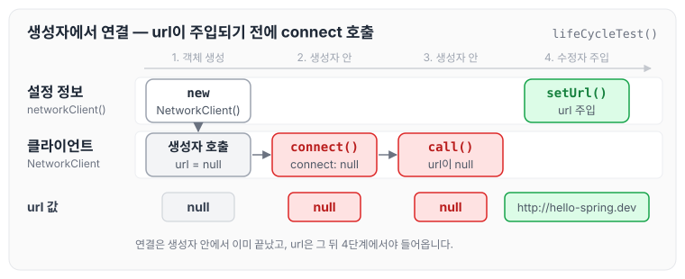
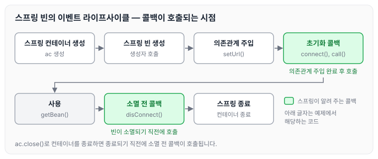
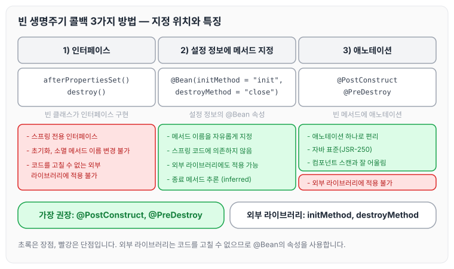

이전에 [자동과 수동, 실무에서의 판단 기준](../spring-core-auto-manual/)에 대해 작성하였습니다. 이번에는 스프링 빈이 생성되고 소멸될 때까지의 생명주기와, 그 사이에 초기화·소멸 작업을 넣는 빈 생명주기 콜백에 대해 정리하도록 하겠습니다.

## 빈 생명주기 콜백이 필요한 이유

데이터베이스 커넥션 풀이나 네트워크 소켓처럼 애플리케이션 시작 시점에 필요한 연결을 미리 해 두고, 애플리케이션 종료 시점에 연결을 모두 종료하는 작업을 진행하려면 객체의 초기화와 종료 작업이 필요합니다.

간단하게 외부 네트워크에 미리 연결하는 객체를 생성한다고 가정해 보겠습니다. 실제로 연결하지는 않고 단순히 문자만 출력하도록 했습니다.

### 예제 코드

네트워크 클라이언트 객체는 아래와 같습니다. 생성자에서 `connect()`와 `call()`을 호출합니다.

```java
package hello.core.lifecycle;

public class NetworkClient {
    private String url;

    public NetworkClient() {
        System.out.println("생성자 호출, url" + url);
        connect();
        call("초기화 연결 메세지");
    }

    public void setUrl(String url) {
        this.url = url;
    }

//서비스를 시작시 호출
	 public void connect() {
        System.out.println("connect: " + url);
    }

    public void call(String message) {
        System.out.println("client: " + url + " message = " + message);
    }

//서비스를 시작시 호출
		public void disConnect() {
        System.out.println("close: " + url);
    }
}
```

빈 생명주기를 확인하는 테스트는 아래와 같습니다. 설정 정보에서 `NetworkClient`를 생성한 뒤 `setUrl()`로 url을 넣고, 테스트가 끝나면 `ac.close()`로 스프링 컨테이너를 종료합니다.

```java
package hello.core.lifecycle;
import org.junit.jupiter.api.Test;
import org.springframework.context.ConfigurableApplicationContext;
import org.springframework.context.annotation.AnnotationConfigApplicationContext;
import org.springframework.context.annotation.Bean;
import org.springframework.context.annotation.Configuration;
public class BeanLifeCycleTest {
    @Test
    public void lifeCycleTest() {
        ConfigurableApplicationContext ac = new
                AnnotationConfigApplicationContext(LifeCycleConfig.class);
        NetworkClient client = ac.getBean(NetworkClient.class);
        ac.close();//스프링 컨테이너를 종료, ConfigurableApplicationContext 필요
    }

    @Configuration
    static class LifeCycleConfig {
        @Bean
        public NetworkClient networkClient() {
            NetworkClient networkClient = new NetworkClient();
            networkClient.setUrl("http://hello-spring.dev");
            return networkClient;
        }
    }
}
```

실행해 보면 다음과 같이 url이 null 값으로 나옵니다.

```text
생성자 호출, url = null
connect: null
call: null message = 초기화 연결 메시지
```

생성자가 실행되는 시점에는 아직 url이 없기 때문입니다. 객체를 생성한 다음 외부에서 수정자 주입을 통해 `setUrl()`이 호출되어야 url이 존재하게 됩니다. 실행 순서를 그리면 아래와 같습니다.



생성자 안에서 연결을 시도하면 url이 비어 있는 상태로 연결하게 됩니다. 연결 작업은 `setUrl()`까지 끝난 뒤에 실행해야 합니다.

## 스프링 빈의 이벤트 라이프사이클

스프링 빈은 간단하게 "객체 생성 → 의존관계 주입"이라는 라이프사이클을 가집니다.

스프링 빈은 객체를 생성하고 의존관계 주입이 다 끝난 다음에야 필요한 데이터를 사용할 수 있는 준비가 완료됩니다. 따라서 초기화 작업은 의존관계 주입이 모두 완료되고 난 다음에 호출해야 합니다. 다만 개발자가 의존관계 주입이 모두 완료된 시점을 직접 알기는 어렵습니다. 이 때문에 스프링은 의존관계 주입이 완료되면 스프링 빈에게 콜백 메서드를 통해서 초기화 시점을 알려 주는 다양한 기능을 제공합니다. 또한 스프링은 스프링 컨테이너가 종료되기 직전에 소멸 콜백을 주기 때문에 안전하게 종료 작업을 진행할 수 있습니다.

스프링 빈의 이벤트 라이프사이클은 아래와 같습니다.

- 스프링 컨테이너 생성 → 스프링 빈 생성 → 의존관계 주입 → 초기화 콜백 → 사용 → 소멸 전 콜백 → 스프링 종료



각 콜백이 호출되는 시점은 아래와 같습니다.

- 초기화 콜백: 빈이 생성되고, 빈의 의존관계 주입이 완료된 후 호출
- 소멸 전 콜백: 빈이 소멸되기 직전에 호출

> 참고
>
> 생성자는 필수 정보(파라미터)를 받고, 메모리를 할당해서 객체를 생성하는 책임을 가집니다. 반면에 초기화는 이렇게 생성된 값들을 활용해서 외부 커넥션을 연결하는 등 무거운 동작을 수행합니다.
>
> 따라서 생성자 안에서 무거운 초기화 작업을 함께 하는 것보다는 객체를 생성하는 부분과 초기화하는 부분을 명확하게 나누는 것이 유지보수 관점에서 좋습니다.

## 빈 생명주기 콜백을 지원하는 3가지 방법

스프링은 크게 3가지 방법으로 빈 생명주기 콜백을 지원합니다.

- 인터페이스(`InitializingBean`, `DisposableBean`)
- 설정 정보에 초기화 메서드, 종료 메서드 지정
- `@PostConstruct`, `@PreDestroy` 애노테이션 지원

### 1) 인터페이스 InitializingBean, DisposableBean

- `InitializingBean`: `afterPropertiesSet()` 메서드로 초기화를 지원합니다.
- `DisposableBean`: `destroy()` 메서드로 소멸을 지원합니다.

이 방식에는 아래와 같은 단점이 있습니다.

- 스프링 전용 인터페이스입니다.
- 초기화, 소멸 메서드의 이름을 변경할 수 없습니다.
- 내가 코드를 고칠 수 없는 외부 라이브러리에 적용할 수 없습니다.

인터페이스를 구현한 `NetworkClient`는 아래와 같습니다.

```java
package hello.core.lifecycle;

import org.springframework.beans.factory.DisposableBean;
import org.springframework.beans.factory.InitializingBean;

public class NetworkClient implements InitializingBean, DisposableBean {
    private String url;

    public NetworkClient() {
        System.out.println("생성자 호출, url" + url);
    }

    public void setUrl(String url) {
        this.url = url;
    }

//서비스를 시작시 호출
    public void connect() {
        System.out.println("connect: " + url);
    }

    public void call(String message) {
        System.out.println("client: " + url + " message = " + message);
    }

//서비스를 시작시 호출
    public void disConnect() {
        System.out.println("close: " + url);
    }

    @Override
    public void afterPropertiesSet() throws Exception {
        connect();
        call("초기화 연결 메시지");
    }

    @Override
    public void destroy() throws Exception {
        disConnect();
    }

}
```

### 2) 빈 등록 초기화, 소멸 메서드 지정

설정 정보를 사용하는 방식의 특징은 아래와 같습니다.

- 메서드 이름을 자유롭게 줄 수 있습니다.
- 스프링 빈이 스프링 코드에 의존하지 않습니다.
- 코드가 아니라 설정 정보를 사용하기 때문에 **코드를 고칠 수 없는 외부 라이브러리에도** 초기화, 종료 메서드를 적용할 수 있습니다.

`@Bean`의 `destroyMethod` 속성에는 종료 메서드를 추론하는 기능이 있습니다.

- 라이브러리는 대부분 `close`, `shutdown`이라는 이름의 종료 메서드를 사용합니다.
- `@Bean`의 `destroyMethod`는 기본값이 `(inferred)`(추론)으로 등록되어 있습니다. 이 추론 기능은 `close`, `shutdown`이라는 이름의 메서드를 자동으로 호출해 줍니다.
- 이름 그대로 종료 메서드를 추론해서 호출해 주기 때문에, 직접 스프링 빈으로 등록하면 종료 메서드는 따로 적어 주지 않아도 잘 동작합니다.
- 추론 기능을 사용하기 싫으면 `destroyMethod=""`처럼 빈 공백을 지정하면 됩니다.

`NetworkClient`에는 `init()`, `close()` 메서드를 만들어 둡니다.

```java
package hello.core.lifecycle;

import org.springframework.beans.factory.DisposableBean;
import org.springframework.beans.factory.InitializingBean;

public class NetworkClient {
    private String url;

    public NetworkClient() {
        System.out.println("생성자 호출, url" + url);
    }

    public void setUrl(String url) {
        this.url = url;
    }

//서비스를 시작시 호출
    public void connect() {
        System.out.println("connect: " + url);
    }

    public void call(String message) {
        System.out.println("client: " + url + " message = " + message);
    }

//서비스를 시작시 호출
    public void disConnect() {
        System.out.println("close: " + url);
    }

    public void init() {
        System.out.println("NetworkClient.init");
        connect();
        call("초기화 연결 메시지");
    }
    public void close() {
        System.out.println("NetworkClient.close");
        disConnect();
    }

}
```

설정 정보에서 `@Bean(initMethod = "init", destroyMethod = "close")`로 초기화, 종료 메서드를 지정합니다.

```java
package hello.core.lifecycle;
import org.junit.jupiter.api.Test;
import org.springframework.context.ConfigurableApplicationContext;
import org.springframework.context.annotation.AnnotationConfigApplicationContext;
import org.springframework.context.annotation.Bean;
import org.springframework.context.annotation.Configuration;
public class BeanLifeCycleTest {
    @Test
    public void lifeCycleTest() {
        ConfigurableApplicationContext ac = new
                AnnotationConfigApplicationContext(LifeCycleConfig.class);
        NetworkClient client = ac.getBean(NetworkClient.class);
        ac.close();//스프링 컨테이너를 종료, ConfigurableApplicationContext 필요
    }

    @Configuration
    static class LifeCycleConfig {
        @Bean(initMethod = "init", destroyMethod = "close")
        public NetworkClient networkClient() {
            NetworkClient networkClient = new NetworkClient();
            networkClient.setUrl("http://hello-spring.dev");
            return networkClient;
        }
    }
}
```

### 3) 애노테이션 @PostConstruct, @PreDestroy

`@PostConstruct`, `@PreDestroy` 애노테이션의 특징은 아래와 같습니다.

- 최신 스프링에서 가장 권장하는 방법입니다.
- 애노테이션 하나만 붙이면 되므로 매우 편리합니다.
- 패키지를 잘 보면 `javax.annotation.PostConstruct`입니다. 스프링에 종속적인 기술이 아니라 JSR-250이라는 자바 표준입니다. 따라서 스프링이 아닌 다른 컨테이너에서도 동작합니다.
- 컴포넌트 스캔과 잘 어울립니다.
- 유일한 단점은 외부 라이브러리에는 적용하지 못한다는 것입니다. 외부 라이브러리를 초기화, 종료해야 하면 `@Bean`의 기능을 사용합니다.

애노테이션을 붙인 `NetworkClient`는 아래와 같습니다.

```java
package hello.core.lifecycle;

import org.springframework.beans.factory.DisposableBean;
import org.springframework.beans.factory.InitializingBean;

import javax.annotation.PostConstruct;
import javax.annotation.PreDestroy;

public class NetworkClient {
    private String url;

    public NetworkClient() {
        System.out.println("생성자 호출, url" + url);
    }

    public void setUrl(String url) {
        this.url = url;
    }

//서비스를 시작시 호출
    public void connect() {
        System.out.println("connect: " + url);
    }

    public void call(String message) {
        System.out.println("client: " + url + " message = " + message);
    }

//서비스를 시작시 호출
    public void disConnect() {
        System.out.println("close: " + url);
    }

    @PostConstruct
    public void init() {
        System.out.println("NetworkClient.init");
        connect();
        call("초기화 연결 메시지");
    }

    @PreDestroy
    public void close() {
        System.out.println("NetworkClient.close");
        disConnect();
    }

}
```

## 세 가지 방법 비교

세 가지 방법에서 초기화·소멸 메서드를 어디에 지정하는지와 특징을 비교하면 아래와 같습니다.



정리하면 아래와 같습니다.

- `@PostConstruct`, `@PreDestroy` 애노테이션을 사용합니다.
- 코드를 고칠 수 없는 외부 라이브러리를 초기화, 종료해야 하면 `@Bean`의 `initMethod`, `destroyMethod`를 사용합니다.

## 마무리

오늘은 스프링 빈의 이벤트 라이프사이클과 초기화·소멸 콜백을 지원하는 세 가지 방법에 대해 정리하였습니다. 빈의 라이프사이클을 파악할 수 있었고, 특히 생성자와 초기화를 어떻게 나누어 사용하면 좋은지 이유와 함께 설명해 주신 부분이 좋았던 것 같습니다. 이유를 모른 채 라이프사이클을 통해서 초기화를 했다면, 왜 사용하는지 파악하기 힘들었을 것 같습니다.

다음 글에서는 [프로토타입 스코프와 싱글톤 빈](../spring-core-prototype-scope/)에 대해 정리하도록 하겠습니다.

> 이 글은 인프런 김영한 님의 [스프링 핵심 원리 — 기본편](https://www.inflearn.com/course/스프링-핵심-원리-기본편)을 들으며 정리한 노트입니다.
