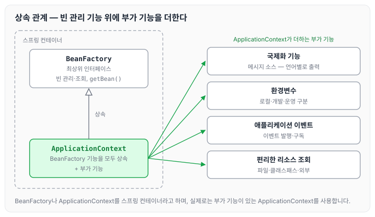

이전에 [스프링 빈으로 전환하기](../spring-core-bean-conversion/)에 대해 작성하였습니다. 그 글에서는 `ApplicationContext`를 스프링 컨테이너로 사용해 빈을 등록하고 조회하였습니다. 오늘은 스프링 컨테이너를 이루는 BeanFactory와 ApplicationContext가 각각 어떤 역할을 하는지 정리하도록 하겠습니다.

## BeanFactory

BeanFactory는 스프링 컨테이너의 최상위 인터페이스로, 스프링 빈을 관리하고 조회하는 역할을 담당합니다.

- `getBean()`을 제공합니다.
- 지금까지 사용했던 대부분의 기능은 BeanFactory가 제공하는 기능입니다.
- 다만 BeanFactory를 직접 사용하지는 않고, 실제로 사용하는 것은 ApplicationContext입니다.

## ApplicationContext

ApplicationContext는 BeanFactory의 기능을 모두 상속받아서 제공합니다. 애플리케이션을 개발할 때는 빈을 관리하고 조회하는 기능은 물론이고, 그 밖에도 수많은 부가 기능이 필요하기 때문입니다.

### ApplicationContext가 제공하는 부가 기능

- 메시지 소스를 활용한 국제화 기능: 한국에서 들어오면 한국어로, 영어권에서 들어오면 영어로 출력합니다.
- 환경변수: 로컬, 개발, 운영 등을 구분해서 처리합니다.
- 애플리케이션 이벤트: 이벤트를 발행하고 구독하는 모델을 편리하게 지원합니다.
- 편리한 리소스 조회: 파일, 클래스패스, 외부 등에서 리소스를 편리하게 조회합니다.

BeanFactory와 ApplicationContext의 관계를 그림으로 나타내면 아래와 같습니다.

ApplicationContext는 BeanFactory의 빈 관리 기능을 그대로 물려받고, 그 위에 부가 기능을 더한 구조입니다.

## 정리

- ApplicationContext는 BeanFactory의 기능을 상속받습니다.
- ApplicationContext는 빈 관리 기능과 편리한 부가 기능을 함께 제공합니다.
- BeanFactory를 직접 사용할 일은 거의 없으며, 부가 기능이 포함된 ApplicationContext를 사용합니다.
- BeanFactory나 ApplicationContext를 스프링 컨테이너라고 합니다.

## 마무리

오늘은 BeanFactory와 ApplicationContext의 역할과 관계에 대해 정리하였습니다. 아직 스프링의 많은 기능을 다 사용해 보지는 못했는데, 이렇게 많은 기능이 ApplicationContext에 상속되어 있어 익숙해지기까지는 시간과 노력이 필요할 것 같습니다. 다만 그보다 중요한 것은 핵심 기능이 어떻게 동작하고 실행되는지, 그 라이프 사이클을 잘 기억해 두는 것이라고 생각합니다. 다음 글에서는 [XML로 스프링 빈 설정하기](../spring-core-xml-config/)에 대해 정리하도록 하겠습니다.

> 이 글은 인프런 김영한 님의 [스프링 핵심 원리 — 기본편](https://www.inflearn.com/course/스프링-핵심-원리-기본편)을 들으며 정리한 노트입니다.
