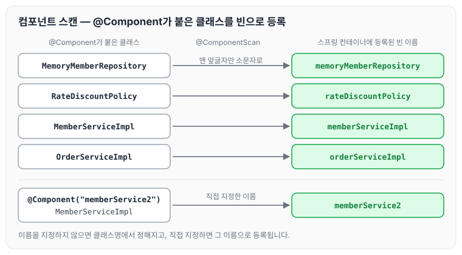
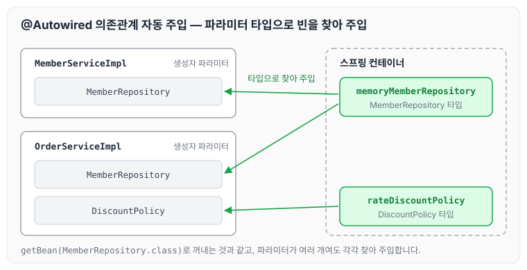
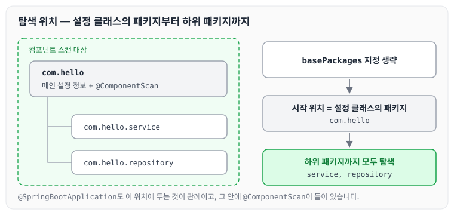

이전에 [싱글톤 컨테이너와 @Configuration](../spring-core-singleton/)에 대해 작성하였습니다. 지금까지는 스프링 빈을 등록할 때 `@Bean`이나 XML의 `<bean>`을 사용해서 직접 등록했습니다. 현재 예제는 등록할 빈이 몇 개 되지 않지만, 스프링 빈이 수십, 수백 개가 되면 일일이 등록하기 번거롭고 누락하는 문제도 생길 수 있습니다.

그래서 스프링은 설정 정보가 없어도 자동으로 스프링 빈을 등록하는 컴포넌트 스캔 기능을 제공하고, 의존관계도 자동으로 주입하는 `@Autowired` 기능을 함께 제공합니다. 오늘은 컴포넌트 스캔과 `@Autowired`가 어떻게 동작하는지, 그리고 탐색 위치와 기본 스캔 대상에 대해 정리하도록 하겠습니다.

## AutoAppConfig 작성

컴포넌트 스캔을 사용하는 설정 클래스는 아래와 같이 작성합니다. 기존 `AppConfig`와 달리 `@Bean`으로 등록하는 메서드가 하나도 없고, `@ComponentScan`만 붙어 있습니다.

```java
package hello.core;

import org.springframework.context.annotation.ComponentScan;
import org.springframework.context.annotation.Configuration;
import org.springframework.context.annotation.FilterType;

import static org.springframework.context.annotation.ComponentScan.*;

@Configuration
@ComponentScan(excludeFilters = @Filter(type = FilterType.ANNOTATION, classes = Configuration.class))
public class AutoAppConfig {

}
```

`excludeFilters`에는 `@Configuration`이 붙은 클래스를 스캔 대상에서 제외하도록 지정했습니다. 아래 컴포넌트 스캔 기본 대상에서 보듯이 `@Configuration`도 `@Component`를 포함하고 있어서, 앞에서 만들어 둔 `AppConfig` 같은 설정 클래스까지 함께 등록되기 때문입니다.

## 각 클래스에 @Component 추가

스프링 빈으로 등록할 클래스에는 `@Component`를 붙입니다. 의존관계가 필요한 클래스는 생성자에 `@Autowired`를 붙여 주입받도록 합니다.

```java
@Component
public class MemoryMemberRepository implements MemberRepository {}
```

```java
@Component
public class RateDiscountPolicy implements DiscountPolicy {}
```

```java
@Component
public class OrderServiceImpl implements OrderService {
	private final MemberRepository memberRepository;
 	private final DiscountPolicy discountPolicy;
    @Autowired
    public OrderServiceImpl(MemberRepository memberRepository, DiscountPolicy discountPolicy) {
        this.memberRepository = memberRepository;
        this.discountPolicy = discountPolicy;
    }
}
```

```java
@Component
public class MemberServiceImpl implements MemberService {
     private final MemberRepository memberRepository;
     @Autowired
     public MemberServiceImpl(MemberRepository memberRepository) {
     this.memberRepository = memberRepository;
     }
}
```

## AutoAppConfigTest 작성

`AutoAppConfig`로 스프링 컨테이너를 만들고, 빈을 꺼내 회원 가입과 주문을 실행하는 테스트는 아래와 같습니다.

```java
package hello.core.scan;
import hello.core.AutoAppConfig;
import hello.core.member.Grade;
import hello.core.member.Member;
import hello.core.member.MemberService;
import hello.core.order.Order;
import hello.core.order.OrderService;
import org.junit.jupiter.api.Test;
import org.springframework.context.ApplicationContext;
import org.springframework.context.annotation.AnnotationConfigApplicationContext;
import static org.assertj.core.api.Assertions.*;
public class AutoAppConfigTest {
    @Test
    void basicScan() {
        ApplicationContext ac = new AnnotationConfigApplicationContext(AutoAppConfig.class);
        MemberService memberService = ac.getBean(MemberService.class);
        OrderService orderService = ac.getBean(OrderService.class);

        Long memberId = 1L;
        Member memberA = new Member(memberId, "memberA", Grade.VIP);
        memberService.join(memberA);

        Order order = orderService.createOrder(memberId,"itemA", 200000);
        System.out.println("Order = " + order.toString());

        assertThat(memberService).isInstanceOf(MemberService.class);
    }
}
```

## 컴포넌트 스캔과 자동 의존관계 주입의 동작

### @ComponentScan

`@ComponentScan`은 `@Component`가 붙은 모든 클래스를 스프링 빈으로 등록합니다. 이때 스프링 빈의 기본 이름은 클래스명을 사용하되 맨 앞글자만 소문자로 바꿉니다.

- 빈 이름 기본 전략 : `MemberServiceImpl` 클래스 → `memberServiceImpl`
- 빈 이름 직접 지정 : 스프링 빈의 이름을 직접 지정하고 싶으면 `@Component("memberService2")`처럼 이름을 부여하면 됩니다.

예제의 네 클래스가 스캔되어 빈으로 등록되는 모습은 아래와 같습니다.



빈 이름은 따로 지정하지 않으면 클래스명에서 정해지고, 직접 지정하면 지정한 이름이 그대로 쓰입니다.

### @Autowired 의존관계 자동 주입

생성자에 `@Autowired`를 지정하면 스프링 컨테이너가 자동으로 해당 스프링 빈을 찾아서 주입합니다.

- 기본 조회 전략은 타입이 같은 빈을 찾아서 주입하는 것입니다. `getBean(MemberRepository.class)`와 동일하다고 이해하면 됩니다.
- 생성자에 파라미터가 많아도 모두 찾아서 자동으로 주입합니다.

`MemberServiceImpl`과 `OrderServiceImpl`의 생성자에 의존관계가 주입되는 흐름은 아래와 같습니다.



`OrderServiceImpl`처럼 파라미터가 두 개여도 파라미터마다 타입으로 빈을 찾아서 한 번에 주입합니다.

## 탐색 위치

탐색할 패키지의 시작 위치는 아래와 같이 지정합니다.

```java
@ComponentScan(
 basePackages = "hello.core"
)
```

- `basePackages` : 탐색할 패키지의 시작 위치를 지정합니다. 이 패키지를 포함해서 하위 패키지를 모두 탐색합니다.
    - `basePackages = {"hello.core", "hello.service"}`처럼 여러 시작 위치를 지정할 수도 있습니다.
- `basePackageClasses` : 지정한 클래스의 패키지를 탐색 위치로 지정합니다.
- 지정하지 않으면 `@ComponentScan`이 붙은 설정 정보 클래스의 패키지가 시작 위치가 됩니다.

### 권장하는 방법

예를 들어 프로젝트가 아래와 같은 구조로 되어 있다고 하겠습니다.

- com.hello
- com.hello.service
- com.hello.repository

프로젝트 시작 루트인 `com.hello`에 `AppConfig` 같은 메인 설정 정보를 두고, `@ComponentScan` 애노테이션을 붙인 뒤 `basePackages` 지정은 생략합니다. 이렇게 하면 `com.hello`를 포함한 하위 패키지가 모두 자동으로 컴포넌트 스캔의 대상이 됩니다.



프로젝트 메인 설정 정보는 프로젝트를 대표하는 정보이기 때문에 프로젝트 시작 루트 위치에 두는 것이 좋다고 생각합니다.

참고로 스프링 부트를 사용하면 스프링 부트의 대표 시작 정보인 `@SpringBootApplication`을 프로젝트 시작 루트 위치에 두는 것이 관례입니다. 이 설정 안에 `@ComponentScan`이 들어 있습니다.

## 컴포넌트 스캔 기본 대상

컴포넌트 스캔은 `@Component`뿐만 아니라 아래 애노테이션도 대상에 포함합니다.

- `@Component` : 컴포넌트 스캔에서 사용
- `@Controller` : 스프링 MVC 컨트롤러에서 사용
- `@Service` : 스프링 비즈니스 로직에서 사용
- `@Repository` : 스프링 데이터 접근 계층에서 사용
- `@Configuration` : 스프링 설정 정보에서 사용. 해당 클래스의 소스 코드를 보면 `@Component`를 포함하고 있는 것을 알 수 있습니다.

## 마무리

오늘은 컴포넌트 스캔과 `@Autowired` 의존관계 자동 주입의 동작, 탐색 위치와 기본 스캔 대상에 대해 정리하였습니다. 이제는 `AppConfig.java`나 XML 설정 파일 없이 `@Component`, `@Autowired`, `@ComponentScan`으로 스프링이 관리해 주는 DI를 사용할 수 있습니다. 다만 관리하는 측면에서는 `AppConfig.java`로 직접 등록하는 방식이 좀 더 직관적으로 와닿았습니다.

다음 글에서는 [생성자 주입을 선택해야 하는 이유](../spring-core-constructor-injection/)에 대해 정리하도록 하겠습니다.

> 이 글은 인프런 김영한 님의 [스프링 핵심 원리 — 기본편](https://www.inflearn.com/course/스프링-핵심-원리-기본편)을 들으며 정리한 노트입니다.
