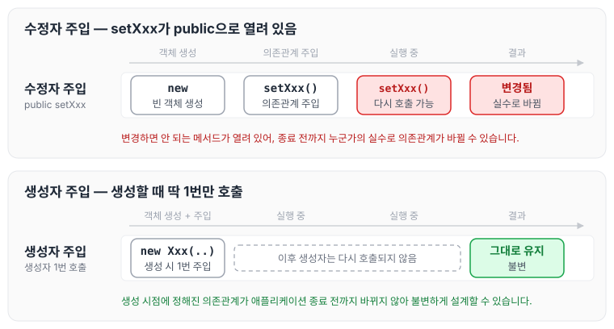
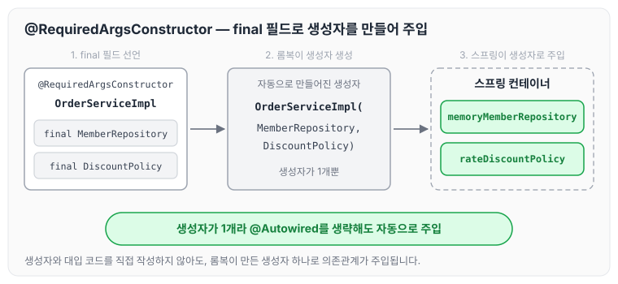

이전에 [컴포넌트 스캔](../spring-core-component-scan/)에 대해 작성하였습니다. 그 글에서는 생성자에 `@Autowired`를 붙여 의존관계를 자동으로 주입받았는데, 의존관계를 주입하는 방법에는 생성자 주입 말고도 수정자 주입, 필드 주입이 있습니다. 오늘은 그중 생성자 주입을 선택해야 하는 이유와, 롬복으로 생성자 코드를 줄이는 방법에 대해 정리하도록 하겠습니다.

## DI를 사용할 때 생성자 주입을 선택해야 하는 이유

과거에는 수정자 주입과 필드 주입을 많이 사용했지만, 최근에는 스프링을 포함한 DI 프레임워크 대부분이 생성자 주입을 권장합니다. 그 이유는 아래와 같습니다.

### 불변

- 대부분의 의존관계 주입은 한 번 일어나면 애플리케이션 종료 시점까지 의존관계를 변경할 일이 없습니다. 오히려 대부분의 의존관계는 애플리케이션 종료 전까지 변하면 안 됩니다.
- 수정자 주입을 사용하면 `setXxx` 메서드를 public으로 열어두어야 합니다. 이 경우 누군가의 실수로 의존관계가 변경될 수 있고, 변경하면 안 되는 메서드를 열어두는 것은 좋은 설계 방법이 아닙니다.
- 생성자 주입은 객체를 생성할 때 딱 1번만 호출되므로 이후에 다시 호출되는 일이 없습니다. 따라서 불변하게 설계할 수 있습니다.

두 방식을 비교하면 아래와 같습니다.



수정자 주입은 열어 둔 `setXxx`로 언제든 의존관계가 바뀔 수 있지만, 생성자 주입은 생성 시점에 한 번 정해진 의존관계가 그대로 유지됩니다.

## 롬복 사용법

개발을 해 보면 `OrderServiceImpl`의 `memberRepository`, `discountPolicy` 두 필드는 모두 불변이어서 필드에 `final` 키워드를 사용하게 됩니다. 다만 이렇게 하면 생성자도 만들어야 하고, 주입받은 값을 필드에 대입하는 코드도 작성해야 합니다. 롬복을 사용하면 이 코드를 줄여서 필드 주입처럼 편리하게 작성할 수 있습니다.

기본 코드를 롬복으로 줄여 보겠습니다.

### 1) build.gradle에 라이브러리 및 환경 추가

```gradle
plugins {
     id 'org.springframework.boot' version '2.3.2.RELEASE'
     id 'io.spring.dependency-management' version '1.0.9.RELEASE'
     id 'java'
}

group = 'hello'
version = '0.0.1-SNAPSHOT'
sourceCompatibility = '11'

//lombok 설정 추가 시작
configurations {
    compileOnly {
    extendsFrom annotationProcessor
    }
}
//lombok 설정 추가 끝

repositories {
	mavenCentral()
}

dependencies {
    implementation 'org.springframework.boot:spring-boot-starter'
//lombok 라이브러리 추가 시작
    compileOnly 'org.projectlombok:lombok'
    annotationProcessor 'org.projectlombok:lombok'
    testCompileOnly 'org.projectlombok:lombok'
    testAnnotationProcessor 'org.projectlombok:lombok'
//lombok 라이브러리 추가 끝
    testImplementation('org.springframework.boot:spring-boot-starter-test') {
    	exclude group: 'org.junit.vintage', module: 'junit-vintage-engine'
    }
}
test {
	useJUnitPlatform()
}
```

### 2) 롬복 적용 및 사용법

- `@RequiredArgsConstructor` : `final`이 붙은 필드를 모아서 생성자를 자동으로 만들어 줍니다.
- `@Setter`, `@Getter` : 필드를 확인한 후 setter와 getter를 자동으로 만들어 줍니다.
- 롬복으로 생성자를 한 개 만들어 주면 자동으로 `@Autowired`가 적용됩니다.

`OrderServiceImpl`에 `@RequiredArgsConstructor`를 적용하면 아래와 같습니다. 직접 작성했던 생성자는 주석으로 남겨 두었습니다.

```java
package hello.core.order;

import hello.core.discount.DiscountPolicy;
import hello.core.member.*;
import lombok.RequiredArgsConstructor;
import org.springframework.stereotype.Component;

@Component
@RequiredArgsConstructor
public class OrderServiceImpl implements OrderService{
    private final MemberRepository memberRepository;
    private final DiscountPolicy discountPolicy;

/*@Autowired
    public OrderServiceImpl(MemberRepository memberRepository, DiscountPolicy discountPolicy) {
        this.memberRepository = memberRepository;
        this.discountPolicy = discountPolicy;
    }*/@Override
    public Order createOrder(Long memberId, String itemName, int itemPrice) {
        Member newMember = memberRepository.findById(memberId);
        int discountPrice = discountPolicy.discount(newMember, itemPrice);

        return new Order(memberId, itemName, itemPrice, discountPrice);
    }

// 테스트 용도
public MemberRepository getMemberRepository() {
        return memberRepository;
    }
}
```

`@RequiredArgsConstructor`가 `final` 필드로 생성자를 만들고, 그 생성자로 의존관계가 주입되는 흐름은 아래와 같습니다.



생성자를 직접 작성하지 않아도 롬복이 만든 생성자 하나로 주입이 이루어집니다.

`@Getter`, `@Setter`도 getter와 setter를 자동으로 만들어 주므로, 직접 작성하지 않고 사용하기만 하면 됩니다. `Member`에 적용하면 아래와 같습니다.

```java
package hello.core.member;

import lombok.Getter;
import lombok.Setter;

@Getter
@Setter
public class Member {

    private Long id;
    private String name;
    private Grade grade;

    public Member(Long id, String name, Grade grade) {
        this.id = id;
        this.name = name;
        this.grade = grade;
    }

/*public Long getId() {
        return id;
    }

    public void setId(Long id) {
        this.id = id;
    }

    public String getName() {
        return name;
    }

    public void setName(String name) {
        this.name = name;
    }

    public Grade getGrade() {
        return grade;
    }

    public void setGrade(Grade grade) {
        this.grade = grade;
    }*/
}
```

## 마무리

오늘은 생성자 주입을 선택해야 하는 이유와 롬복으로 생성자 코드를 줄이는 방법에 대해 정리하였습니다. DI 의존관계 주입은 생성자 주입으로 하는 것을 지향하는 것이 좋고, 롬복을 사용하면 코드가 깔끔해져서 관리하기도 편해집니다.

다만 `@Autowired`가 없어도 의존관계 주입이 잘 되는 이유는 생성자가 1개일 때 스프링이 자동으로 `@Autowired`를 적용해 주기 때문이라는 점은 알고 사용해야 할 것 같습니다.

다음 글에서는 [조회 빈이 2개 이상 충돌할 때](../spring-core-bean-conflict/)에 대해 정리하도록 하겠습니다.

> 이 글은 인프런 김영한 님의 [스프링 핵심 원리 — 기본편](https://www.inflearn.com/course/스프링-핵심-원리-기본편)을 들으며 정리한 노트입니다.
