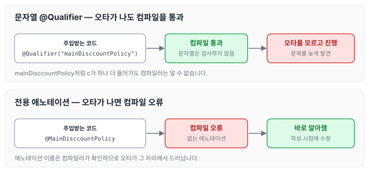
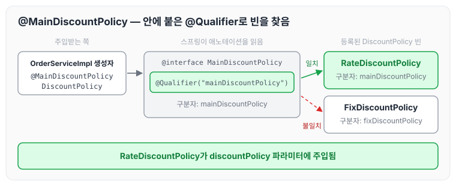

이전에 [조회 빈이 2개 이상 충돌할 때](../spring-core-bean-conflict/)에 대해 작성하였습니다. 그 글에서는 `@Qualifier("mainDiscountPolicy")`처럼 문자열로 구분자를 붙여 빈 충돌을 해결했는데, 이번에는 이 문자열을 애노테이션으로 바꾸는 방법에 대해 정리하도록 하겠습니다.

## 문자열 @Qualifier의 문제

`@Qualifier("mainDiscountPolicy")`처럼 문자로 적으면 컴파일 시 타입 체크가 되지 않습니다. 이 때문에 `mainDisccountPolicy`처럼 오타가 나도 코드에 문제가 있는지 모른 채 진행될 수 있습니다.

문자열로 적었을 때와 애노테이션으로 적었을 때 오타를 언제 알 수 있는지 비교하면 아래와 같습니다.



애노테이션 이름은 컴파일러가 확인하기 때문에 오타가 나면 바로 컴파일 오류로 드러납니다. 이 부분을 애노테이션을 직접 만들어서 개선해 보겠습니다.

## MainDiscountPolicy 애노테이션 만들기

`@Qualifier("mainDiscountPolicy")`를 붙인 애노테이션 `MainDiscountPolicy`를 만듭니다. 코드는 아래와 같습니다.

```java
package hello.core.annotation;

import org.springframework.beans.factory.annotation.Qualifier;

import java.lang.annotation.*;

@Target({ElementType.FIELD, ElementType.METHOD, ElementType.PARAMETER,
        ElementType.TYPE, ElementType.ANNOTATION_TYPE})
@Retention(RetentionPolicy.RUNTIME)
@Documented
@Qualifier("mainDiscountPolicy")// 해당하는 애노테이션을 지정해준다.
public @interface MainDiscountPolicy {

}
```

애노테이션에는 상속이라는 개념이 없습니다. 이렇게 여러 애노테이션을 모아서 사용하는 기능은 스프링이 지원해 주는 것입니다. `@MainDiscountPolicy`가 붙은 자리를 스프링이 어떻게 해석하는지 그리면 아래와 같습니다.



이전 글에서 `RateDiscountPolicy`에 `@Qualifier("mainDiscountPolicy")`를 붙여 두었습니다. 주입받는 쪽에 `@MainDiscountPolicy`만 적어도 스프링은 그 안에 붙은 `@Qualifier("mainDiscountPolicy")`를 기준으로 빈을 찾기 때문에, 같은 구분자를 가진 `RateDiscountPolicy`가 주입됩니다.

## 주입되는 Qualifier 수정하기

이제 빈이 충돌했을 때 `@MainDiscountPolicy` 애노테이션으로 주입할 빈을 맞춰 줄 수 있습니다. String이 아닌 애노테이션으로 변경하면 코드에 오타가 발생했을 때 바로 알아챌 수 있습니다.

변경 전

```java
@Autowired
public OrderServiceImpl(MemberRepository memberRepository,
						@Qualifier("mainDiscountPolicy") DiscountPolicy discountPolicy) {
     this.memberRepository = memberRepository;
     this.discountPolicy = discountPolicy;
}
```

변경 후

```java
@Autowired
public OrderServiceImpl(MemberRepository memberRepository,
						@MainDiscountPolicy DiscountPolicy discountPolicy) {
     this.memberRepository = memberRepository;
     this.discountPolicy = discountPolicy;
}
```

## 마무리

오늘은 문자열 `@Qualifier` 대신 전용 애노테이션을 직접 만들어 의존관계를 주입하는 방법에 대해 정리하였습니다. 처음에는 이렇게 번거롭게 변경해야 하는 이유가 와닿지 않았습니다. 하지만 String은 컴파일 시 오류를 찾아내기가 어렵기 때문에, 번거롭더라도 애노테이션을 만들어서 사용하는 편이 좋을 것 같습니다. 다만 그보다 중요한 것은 `@Qualifier`와 `@Primary`를 적절한 위치에 사용하는 것이라고 생각합니다.

다음 글에서는 [자동과 수동, 실무에서의 판단 기준](../spring-core-auto-manual/)에 대해 정리하도록 하겠습니다.

> 이 글은 인프런 김영한 님의 [스프링 핵심 원리 — 기본편](https://www.inflearn.com/course/스프링-핵심-원리-기본편)을 들으며 정리한 노트입니다.
