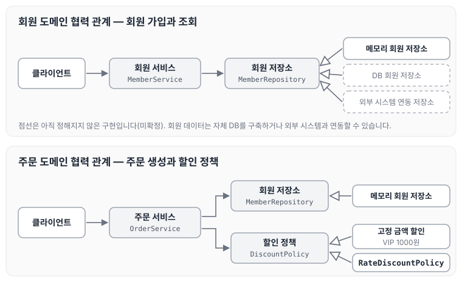
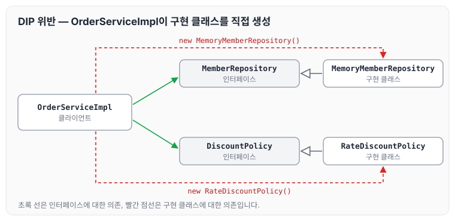
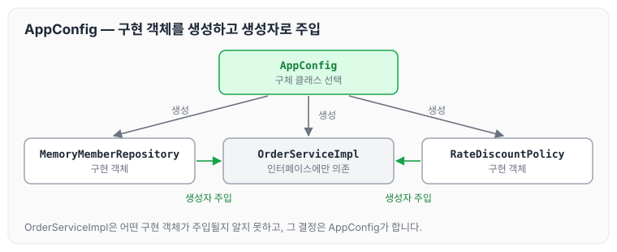
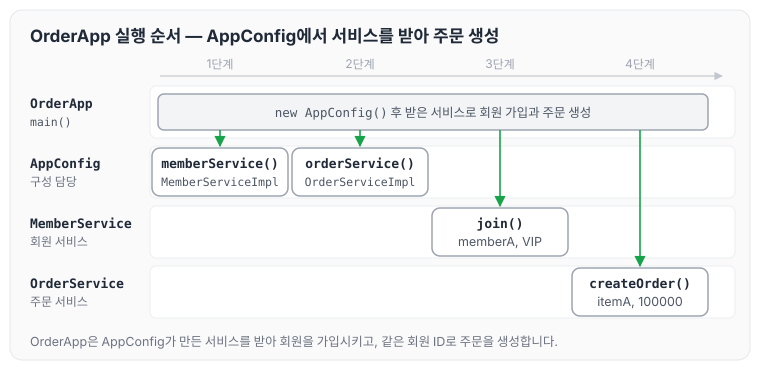

이전에 [객체 지향 설계와 스프링](../spring-core-oop-design/)에 대해 작성하였습니다. 이번에는 회원과 주문 할인 정책 예제를 직접 구현하면서 DIP를 위반하게 되는 상황을 확인하고, AppConfig로 관심사를 분리하는 과정을 정리하도록 하겠습니다.

## 비즈니스 요구사항과 설계

### 회원

- 회원을 가입하고 조회할 수 있습니다.
- 회원은 일반과 VIP 두 가지 등급이 있습니다.
- 회원 데이터는 자체 DB를 구축할 수 있고, 외부 시스템과 연동할 수 있습니다. (미확정)

### 주문과 할인 정책

- 회원은 상품을 주문할 수 있습니다.
- 회원 등급에 따라 할인 정책을 적용할 수 있습니다.
- 할인 정책은 모든 VIP에게 1000원을 할인해 주는 고정 금액 할인을 적용해 달라는 요구입니다.
- 할인 정책은 변경 가능성이 높습니다. 회사의 기본 할인 정책을 아직 정하지 못했고, 오픈 직전까지 고민을 미루고 싶습니다. 최악의 경우 할인을 적용하지 않을 수도 있습니다. (미확정)

요구사항을 바탕으로 회원 도메인과 주문 도메인의 협력 관계를 그려 보면 아래와 같습니다.



회원 저장소와 할인 정책은 아직 정해지지 않은 부분이 있기 때문에 역할(인터페이스)로 두고, 구현은 나중에 바꿀 수 있도록 설계합니다.

소스 코드는 다음 저장소에서 확인할 수 있습니다.

[https://github.com/qkrxodud/spring_basic](https://github.com/qkrxodud/spring_basic)

## 구현하면서 생기는 DIP 위반

구현을 하다 보면 DIP를 위반할 수밖에 없는 상황이 발생합니다. 아래 코드는 추상화(인터페이스)에 의존하지 않고 구체화(구현 클래스)에 의존하고 있습니다.

```java
package hello.core.order;

import hello.core.discout.DiscountPolicy;
import hello.core.discout.RateDiscountPolicy;
import hello.core.member.*;

public class OrderServiceImpl implements OrderService{
    private final MemberRepository memberRepository = new MemoryMemberRepository();//DIP 위반
    private final DiscountPolicy discountPolicy = new RateDiscountPolicy();//DIP 위반

    ...
}
```

`OrderServiceImpl`의 의존 관계를 그림으로 나타내면 아래와 같습니다.



`OrderServiceImpl`은 인터페이스를 필드 타입으로 쓰고 있지만, `new`로 구현 클래스를 직접 생성하고 있어 구현 클래스에도 함께 의존합니다.

## 관심사의 분리

강의에서는 이 문제를 공연에 빗대어 설명합니다. 애플리케이션을 하나의 공연이라고 보면, 각각의 인터페이스는 배역(배우 역할)에 해당합니다. 이때 실제 배역에 맞는 배우를 선택하는 책임이 어디에 있는지가 문제가 됩니다.

- 로미오와 줄리엣 공연에서 로미오 역할을 누가 할지, 줄리엣 역할을 누가 할지는 배우들이 정하지 않습니다. 이전 코드는 로미오 역할(인터페이스)을 하는 레오나르도 디카프리오(구현체, 배우)가 줄리엣 역할(인터페이스)을 하는 여자 주인공(구현체, 배우)을 직접 초빙하는 것과 같습니다. 디카프리오는 공연도 해야 하고, 동시에 여자 주인공도 직접 초빙해야 하는 여러 책임을 가지고 있습니다.
- 따라서 관심사를 분리해야 합니다.
- 배우는 본인의 역할인 배역을 수행하는 것에만 집중해야 합니다.
- 디카프리오는 어떤 여자 주인공이 선택되더라도 똑같이 공연을 할 수 있어야 합니다.
- 공연을 구성하고, 담당 배우를 섭외하고, 역할에 맞는 배우를 지정하는 책임을 담당하는 별도의 공연 기획자가 필요합니다.
- 공연 기획자를 만들고, 배우와 공연 기획자의 책임을 확실히 분리합니다.

### AppConfig 생성

공연 기획자 역할을 하는 AppConfig를 만들고, 구현 객체를 생성해 각 서비스에 넘겨 줍니다.

```java
package hello.core;

import hello.core.discout.RateDiscountPolicy;
import hello.core.member.MemberService;
import hello.core.member.MemberServiceImpl;
import hello.core.member.MemoryMemberRepository;
import hello.core.order.OrderService;
import hello.core.order.OrderServiceImpl;

public class AppConfig {

    public MemberService memberService() {
        return new MemberServiceImpl(new MemoryMemberRepository());
    }

    public OrderService orderService() {
        return new OrderServiceImpl(new MemoryMemberRepository(), new RateDiscountPolicy());
    }
}
```

AppConfig가 구현 객체를 생성하고 주입하는 구조를 그림으로 나타내면 아래와 같습니다.



### 생성자 의존성 주입

- AppConfig를 통해 생성자로 의존성을 주입받기 때문에 DIP 의존관계 역전 원칙에 부합하게 적용하였습니다.
- 이제 해당 클래스가 인터페이스에만 의존하기 때문에 역할에만 집중할 수 있습니다.

예시 코드: OrderApp

```java
package hello.core;

import hello.core.member.Grade;
import hello.core.member.Member;
import hello.core.member.MemberService;
import hello.core.member.MemberServiceImpl;
import hello.core.order.Order;
import hello.core.order.OrderService;
import hello.core.order.OrderServiceImpl;

public class OrderApp {
    public static void main(String[] args) {
        AppConfig appConfig = new AppConfig();
        MemberService memberService = appConfig.memberService();
        OrderService orderService = appConfig.orderService();

        Long memberId = 1L;
        Member memberA = new Member(memberId, "memberA", Grade.VIP);
        memberService.join(memberA);

        Order order = orderService.createOrder(memberId,"itemA", 100000);

        System.out.println("Order = " + order.toString());
    }
}
```

`OrderApp`이 실행되는 순서는 아래와 같습니다.



`OrderApp`은 구현 클래스를 직접 생성하지 않고, AppConfig가 만들어 준 서비스만 받아서 사용합니다.

예시 코드: OrderServiceImpl

```java
package hello.core.order;

import hello.core.discout.DiscountPolicy;
import hello.core.member.*;

public class OrderServiceImpl implements OrderService{
    private final MemberRepository memberRepository;
    private final DiscountPolicy discountPolicy;

    public OrderServiceImpl(MemberRepository memberRepository, DiscountPolicy discountPolicy) {
        this.memberRepository = memberRepository;
        this.discountPolicy = discountPolicy;
    }

    @Override
    public Order createOrder(Long memberId, String itemName, int itemPrice) {
        Member newMember = memberRepository.findById(memberId);
        int discountPrice = discountPolicy.discount(newMember, 10000);

        return new Order(memberId, itemName, 10000, discountPrice);
    }
}
```

## 정리

배역과 배우에 빗대어 정리하면 아래와 같습니다.

- AppConfig는 공연 기획자입니다.
- AppConfig는 구체 클래스를 선택합니다. 배역에 맞는 담당 배우를 선택하는 것과 같으며, 애플리케이션이 어떻게 동작해야 할지 전체 구성을 책임집니다.
- 이제 각 배우들은 담당 기능을 실행하는 책임만 지면 됩니다.

이제 `OrderServiceImpl` 입장에서는 생성자를 통해 어떤 구현 객체가 들어올지(주입될지) 알 수 없습니다. 따라서 역할 기능에만 충실할 수 있게 됩니다. 생성자를 통해 어떤 구현 객체를 주입할지는 오직 외부의 AppConfig에서 결정합니다.

## 마무리

오늘은 회원과 주문 할인 정책 예제를 구현하면서 생기는 DIP 위반 문제와, AppConfig로 구현 객체의 생성·주입 책임을 분리하는 방법에 대해 정리하였습니다. 다음 글에서는 [AppConfig 리팩터링](../spring-core-appconfig-refactor/)에 대해 정리하도록 하겠습니다.

> 이 글은 인프런 김영한 님의 [스프링 핵심 원리 — 기본편](https://www.inflearn.com/course/스프링-핵심-원리-기본편)을 들으며 정리한 노트입니다.
