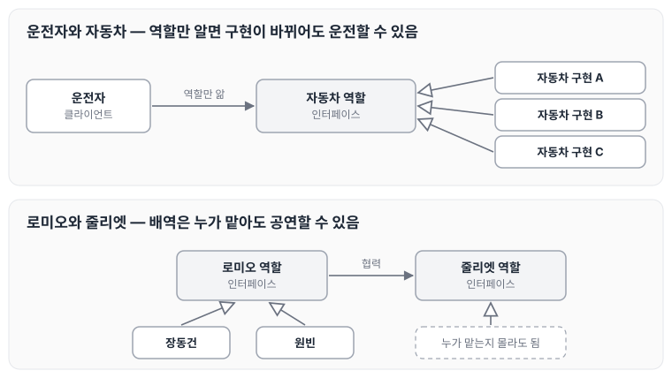
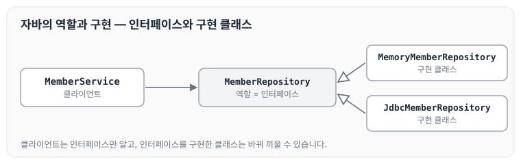
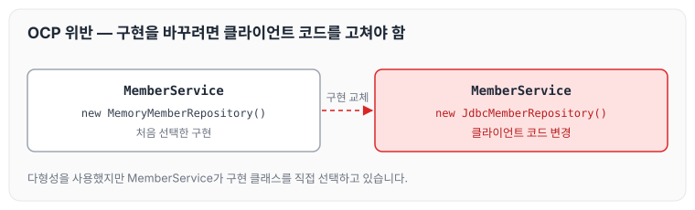
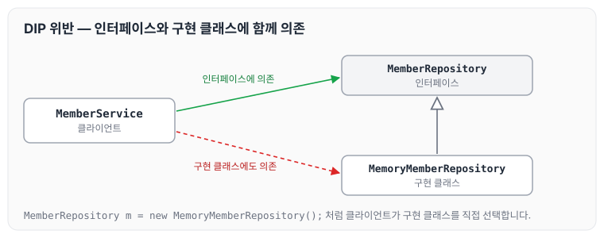

오늘은 스프링을 본격적으로 배우기에 앞서, 스프링이 왜 객체 지향과 함께 이야기되는지 다형성과 역할·구현의 분리, 그리고 좋은 객체 지향 설계의 5가지 원칙(SOLID)을 중심으로 정리하도록 하겠습니다.

## 스프링의 핵심

스프링의 핵심을 요약하자면 아래와 같습니다.

- 스프링은 자바 언어 기반의 프레임워크입니다.
- 자바 언어의 가장 큰 특징은 객체 지향 언어라는 점입니다.
- 스프링은 좋은 객체 지향 애플리케이션을 개발할 수 있게 도와주는 프레임워크입니다.

## 다형성의 실세계 비유

강의에서는 다형성을 운전자와 자동차, 공연의 배역과 배우에 빗대어 설명합니다.

운전자는 자동차가 바뀌어도 운전을 할 수 있습니다. 운전자는 자동차 인터페이스, 즉 역할만 알면 되고 자동차의 내부 구조는 몰라도 됩니다. 이처럼 클라이언트에 영향을 주지 않고 새로운 기능을 제공할 수 있으며, 무한하게 확장할 수 있습니다.

공연도 마찬가지입니다. 로미오 역할은 장동건이 맡아도 되고 원빈이 맡아도 됩니다. 또한 로미오 역할은 줄리엣 역할을 누가 맡는지 몰라도 됩니다. 이 때문에 변경이 유연하고 자유롭습니다.

두 예시의 관계를 그림으로 나타내면 아래와 같습니다.



클라이언트(운전자, 상대 배역)는 역할에만 연결되어 있기 때문에, 역할을 수행하는 구현이 바뀌어도 영향을 받지 않습니다.

## 역할과 구현을 분리

역할과 구현으로 구분하면 세상이 단순해지고, 유연해지며 변경도 편리해집니다. 장점은 아래와 같습니다.

1. 클라이언트는 대상의 역할(인터페이스)만 알면 됩니다.
2. 클라이언트는 구현 대상의 내부 구조를 몰라도 됩니다.
3. 클라이언트는 구현 대상의 내부 구조가 변경되어도 영향을 받지 않습니다.
4. 클라이언트는 구현 대상 자체를 변경해도 영향을 받지 않습니다.

## 자바 언어에서의 역할과 구현 분리

자바 언어에서는 다형성을 활용해 역할과 구현을 분리합니다.

- 역할 = 인터페이스
- 구현 = 인터페이스를 구현한 클래스, 구현 객체

객체를 설계할 때는 역할과 구현을 명확히 분리합니다. 먼저 역할(인터페이스)을 부여하고, 그 역할을 수행하는 구현 객체를 만듭니다. 뒤에서 살펴볼 `MemberService`와 `MemberRepository`로 나타내면 아래와 같습니다.



## 좋은 객체 지향 설계의 5가지 원칙 (SOLID)

클린 코드로 유명한 로버트 마틴이 좋은 객체 지향 설계의 5가지 원칙을 정리하였습니다.

- SRP : 단일 책임 원칙
- OCP : 개방폐쇄 원칙
- LSP : 리스코프 치환 원칙
- ISP : 인터페이스 분리 원칙
- DIP : 의존관계 역전 원칙

### SRP 단일 책임 원칙

Single responsibility principle

- 한 클래스는 하나의 책임만 가져야 합니다.
- 다만 하나의 책임이라는 것은 모호합니다. 클 수도 있고 작을 수도 있으며, 문맥과 상황에 따라 다릅니다.
- 중요한 기준은 변경입니다. 변경이 있을 때 파급 효과가 적으면 단일 책임 원칙을 잘 따른 것입니다.
- 예) UI 변경, 객체의 생성과 사용을 분리

### OCP 개방폐쇄 원칙

Open/closed principle

- 소프트웨어 요소는 확장에는 열려 있으나 변경에는 닫혀 있어야 합니다.
- 확장을 하려면 기존 코드를 변경해야 할 것 같아서 처음에는 모순처럼 들리지만, 다형성을 활용하면 가능합니다.
- 인터페이스를 구현한 새로운 클래스를 하나 만들어서 새로운 기능을 구현합니다. 앞에서 정리한 역할과 구현의 분리가 이에 해당합니다.

다만 아래 코드처럼 클라이언트가 구현 클래스를 직접 생성하면 문제가 생깁니다.

```java
public class MemberService {
	private MemberRepository memberRepository = new MemoryMemberRepository();
}
```

```java
public class MemberService {
// private MemberRepository memberRepository = new MemoryMemberRepository();
private MemberRepository memberRepository = new JdbcMemberRepository();
}
```

구현을 `MemoryMemberRepository`에서 `JdbcMemberRepository`로 바꾸는 과정을 그림으로 나타내면 아래와 같습니다.



이 코드의 문제점은 아래와 같습니다.

1. `MemberService` 클라이언트가 구현 클래스를 직접 선택합니다.
2. 구현 객체를 변경하려면 클라이언트 코드를 변경해야 합니다.
3. 분명 다형성을 사용했지만 OCP 원칙(변경에는 닫혀 있어야 한다)을 지킬 수 없습니다.
4. 이 문제를 해결하려면 객체를 생성하고 연관관계를 맺어 주는 별도의 조립자, 설정자가 필요합니다.

### LSP 리스코프 치환 원칙

Liskov substitution principle

- 프로그램의 객체는 프로그램의 정확성을 깨뜨리지 않으면서 하위 타입의 인스턴스로 바꿀 수 있어야 합니다.
- 다형성에서 하위 클래스는 인터페이스 규약을 다 지켜야 한다는 뜻입니다. 단순히 컴파일에 성공하는 것을 넘어서는 이야기입니다.
- 예) 자동차 인터페이스의 엑셀은 앞으로 가라는 기능인데, 뒤로 가게 구현하면 LSP 위반입니다.

### ISP 인터페이스 분리 원칙

Interface segregation principle

- 특정 클라이언트를 위한 인터페이스 여러 개가 범용 인터페이스 하나보다 낫습니다.
- 자동차 인터페이스 > 운전 인터페이스, 정비 인터페이스로 분리
- 사용자 클라이언트 > 운전자 클라이언트, 정비사 클라이언트로 분리
- 분리하면 정비 인터페이스 자체가 변해도 운전자 클라이언트에는 영향을 주지 않습니다.
- 인터페이스가 명확해지고 대체 가능성이 높아집니다.

### DIP 의존관계 역전 원칙

Dependency inversion principle

- 프로그래머는 추상화에 의존해야지, 구체화에 의존하면 안 됩니다. 의존성 주입은 이 원칙을 따르는 방법 중 하나입니다.
- 구현 클래스에 의존하지 말고 인터페이스에 의존하라는 뜻으로, 앞에서 이야기한 역할(Role)에 의존하게 해야 한다는 것과 같습니다.
- 그런데 OCP에서 살펴본 `MemberService`는 인터페이스에 의존하지만, 구현 클래스에도 동시에 의존합니다.
- `MemberService` 클라이언트가 `MemberRepository m = new MemoryMemberRepository();`처럼 구현 클래스를 직접 선택하기 때문에 DIP 위반입니다.

이 의존 관계를 그림으로 나타내면 아래와 같습니다.



`MemberService`가 인터페이스뿐 아니라 구현 클래스까지 알고 있기 때문에, 구현을 바꾸면 `MemberService`도 함께 바뀌어야 합니다.

## 정리

- 객체 지향의 핵심은 다형성입니다.
- 다만 다형성만으로는 부품을 갈아 끼우듯이 쉽게 개발할 수 없습니다.
- 다형성만으로는 구현 객체를 변경할 때 클라이언트 코드도 함께 변경됩니다.
- 다형성만으로는 OCP, DIP를 지킬 수 없습니다.
- 그래서 다형성 외에 무언가가 더 필요합니다.

자바 진영의 추운 겨울을 지나 따뜻한 Spring이 탄생한 것도 이 때문입니다.

## 마무리

오늘은 스프링의 핵심인 객체 지향 설계와 다형성, 역할과 구현의 분리, 그리고 SOLID 5원칙에 대해 정리하였습니다. 다형성만으로는 OCP와 DIP를 지키기 어렵다는 점이 이후 스프링을 이해하는 출발점이 되는 것 같습니다. 다음 글에서는 [예제 만들기](../spring-core-example/)에 대해 정리하도록 하겠습니다.

> 이 글은 인프런 김영한 님의 [스프링 핵심 원리 — 기본편](https://www.inflearn.com/course/스프링-핵심-원리-기본편)을 들으며 정리한 노트입니다.
