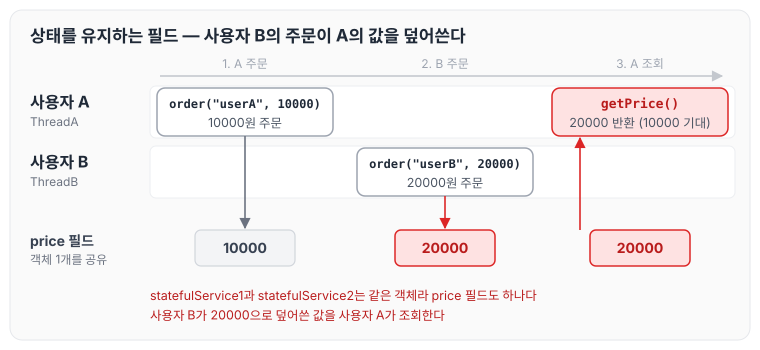
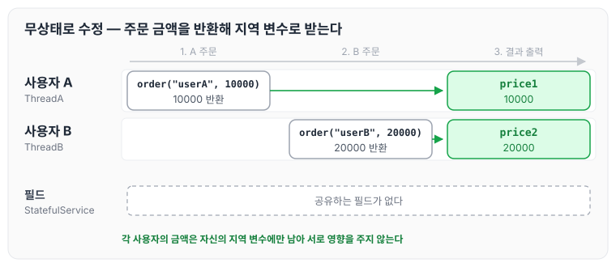

이전에 [웹 애플리케이션과 싱글톤](../spring-core-singleton-web/)에 대해 작성하였습니다. 싱글톤으로 객체를 공유하면 메모리를 아낄 수 있지만, 공유하는 객체에 상태가 있으면 문제가 생깁니다. 오늘은 싱글톤 방식을 사용할 때 주의할 점을 StatefulService 예제로 정리하도록 하겠습니다.

## 싱글톤 패턴의 주의할 점

- 싱글톤 패턴은 객체 인스턴스를 하나만 생성해서 공유하는 방식입니다. 여러 클라이언트가 하나의 같은 객체 인스턴스를 공유하기 때문에 상태를 유지하지 않도록 설계해야 합니다.
- 즉, 무상태(stateless)로 설계해야 합니다.
- 스프링 빈의 필드에 공유 값을 설정하면 큰 장애가 발생할 수 있습니다.

## 객체 생성

상태를 유지하는 필드 `price`를 가진 StatefulService를 아래와 같이 작성합니다. `order()`를 호출하면 전달받은 금액을 필드에 저장합니다.

예시 코드: StatefulService

```java
package hello.core.singleton;

public class StatefulService {
    private int price;//상태를 유지하는 필드

		public void order(String name, int price) {
        System.out.println("name = " + name + " price = " + price);
        this.price = price;//여기가 문제!
    }

    public int getPrice() {
        return price;
    }
}
```

## 빈을 등록 후 사용

StatefulService를 스프링 빈으로 등록하고, 같은 빈을 두 번 조회해 사용자 A와 사용자 B가 차례로 주문하는 상황을 만듭니다. 주석의 ThreadA, ThreadB는 각 사용자의 요청을 처리하는 스레드라고 가정한 것입니다.

예시 코드: StatefulServiceTest

```java
package hello.core.singleton;

import org.assertj.core.api.Assertions;
import org.junit.jupiter.api.Test;
import org.springframework.context.ApplicationContext;
import org.springframework.context.annotation.AnnotationConfigApplicationContext;
import org.springframework.context.annotation.Bean;

public class StatefulServiceTest {
    @Test
    void statefulServiceSingleton() {
        ApplicationContext ac = new AnnotationConfigApplicationContext(TestConfig.class);
        StatefulService statefulService1 = ac.getBean("statefulService", StatefulService.class);
        StatefulService statefulService2 = ac.getBean("statefulService", StatefulService.class);
//ThreadA: A사용자 10000원 주문
        statefulService1.order("userA", 10000);
//ThreadB: B사용자 20000원 주문
        statefulService2.order("userB", 20000);
//ThreadA: 사용자A 주문 금액 조회
        int price = statefulService1.getPrice();
//ThreadA: 사용자A는 10000원을 기대했지만, 기대와 다르게 20000원 출력
        System.out.println("price = " + price);
        Assertions.assertThat(statefulService1.getPrice()).isEqualTo(20000);
    }

    static class TestConfig {
        @Bean
        public StatefulService statefulService() {
            return new StatefulService();
        }
    }
}
```

## 문제 발생

`statefulService1`과 `statefulService2`는 같은 객체이므로 `price` 필드도 하나입니다. 사용자 A가 저장한 10000이 사용자 B의 주문으로 20000으로 바뀌고, 사용자 A가 금액을 조회하면 20000이 나옵니다. 단계별로 보면 아래와 같습니다.



- 하나의 객체가 가진 공유 필드에 값을 세팅했기 때문에, 특정 클라이언트가 다른 클라이언트의 값을 변경하는 문제가 발생합니다.
- 사용자 A의 주문 금액은 10,000원인데 20,000원이라는 결과가 나왔습니다.
- 그래서 공유 필드는 항상 조심해야 합니다. 스프링 빈은 항상 무상태(stateless)로 설계해야 합니다.

## StatefulService와 StatefulServiceTest 수정

필드에 금액을 저장하지 않고, `order()`가 금액을 반환하도록 수정합니다.

예시 코드: StatefulService

```java
package hello.core.singleton;

public class StatefulService {

    public int order(String name, int price) {
        System.out.println("name = " + name + " price = " + price);
        return price;//여기가 문제!
    }
}
```

테스트에서는 반환된 금액을 각자의 지역 변수에 받습니다.

예시 코드: StatefulServiceTest

```java
package hello.core.singleton;

import org.assertj.core.api.Assertions;
import org.junit.jupiter.api.Test;
import org.springframework.context.ApplicationContext;
import org.springframework.context.annotation.AnnotationConfigApplicationContext;
import org.springframework.context.annotation.Bean;

public class StatefulServiceTest {
    @Test
    void statefulServiceSingleton() {
        ApplicationContext ac = new AnnotationConfigApplicationContext(TestConfig.class);
        StatefulService statefulService1 = ac.getBean("statefulService", StatefulService.class);
        StatefulService statefulService2 = ac.getBean("statefulService", StatefulService.class);
//ThreadA: A사용자 10000원 주문
        int price1 = statefulService1.order("userA", 10000);
//ThreadB: B사용자 20000원 주문
        int price2 = statefulService2.order("userB", 20000);
//ThreadA: 사용자A 주문 금액 조회//ThreadA: 사용자A는 10000원을 기대했지만, 기대와 다르게 20000원 출력
        System.out.println("price1 = " + price1);
        System.out.println("price1 = " + price2);
    }

    static class TestConfig {
        @Bean
        public StatefulService statefulService() {
            return new StatefulService();
        }
    }
}
```

이렇게 스프링 빈을 무상태로 변경했습니다. 공유하는 필드가 없기 때문에 사용자 B의 주문이 사용자 A의 금액에 영향을 주지 않습니다.



## 마무리

오늘은 싱글톤 방식을 사용할 때 스프링 빈을 무상태로 설계해야 하는 이유를 StatefulService 예제로 정리하였습니다. 이번 예시는 멀티 스레드를 사용하지 않아서 복잡하지 않았지만, 실무에서는 싱글톤 객체의 값을 변경해서 생기는 문제가 많이 발생한다고 합니다. 이를 명심하고 스프링 빈은 무상태로 만들 수 있도록 주의해야 할 것 같습니다. 다음 글에서는 [싱글톤 컨테이너와 @Configuration](../spring-core-singleton/)에 대해 정리하도록 하겠습니다.

> 이 글은 인프런 김영한 님의 [스프링 핵심 원리 — 기본편](https://www.inflearn.com/course/스프링-핵심-원리-기본편)을 들으며 정리한 노트입니다.
