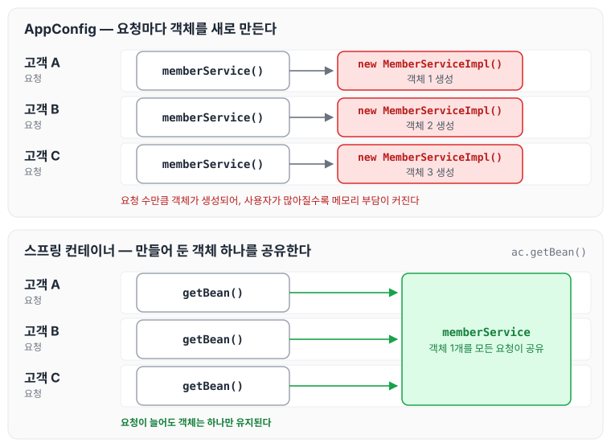
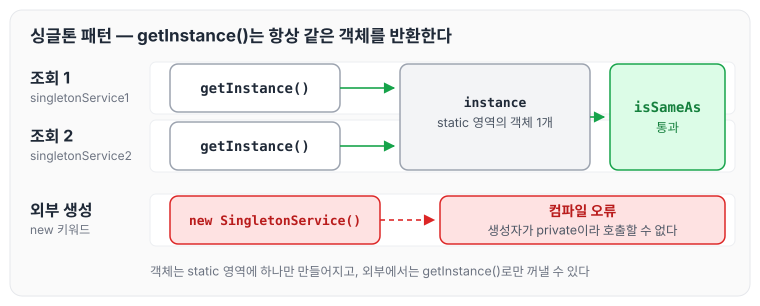

이전에 [XML로 스프링 빈 설정하기](../spring-core-xml-config/)에 대해 작성하였습니다. 오늘은 지금까지 만든 AppConfig가 요청마다 객체를 새로 생성하는 문제와, 이를 직접 구현한 싱글톤 패턴과 스프링 컨테이너로 각각 해결하는 방법에 대해 정리하도록 하겠습니다.

## AppConfig의 문제점

현재 AppConfig는 객체가 필요할 때마다 `new`로 생성자를 호출해서 새로 메모리를 할당받고 있습니다. 이렇게 되면 웹 애플리케이션에서 사용자가 많아질수록 요청마다 객체가 새로 생성되기 때문에 메모리 부담이 커집니다.

요청마다 객체를 새로 만드는 경우와, 만들어 둔 객체 하나를 공유하는 경우를 비교하면 아래와 같습니다.



이 문제를 해결하기 위해 객체를 하나만 생성해서 공유하는 싱글톤(Singleton) 방식을 사용해 보겠습니다.

## SingletonService 구현

싱글톤 패턴은 클래스의 인스턴스가 하나만 생성되도록 보장하는 방식입니다. `static` 영역에 객체를 하나만 만들어 두고, 생성자를 `private`으로 막아 외부에서 `new`로 생성하지 못하게 합니다. 객체가 필요하면 `getInstance()`로만 조회합니다.

```java
package hello.core.singleton;

public class SingletonService {

    //1. static 영억에서 객체를 딱 1개만 생성한다.
    private static final SingletonService instance = new SingletonService();

    //2. public으로 열어 객체인스턴스가 필요히면 이 static 메서드를 통해 조회하도록 한다.
    public static SingletonService getInstance() {
        return instance;
    }

    //3. 생성자를 private으로 선언해서 외부에서 new 키워드를 사용한 객체 생성을 못하게 막는다.
    private SingletonService() {}

    public void logic() {
        System.out.println("싱글톤 객체 로직 호출");
    }
}
```

## SingletonServiceTest 구현

테스트에서는 아래 두 가지를 확인합니다.

- 두 번 조회한 객체가 같은 메모리 주소값인지 확인합니다.
- 두 개의 참조값이 같은지 확인합니다.

```java
package hello.core.singleton;

import org.assertj.core.api.Assertions;
import org.junit.jupiter.api.Test;

public class SingletonServiceTest {

    @Test
    public void singletonServiceTest() {
//private으로 생성자를 막아두었다. 컴파일 오류가 발생한다.//new SingletonService();//1. 조회: 호출할 때 마다 같은 객체를 반환
        SingletonService singletonService1 = SingletonService.getInstance();
//2. 조회: 호출할 때 마다 같은 객체를 반환
        SingletonService singletonService2 = SingletonService.getInstance();

//참조값이 같은지 확인
        System.out.println(singletonService1);
        System.out.println(singletonService2);

// singletonService1 == singletonService2
        Assertions.assertThat(singletonService1).isSameAs(singletonService2);
    }
}
```

`getInstance()`를 두 번 호출해도 `static` 영역에 만들어 둔 같은 객체가 반환되고, `new SingletonService()`는 생성자가 `private`이라 컴파일 오류가 발생합니다. 이 흐름은 아래와 같습니다.



## 싱글톤 패턴의 문제점

싱글톤 패턴으로 객체를 하나만 쓰게 할 수는 있지만, 아래와 같은 문제점이 있습니다.

- 싱글톤 패턴을 구현하는 코드 자체가 많이 들어갑니다.
- 의존관계상 클라이언트가 구체 클래스에 의존합니다.
- DIP를 위반합니다. 클라이언트가 구체 클래스에 의존해서 OCP 원칙을 위반할 가능성이 높습니다.
- 테스트하기 어렵습니다.
- 내부 속성을 변경하거나 초기화하기 어렵습니다.
- private 생성자로 자식 클래스를 만들기 어렵습니다.
- 결론적으로 유연성이 떨어집니다.
- 안티 패턴으로 불리기도 합니다.

## 스프링 컨테이너

스프링 컨테이너는 싱글톤 패턴의 문제점을 해결하면서, 객체 인스턴스를 싱글톤으로 관리합니다. 아래 테스트는 스프링 컨테이너에서 `memberService`를 두 번 조회해 같은 객체인지 확인합니다.

```java
package hello.core.singleton;

import hello.core.AppConfig;
import hello.core.member.MemberService;
import org.assertj.core.api.Assertions;
import org.junit.jupiter.api.DisplayName;
import org.junit.jupiter.api.Test;
import org.springframework.context.ApplicationContext;
import org.springframework.context.annotation.AnnotationConfigApplicationContext;

import static org.assertj.core.api.Assertions.*;

public class SingletonServiceTest {

    ...

    @Test
    @DisplayName("스프링 컨테이너와 싱글톤")
    void springContainer() {
        ApplicationContext ac = new AnnotationConfigApplicationContext(AppConfig.class);
//1. 조회: 호출할 때 마다 같은 객체를 반환
        MemberService memberService1 = ac.getBean("memberService", MemberService.class);
//2. 조회: 호출할 때 마다 같은 객체를 반환
        MemberService memberService2 = ac.getBean("memberService", MemberService.class);
//참조값이 같은 것을 확인
        System.out.println("memberService1 = " + memberService1);
        System.out.println("memberService2 = " + memberService2);
//memberService1 == memberService2
        assertThat(memberService1).isSameAs(memberService2);
    }

}
```

`SingletonService`처럼 싱글톤을 위한 코드를 따로 작성하지 않았는데도, 두 번 조회한 `memberService`는 같은 객체입니다.

## 싱글톤 컨테이너 적용 후

스프링 컨테이너를 적용하면 아래와 같은 점이 달라집니다.

- 고객의 요청이 올 때마다 객체를 새로 만들지 않고, 이미 만들어진 객체를 공유해서 효율적으로 사용할 수 있습니다.
- DIP, OCP, 테스트, private 생성자 같은 제약으로부터 자유롭게 싱글톤을 사용할 수 있습니다.

## 마무리

오늘은 AppConfig가 요청마다 객체를 새로 생성하는 문제와, 이를 싱글톤 패턴과 스프링 컨테이너로 해결하는 방법에 대해 정리하였습니다. 기존에는 자바로 AppConfig를 구성해서 스프링 대신 사용했는데, `new`로 객체를 계속 생성하다 보니 메모리 낭비가 생겼습니다. 이를 해결하기 위해 싱글톤 패턴을 사용해 보았지만 DIP, OCP, 중복 코드 관리 측면에서 어려움이 느껴졌습니다. 스프링 컨테이너를 사용하면 이런 문제 없이 싱글톤 방식을 쓸 수 있다는 점을 기억해 두려고 합니다. 다음 글에서는 [싱글톤 방식의 주의점](../spring-core-singleton-caution/)에 대해 정리하도록 하겠습니다.

> 이 글은 인프런 김영한 님의 [스프링 핵심 원리 — 기본편](https://www.inflearn.com/course/스프링-핵심-원리-기본편)을 들으며 정리한 노트입니다.
