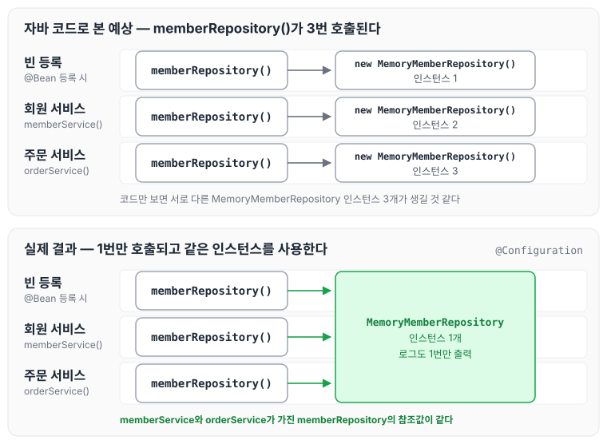
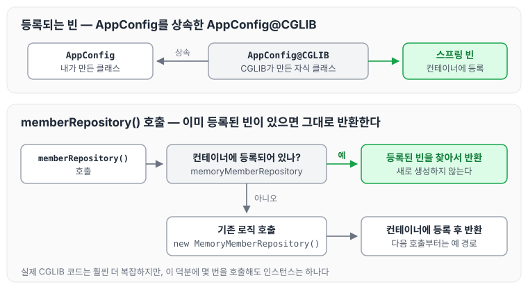
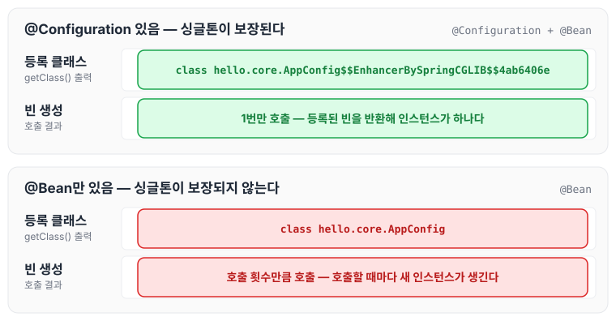

이전에 [싱글톤 방식의 주의점](../spring-core-singleton-caution/)에 대해 작성하였습니다. 오늘은 AppConfig의 자바 코드만 보면 `MemoryMemberRepository`가 여러 번 생성될 것 같은데도 스프링 컨테이너에서는 싱글톤이 유지되는 이유를 `@Configuration`과 CGLIB를 통해 정리하도록 하겠습니다.

## AppConfig 살펴보기

자바를 배운 사람이라면 AppConfig를 보고 객체가 계속 생성될 것이라고 예상합니다. 예를 들면 아래와 같습니다.

- `@Bean memberService` -> `new MemoryMemberRepository()` 호출
- `@Bean orderService` -> `new MemoryMemberRepository()` 호출

하지만 실제 결과는 이 예상과 다릅니다. 어떻게 다른지 확인해 보겠습니다.

예시 코드: AppConfig

```java
package hello.core;

import hello.core.discount.DiscountPolicy;
import hello.core.discount.RateDiscountPolicy;
import hello.core.member.MemberRepository;
import hello.core.member.MemberService;
import hello.core.member.MemberServiceImpl;
import hello.core.member.MemoryMemberRepository;
import hello.core.order.OrderService;
import hello.core.order.OrderServiceImpl;
import org.springframework.context.annotation.Bean;
import org.springframework.context.annotation.Configuration;

@Configuration
public class AppConfig {

//@Bean memberService -> new MemoryMemberRepository()
//@Bean orderService -> new MemoryMemberRepository()
    @Bean
    public MemberService memberService() {
        return new MemberServiceImpl(memberRepository());
    }

    @Bean
    public OrderService orderService() {
        return new OrderServiceImpl(memberRepository(), discountPolicy());
    }

    @Bean
    public MemberRepository memberRepository() {
        return new MemoryMemberRepository();
    }

    @Bean
    public DiscountPolicy discountPolicy() {
        return new RateDiscountPolicy();
    }
}
```

## MemberServiceImpl에 테스트 용도 메서드 작성

`memberService`가 주입받은 `memberRepository`를 꺼내 볼 수 있도록 MemberServiceImpl에 테스트 용도의 메서드를 추가합니다.

예시 코드: MemberServiceImpl

```java
package hello.core.member;

public class MemberServiceImpl implements MemberService {

    private final MemberRepository memberRepository;

    ...

		 // 테스트 용도
		public MemberRepository getMemberRepository() {
        return memberRepository;
    }

}
```

## OrderServiceImpl에 테스트 용도 메서드 작성

OrderServiceImpl에도 같은 메서드를 추가합니다.

예시 코드: OrderServiceImpl

```java
package hello.core.order;

import hello.core.discount.DiscountPolicy;
import hello.core.member.*;

public class OrderServiceImpl implements OrderService{
    private final MemberRepository memberRepository;
    private final DiscountPolicy discountPolicy;

    ...

// 테스트 용도
		public MemberRepository getMemberRepository() {
        return memberRepository;
    }
}
```

## ConfigurationSingletonTest 구현

스프링 컨테이너에서 `memberService`와 `orderService`를 조회하고, 각각이 가진 `memberRepository`의 참조값을 출력합니다.

예시 코드: ConfigurationSingletonTest

```java
package hello.core.singleton;

import hello.core.AppConfig;
import hello.core.member.MemberRepository;
import hello.core.member.MemberServiceImpl;
import hello.core.order.OrderServiceImpl;
import org.junit.jupiter.api.Test;
import org.springframework.context.ApplicationContext;
import org.springframework.context.annotation.AnnotationConfigApplicationContext;

public class ConfigurationSingletonTest {

    @Test
    void configurationTest() {
        ApplicationContext ac = new AnnotationConfigApplicationContext(AppConfig.class);

        MemberServiceImpl memberService = ac.getBean("memberService", MemberServiceImpl.class);
        OrderServiceImpl orderService = ac.getBean("orderService", OrderServiceImpl.class);

        MemberRepository memberRepository1 = memberService.getMemberRepository();
        MemberRepository memberRepository2 = orderService.getMemberRepository();

        System.out.println("memberService -> memberRepository = " + memberRepository1);
        System.out.println("memberRepository2 -> memberRepository = " + memberRepository2);

    }
}

```

- `System.out.println`으로 출력한 두 참조값이 같은 것을 확인할 수 있습니다.
- AppConfig의 자바 코드를 보면 분명히 `new MemoryMemberRepository`를 각각 호출해서 서로 다른 인스턴스가 생성되어야 합니다.
- 그런데도 같은 참조값을 가진다는 것은 `memberRepository()`가 여러 번 호출되지 않는다는 뜻인지, 실험을 통해 확인해 보겠습니다.

## AppConfig에 호출 로그 남기기

각 `@Bean` 메서드가 호출될 때마다 로그를 출력하도록 AppConfig를 수정합니다.

예시 코드: AppConfig.java

```java
package hello.core;

import hello.core.discount.DiscountPolicy;
import hello.core.discount.RateDiscountPolicy;
import hello.core.member.MemberRepository;
import hello.core.member.MemberService;
import hello.core.member.MemberServiceImpl;
import hello.core.member.MemoryMemberRepository;
import hello.core.order.OrderService;
import hello.core.order.OrderServiceImpl;
import org.springframework.context.annotation.Bean;
import org.springframework.context.annotation.Configuration;

@Configuration
public class AppConfig {

//@Bean memberService -> new MemoryMemberRepository()
//@Bean orderService -> new MemoryMemberRepository()
    @Bean
    public MemberService memberService() {
//1번 호출
        System.out.println("call AppConfig.memberService");
        return new MemberServiceImpl(memberRepository());
    }

    @Bean
    public OrderService orderService() {
//1번 호출
        System.out.println("call AppConfig.orderService");
        return new OrderServiceImpl(memberRepository(), discountPolicy());
    }

    @Bean
    public MemberRepository memberRepository() {
//2번? 3번? 호출
        System.out.println("call AppConfig.MemberRepository");
        return new MemoryMemberRepository();
    }

    @Bean
    public DiscountPolicy discountPolicy() {
        return new RateDiscountPolicy();
    }
}

```

실행해 보면 각 메서드가 1번씩 호출되었습니다.

자바 코드로 보면 `memberRepository()`는 아래와 같이 3번 호출되어야 합니다.

- 스프링 컨테이너가 `@Bean`을 등록할 때 1번
- `memberService()`에서 `memberRepository()`를 호출할 때 1번
- `orderService()`에서 `memberRepository()`를 호출할 때 1번

그런데 실제 결과는 `call AppConfig.MemberRepository`가 1번만 출력되었습니다. 코드만 보고 예상한 호출과 실제 결과를 비교하면 아래와 같습니다.



이렇게 동작하도록 만들어 주는 것이 `@Configuration`의 역할입니다. 스프링 컨테이너는 싱글톤 레지스트리이기 때문에 스프링 빈이 싱글톤이 되도록 보장해 주어야 합니다.

## @Configuration을 적용한 AppConfig 분석

AppConfig도 스프링 빈으로 등록되므로, 컨테이너에서 AppConfig를 조회해 클래스 정보를 출력해 봅니다.

```java
@Test
    void configurationDeep() {
        ApplicationContext ac = new AnnotationConfigApplicationContext(AppConfig.class);

//AppConfig도 스프링 빈으로 등록된다.
        AppConfig bean = ac.getBean(AppConfig.class);

        System.out.println("Bean = " + bean.getClass());
//출력 결과 Bean = class hello.core.AppConfig$$EnhancerBySpringCGLIB$$4ab6406e
    }
```

출력 값이 순수한 클래스 이름이 아니라 뒤에 다른 문자가 붙은 결과로 나온 것을 확인할 수 있습니다.

- 순수한 자바 클래스
    - `class hello.core.AppConfig`
- `@Configuration`을 적용한 클래스
    - `class hello.core.AppConfig$$EnhancerBySpringCGLIB$$4ab6406e`

이는 내가 만든 클래스가 아니라, 스프링이 CGLIB라는 바이트코드 조작 라이브러리를 사용해서 AppConfig 클래스를 상속받은 임의의 다른 클래스를 만들고, 그 클래스를 스프링 빈으로 등록한 것입니다.

## AppConfig@CGLIB의 예상 코드

CGLIB가 만든 클래스의 `memberRepository()`는 대략 아래와 같이 동작할 것으로 예상할 수 있습니다. 실제로는 훨씬 더 복잡합니다.

```java
@Bean
public MemberRepository memberRepository() {
     if (memoryMemberRepository가 이미 스프링 컨테이너에 등록되어 있으면?) {
        return 스프링 컨테이너에서 찾아서 반환;
     } else {//스프링 컨테이너에 없으면
        기존 로직을 호출해서 MemoryMemberRepository를 생성하고 스프링 컨테이너에 등록
         return 반환
     }
}
```

`memoryMemberRepository`가 이미 스프링 컨테이너에 등록되어 있으면 등록된 빈을 찾아서 반환하고, 없으면 기존 로직을 호출해서 생성하고 스프링 컨테이너에 등록한 뒤 반환합니다. 이 흐름을 그림으로 나타내면 아래와 같습니다.



이 덕분에 `memberRepository()`를 몇 번 호출하더라도 싱글톤이 보장됩니다.

## @Configuration 없이 @Bean만 적용하면

AppConfig에서 `@Configuration`을 지우고 `@Bean`만 남겨 실행해 봅니다.

```java
//@Configuration 삭제
public class AppConfig {

}
```

결과는 아래와 같습니다.

- 싱글톤이 적용되지 않고, `memberRepository()`가 호출 횟수만큼 호출되는 것을 볼 수 있습니다.
- AppConfig 또한 CGLIB 클래스가 아닌 순수한 클래스로 출력되는 것을 확인할 수 있습니다.

`@Configuration`이 있을 때와 없을 때를 비교하면 아래와 같습니다.



`@Configuration`을 사용할 때 스프링이 원래 클래스를 상속한 임의의 클래스로 대신 등록한다는 점을 보니, 예전에 정리했던 프록시에 관한 글이 생각났습니다. 함께 참고하면 좋을 것 같습니다.

[https://cozing.tistory.com/54?category=1076708](https://cozing.tistory.com/54?category=1076708)

## 마무리

오늘은 AppConfig의 `@Bean` 메서드가 여러 번 호출되는 것처럼 보여도 싱글톤이 보장되는 이유를 `@Configuration`과 CGLIB를 통해 정리하였습니다. `@Bean`만 사용해도 스프링 빈으로 등록은 되지만 싱글톤은 보장되지 않는다는 것을 알게 되었습니다. 크게 고민하지 말고 스프링 설정 정보는 항상 `@Configuration`을 사용해서 싱글톤으로 등록해야 할 것 같습니다. 다음 글에서는 [컴포넌트 스캔](../spring-core-component-scan/)에 대해 정리하도록 하겠습니다.

> 이 글은 인프런 김영한 님의 [스프링 핵심 원리 — 기본편](https://www.inflearn.com/course/스프링-핵심-원리-기본편)을 들으며 정리한 노트입니다.
