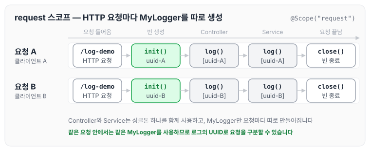
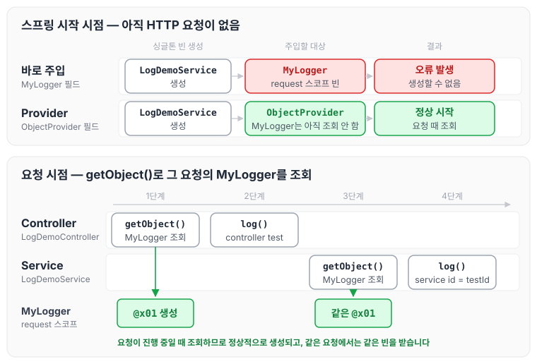
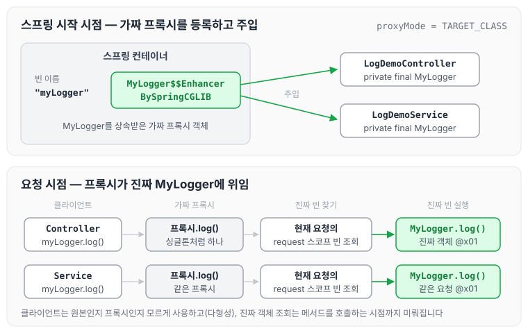

이전에 [프로토타입과 싱글톤을 함께 쓸 때 Provider로 푸는 법](../spring-core-provider/)에 대해 작성하였습니다. 지금까지 다룬 싱글톤은 스프링 컨테이너의 시작과 끝까지 함께하는 매우 긴 스코프이고, 프로토타입은 생성과 의존관계 주입, 그리고 초기화까지만 진행하는 특별한 스코프입니다. 이번에는 웹 스코프에 대해 정리하도록 하겠습니다.

## 웹 스코프

웹 스코프의 특징은 아래와 같습니다.

- 웹 스코프는 웹 환경에서만 동작합니다.
- 웹 스코프는 프로토타입과 다르게 스프링이 해당 스코프의 종료 시점까지 관리합니다. 따라서 종료 메서드가 호출됩니다.

웹 스코프의 종류는 아래와 같습니다.

- request : HTTP 요청 하나가 들어오고 나갈 때까지 유지되는 스코프이며, 각각의 HTTP 요청마다 별도의 빈 인스턴스가 생성되고 관리됩니다.
- session : HTTP Session과 동일한 생명주기를 가지는 스코프입니다.
- application : 서블릿 컨텍스트(ServletContext)와 동일한 생명주기를 가지는 스코프입니다.
- websocket : 웹 소켓과 동일한 생명주기를 가지는 스코프입니다.

여기서는 request 스코프를 예제로 설명하겠습니다. 나머지 스코프도 범위만 다르고 동작 방식은 비슷합니다.

## HTTP 요청마다 할당되는 request 스코프

request 스코프 빈은 HTTP 요청마다 따로 생성되고, 그 요청이 끝날 때 함께 종료됩니다. 두 클라이언트가 동시에 요청을 보내는 경우를 그리면 아래와 같습니다.



Controller와 Service는 싱글톤이지만, 이들이 사용하는 MyLogger는 요청마다 다른 인스턴스이고 같은 요청 안에서는 같은 인스턴스입니다.

## request 스코프 예제 만들기

웹 스코프는 웹 환경에서만 동작하므로 build.gradle에 web 라이브러리를 추가합니다.

이번 예제에서 남길 로그의 공통 포맷은 `[UUID][requestURL] {message}`입니다.

- UUID를 사용해서 HTTP 요청을 구분합니다.
- requestURL 정보도 추가로 넣어서 어떤 URL을 요청해서 남은 로그인지 확인합니다.

## 스코프와 Provider

### MyLogger 만들기

로그를 출력하는 MyLogger 클래스를 request 스코프로 만듭니다.

```java
package hello.core.common;

import org.springframework.context.annotation.ComponentScan;
import org.springframework.context.annotation.Scope;
import org.springframework.stereotype.Component;

import javax.annotation.PostConstruct;
import javax.annotation.PreDestroy;
import java.util.UUID;

@Component
@Scope(value = "request")// "request"
public class MyLogger {
    private String uuid;
    private String requestURL;

    public void setRequestURL (String requestURL) {
        this.requestURL  = requestURL;
    }

    public void log(String message) {
        System.out.println("[" + uuid + "]" + "[" + requestURL + "]"
         +  message);
    }

    @PostConstruct
    public void init() {
        uuid = UUID.randomUUID().toString();
        System.out.println("[" + uuid + "] request scope bean create:" + this);
    }

    @PreDestroy
    public void close() {
        System.out.println("[" + uuid + "] request scope bean close:" + this);
    }

}

```

### LogDemoService 만들기

- request 스코프 빈은 HTTP 요청이 들어올 때 생성되고 나갈 때 종료됩니다. 스프링이 시작되는 시점에는 아직 HTTP 요청이 없어 request 스코프 빈을 생성할 수 없으므로, MyLogger를 바로 주입받으려고 하면 오류가 발생합니다.
- 이를 해결하기 위해 아래와 같이 ObjectProvider를 사용해 DL(Dependency Lookup)로 MyLogger를 조회합니다.

```java
package hello.core.web;

import hello.core.common.MyLogger;
import lombok.RequiredArgsConstructor;
import org.springframework.beans.factory.ObjectProvider;
import org.springframework.stereotype.Service;

@Service
@RequiredArgsConstructor
public class LogDemoService {
    private final ObjectProvider<MyLogger> myLoggerProvider;

    public void logic(String id) {
        MyLogger myLogger = myLoggerProvider.getObject();
        myLogger.log("service id = " + id);
    }
}
```

### LogDemoController 만들기

Controller에서도 같은 방식으로 MyLogger를 조회해 requestURL을 넣고 로그를 남깁니다.

```java
package hello.core.web;

import hello.core.common.MyLogger;
import lombok.RequiredArgsConstructor;
import org.springframework.beans.factory.ObjectProvider;
import org.springframework.stereotype.Controller;
import org.springframework.web.bind.annotation.RequestMapping;
import org.springframework.web.bind.annotation.ResponseBody;

import javax.servlet.http.HttpServletRequest;

@Controller
@RequiredArgsConstructor
public class LogDemoController {
    private final LogDemoService logDemoService;
    private final ObjectProvider<MyLogger> myLoggerObjectProvider;

    @RequestMapping("log-demo")
    @ResponseBody
    public String logDemo(HttpServletRequest request) {
        String requestURL = request.getRequestURL().toString();
        MyLogger myLogger = myLoggerObjectProvider.getObject();
        myLogger.setRequestURL(requestURL);

        myLogger.log("controller test");
        logDemoService.logic("testId");
        return "OK";
    }
}
```

스프링이 시작될 때와 요청이 들어왔을 때 MyLogger를 어떻게 얻는지 그리면 아래와 같습니다.



`getObject()`를 호출하는 시점은 HTTP 요청이 진행 중인 때이므로 request 스코프 빈을 정상적으로 생성하고 조회할 수 있습니다. 같은 요청 안에서 Controller와 Service가 각각 `getObject()`를 호출해도 같은 MyLogger를 받습니다.

## 스코프와 프록시

이번에는 프록시 방식을 사용해 보겠습니다.

### MyLogger에 proxyMode 추가

```java
package hello.core.common;

import org.springframework.context.annotation.ComponentScan;
import org.springframework.context.annotation.Scope;
import org.springframework.context.annotation.ScopedProxyMode;
import org.springframework.stereotype.Component;

import javax.annotation.PostConstruct;
import javax.annotation.PreDestroy;
import java.util.UUID;

@Component
@Scope(value = "request", proxyMode = ScopedProxyMode.TARGET_CLASS)
public class MyLogger {
    ...
}
```

- 이 방식에서 바뀌는 곳은 `proxyMode = ScopedProxyMode.TARGET_CLASS`를 추가한 부분입니다.
    - 적용 대상이 인터페이스가 아닌 클래스면 TARGET_CLASS를 선택합니다.
    - 적용 대상이 인터페이스면 INTERFACES를 선택합니다.
- 이렇게 하면 MyLogger의 가짜 프록시 클래스를 만들어 두고, HTTP request와 상관없이 가짜 프록시 클래스를 다른 빈에 미리 주입해 둘 수 있습니다.

### LogDemoService 원복

```java
package hello.core.web;

import hello.core.common.MyLogger;
import lombok.RequiredArgsConstructor;
import org.springframework.stereotype.Service;

@Service
@RequiredArgsConstructor
public class LogDemoService {
    private final MyLogger myLogger;

    public void logic(String id) {
        myLogger.log("service id = " + id);
    }
}
```

### LogDemoController 원복

```java
package hello.core.web;

import hello.core.common.MyLogger;
import lombok.RequiredArgsConstructor;
import org.springframework.stereotype.Controller;
import org.springframework.web.bind.annotation.RequestMapping;
import org.springframework.web.bind.annotation.ResponseBody;

import javax.servlet.http.HttpServletRequest;

@Controller
@RequiredArgsConstructor
public class LogDemoController {
    private final LogDemoService logDemoService;
    private final MyLogger myLogger;

    @RequestMapping("log-demo")
    @ResponseBody
    public String logDemo(HttpServletRequest request) {
        String requestURL = request.getRequestURL().toString();
        myLogger.setRequestURL(requestURL);
        myLogger.log("controller test");
        logDemoService.logic("testId");
        return "OK";
    }
}
```

### 주입된 MyLogger 확인

먼저 주입된 myLogger의 클래스를 출력해 보겠습니다.

```java
System.out.println("myLogger = " + myLogger.getClass());
```

출력 결과는 아래와 같습니다.

```text
myLogger = class hello.core.common.MyLogger$$EnhancerBySpringCGLIB$$b68b726d
```

### CGLIB 프록시 객체 주입

스프링은 CGLIB라는 라이브러리로 내 클래스를 상속받은 가짜 프록시 객체를 만들어서 주입합니다.

- `@Scope`의 `proxyMode = ScopedProxyMode.TARGET_CLASS`를 설정하면 스프링 컨테이너는 CGLIB라는 바이트코드를 조작하는 라이브러리를 사용해서, MyLogger를 상속받은 가짜 프록시 객체를 생성합니다.
- 결과를 확인해 보면 우리가 등록한 순수한 MyLogger 클래스가 아니라 `MyLogger$$EnhancerBySpringCGLIB`이라는 클래스로 만들어진 객체가 대신 등록된 것을 확인할 수 있습니다.
- 그리고 스프링 컨테이너에 "myLogger"라는 이름으로 진짜 대신에 이 가짜 프록시 객체를 등록합니다.
- `ac.getBean("myLogger", MyLogger.class)`로 조회해도 프록시 객체가 조회되는 것을 확인할 수 있습니다.
- 그래서 의존관계 주입도 이 가짜 프록시 객체가 주입됩니다.

### 프록시 객체의 위임

가짜 프록시 객체에는 요청이 오면 그때 내부에서 진짜 빈을 요청하는 위임 로직이 들어 있습니다.

- 가짜 프록시 객체는 내부에 진짜 myLogger를 찾는 방법을 알고 있습니다.
- 클라이언트가 `myLogger.log()`를 호출하면 사실은 가짜 프록시 객체의 메서드를 호출한 것입니다.
- 가짜 프록시 객체는 request 스코프의 진짜 `myLogger.log()`를 호출합니다.
- 가짜 프록시 객체는 원본 클래스를 상속받아서 만들어졌기 때문에, 이 객체를 사용하는 클라이언트 입장에서는 원본인지 아닌지 모르게 동일하게 사용할 수 있습니다(다형성).

스프링 시작 시점의 주입과 요청 시점의 위임을 순서대로 그리면 아래와 같습니다.



Controller와 Service에는 싱글톤처럼 프록시 하나가 주입되어 있고, 실제 MyLogger는 요청이 들어와 메서드를 호출할 때 프록시가 찾아서 사용합니다.

### 동작 정리

- CGLIB라는 라이브러리로 내 클래스를 상속받은 가짜 프록시 객체를 만들어서 주입합니다.
- 이 가짜 프록시 객체는 실제 요청이 오면 그때 내부에서 실제 빈을 요청하는 위임 로직이 들어 있습니다.
- 가짜 프록시 객체는 실제 request scope와는 관계가 없습니다. 내부에 단순한 위임 로직만 있고, 싱글톤처럼 동작합니다.

### 특징 정리

- 프록시 객체 덕분에 클라이언트는 마치 싱글톤 빈을 사용하듯이 편리하게 request scope를 사용할 수 있습니다.
- Provider를 사용하든, 프록시를 사용하든 핵심 아이디어는 진짜 객체 조회를 꼭 필요한 시점까지 지연 처리한다는 점입니다.
- 애노테이션 설정 변경만으로 원본 객체를 프록시 객체로 대체할 수 있습니다. 이것이 다형성과 DI 컨테이너가 가진 큰 강점입니다.
- 꼭 웹 스코프가 아니어도 프록시는 사용할 수 있습니다.

### 주의점

- 마치 싱글톤을 사용하는 것 같지만 다르게 동작하기 때문에 주의해서 사용해야 합니다.
- 이런 특별한 scope는 꼭 필요한 곳에만 최소화해서 사용해야 합니다. 무분별하게 사용하면 유지보수하기 어려워집니다.

프록시에 대한 추가 설명은 아래 글에 정리해 두었습니다.

[https://cozing.tistory.com/54?category=1076708](https://cozing.tistory.com/54?category=1076708)

## 마무리

오늘은 웹 스코프 중 request 스코프의 동작 방식과, request 스코프 빈을 ObjectProvider와 CGLIB 프록시로 사용하는 방법에 대해 정리하였습니다.

스프링 핵심 원리 기본편을 들으면서 스프링이 전반적으로 어떻게 동작하며, 어떻게 다형성을 적용하는지 잘 알 수 있었습니다. 지금처럼 여유가 있을 때 생각해 보면 개발 3년 동안 어떻게 동작하는지 원리를 파악하지 않고 사용하는 방법만 인지하고 썼던 경험이 많은 것 같습니다. 때문에 처음 개발 속도는 빨랐을지언정 나중 발전 속도는 좀 더뎠던 것 같습니다. 앞으로도 동작 원리를 잘 파악하고, 최적으로 사용할 수 있기를 바랍니다.

> 이 글은 인프런 김영한 님의 [스프링 핵심 원리 — 기본편](https://www.inflearn.com/course/스프링-핵심-원리-기본편)을 들으며 정리한 노트입니다.
