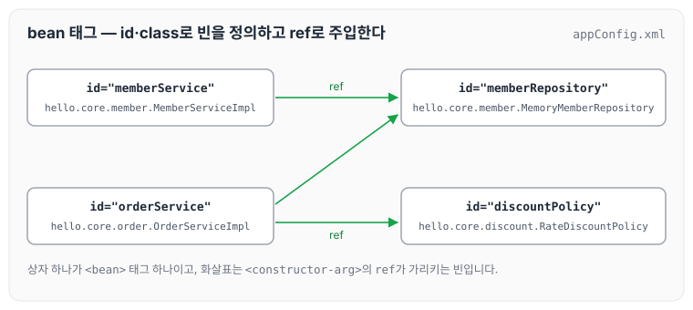
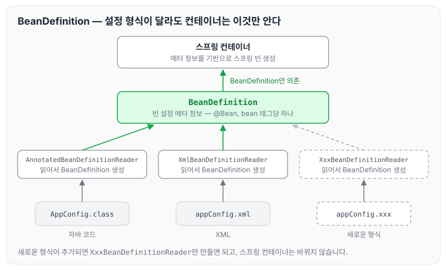

이전에 [BeanFactory와 ApplicationContext](../spring-core-beanfactory/)에 대해 작성하였습니다. 지금은 많이 사용하지 않지만, 과거에는 XML로 스프링 설정을 하였습니다. XML로 빈을 설정하는 것을 보니 예전에 학원에서 배웠던 XML 파일이 생각났습니다. 오늘은 자바 코드로 작성한 AppConfig를 appConfig.xml로 바꾸는 방법과, 스프링이 이렇게 여러 설정 형식을 지원할 수 있는 이유인 BeanDefinition에 대해 정리하도록 하겠습니다.

## appConfig.xml의 소스 구성

AppConfig의 `@Bean` 메서드 하나가 XML에서는 `<bean>` 태그 하나가 됩니다. 빈 이름은 `id`, 구현 클래스는 `class`로 적고, 생성자로 주입할 의존관계는 `<constructor-arg>`의 `ref`로 다른 빈을 가리킵니다.

```xml
<?xml version="1.0" encoding="UTF-8"?>
<beans xmlns="http://www.springframework.org/schema/beans"
       xmlns:xsi="http://www.w3.org/2001/XMLSchema-instance"
       xsi:schemaLocation="http://www.springframework.org/schema/beans http://www.springframework.org/schema/beans/spring-beans.xsd">
    <bean id="memberService" class="hello.core.member.MemberServiceImpl">
        <constructor-arg name="memberRepository" ref="memberRepository"/>
    </bean>
    <bean id="memberRepository" class="hello.core.member.MemoryMemberRepository"/>

    <bean id="orderService" class="hello.core.order.OrderServiceImpl">
        <constructor-arg name="memberRepository" ref="memberRepository"/>
        <constructor-arg name="discountPolicy" ref="discountPolicy"/>
    </bean>

    <bean id="discountPolicy" class="hello.core.discount.RateDiscountPolicy"/>
</beans>
```

위 설정에서 각 `<bean>` 태그와 `ref`로 연결된 의존관계를 그림으로 나타내면 아래와 같습니다.



## appConfig.xml 단위 테스트

XML 설정은 `GenericXmlApplicationContext`에 파일 이름을 넘겨 읽습니다. 아래 테스트는 appConfig.xml로 만든 스프링 컨테이너에서 `memberService`를 조회해 `MemberService` 타입인지 확인합니다.

```java
package hello.core.xml;

import hello.core.member.MemberService;
import org.junit.jupiter.api.Test;
import org.springframework.context.ApplicationContext;
import org.springframework.context.support.GenericXmlApplicationContext;

import static org.assertj.core.api.Assertions.*;

public class XmlAppContext {
    @Test
    void xmlAppContext() {
        ApplicationContext ac = new GenericXmlApplicationContext("appConfig.xml");

        MemberService memberService = ac.getBean("memberService", MemberService.class);
        assertThat(memberService).isInstanceOf(MemberService.class);

    }
}
```

## 스프링 빈 설정 메타 정보 - BeanDefinition

스프링이 이렇게 다양한 설정 형식을 지원할 수 있는 중심에는 BeanDefinition이라는 추상화가 있습니다. 역할과 구현을 개념적으로 나눈 것입니다.

- XML을 읽어서 BeanDefinition을 만듭니다.
- 자바 코드를 읽어서 BeanDefinition을 만듭니다.
- 스프링 컨테이너는 설정이 자바 코드인지 XML인지 몰라도 되며, 오직 BeanDefinition만 알면 됩니다.

BeanDefinition을 빈 설정 메타 정보라고 합니다. `@Bean`이나 `<bean>` 태그 하나당 각각 하나씩 메타 정보가 생성되고, 스프링 컨테이너는 이 메타 정보를 기반으로 스프링 빈을 생성합니다.

## 코드 레벨로 깊이 들어가 보기

설정 형식마다 BeanDefinition을 만드는 쪽은 아래와 같이 나뉩니다.

- `AnnotationConfigApplicationContext`는 `AnnotatedBeanDefinitionReader`를 사용해서 `AppConfig.class`를 읽고 BeanDefinition을 생성합니다.
- `GenericXmlApplicationContext`는 `XmlBeanDefinitionReader`를 사용해서 `appConfig.xml`을 읽고 BeanDefinition을 생성합니다.
- 새로운 형식의 설정 정보가 추가되면 `XxxBeanDefinitionReader`를 만들어 BeanDefinition을 생성하면 됩니다.

이 관계를 그림으로 나타내면 아래와 같습니다.



설정 형식이 늘어나도 Reader만 추가되고, 스프링 컨테이너는 BeanDefinition만 바라보기 때문에 바뀌지 않습니다.

## 마무리

오늘은 XML로 스프링 빈을 설정하는 방법과, 다양한 설정 형식을 가능하게 하는 BeanDefinition에 대해 정리하였습니다. 스프링의 메타 정보도 역할과 구현을 구분해서, ApplicationContext는 BeanDefinition만 DI로 받고 어떤 설정 형식이 오든 동작하도록 잘 설계되어 있었습니다. 이를 통해 확장이 얼마나 쉬워지는지 다시 한번 느낄 수 있었습니다. 다음 글에서는 [웹 애플리케이션과 싱글톤](../spring-core-singleton-web/)에 대해 정리하도록 하겠습니다.

> 이 글은 인프런 김영한 님의 [스프링 핵심 원리 — 기본편](https://www.inflearn.com/course/스프링-핵심-원리-기본편)을 들으며 정리한 노트입니다.
