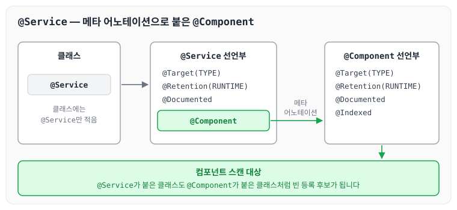
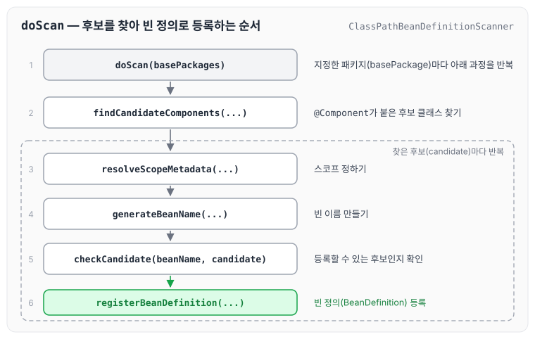

오늘은 Spring에서 자주 사용하는 `@Component`, `@Service` 같은 어노테이션이 어떻게 선언되어 있는지, 그리고 Spring이 애플리케이션을 실행할 때 이 어노테이션이 붙은 클래스를 어떻게 읽어 들이는지 정리하도록 하겠습니다.

## @Component 어노테이션의 구성

`@Component` 어노테이션의 선언부는 아래와 같습니다.

```java
@Target(ElementType.TYPE)
@Retention(RetentionPolicy.RUNTIME)
@Documented
@Indexed
public @interface Component {
```

어노테이션 위에 붙은 `@Target`, `@Retention`, `@Documented`는 어노테이션에 붙이는 어노테이션으로, 메타 어노테이션이라고 부릅니다. 각각의 의미는 아래와 같습니다.

- `@Target` : 어노테이션을 붙일 수 있는 위치를 지정합니다. 지정하지 않으면 타입이 사용되는 위치(`TYPE_USE`)를 제외한 모든 선언 위치에 붙일 수 있습니다.
    - `ElementType.PACKAGE` : 패키지 선언
    - `ElementType.TYPE` : 타입 선언(클래스, 인터페이스, enum 등)
    - `ElementType.ANNOTATION_TYPE` : 어노테이션 타입 선언
    - `ElementType.CONSTRUCTOR` : 생성자 선언
    - `ElementType.FIELD` : 멤버 변수 선언
    - `ElementType.LOCAL_VARIABLE` : 지역 변수 선언
    - `ElementType.METHOD` : 메서드 선언
    - `ElementType.PARAMETER` : 매개변수 선언
    - `ElementType.TYPE_PARAMETER` : 타입 파라미터 선언(`<T>`의 `T`)
    - `ElementType.TYPE_USE` : 타입이 사용되는 곳
- `@Retention` : 어노테이션 정보를 언제까지 유지할지 지정합니다.
    - `SOURCE` : 소스 코드까지만 유효하며, 컴파일하면 사라집니다.
    - `CLASS` : 클래스 파일까지는 남지만, 런타임에 클래스를 메모리로 읽어 오면 해당 정보는 유지되지 않습니다.
    - `RUNTIME` : 런타임까지 유지되어 실행 중에도 리플렉션으로 읽을 수 있습니다.
- `@Documented` : Javadoc 문서에 어노테이션 정보를 포함할지 지정합니다.

이렇게 메타 어노테이션을 조합해서 어노테이션을 직접 만들 수도 있습니다. `@Qualifier`를 메타 어노테이션으로 붙여 의존관계 주입용 어노테이션을 만드는 예는 [의존관계 주입 애노테이션 직접 만들기](../spring-core-custom-annotation/)에서 정리하였습니다.

## Spring이 @Service를 읽어 들이는 방식

Spring에서 애플리케이션을 실행하면 `@Service`, `@Component`가 붙은 클래스가 빈으로 등록됩니다. 이 클래스들을 어떻게 읽어 들이는지 `@Service`의 선언부부터 살펴보겠습니다.

```java
@Target(ElementType.TYPE)
@Retention(RetentionPolicy.RUNTIME)
@Documented
@Component
public @interface Service {

	/**
	 * The value may indicate a suggestion for a logical component name,
	 * to be turned into a Spring bean in case of an autodetected component.
	 * @return the suggested component name, if any (or empty String otherwise)
	 */
	@AliasFor(annotation = Component.class)
	String value() default "";

}
```

- `ElementType.TYPE` : 클래스나 인터페이스 같은 타입을 대상으로 합니다.
- `RetentionPolicy.RUNTIME` : 런타임까지 어노테이션 정보가 유지됩니다.
- `@Component` : `@Service` 위에 `@Component` 어노테이션이 붙어 있습니다.

`@Service`에 붙어 있는 `@Component`의 선언부는 아래와 같습니다.

```java
@Target(ElementType.TYPE)
@Retention(RetentionPolicy.RUNTIME)
@Documented
@Indexed
public @interface Component {

	/**
	 * The value may indicate a suggestion for a logical component name,
	 * to be turned into a Spring bean in case of an autodetected component.
	 * @return the suggested component name, if any (or empty String otherwise)
	 */
	String value() default "";

}

```

`@Service`에는 `@Component`가 메타 어노테이션으로 붙어 있기 때문에, Spring은 `@Service`가 붙은 클래스도 `@Component`가 붙은 클래스와 같이 컴포넌트 스캔 대상으로 봅니다. 두 어노테이션의 관계를 그리면 아래와 같습니다.



클래스에는 `@Service`만 적었지만, Spring은 그 안에 붙은 `@Component`를 보고 빈으로 등록할 후보로 판단합니다.

실제로 후보 클래스를 찾아 빈으로 등록하는 곳은 `ClassPathBeanDefinitionScanner`의 `doScan` 메서드입니다.

```java
protected Set<BeanDefinitionHolder> doScan(String... basePackages) {
		Assert.notEmpty(basePackages, "At least one base package must be specified");
		Set<BeanDefinitionHolder> beanDefinitions = new LinkedHashSet<>();
		for (String basePackage : basePackages) {
			Set<BeanDefinition> candidates = findCandidateComponents(basePackage);
			for (BeanDefinition candidate : candidates) {
				ScopeMetadata scopeMetadata = this.scopeMetadataResolver.resolveScopeMetadata(candidate);
				candidate.setScope(scopeMetadata.getScopeName());
				String beanName = this.beanNameGenerator.generateBeanName(candidate, this.registry);
				if (candidate instanceof AbstractBeanDefinition abstractBeanDefinition) {
					postProcessBeanDefinition(abstractBeanDefinition, beanName);
				}
				if (candidate instanceof AnnotatedBeanDefinition annotatedBeanDefinition) {
					AnnotationConfigUtils.processCommonDefinitionAnnotations(annotatedBeanDefinition);
				}
				if (checkCandidate(beanName, candidate)) {
					BeanDefinitionHolder definitionHolder = new BeanDefinitionHolder(candidate, beanName);
					definitionHolder =
							AnnotationConfigUtils.applyScopedProxyMode(scopeMetadata, definitionHolder, this.registry);
					beanDefinitions.add(definitionHolder);
					registerBeanDefinition(definitionHolder, this.registry);
				}
			}
		}
		return beanDefinitions;
	}
```

`doScan`은 지정한 패키지(`basePackages`)마다 `findCandidateComponents`로 `@Component`가 붙은 후보 클래스를 찾습니다. 찾은 후보마다 스코프와 빈 이름을 정하고, `checkCandidate`로 등록할 수 있는지 확인한 뒤 `registerBeanDefinition`으로 빈 정의를 등록합니다. Spring이 시작될 때 이 과정을 거쳐 `@Component`가 붙은 클래스가 빈으로 등록됩니다.

`doScan`의 흐름을 순서대로 그리면 아래와 같습니다.



컴포넌트 스캔의 탐색 위치와 기본 스캔 대상은 [컴포넌트 스캔](../spring-core-component-scan/)에서 정리하였습니다.

## 마무리

오늘은 `@Component`, `@Service`에 붙은 메타 어노테이션의 의미와, Spring이 `ClassPathBeanDefinitionScanner`의 `doScan`으로 이 어노테이션이 붙은 클래스를 찾아 빈으로 등록하는 과정에 대해 정리하였습니다.
