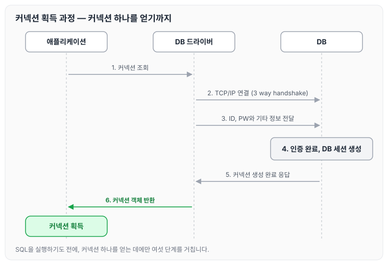
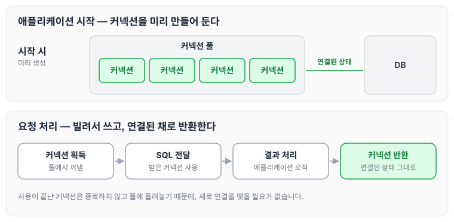
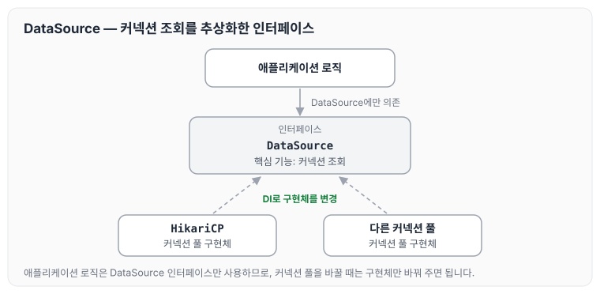

오늘은 데이터베이스 커넥션을 획득하는 과정과 커넥션 풀, 그리고 DataSource에 대해 정리하도록 하겠습니다.

## 커넥션 이해

과거에는 데이터베이스 커넥션을 획득할 때 아래와 같이 복잡한 과정을 거쳤습니다.

1. 애플리케이션이 DB 드라이버에 커넥션을 조회합니다.
2. DB 드라이버는 DB와 TCP/IP 커넥션을 연결합니다(3 way handshake).
3. DB 드라이버는 DB에 ID, PW와 기타 정보를 전달합니다.
4. DB는 인증을 완료하고 내부에 DB 세션을 생성합니다.
5. DB는 커넥션이 생성되었다고 DB 드라이버에 응답합니다.
6. DB 드라이버는 커넥션 객체를 생성해서 클라이언트에 반환합니다.

애플리케이션, DB 드라이버, DB가 주고받는 순서를 그리면 다음과 같습니다.

그림처럼 SQL을 실행하기 전에 커넥션 하나를 얻는 데에만 여섯 단계를 거칩니다.

### 문제

이 방식에는 아래와 같은 문제가 있습니다.

1. 과정이 너무 복잡합니다.
2. TCP/IP 커넥션을 새로 생성하기 위한 리소스를 매번 사용해야 합니다.
3. 애플리케이션을 사용할 때 SQL 실행 시간에 커넥션을 새로 만드는 시간이 더해져 응답 속도가 지연됩니다.

### 해결 방법

커넥션 풀을 미리 만들어서 사용합니다.

커넥션 풀은 미리 DB와 연결해 두고 필요할 때마다 풀에 있는 커넥션을 사용하기 때문에, 커넥션을 새로 생성할 필요가 없습니다. 애플리케이션 로직은 커넥션 풀에서 받은 커넥션으로 SQL을 전달하고, 그 결과를 받아서 처리합니다.

이때 중요한 것은 사용이 끝난 커넥션을 종료하는 것이 아니라, `연결한 상태로 반환`한다는 것입니다. 커넥션을 미리 만들어 두는 단계와 요청을 처리하는 단계를 나누어 그리면 다음과 같습니다.

요청을 처리하는 단계에는 앞에서 본 TCP/IP 연결과 인증 과정이 들어가지 않습니다. 커넥션 풀을 실제로 사용할 때 맞춰야 하는 HikariCP 설정은 [DBCP](../dbcp/) 글에서 정리하였습니다.

## DataSource 추상화

`DataSource`는 커넥션을 획득하는 방법을 추상화한 인터페이스로, 핵심 기능은 커넥션 조회 하나입니다.

따라서 어떤 커넥션 풀을 사용하든 애플리케이션 로직은 `DataSource` 인터페이스를 통해 커넥션을 얻고, 사용할 커넥션 풀을 바꿀 때는 DI를 통해 구현체만 변경해 주면 됩니다. 구조를 그리면 다음과 같습니다.

오늘은 커넥션을 획득하는 과정과 커넥션 풀, DataSource 추상화에 대해 정리하였습니다.

---

> 이 글은 인프런 김영한 님의 「스프링 DB 1편 — 데이터 접근 핵심 원리」를 들으며 정리한 노트입니다.
