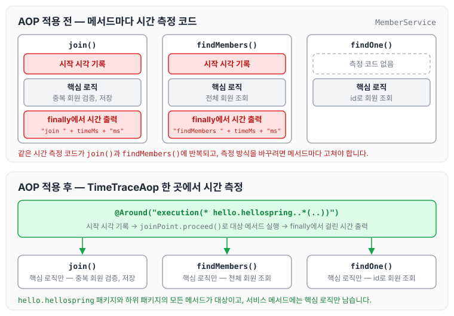
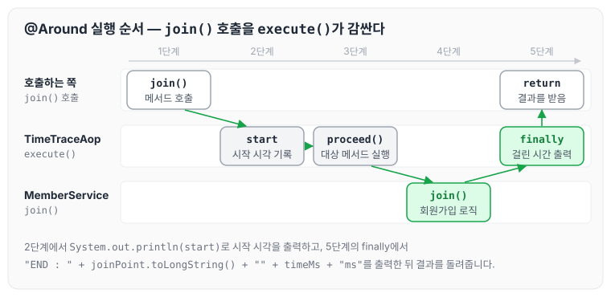

이전에 [스프링 데이터 JPA와 통합 테스트](../spring-intro-data-jpa/)에 대해 작성하였습니다. 이번에는 메서드의 실행 시간을 측정하는 예제를 통해 AOP가 필요한 상황과 사용법을 정리하도록 하겠습니다.

## AOP가 필요한 상황

'각각의 메서드의 실행 시간을 알고 싶다'는 요청이 들어왔습니다. 이때 코드는 핵심 관심사항(회원가입, 회원 조회 같은 핵심 로직)과 공통 관심사항(시간 측정), 이렇게 두 가지로 나뉘게 됩니다. 시간 측정 코드를 핵심 로직에 직접 넣은 예시는 아래와 같습니다.

```java
package hello.hellospring.service;

import hello.hellospring.domain.Member;
import hello.hellospring.repository.MemberRepository;
import org.springframework.beans.factory.annotation.Autowired;
import org.springframework.transaction.annotation.Transactional;

import java.util.List;
import java.util.Optional;

//test case 생성 alt + enter
@Transactional
public class MemberService {

    private final MemberRepository memberRepository;

    @Autowired
    public MemberService(MemberRepository memberRepository) {
        this.memberRepository = memberRepository;
    }

/**
     * 회원가입
     */
    public Long join(Member member) {
// alt + ctrl + v 함수 리턴 값을 변수로 자동완성
// 같이 이름이 있는 중복 회원 X
        long start = System.currentTimeMillis();
        try {
            validateDuplicateMember(member);//중복 회원 검증
            memberRepository.save(member);
            return member.getId();
        } finally {
            long finish = System.currentTimeMillis();
            long timeMs = finish - start;
            System.out.println("join " + timeMs + "ms");
        }
    }

    public List<Member> findMembers() {
        long start = System.currentTimeMillis();
        try {
            return memberRepository.findAll();
        } finally {
            long finish = System.currentTimeMillis();
            long timeMs = finish - start;
            System.out.println("findMembers " + timeMs + "ms");
        }
    }

    public Optional<Member> findOne(Long memberId) {
        return memberRepository.findById(memberId);
    }

// alt + ctrl + shift + t 함수로 뽑아내기
    private void validateDuplicateMember(Member member) {
        memberRepository.findByName(member.getName())
                .ifPresent(m -> {
                    throw new IllegalStateException("이미 존재하는 회원입니다.");
                });
    }

    public Optional<Member> findByName(String name) {
        return memberRepository.findByName(name);
    }
}
```

위 코드를 보면 시간 측정 코드와 핵심 로직이 한 메서드 안에 섞여 있어 유지보수가 어렵습니다. 또한 시간을 초 단위로 보고 싶다는 요청이 오면, 시간을 측정하는 메서드를 하나씩 수정해야 하므로 많은 시간이 소요됩니다. AOP를 사용하면 핵심 관심사항과 공통 관심사항을 나눠서 코드를 깔끔하게 정리할 수 있습니다.

AOP를 적용하기 전과 후를 비교하면 아래와 같습니다.



적용 전에는 시간 측정 코드가 메서드마다 반복되지만, 적용 후에는 시간 측정 코드가 TimeTraceAop 한 곳에만 있습니다.

## TimeTraceAop 작성

- java 폴더의 hello.hellospring.aop 패키지에 TimeTraceAop.java를 작성합니다.
- @Aspect : 흩어진 관심사를 모듈화한 클래스임을 나타냅니다.
- @Component : 스프링 빈으로 등록해 스프링 컨테이너가 관리하도록 합니다.
- @Around : 지정한 범위의 메서드가 실행될 때 그 앞뒤로 이 메서드를 실행합니다. 이 예제는 `execution(* hello.hellospring..*(..))`로 hello.hellospring 패키지와 하위 패키지의 모든 메서드를 대상으로 지정하였습니다.

```java
package hello.hellospring.aop;

import org.aspectj.lang.ProceedingJoinPoint;
import org.aspectj.lang.annotation.Around;
import org.aspectj.lang.annotation.Aspect;
import org.springframework.stereotype.Component;

@Aspect
@Component
public class TimeTraceAop {

    @Around("execution(* hello.hellospring..*(..))")
    public Object execute(ProceedingJoinPoint joinPoint) throws  Throwable {
        long start = System.currentTimeMillis();
        System.out.println(start);
        try {
            return joinPoint.proceed();
        } finally {
            long finish = System.currentTimeMillis();
            long timeMs = finish - start;
            System.out.println("END : " + joinPoint.toLongString() + "" + timeMs + "ms");
        }
    }
}
```

`joinPoint.proceed()`를 호출하면 실제 대상 메서드가 실행되고, 대상 메서드가 끝나면 finally에서 걸린 시간을 출력합니다. join()을 호출했을 때의 실행 순서는 아래와 같습니다.



시간 측정은 execute()에서만 일어나고, join()은 회원가입 로직만 실행합니다.

## 마무리

오늘은 메서드의 실행 시간 측정을 예로 들어 AOP가 필요한 상황과 사용법을 정리하였습니다. 관심사를 분리해서 핵심 로직과 시간 측정 기능을 나누었는데, 이렇게 기능을 분리하면 유지보수가 쉬워질 뿐 아니라 개발 속도에서도 이점이 있을 것 같습니다. AOP는 클린 코드 11장을 읽으면서 [11장 시스템 (2)](../clean-code-ch12-systems-2/)에 정리한 적이 있는데, 이번에 직접 사용해 보니 이해하기가 좀 더 수월하였습니다.

AOP에 대해 좀 더 자세하게 정리한 글도 있으니, 아래 링크를 함께 보면 이해하는 데 도움이 될 것 같습니다.

[https://cozing.tistory.com/54?category=1076708](https://cozing.tistory.com/54?category=1076708)

> 이 글은 인프런 김영한 님의 [스프링 입문 — 코드로 배우는 스프링 부트, 웹 MVC, DB 접근 기술](https://www.inflearn.com/course/스프링-입문-스프링부트)을 들으며 정리한 노트입니다.
