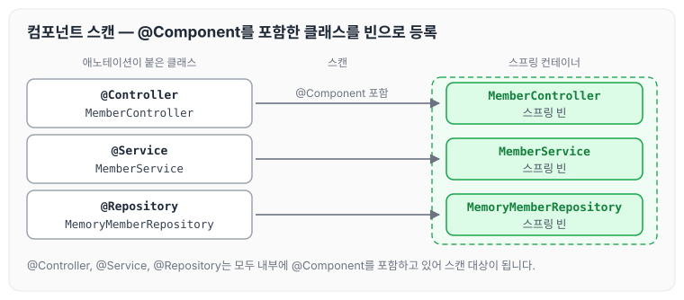
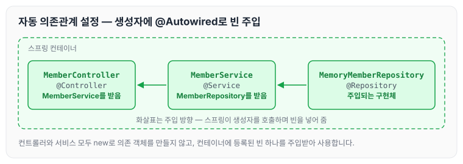

이전에 [회원 관리 예제 — 백엔드 개발 (2)](../spring-intro-member-backend-2/)에 대해 작성하였습니다. 앞 글까지는 서비스와 리포지토리를 만들고 테스트에서 직접 생성해 사용했는데, 이번에는 회원 컨트롤러가 회원 서비스와 리포지토리를 사용할 수 있도록 스프링 빈을 등록하고 의존관계를 설정하는 컴포넌트 스캔 방식에 대해 정리하도록 하겠습니다.

## 컴포넌트 스캔

컴포넌트 스캔은 아래와 같은 순서로 이루어집니다.

1. 스프링이 시작되면 스프링 컨테이너가 생성됩니다.
2. 스프링이 `@Component`가 붙은 클래스들을 스캔한 뒤 빈으로 스프링 컨테이너에 올려놓습니다. 이를 스프링 빈을 등록한다고 합니다.
3. 등록된 빈은 싱글톤으로 관리되고, 스프링이 DI를 통해 필요한 곳에 직접 넣어 줍니다.

`@Service`, `@Controller`, `@Repository`는 내부에 `@Component`를 포함하고 있기 때문에 빈으로 등록될 수 있습니다. 이처럼 내부의 `@Component`를 스캔해서 등록하는 것이기 때문에, 스프링에서는 이를 컴포넌트 스캔 방식이라고 합니다.



그림처럼 세 클래스에 붙은 애노테이션은 서로 다르지만, 모두 안에 `@Component`를 포함하고 있어서 스캔 대상이 됩니다. 컴포넌트 스캔의 탐색 위치와 기본 스캔 대상은 [컴포넌트 스캔](../spring-core-component-scan/)에 좀 더 자세히 정리해 두었습니다.

## 컨트롤러에 서비스 주입

먼저 MemberController입니다.

```java
package hello.hellospring.controller;

import hello.hellospring.service.MemberService;
import org.springframework.beans.factory.annotation.Autowired;
import org.springframework.stereotype.Controller;

@Controller
public class MemberController {

//스프링 컨테이너에 등록 하고 사용하는게좋다.
    private final MemberService memberService;

// DI를 통해서 스프링 컨테이너에서 넣어준다.
    @Autowired
    public MemberController(MemberService memberService) {
        this.memberService = memberService;
    }
}
```

위 코드를 보면 생성자를 통해 MemberService를 주입받는 것을 볼 수 있습니다. `@Service` 내부에 `@Component`가 선언되어 있어 MemberService가 스프링 컨테이너에 빈으로 등록되어 있기 때문에, 컨트롤러에서 Service를 직접 생성하지 않고 의존성 주입을 받을 수 있습니다.

## 서비스에 리포지토리 주입

MemberService도 같은 방식으로 생성자를 통해 MemberRepository를 주입받습니다.

```java
package hello.hellospring.service;

import hello.hellospring.domain.Member;
import hello.hellospring.repository.MemberRepository;
import hello.hellospring.repository.MemoryMemberRepository;
import org.springframework.stereotype.Service;

import java.util.List;
import java.util.Optional;

//test case 생성 alt + enter
@Service
public class MemberService {
	private final MemberRepository memberRepository;

    @Autowired
    public MemberService(MemberRepository memberRepository) {
        this.memberRepository = memberRepository;
    }
    ...
}
```

MemoryMemberRepository도 `@Repository` 내부에 `@Component`가 선언되어 있기 때문에 빈으로 등록하고 사용할 수 있습니다.

```java
package hello.hellospring.repository;

import hello.hellospring.domain.Member;
import org.springframework.stereotype.Repository;

import java.util.*;

@Repository
public class MemoryMemberRepository implements MemberRepository{
	...
}
```

세 클래스가 빈으로 등록된 뒤 생성자를 통해 서로 연결되는 모습은 아래와 같습니다.



컨트롤러와 서비스 어디에서도 `new`로 의존 객체를 만들지 않고, 스프링 컨테이너에 등록된 빈 하나를 생성자로 받아서 사용합니다. 빈이 싱글톤으로 관리되는 방식은 [싱글톤 컨테이너와 @Configuration](../spring-core-singleton/)에서 다뤘습니다.

## 마무리

오늘은 컴포넌트 스캔으로 스프링 빈을 등록하고, 생성자를 통해 의존관계를 자동으로 주입받는 방법에 대해 정리하였습니다. 스프링 컨테이너가 `@Component`를 스캔해서 빈으로 등록하면, 위와 같이 생성자에서 `new`를 쓰지 않고 DI를 통해 싱글톤 방식으로 하나의 객체를 사용할 수 있다는 것을 알 수 있었습니다.

다음 글에서는 [자바 코드로 스프링 빈 직접 등록하기](../spring-intro-java-config/)에 대해 정리하도록 하겠습니다.

> 이 글은 인프런 김영한 님의 [스프링 입문 — 코드로 배우는 스프링 부트, 웹 MVC, DB 접근 기술](https://www.inflearn.com/course/스프링-입문-스프링부트)을 들으며 정리한 노트입니다.
