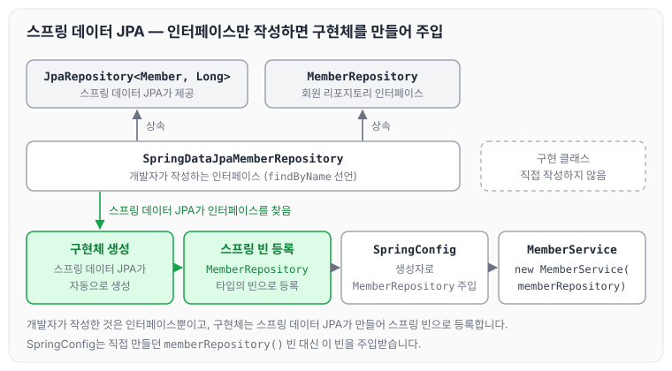
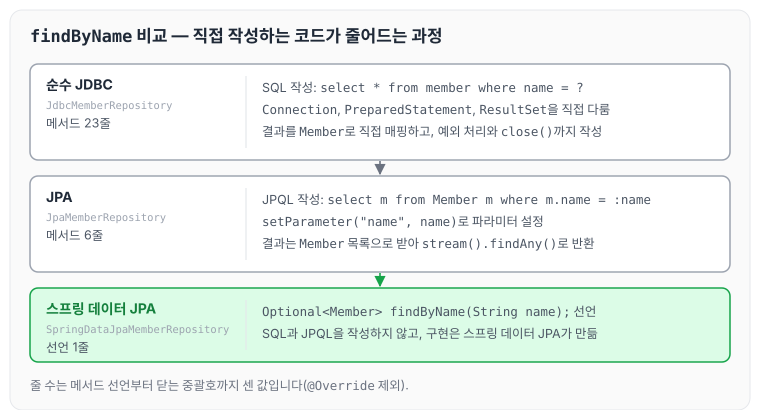

이전에 [스프링 JPA 통합 테스트](../spring-intro-jpa-test/)에 대해 작성하였습니다. 이번에는 스프링 데이터 JPA를 사용해 리포지토리를 만드는 방법을 정리하도록 하겠습니다.

스프링 데이터 JPA를 사용하면 리포지토리에 구현 클래스 없이 인터페이스만으로 개발을 완료할 수 있습니다.

## 1) SpringDataJpaMemberRepository 인터페이스 생성

1. SpringDataJpaMemberRepository 인터페이스가 `JpaRepository<Member, Long>`과 MemberRepository를 상속받도록 만듭니다.
2. 이렇게 상속을 받으면 스프링 데이터 JPA가 JpaRepository를 상속받은 인터페이스의 구현체를 자동으로 만들고, 만든 구현체를 스프링 빈으로 자동 등록합니다.
3. 이제 SpringConfig에서는 스프링 빈으로 등록된 MemberRepository를 사용하면 됩니다.

```java
package hello.hellospring.repository;

import hello.hellospring.domain.Member;
import org.springframework.data.jpa.repository.JpaRepository;

import java.util.Optional;

public interface SpringDataJpaMemberRepository extends JpaRepository<Member, Long>, MemberRepository {

    @Override
    Optional<Member> findByName(String name);
}
```

인터페이스만 작성했을 때 구현체가 만들어져 SpringConfig까지 전달되는 구조를 그림으로 보면 아래와 같습니다.



개발자가 작성하는 것은 인터페이스뿐이고, 구현체는 스프링 데이터 JPA가 만듭니다. 공통 인터페이스가 제공하는 기능은 [공통 인터페이스 기능](../data-jpa-common-interface/)에 따로 정리하였습니다.

여기서 findByName을 따로 선언한 이유를 부연하자면, 엔티티마다 조회할 때 사용하는 정보가 전부 다르기 때문에 이런 조회 메서드는 공통으로 제공되지 않고 직접 지정해 주어야 합니다. 또한 다른 속성을 더해서 조회하려면 findByNameAndId...와 같이 메서드 이름에 이어서 추가해 주면 됩니다. 메서드 이름으로 쿼리를 만드는 방법은 [쿼리 메소드 기능](../data-jpa-query-methods/)에 정리하였습니다.

같은 findByName을 [순수 JDBC 사용과 연동](../spring-intro-jdbc/)과 이전 글의 JPA, 그리고 스프링 데이터 JPA로 작성한 코드를 비교하면 아래와 같습니다.



순수 JDBC에서는 SQL, 커넥션, 결과 매핑을 모두 직접 작성했고, JPA에서는 JPQL만 작성했으며, 스프링 데이터 JPA에서는 메서드 선언만 남았습니다.

## 2) SpringConfig 의존성 주입

SpringConfig에서 직접 등록하던 memberRepository() 빈 설정을 주석 처리하고, 스프링 데이터 JPA가 자동으로 등록한 MemberRepository를 생성자로 주입받아 사용하도록 변경합니다.

```java
package hello.hellospring;
import hello.hellospring.repository.MemberRepository;
import hello.hellospring.service.MemberService;
import org.springframework.context.annotation.Bean;
import org.springframework.context.annotation.Configuration;

@Configuration
public class SpringConfig {

    private final MemberRepository memberRepository;

    public SpringConfig(MemberRepository memberRepository) {
        this.memberRepository = memberRepository;
    }

    @Bean
    public MemberService memberService() {
        return new MemberService(memberRepository);
    }

/*@Bean
    public MemberRepository memberRepository() {
        // return new MemoryMemberRepository();
        // return new JdbcMemberRepository(dataSource);
        // return new JdbcTemplateMemberRepository(dataSource);
        // return new JpaMemberRepository(em);
    }*/
}
```

## 마무리

오늘은 JpaRepository를 상속한 인터페이스만으로 리포지토리를 만들고, 스프링 데이터 JPA가 자동으로 등록한 구현체를 SpringConfig에서 주입받아 사용하는 방법을 정리하였습니다. 이제 쿼리를 하나도 작성하지 않고 인터페이스만으로 데이터 조회, 추가, 삭제 같은 간단한 기능을 사용할 수 있습니다. 복잡한 쿼리는 JdbcTemplate이나 마이바티스 등 여러 기술을 조합해서 조회하면 된다고 강의에서 설명합니다. 이후에 JPA를 따로 배울 예정이지만, 이 기술을 접하지 못한 사람이 코드를 봤을 때 어떻게 동작하는지 유추하기는 쉽지 않을 것 같습니다.

다음 글에서는 [AOP가 필요한 상황, 사용법](../spring-intro-aop/)에 대해 정리하도록 하겠습니다.

> 이 글은 인프런 김영한 님의 [스프링 입문 — 코드로 배우는 스프링 부트, 웹 MVC, DB 접근 기술](https://www.inflearn.com/course/스프링-입문-스프링부트)을 들으며 정리한 노트입니다.
