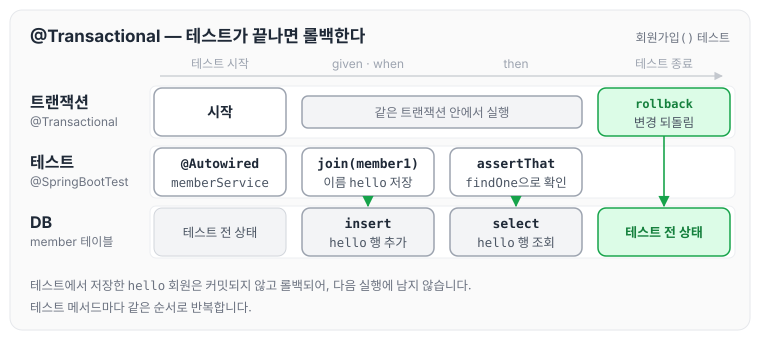

이전에 [순수 JDBC 사용과 연동](../spring-intro-jdbc/)에 대해 작성하였습니다. 오늘은 지금까지 만든 회원 기능을 스프링과 DB까지 연결한 상태에서 테스트하는 통합 테스트에 대해 정리하도록 하겠습니다.

## 통합 테스트 작성

`test > java > hello.hellospring > service` 경로에 `MemberServiceIntegrationTest.java`를 생성하고, 테스트 클래스에 아래 두 애노테이션을 붙입니다.

- `@SpringBootTest` : 스프링을 실제로 띄운 상태에서 테스트를 실행합니다.
- `@Transactional` : DB 테스트 중 insert, update, delete 된 내용을 확인한 후 롤백합니다. 테스트가 끝나면 DB가 원래 상태로 돌아가기 때문에 테스트를 반복해서 실행할 수 있습니다.

스프링이 띄워져 있으므로 `MemberService`와 `MemberRepository`는 `@Autowired`로 주입받습니다.

```java
package hello.hellospring.service;

import hello.hellospring.domain.Member;
import hello.hellospring.repository.MemberRepository;
import org.assertj.core.api.Assertions;
import org.junit.jupiter.api.Test;
import org.springframework.beans.factory.annotation.Autowired;
import org.springframework.boot.test.context.SpringBootTest;
import org.springframework.transaction.annotation.Transactional;

import static org.junit.jupiter.api.Assertions.assertThrows;

//이전에 실행 시켰던 것을 다시 재실행 shift + F10
@SpringBootTest
@Transactional
class MemberServiceIntegrationTest {

    @Autowired MemberService memberService;
    @Autowired MemberRepository memberRepository;

    @Test
    void 회원가입() {
//given 주어주다
        Member member1 = new Member();
        member1.setName("hello");

// when 실행했을때
        memberService.join(member1);

// then 결과값
        Assertions.assertThat(memberService.findOne(member1.getId()).get().equals(member1));
    }

    @Test
    void 중복_회원_예외() {
//given 주어주다
        Member member1 = new Member();
        member1.setName("spring");

        Member member2 = new Member();
        member2.setName("spring");

// when 실행했을때
        memberService.join(member1);
//then
        assertThrows(IllegalStateException.class, ()-> memberService.join(member2));
    }

    @Test
    void 회원조회() {
        Member member1 = new Member();
        member1.setName("typark");
        memberService.findByName(member1.getName());
        Assertions.assertThat(memberService.findMembers().size()).isEqualTo(1);
    }
}
```

테스트 메서드 하나가 실행될 때 `@Transactional`이 DB를 어떻게 되돌리는지 그림으로 나타내면 아래와 같습니다.



테스트 안에서 저장한 회원은 테스트가 끝나면 롤백됩니다. 그래서 `중복_회원_예외`처럼 이름이 spring인 회원을 저장하는 테스트를 다시 실행해도, 이전 실행에서 저장한 회원 때문에 실패하지 않습니다.

## 마무리

오늘은 `@SpringBootTest`와 `@Transactional`로 회원 서비스를 통합 테스트하는 방법에 대해 정리하였습니다. 두 애노테이션으로 테스트를 편하게 작성할 수 있었을 뿐만 아니라, 이전에 정리한 SpringConfig 덕분에 테스트 코드도 따로 바꾸지 않고 DB에 접근해 통합 테스트를 할 수 있었습니다.

다만 강사님 말씀으로는 테스트를 잘하는 사람들은 [회원 관리 예제 — 백엔드 개발 (2)](../spring-intro-member-backend-2/)의 `MemberServiceTest`처럼 메모리로 빠르게 단위 테스트를 한 후, 마지막에 스프링에 접근해서 통합 테스트를 한다고 합니다. 통합 테스트도 중요하지만, 정말 잘하는 개발자는 순수한 단위 테스트를 잘하는 개발자라는 말을 기억해 두려고 합니다.

다음 글에서는 [스프링 JPA 통합 테스트](../spring-intro-jpa-test/)에 대해 정리하도록 하겠습니다.

> 이 글은 인프런 김영한 님의 [스프링 입문 — 코드로 배우는 스프링 부트, 웹 MVC, DB 접근 기술](https://www.inflearn.com/course/스프링-입문-스프링부트)을 들으며 정리한 노트입니다.
