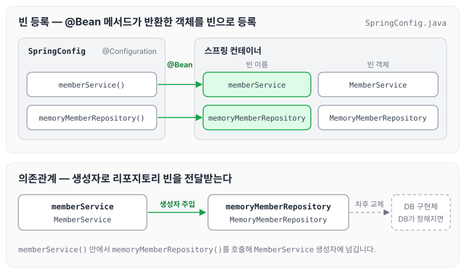

이전에 [컴포넌트 스캔과 자동 의존관계 설정](../spring-intro-component-scan/)에 대해 작성하였습니다. 오늘은 컴포넌트 스캔 대신 자바 코드로 스프링 빈을 직접 등록하는 방법을 정리하도록 하겠습니다.

예제 프로젝트는 아직 데이터베이스가 정해지지 않은 상황입니다. 이럴 때 SpringConfig로 빈을 직접 등록해 두면, 나중에 DB가 정해졌을 때 SpringConfig의 MemoryMemberRepository 부분만 수정하면 됩니다.

## SpringConfig 생성

`main > java > hello.hellospring` 경로에 `SpringConfig.java`를 생성합니다. 클래스에는 `@Configuration`을 붙이고, 빈으로 등록할 객체를 반환하는 메서드에는 `@Bean`을 붙입니다.

```java
package hello.hellospring;
import hello.hellospring.repository.MemoryMemberRepository;
import hello.hellospring.service.MemberService;
import org.springframework.context.annotation.Bean;
import org.springframework.context.annotation.Configuration;

@Configuration
public class SpringConfig {

    @Bean
    public MemberService memberService() {
        return new MemberService(memoryMemberRepository());
    }

    @Bean
    public MemoryMemberRepository memoryMemberRepository() {// 차후에 MySqlDBMemberRepository 처럼 해당하는 인터페이스 구현체를 통해 변경해준다.
        return new MemoryMemberRepository();
    }
}
```

`memberService()`는 `memoryMemberRepository()`를 호출해서 그 결과를 `MemberService`의 생성자에 넘깁니다. SpringConfig가 등록하는 빈과 의존관계를 그림으로 나타내면 아래와 같습니다.



DB가 정해지면 코드 주석처럼 이 부분을 해당 DB의 구현체로 바꾸면 됩니다. 실제로 DB 구현체로 바꾸는 과정은 [순수 JDBC 사용과 연동](../spring-intro-jdbc/)에서 정리하였습니다.

## 마무리

오늘은 SpringConfig 자바 클래스로 스프링 빈을 직접 등록하는 방법에 대해 정리하였습니다. 자바 코드로 빈을 직접 등록하는 방식은 아직 정해지지 않은 DB처럼 인터페이스의 구현체를 계속 바꿔야 하는 상황에서 사용하면 편리한 것 같습니다.

다음 글에서는 [회원 웹 기능 — 등록, 출력](../spring-intro-member-web/)에 대해 정리하도록 하겠습니다.

> 이 글은 인프런 김영한 님의 [스프링 입문 — 코드로 배우는 스프링 부트, 웹 MVC, DB 접근 기술](https://www.inflearn.com/course/스프링-입문-스프링부트)을 들으며 정리한 노트입니다.
