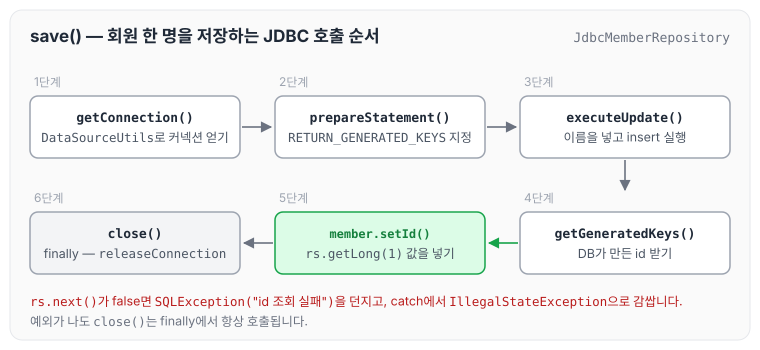
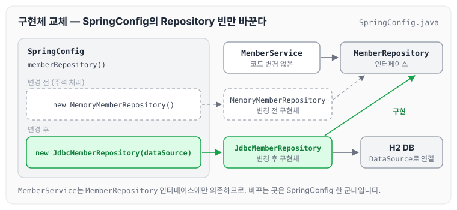

이전에 [H2 데이터베이스 설치와 연동](../spring-intro-h2/)에 대해 작성하였습니다. 오늘은 순수 JDBC로 MemberRepository를 구현하고, SpringConfig의 빈 설정만 바꿔서 메모리 저장소를 DB로 교체하는 과정을 정리하도록 하겠습니다.

## 1) JDBC 연동

JDBC를 연동하려면 [자바 코드로 스프링 빈 직접 등록하기](../spring-intro-java-config/)에서 만들어 둔 `SpringConfig.java` 파일이 필요합니다.

DataSource는 스프링이 `application.properties`의 환경설정 값을 토대로 스프링 컨테이너에 빈으로 등록합니다. 그래서 아래와 같이 `@Autowired`로 의존성 주입(DI)을 받을 수 있습니다.

```java
package hello.hellospring;
import hello.hellospring.repository.MemoryMemberRepository;
import hello.hellospring.service.MemberService;
import org.springframework.beans.factory.annotation.Autowired;
import org.springframework.context.annotation.Bean;
import org.springframework.context.annotation.Configuration;

import javax.sql.DataSource;

@Configuration
public class SpringConfig {

    private DataSource dataSource;

    @Autowired
    public SpringConfig(DataSource dataSource) {
        this.dataSource = dataSource;
    }
    ...
}
```

## 2) 순수 JDBC 구성

`MemberRepository` 인터페이스를 구현한 `JdbcMemberRepository`를 작성합니다. 여기서 주의해야 할 부분은 커넥션을 얻는 `getConnection()`입니다. 커넥션을 직접 꺼내 쓰면 트랜잭션이 걸려 있을 때 그 트랜잭션과 다른 커넥션을 사용하게 될 수 있으므로, 항상 `DataSourceUtils.getConnection()`을 통해서 Connection을 받아야 합니다. 커넥션을 닫을 때도 마찬가지로 `DataSourceUtils.releaseConnection()`을 사용합니다.

```java
package hello.hellospring.repository;

import hello.hellospring.domain.Member;
import org.springframework.jdbc.datasource.DataSourceUtils;

import javax.sql.DataSource;
import java.sql.*;
import java.util.ArrayList;
import java.util.List;
import java.util.Optional;

public class JdbcMemberRepository implements MemberRepository {
    private final DataSource dataSource;

    public JdbcMemberRepository(DataSource dataSource) {
        this.dataSource = dataSource;
    }

    @Override
    public Member save(Member member) {
        String sql = "insert into member(name) values(?)";
        Connection conn = null;
        PreparedStatement pstmt = null;
        ResultSet rs = null;// 결과를 받는다.
        try {
            conn = getConnection();
            pstmt = conn.prepareStatement(sql, Statement.RETURN_GENERATED_KEYS);//

            pstmt.setString(1, member.getName());

            pstmt.executeUpdate();
            rs = pstmt.getGeneratedKeys();// RETURN_GENERATED_KEYS와 매칭되서 사용된다. key 값을 반환 받는다.
            if (rs.next()) {
                member.setId(rs.getLong(1));
            } else {
                throw new SQLException("id 조회 실패");
            }
            return member;
        } catch (Exception e) {
            throw new IllegalStateException(e);
        } finally {
            close(conn, pstmt, rs);
        }
    }

    @Override
    public Optional<Member> findById(Long id) {
        String sql = "select * from member where id = ?";
        Connection conn = null;
        PreparedStatement pstmt = null;
        ResultSet rs = null;
        try {
            conn = getConnection();
            pstmt = conn.prepareStatement(sql);
            pstmt.setLong(1, id);
            rs = pstmt.executeQuery();
            if (rs.next()) {
                Member member = new Member();
                member.setId(rs.getLong("id"));
                member.setName(rs.getString("name"));
                return Optional.of(member);
            } else {
                return Optional.empty();
            }
        } catch (Exception e) {
            throw new IllegalStateException(e);
        } finally {
            close(conn, pstmt, rs);
        }
    }

    @Override
    public List<Member> findAll() {
        String sql = "select * from member";
        Connection conn = null;
        PreparedStatement pstmt = null;
        ResultSet rs = null;
        try {
            conn = getConnection();
            pstmt = conn.prepareStatement(sql);
            rs = pstmt.executeQuery();
            List<Member> members = new ArrayList<>();
            while (rs.next()) {
                Member member = new Member();
                member.setId(rs.getLong("id"));
                member.setName(rs.getString("name"));
                members.add(member);
            }
            return members;
        } catch (Exception e) {
            throw new IllegalStateException(e);
        } finally {
            close(conn, pstmt, rs);
        }
    }

    @Override
    public Optional<Member> findByName(String name) {
        String sql = "select * from member where name = ?";
        Connection conn = null;
        PreparedStatement pstmt = null;
        ResultSet rs = null;
        try {
            conn = getConnection();
            pstmt = conn.prepareStatement(sql);
            pstmt.setString(1, name);
            rs = pstmt.executeQuery();
            if (rs.next()) {
                Member member = new Member();
                member.setId(rs.getLong("id"));
                member.setName(rs.getString("name"));
                return Optional.of(member);
            }
            return Optional.empty();
        } catch (Exception e) {
            throw new IllegalStateException(e);
        } finally {
            close(conn, pstmt, rs);
        }
    }

    private Connection getConnection() {
        return DataSourceUtils.getConnection(dataSource);// 이전의 트랜잭션에 걸릴수 있으므로 항상 DataSourceUtils.getConnect을 통해서 받아와야된다.
    }

    private void close(Connection conn, PreparedStatement pstmt, ResultSet rs) {
        try {
            if (rs != null) {
                rs.close();
            }
        } catch (SQLException e) {
            e.printStackTrace();
        }
        try {
            if (pstmt != null) {
                pstmt.close();
            }
        } catch (SQLException e) {
            e.printStackTrace();
        }
        try {
            if (conn != null) {
                close(conn);
            }
        } catch (SQLException e) {
            e.printStackTrace();
        }
    }

    private void close(Connection conn) throws SQLException {
        DataSourceUtils.releaseConnection(conn, dataSource);
    }
}
```

`save()`를 예로 들면, 회원 한 명을 저장할 때 아래 순서로 JDBC API를 호출합니다.



`prepareStatement()`에 `Statement.RETURN_GENERATED_KEYS`를 넘겼기 때문에, insert 후 `getGeneratedKeys()`로 DB가 만든 id 값을 받을 수 있습니다. 조회 메서드인 `findById()`, `findAll()`, `findByName()`도 커넥션을 얻고 쿼리를 실행한 뒤 `finally`에서 `close()`를 호출하는 흐름은 같고, `executeQuery()`로 받은 `ResultSet`에서 회원 정보를 꺼낸다는 점만 다릅니다.

## 3) 메모리에서 DB로 변경하기

앞서 SpringConfig를 설명할 때, DB를 언제든지 바꿀 수 있도록 SpringConfig로 빈을 등록한다고 정리하였습니다. 아래 예제처럼 SpringConfig에서 Repository 빈만 바꾸면, 다른 소스는 변경하지 않고 바로 DB로 바꿀 수 있습니다.

```java
package hello.hellospring;
import hello.hellospring.repository.JdbcMemberRepository;
import hello.hellospring.repository.MemberRepository;
import hello.hellospring.service.MemberService;
import org.springframework.beans.factory.annotation.Autowired;
import org.springframework.context.annotation.Bean;
import org.springframework.context.annotation.Configuration;

import javax.sql.DataSource;

@Configuration
public class SpringConfig {

    private DataSource dataSource;

    @Autowired
    public SpringConfig(DataSource dataSource) {
        this.dataSource = dataSource;
    }

    ...

    @Bean
    public MemberRepository memberRepository() {
//return new MemoryMemberRepository();
        return new JdbcMemberRepository(dataSource);
    }
}
```

`MemberService`는 `MemberRepository` 인터페이스에만 의존하기 때문에, 스프링 컨테이너가 어떤 구현체를 넣어 주는지만 바뀝니다. 바꾸기 전과 후를 그림으로 나타내면 아래와 같습니다.



## 마무리

오늘은 순수 JDBC로 `JdbcMemberRepository`를 구현하고, SpringConfig에서 Repository 빈만 바꿔 메모리 저장소를 DB로 교체하는 과정에 대해 정리하였습니다. SpringConfig의 환경설정만 바꿔서 Repository를 바로 교체할 수 있다는 점에서 스프링을 잘 활용하면 정말 유연하게 코드를 작성할 수 있다는 것을 알 수 있었고, 정리를 하면서 각각의 동작이 좀 더 머릿속에 자리 잡는 것 같습니다.

다음 글에서는 [스프링 통합 테스트](../spring-intro-integration-test/)에 대해 정리하도록 하겠습니다.

> 이 글은 인프런 김영한 님의 [스프링 입문 — 코드로 배우는 스프링 부트, 웹 MVC, DB 접근 기술](https://www.inflearn.com/course/스프링-입문-스프링부트)을 들으며 정리한 노트입니다.
