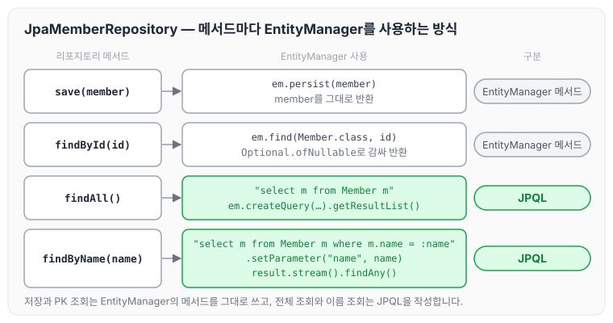
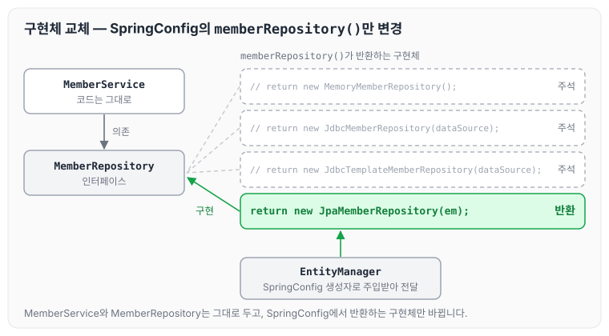

이전에 [스프링 통합 테스트](../spring-intro-integration-test/)에 대해 작성하였습니다. 이번에는 지금까지 JDBC로 구현한 회원 리포지토리를 JPA로 바꾸는 과정을 정리하도록 하겠습니다.

JPA를 사용하면 SQL과 데이터 중심의 설계에서 객체 중심의 설계로 패러다임을 전환할 수 있고, 개발 생산성도 크게 높일 수 있습니다. JPA 자체의 구동 방식은 [JPA 시작하기](../jpa-getting-started/)에 따로 정리하였습니다.

## 1) build.gradle 라이브러리 추가

기존에 사용하던 jdbc 라이브러리를 주석 처리하고 data-jpa 라이브러리를 추가합니다.

```gradle
dependencies {
	implementation 'org.springframework.boot:spring-boot-starter-thymeleaf'
	implementation 'org.springframework.boot:spring-boot-starter-web'
//implementation 'org.springframework.boot:spring-boot-starter-jdbc'
	implementation 'org.springframework.boot:spring-boot-starter-data-jpa'
	runtimeOnly 'com.h2database:h2'
	testImplementation 'org.springframework.boot:spring-boot-starter-test'
}
```

## 2) application.properties 설정

JPA 관련 설정 값을 application.properties에 추가합니다.

- spring.jpa.show-sql=true : JPA가 생성하는 SQL을 출력합니다.
- spring.jpa.hibernate.ddl-auto=none : JPA는 테이블을 자동으로 생성하는 기능을 제공하는데, 이 기능을 끕니다.

```properties
spring.datasource.url=jdbc:h2:tcp://localhost/~/test
spring.datasource.driver-class-name=org.h2.Driver
spring.datasource.username=sa

spring.jpa.show-sql=true
spring.jpa.hibernate.ddl-auto=none
```

## 3) Member 엔티티 매핑

Member 객체를 JPA 엔티티로 매핑합니다.

- @Id : PK를 나타냅니다.
- @GeneratedValue(strategy = GenerationType.IDENTITY) : 기본 키 생성을 데이터베이스에 맡기는 전략입니다. GenerationType.IDENTITY 옵션을 지정해야 auto_increment가 적용됩니다.

기본 키 생성 전략은 [엔티티 매핑](../jpa-entity-mapping/)에 따로 정리하였습니다.

```java
package hello.hellospring.domain;

import javax.persistence.Entity;
import javax.persistence.GeneratedValue;
import javax.persistence.GenerationType;
import javax.persistence.Id;

@Entity
public class Member {

    @Id//PK를 나타낸다.
    @GeneratedValue(strategy = GenerationType.IDENTITY)//GenerationType.IDENTITY 옵션을 추가해야만 auto_increment가 된다.
    Long id;
    String name;

    public String getName() {
        return name;
    }

    public void setName(String name) {
        this.name = name;
    }

    public Long getId() {
        return id;
    }

    public void setId(Long id) {
        this.id = id;
    }
}
```

## 4) MemberService 트랜잭션 추가

JPA는 모든 데이터 변경을 트랜잭션 안에서 실행해야 합니다. 그래서 MemberService에 `@Transactional`을 붙입니다. 현재 클래스에서 데이터를 변경하는 것은 회원가입의 저장뿐이므로, join 메서드에만 걸어도 상관없습니다.

```java
package hello.hellospring.service;

import hello.hellospring.domain.Member;
import hello.hellospring.repository.MemberRepository;
import hello.hellospring.repository.MemoryMemberRepository;
import org.springframework.beans.factory.annotation.Autowired;
import org.springframework.stereotype.Service;
import org.springframework.transaction.annotation.Transactional;

import java.util.List;
import java.util.Optional;

//test case 생성 alt + enter
@Transactional
public class MemberService {
	...
}
```

## 5) JpaMemberRepository 구현

JPA는 EntityManager를 통해 동작합니다. EntityManager는 application.properties 설정을 바탕으로 스프링 컨테이너에 빈으로 등록되므로, 리포지토리에서는 생성자로 의존성 주입을 받아 사용하면 됩니다.

```java
package hello.hellospring.repository;

import hello.hellospring.domain.Member;

import javax.persistence.EntityManager;
import java.util.List;
import java.util.Optional;

public class JpaMemberRepository implements MemberRepository {
    private final EntityManager em;

//application.properties에서 Spring 컨테이너에 빈으로 등록됨
//EntityManager를 의존성 주입 받아야된다.
    public JpaMemberRepository(EntityManager em) {
        this.em = em;
    }

    public Member save(Member member) {
        em.persist(member);
        return member;
    }

    public Optional<Member> findById(Long id) {
        Member member = em.find(Member.class, id);
        return Optional.ofNullable(member);
    }

    public List<Member> findAll() {
        return em.createQuery("select m from Member m", Member.class)
                .getResultList();
    }

    public Optional<Member> findByName(String name) {
        List<Member> result = em.createQuery("select m from Member m where m.name = :name ", Member.class)
                .setParameter("name", name)
                .getResultList();
        return result.stream().findAny();
    }
}
```

각 메서드가 EntityManager를 어떻게 사용하는지 정리하면 아래와 같습니다.



저장과 PK 조회는 EntityManager가 제공하는 메서드를 그대로 사용하고, 전체 조회와 이름 조회는 JPQL을 작성해서 조회합니다. JPQL은 [JPQL 기본 문법](../jpa-jpql-basics/)에 따로 정리하였습니다.

## 6) SpringConfig에서 JpaMemberRepository로 변경

SpringConfig에서 JpaMemberRepository를 사용하려면 EntityManager를 의존성 주입으로 받아서 넘겨 주어야 합니다.

```java
package hello.hellospring;
import hello.hellospring.repository.JdbcMemberRepository;
import hello.hellospring.repository.JdbcTemplateMemberRepository;
import hello.hellospring.repository.JpaMemberRepository;
import hello.hellospring.repository.MemberRepository;
import hello.hellospring.service.MemberService;
import org.springframework.beans.factory.annotation.Autowired;
import org.springframework.context.annotation.Bean;
import org.springframework.context.annotation.Configuration;

import javax.persistence.Entity;
import javax.persistence.EntityManager;
import javax.sql.DataSource;

@Configuration
public class SpringConfig {

    private DataSource dataSource;
    private EntityManager em;

    @Autowired
    public SpringConfig(DataSource dataSource, EntityManager em) {
        this.dataSource = dataSource;
        this.em = em;
    }

    @Bean
    public MemberService memberService() {
        return new MemberService(memberRepository());
    }

    @Bean
    public MemberRepository memberRepository() {
// return new MemoryMemberRepository();
// return new JdbcMemberRepository(dataSource);
// return new JdbcTemplateMemberRepository(dataSource);
        return new JpaMemberRepository(em);
    }
}
```

MemberService는 MemberRepository 인터페이스에만 의존하므로, 구현체를 바꿀 때는 SpringConfig의 memberRepository()가 반환하는 객체만 바꾸면 됩니다. 이 관계를 그림으로 보면 아래와 같습니다.



MemberService의 코드는 그대로 두고, SpringConfig에서 반환하는 구현체만 JpaMemberRepository로 바뀐 것을 확인할 수 있습니다.

## 마무리

오늘은 JPA 라이브러리와 설정을 추가하고, Member를 엔티티로 매핑한 뒤 EntityManager를 사용하는 JpaMemberRepository로 리포지토리를 교체하는 과정을 정리하였습니다. JPA를 사용하니 직접 작성하는 쿼리가 눈에 띄게 줄었습니다. 이것만으로 현업에서 사용할 수 있을까 싶을 정도로 간단해져서 다른 기능들도 더 살펴보고 싶었고, JPA 강의도 제대로 들어 봐야 할 것 같습니다.

다음 글에서는 [스프링 데이터 JPA와 통합 테스트](../spring-intro-data-jpa/)에 대해 정리하도록 하겠습니다.

> 이 글은 인프런 김영한 님의 [스프링 입문 — 코드로 배우는 스프링 부트, 웹 MVC, DB 접근 기술](https://www.inflearn.com/course/스프링-입문-스프링부트)을 들으며 정리한 노트입니다.
