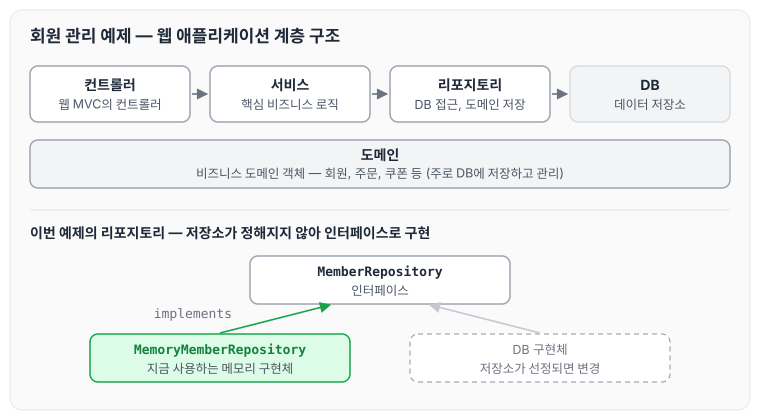
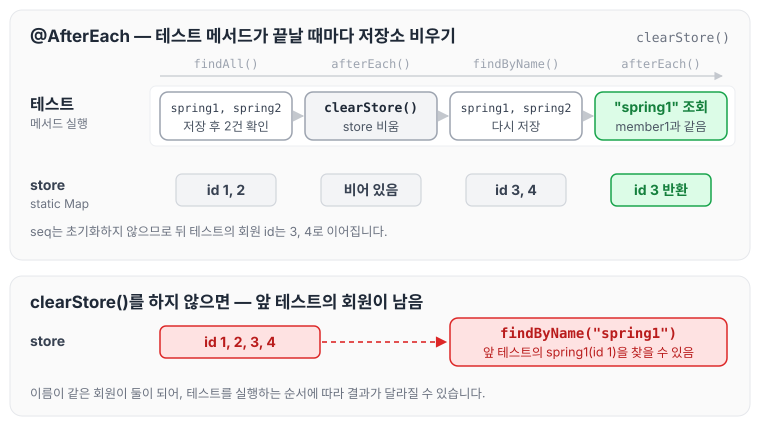

이전에 [웹 개발 기초: 정적 컨텐츠, MVC와 템플릿 엔진](../spring-intro-web-basics/)에 대해 작성하였습니다. 이번에는 회원 관리 예제의 백엔드를 개발하면서 회원 도메인과 리포지토리를 설계하고, JUnit으로 테스트하는 방법을 정리하도록 하겠습니다.

## 비즈니스 요구사항

예제의 비즈니스 요구사항은 아래와 같습니다.

- 데이터 : 회원 ID, 이름
- 기능 : 회원 등록, 조회
- 아직 데이터 저장소가 선정되지 않음(가상의 시나리오)

## 일반적인 웹 애플리케이션 계층 구조

일반적인 웹 애플리케이션은 아래와 같은 계층으로 구성합니다.

- 컨트롤러 : 웹 MVC의 컨트롤러 역할
- 서비스 : 핵심 비즈니스 로직 구현
- 리포지토리 : 데이터베이스에 접근, 도메인 객체를 DB에 저장하고 관리
- 도메인 : 비즈니스 도메인 객체, 예) 회원, 주문, 쿠폰 등 주로 데이터베이스에 저장하고 관리됨

계층 구조와 이번 예제의 리포지토리 구성을 그림으로 보면 아래와 같습니다.



아직 데이터 저장소가 정해지지 않았기 때문에 리포지토리는 인터페이스로 두고, 우선 메모리 구현체를 사용합니다.

## Repository 인터페이스 구현

현재 비즈니스 요구사항에서는 데이터 저장소가 선정되지 않았다고 가정하기 때문에, 리포지토리를 인터페이스로 구현하고 차후 저장소가 선정되면 구현체를 변경합니다.

```java
package hello.hellospring.repository;

import hello.hellospring.domain.Member;

import java.util.List;
import java.util.Optional;

public interface MemberRepository {
    Member save(Member member);// 저장
		Optional<Member> findById(Long id);// 아이디 조회
		Optional<Member> findByName(String name);// 이름으로 조회
		List<Member> findAll();// 전체 조회
}
```

## Member 도메인 구현

id는 저장할 때 자동으로 부여되도록 `Long` 타입으로 설정합니다.

```java
package hello.hellospring.domain;

public class Member {

    Long id;
    String name;

    public String getName() {
        return name;
    }

    public void setName(String name) {
        this.name = name;
    }

    public Long getId() {
        return id;
    }

    public void setId(Long id) {
        this.id = id;
    }
}
```

## MemoryMemberRepository 구현체 구현

저장소는 모든 곳에서 같은 데이터를 사용해야 하므로 static으로 구현했고, Map을 사용해서 key 값으로 회원을 조회할 수 있게 설계했습니다.

```java
package hello.hellospring.repository;

import hello.hellospring.domain.Member;

import java.util.*;

public class MemoryMemberRepository implements MemberRepository{
    private static Map<Long, Member> store = new HashMap<>();
    private static long seq = 0L;

    @Override
    public Member save(Member member) {
        member.setId(++seq);
        store.put(member.getId(), member);
        return member;
    }

    @Override
    public Optional<Member> findById(Long id) {
        return Optional.ofNullable(store.get(id));
    }

    @Override
    public Optional<Member> findByName(String name) {
        return store.values().stream().filter(member -> member.getName().equals(name)).findAny();
    }

    @Override
    public List<Member> findAll() {
        return new ArrayList<>(store.values());
    }

    public void clearStore() {
        store.clear();
    }
}
```

## JUnit 테스트 구현

도메인과 리포지토리 설계를 마쳤다면 간단한 테스트가 가능합니다. test > java > hello.hellospring > repository 아래에 MemoryMemberRepositoryTest를 만듭니다.

```java
package hello.hellospring.repository;

import hello.hellospring.domain.Member;
import org.junit.jupiter.api.AfterEach;
import org.junit.jupiter.api.Test;

import static org.assertj.core.api.Assertions.*;

public class MemoryMemberRepositoryTest {
    MemoryMemberRepository repository = new MemoryMemberRepository();

    @AfterEach
    public void afterEach() {
        repository.clearStore();
    }

    @Test
    public void save() {
        Member member = new Member();
        member.setName("spring");

        repository.save(member);

        assertThat(repository.findById(member.getId()).get()).isEqualTo(member);
    }

    @Test
    public void findByName() {
        Member member1 = new Member();
        member1.setName("spring1");
        repository.save(member1);

        Member member2 = new Member();
        member2.setName("spring2");
        repository.save(member2);

        assertThat(repository.findByName("spring1").get()).isEqualTo(member1);
    }

    @Test
    public void findById() {
        Member member1 = new Member();
        member1.setName("spring1");
        repository.save(member1);

        Member member2 = new Member();
        member2.setName("spring2");
        repository.save(member2);

        assertThat(repository.findById(member1.getId()).get()).isEqualTo(member1);
    }

    @Test
    public void findAll() {
        Member member1 = new Member();
        member1.setName("spring1");
        repository.save(member1);

        Member member2 = new Member();
        member2.setName("spring2");
        repository.save(member2);

        assertThat(repository.findAll().size()).isEqualTo(2);
    }

}
```

테스트에서 사용한 애노테이션과 함수는 아래와 같습니다.

- `@AfterEach` : 각 테스트 메서드가 끝나는 시점에 항상 실행되는 애노테이션입니다.
- `@Test` : JUnit 애노테이션으로, 해당 메서드가 테스트 메서드이며 각자 실행된다는 것을 명시합니다.
- `assertThat` : 기대한 값과 실제 값이 같은지 확인하는 함수입니다.

모든 테스트는 순서와 상관없이 메서드별로 따로 동작해야 합니다. 이 때문에 `afterEach`에서 테스트 메서드가 하나 끝날 때마다 MemoryMemberRepository를 `clearStore()`로 초기화합니다. 테스트 두 개가 이어서 실행될 때 저장소가 어떻게 바뀌는지 보면 아래와 같습니다.



저장소가 static이라 테스트 메서드가 바뀌어도 데이터가 남기 때문에, 비우지 않으면 앞 테스트에서 저장한 회원이 다음 테스트의 결과에 영향을 줄 수 있습니다. `clearStore()`는 store만 비우고 seq는 초기화하지 않으므로, 뒤 테스트의 회원 id는 3, 4로 이어집니다.

이를 통해 순서와 상관없이 각각의 메서드를 테스트하고 잘 동작하는지 확인할 수 있습니다. 물론 클래스 전체를 한 번에 실행할 수도 있습니다.

## 마무리

오늘은 회원 관리 예제의 도메인과 리포지토리를 설계하고, JUnit으로 저장·조회 기능을 테스트하는 방법에 대해 정리하였습니다. 개인적으로는 테스트 클래스를 만들고 메서드별로 테스트하는 것을 이번에 처음 접해 보았습니다. 개발을 하다 보면 테스트보다는 동작을 우선시하게 되는데, 이런 테스트가 있다면 생각하지 못한 예외에 좀 더 유연하게 대처할 수 있을 것 같습니다. 이런 간단한 테스트뿐만 아니라 TDD도 공부해야겠다는 생각이 들었습니다.

다음 글에서는 [회원 관리 예제 — 백엔드 개발 (2)](../spring-intro-member-backend-2/)에 대해 정리하도록 하겠습니다.

> 이 글은 인프런 김영한 님의 [스프링 입문 — 코드로 배우는 스프링 부트, 웹 MVC, DB 접근 기술](https://www.inflearn.com/course/스프링-입문-스프링부트)을 들으며 정리한 노트입니다.
