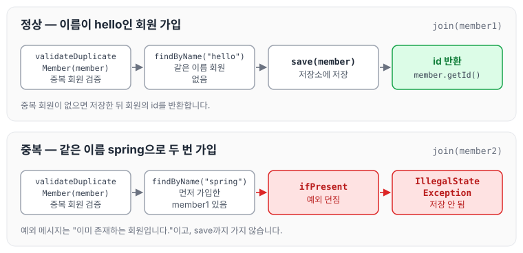
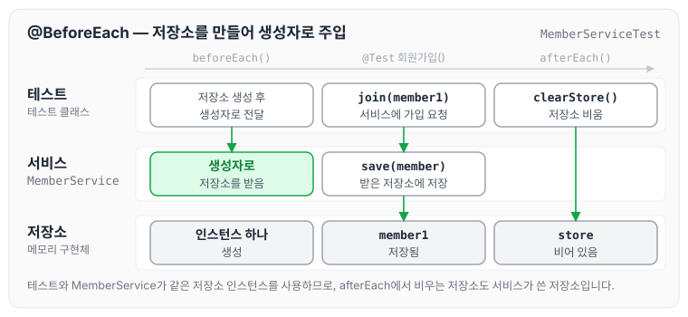

이전에 [회원 관리 예제 — 백엔드 개발 (1)](../spring-intro-member-backend-1/)에 대해 작성하였습니다. 앞 글에서는 회원 도메인과 리포지토리를 만들고 테스트했는데, 이번에는 회원가입과 조회 로직을 담은 서비스를 구현하고 정상 케이스와 예외 케이스를 테스트하는 방법을 정리하도록 하겠습니다.

## Service 구현

Service를 구현하다 보면 메서드 이름이 비즈니스에서 쓰는 용어와 비슷하다는 것을 알 수 있습니다. 그래야 기획자가 말하는 부분의 로직을 찾기가 쉽기 때문입니다. 반면 Model 같은 경우는 단순히 기계적으로, 개발에 맞는 용어로 만듭니다.

```java
package hello.hellospring.service;

import hello.hellospring.domain.Member;
import hello.hellospring.repository.MemberRepository;
import hello.hellospring.repository.MemoryMemberRepository;

import java.util.List;
import java.util.Optional;

public class MemberService {
    MemberRepository memberRepository = new MemoryMemberRepository();

/**
     * 회원가입
     */
    public Long join(Member member) {
// alt + ctrl + v 함수 리턴 값을 변수로 자동완성
// 같이 이름이 있는 중복 회원 X
        validateDuplicateMember(member);// 중복회원 검증
        this.memberRepository.save(member);
        return member.getId();
    }

    public List<Member> findMembers() {
        return memberRepository.findAll();
    }

    public Optional<Member> findOne(Long memberId) {
        return memberRepository.findById(memberId);
    }

// alt + ctrl + shift + t 함수로 뽑아내기
    private void validateDuplicateMember(Member member) {
        memberRepository.findByName(member.getName())
                .ifPresent(m -> {
                    throw new IllegalStateException("이미 존재하는 회원입니다.");
                });
    }
}
```

`join`은 먼저 `validateDuplicateMember`로 같은 이름의 회원이 있는지 확인한 뒤 저장하고, 저장된 회원의 id를 반환합니다. 같은 이름의 회원이 이미 있으면 `IllegalStateException`을 던집니다. 두 경우를 그림으로 보면 아래와 같습니다.



## JUnit 테스트 구현

Service를 구현했으므로 테스트 케이스를 작성합니다. test > java > hello.hellospring > service 아래에 MemberServiceTest.java를 만듭니다.

```java
package hello.hellospring.service;

import hello.hellospring.domain.Member;
import hello.hellospring.repository.MemoryMemberRepository;
import org.assertj.core.api.Assertions;
import org.junit.jupiter.api.AfterEach;
import org.junit.jupiter.api.BeforeEach;
import org.junit.jupiter.api.Test;

import static org.junit.jupiter.api.Assertions.assertThrows;

//이전에 실행 시켰던 것을 다시 재실행 shift + F10
class MemberServiceTest {
    MemberService memberService;
    MemoryMemberRepository memberRepository;

    @BeforeEach
    public void beforeEach() {
        memberRepository = new MemoryMemberRepository();
        memberService = new MemberService(memberRepository);
    }

    @AfterEach
    public void afterEach() {
        memberRepository.clearStore();
    }

    @Test
    void 회원가입() {
//given 주어주다
        Member member1 = new Member();
        member1.setName("hello");

// when 실행했을때
        memberService.join(member1);

// then 결과값
        Assertions.assertThat(memberService.findOne(member1.getId()).get().equals(member1));
    }

    @Test
    void 중복_회원_예외() {
//given 주어주다
        Member member1 = new Member();
        member1.setName("spring");

        Member member2 = new Member();
        member2.setName("spring");

// when 실행했을때
        memberService.join(member1);
//then
        assertThrows(IllegalStateException.class, ()-> memberService.join(member2));

/*
        try {
            memberService.join(member2);
            fail();
        } catch ( IllegalStateException e) {
            Assertions.assertThat(e.getMessage()).isEqualTo("이미 존재하는 회원입니다.");
        }
    */
    }

    @Test
    void 회원조회() {
        Member member1 = new Member();
        member1.setName("spring3");
        memberService.join(member1);
        Assertions.assertThat(memberService.findMembers().size()).isEqualTo(1);
    }

    @Test
    void findOne() {
        Member member1 = new Member();
        member1.setName("spring");
        memberService.join(member1);
        Assertions.assertThat(memberService.findOne(member1.getId()).get()).isEqualTo(member1);
    }
}
```

테스트는 주석으로 given(주어진 값), when(실행했을 때), then(결과값)을 나누어 작성했습니다. 테스트 케이스는 잘 되는 경우도 있지만, 예외가 잘 나오는지도 확인해야 합니다. 이 때문에 `중복_회원_예외` 테스트를 만들어서 같은 이름으로 두 번 가입할 때 예외가 발생하는지 확인합니다.

테스트에서 사용한 기능은 아래와 같습니다.

- `assertThrows` : 실행한 함수에서 발생한 Exception이 지정한 `IllegalStateException`이 맞는지 확인합니다.
- `@BeforeEach` : 각 `@Test` 메서드가 실행되기 전에 항상 실행되는 애노테이션입니다.

`beforeEach`에서는 MemoryMemberRepository를 먼저 만들고, 이를 MemberService의 생성자로 넘겨 줍니다. 이렇게 서비스가 사용할 저장소를 외부에서 생성자를 통해 넣어 주는 것이 DI입니다. 테스트에서 `new MemberService(memberRepository)`로 생성하려면 MemberService도 위 코드처럼 저장소를 직접 `new`로 만들지 않고, 생성자로 받도록 바꿔야 합니다. 생성자로 받는 형태의 MemberService는 [컴포넌트 스캔과 자동 의존관계 설정](../spring-intro-component-scan/)의 코드에서 볼 수 있습니다.



그림처럼 테스트와 MemberService가 같은 저장소 인스턴스를 사용하므로, `afterEach`에서 `clearStore()`로 비우는 저장소도 서비스가 사용한 바로 그 저장소입니다.

DI에 대해서는 [이전에 작성한 글](https://cozing.tistory.com/53?category=1076708)에 좀 더 자세히 정리해 두었습니다.

## 마무리

오늘은 회원 서비스를 구현하고, given-when-then으로 정상 케이스와 예외 케이스를 테스트하는 방법에 대해 정리하였습니다. 이를 통해 Model과 Service의 흐름을 익힐 수 있었고, 테스트 케이스로 예외까지 확인하는 방법을 알 수 있었습니다.

다음 글에서는 [컴포넌트 스캔과 자동 의존관계 설정](../spring-intro-component-scan/)에 대해 정리하도록 하겠습니다.

> 이 글은 인프런 김영한 님의 [스프링 입문 — 코드로 배우는 스프링 부트, 웹 MVC, DB 접근 기술](https://www.inflearn.com/course/스프링-입문-스프링부트)을 들으며 정리한 노트입니다.
