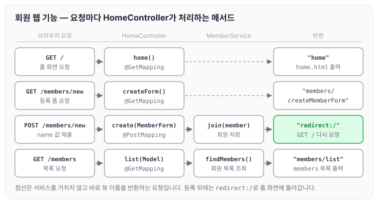

이전에 [자바 코드로 스프링 빈 직접 등록하기](../spring-intro-java-config/)에 대해 작성하였습니다. 오늘은 Thymeleaf로 홈 화면, 회원 등록 폼, 회원 목록 화면을 만들고, HomeController에서 회원 등록과 조회 요청을 처리하는 과정을 정리하도록 하겠습니다.

## 1) Index 페이지 구성

기본 url로 접근했을 때 Index 페이지가 보이도록 화면을 구성합니다. 파일 위치는 `resource > templates > home.html`입니다.

```html
<!DOCTYPE HTML>
<html xmlns:th="http://www.thymeleaf.org">
<body>
<div class="container">
    <div>
        <h1>Hello Spring</h1>
        <p>회원 기능</p>
        <p>
            <a href="/members/new">회원 가입</a>
            <a href="/members">회원 목록</a>
        </p>
    </div>
</div><!-- /container --></body>
</html>
```

## 2) 회원 등록 폼

신규 회원을 등록할 수 있는 폼을 만들고, 리포지토리에 연결합니다. 파일 위치는 `resource > templates > members > createMemberForm.html`입니다.

```html
<!DOCTYPE HTML>
<html xmlns:th="http://www.thymeleaf.org">
<body>
<div class="container">
    <form action="/members/new" method="post">
        <div class="form-group">
            <label for="name">이름</label>
            <input type="text" id="name" name="name" placeholder="이름을
입력하세요">
        </div>
        <button type="submit">등록</button>
    </form>
</div> <!-- /container -->
</body>
</html>
```

## 3) 회원 출력 페이지 구성

Thymeleaf의 `th:each` 루프를 사용하면 리스트 페이지를 구현할 수 있습니다. 이 화면의 뷰 이름은 아래 HomeController의 `list()`가 반환하는 `members/list`입니다.

```html
<!DOCTYPE HTML>
<html xmlns:th="http://www.thymeleaf.org">
<body>
<div class="container">
    <div>
        <table>
            <thead>
            <tr>
                <th>#</th>
                <th>이름</th>
            </tr>
            </thead>
            <tbody>
            <tr th:each="member : ${members}">
                <td th:text="${member.id}"></td>
                <td th:text="${member.name}"></td>
            </tr>
            </tbody>
        </table>
    </div>
</div><!-- /container --></body>
</html>
```

## 4) HomeController 작성

HomeController는 `java > hello.hellospring > controller > HomeController` 경로에 작성합니다. 먼저 인덱스 페이지와 회원 등록 페이지로 이동할 수 있도록 `@GetMapping`을 작성하고, 이어서 아래 순서로 등록과 조회 기능을 만듭니다.

1. POST 방식으로 넘어오는 값을 받기 위해 `@PostMapping`을 작성합니다.
2. POST로 넘어오는 값을 담을 `MemberForm.java`를 작성합니다.
3. MemoryMemberRepository에 데이터를 저장하기 위해 `MemberService`를 주입받습니다.
4. 값이 저장되면 `redirect:/` 값을 반환해서 홈으로 이동시킵니다.
5. `memberService`로 저장된 데이터를 불러온 후 `addAttribute`로 html에 데이터를 넘겨줍니다.

리다이렉트는 re(다시)와 direct(지시하다)를 합친 말로, 다시 지시하는 것을 말합니다. 즉 `members/new`로 들어온 요청에 대해 서버가 `/`로 가도록 다시 지시한 것입니다.

```java
package hello.hellospring.controller;

import hello.hellospring.domain.Member;
import hello.hellospring.service.MemberService;
import org.springframework.stereotype.Controller;
import org.springframework.ui.Model;
import org.springframework.web.bind.annotation.GetMapping;
import org.springframework.web.bind.annotation.PostMapping;

import java.util.List;

@Controller
public class HomeController {
    private MemberService memberService;

    public HomeController(MemberService memberService) {
        this.memberService = memberService;
    }

    @GetMapping("/")
    public String home() {
        return "home";
    }

    @GetMapping("members/new")
    public String createForm() {
        return "members/createMemberForm";
    }

    @PostMapping("members/new")
    public String create(MemberForm memberForm) {
        Member member = new Member();
        member.setName(memberForm.getName());

        memberService.join(member);

        return "redirect:/";
    }

// 이전 파일 보기 ctrl+e
    @GetMapping("/members")
    public String list(Model model) {
        List<Member> members =  memberService.findMembers();
        model.addAttribute("members", members);
        return "members/list";
    }
}
```

화면에서 요청이 들어올 때마다 HomeController의 어느 메서드가 처리하고, 무엇을 반환하는지 정리하면 아래와 같습니다.



회원 등록 폼을 제출하면 `create()`가 `memberService.join()`으로 회원을 저장한 뒤 `redirect:/`를 반환하므로, 브라우저는 다시 `/`를 요청해 홈 화면으로 돌아갑니다. 회원 목록은 `list()`가 `findMembers()`로 조회한 결과를 `members`라는 이름으로 모델에 담아 넘기고, 목록 화면의 `th:each`가 이 값을 반복해서 출력합니다.

## 5) MemberForm 객체

POST 방식으로 넘어오는 값을 받기 위해 MemberForm 객체를 만듭니다. 파일 위치는 `java > hello.hellospring > controller > MemberForm`입니다.

```java
package hello.hellospring.controller;

public class MemberForm {
    private String name;

    public String getName() {
        return name;
    }

    public void setName(String name) {
        this.name = name;
    }
}
```

## 마무리

오늘은 홈, 회원 등록 폼, 회원 목록 화면을 만들고 HomeController에서 데이터를 전달받아 저장하고 출력하는 기능에 대해 정리하였습니다.

작업하면서 스프링이 참 자동으로 잘 연결해 준다는 것을 느꼈습니다. 제가 개발해 왔던 PHP의 옛날 방식은 POST 방식으로 전달받은 값들을 일일이 넣어 주었는데, 객체 하나를 만드는 것만으로 값들을 편리하게 받아서 쓸 수 있다는 점이 놀라웠습니다. 물론 예전에 Spring을 했을 때도 가능했겠지만, 지금 와서 더 이해가 잘되는 느낌이라 좋은 자극이 된 것 같습니다.

다음 글에서는 [H2 데이터베이스 설치와 연동](../spring-intro-h2/)에 대해 정리하도록 하겠습니다.

> 이 글은 인프런 김영한 님의 [스프링 입문 — 코드로 배우는 스프링 부트, 웹 MVC, DB 접근 기술](https://www.inflearn.com/course/스프링-입문-스프링부트)을 들으며 정리한 노트입니다.
