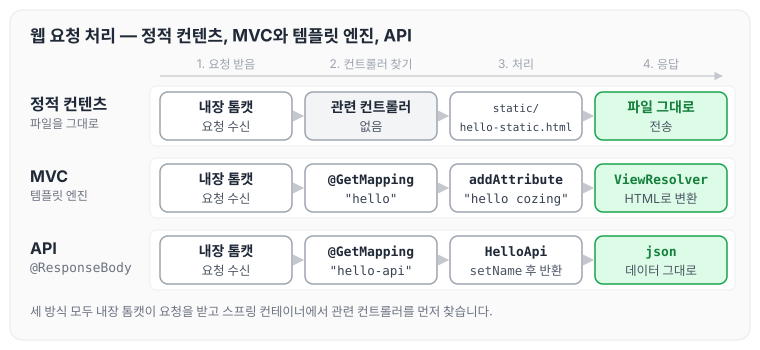
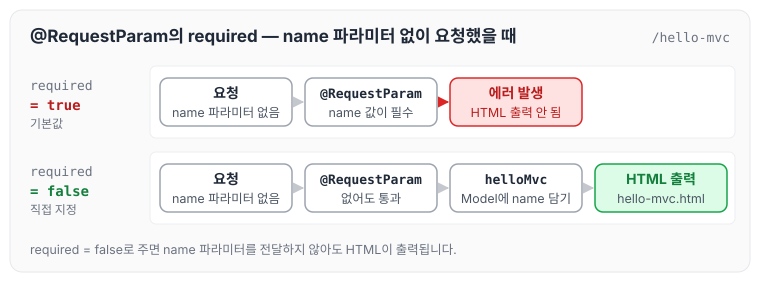

오늘은 스프링 부트로 웹 페이지나 데이터를 내려 주는 세 가지 방식인 정적 컨텐츠, MVC와 템플릿 엔진, API에 대해 정리하도록 하겠습니다. 세 방식 모두 내장 톰캣 서버가 요청을 받는 것은 같지만, 스프링 컨테이너에서 무엇을 찾고 어떤 형태로 응답하는지가 다릅니다.



세 방식의 요청 흐름을 나란히 놓으면 위와 같습니다. 아래에서 방식마다 예제와 접근 순서를 하나씩 살펴보겠습니다.

## 정적 컨텐츠

정적 컨텐츠는 웹 브라우저에 파일을 그대로 전송해 주는 방식입니다. 스프링 부트는 기본적으로 정적 컨텐츠 기능을 제공합니다.

1. main > resources 아래에 static 디렉터리를 생성합니다.
2. static 디렉터리 밑에 hello-static.html 파일을 생성합니다.

이후 `http://localhost:8080/hello-static.html`로 바로 접근할 수 있습니다.

접근 순서는 아래와 같습니다.

1. 내장 톰캣 서버에서 요청을 받습니다.
2. 스프링 컨테이너에서 관련 컨트롤러를 찾습니다.
3. 관련 컨트롤러가 없으면 resources:static/hello-static.html을 찾습니다.
4. 찾은 파일을 웹 브라우저로 전송합니다.

## MVC와 템플릿 엔진

MVC와 템플릿 엔진은 서버에서 데이터를 가공해 HTML로 바꾼 뒤 전송하는 방식입니다. 뒤에서 다룰 API는 이와 달리 json 데이터 포맷으로 데이터를 클라이언트에 전송하는 방식이며, 서버끼리 통신할 때 사용합니다.

MVC는 아래 세 가지를 말합니다.

- M : Model
- V : View
- C : Controller

MVC는 관심사를 분리하기 위해 나온 패턴입니다. 과거에는 뷰 안에서 데이터 접근과 로직을 함께 구성해서 소스를 관리하기가 매우 어려웠습니다. 현재는 화면 구성은 View에, 비즈니스 로직과 서버에 관련된 영역은 Controller에 두고, 화면에 필요한 데이터는 Model에 담아서 구성합니다.

예제는 아래 순서로 만듭니다.

1. main > java > hello > hellospring > controller 아래에 HelloController.java를 생성합니다.
2. resources > templates 아래에 hello.html을 생성합니다.

```java
package hello.hellospring.controller;

import org.springframework.stereotype.Controller;
import org.springframework.ui.Model;
import org.springframework.web.bind.annotation.GetMapping;
import org.springframework.web.bind.annotation.RequestParam;

@Controller
public class HelloController {

    @GetMapping("hello")
    public String hello(Model model) {
        model.addAttribute("data", "hello cozing");
        return "hello";
    }
}
```

```html
<html xmlns:th="http://www.thymeleaf.org">
<body>
<p th:text="'hello' + ${data}">hello! empty</p>
</body>
</html>
```

접근 순서는 아래와 같습니다.

1. 웹 브라우저에서 내장 톰캣 서버로 요청을 보냅니다.
2. 스프링 컨테이너에서 관련 컨트롤러를 찾습니다.
3. HelloController의 `@GetMapping("hello")`에 접근합니다.
4. `model.addAttribute`를 통해 data라는 key에 value를 담습니다.
5. 이후 ViewResolver를 통해 HTML로 변환한 뒤 웹 브라우저에 출력합니다.

## MVC와 템플릿 엔진에서 파라미터 전달 방법

이번에는 요청 파라미터를 받아서 화면에 출력해 보겠습니다.

1. HelloController.java에 `@GetMapping("hello-mvc")`를 추가합니다.
2. resources > templates 아래에 hello-mvc.html을 생성합니다.
3. 매개변수에 `@RequestParam("name") String name`을 선언하면 파라미터 값을 받을 수 있습니다.

주의할 점은 `@RequestParam`의 required 값이 기본으로 true로 설정되어 있다는 것입니다. 이 때문에 파라미터 값을 전달하지 않으면 에러가 발생합니다. required 값을 false로 주면 파라미터 값을 전달하지 않아도 HTML이 출력됩니다.

```java
package hello.hellospring.controller;

import org.springframework.stereotype.Controller;
import org.springframework.ui.Model;
import org.springframework.web.bind.annotation.GetMapping;
import org.springframework.web.bind.annotation.RequestParam;

@Controller
public class HelloController {

    @GetMapping("hello")
    public String hello(Model model) {
        model.addAttribute("data", "hello cozing");
        return "hello";
    }

    @GetMapping("hello-mvc")
    public String helloMvc(@RequestParam("name") String name, Model model) {
        model.addAttribute("name", name);
        return "hello-mvc";
    }

}
```

```html
<html xmlns:th="http://www.thymeleaf.org">
<body>
<p th:text="'hello' + ${name}">hello! empty</p>
</body>
</html>
```

name 파라미터 없이 요청했을 때 required 값에 따라 결과가 어떻게 달라지는지 그림으로 보면 아래와 같습니다.



required가 true이면 에러가 발생하고, false이면 name 파라미터 없이도 템플릿이 HTML로 출력됩니다. required를 false로 준 코드는 아래 API 예제의 `helloMvc`에서 볼 수 있습니다.

접근 순서는 아래와 같습니다.

1. 웹 브라우저에서 내장 톰캣 서버로 요청을 보냅니다.
2. 스프링 컨테이너에서 관련 컨트롤러를 찾습니다.
3. HelloController의 `@GetMapping("hello-mvc")`에 접근합니다.
4. `model.addAttribute`를 통해 name이라는 key에 파라미터 값을 담습니다.
5. 이후 ViewResolver를 통해 HTML로 변환한 뒤 웹 브라우저에 출력합니다.

## API

API 방식은 아래 순서로 만듭니다.

1. HelloController.java에 `@GetMapping("hello-api")`를 추가합니다.
2. `@ResponseBody`를 추가합니다.
3. 응답으로 json 형식으로 보낼 객체를 생성합니다.
4. 객체를 반환합니다.

`@ResponseBody`는 HTTP의 body 응답 부분에 값을 직접 넣어 주겠다는 의미입니다.

```java
package hello.hellospring.controller;

import org.springframework.stereotype.Controller;
import org.springframework.ui.Model;
import org.springframework.web.bind.annotation.GetMapping;
import org.springframework.web.bind.annotation.RequestParam;
import org.springframework.web.bind.annotation.ResponseBody;

@Controller
public class HelloController {

    @GetMapping("hello")
    public String hello(Model model) {
        model.addAttribute("data", "hello cozing");
        return "hello";
    }

    @GetMapping("hello-mvc")
    public String helloMvc(@RequestParam(value = "name", required = false) String name, Model model) {
        model.addAttribute("name", name);
        return "hello-mvc";
    }

    @GetMapping("hello-api")
    @ResponseBody
    public HelloApi helloApi(@RequestParam("name") String name) {
        HelloApi helloApi = new HelloApi();
        helloApi.setName(name);
        return helloApi;
    }

    static class HelloApi {
        private String name;

        public String getName() {
            return name;
        }

        public void setName(String name) {
            this.name = name;
        }
    }

}
```

접근 순서는 아래와 같습니다.

1. 웹 브라우저에서 내장 톰캣 서버로 요청을 보냅니다.
2. 스프링 컨테이너에서 관련 컨트롤러를 찾습니다.
3. HelloController의 `@GetMapping("hello-api")`에 접근합니다.
4. HelloApi 객체를 생성합니다.
5. setter를 통해 값을 넣고 객체를 반환합니다.
6. json 형태의 데이터가 출력됩니다.

MVC와 템플릿 엔진 방식은 ViewResolver를 거쳐 HTML을 응답하지만, `@ResponseBody`가 붙은 API 방식은 반환한 객체가 json 데이터로 바로 응답에 담깁니다.

## 마무리

오늘은 스프링 부트에서 정적 컨텐츠, MVC와 템플릿 엔진, API 방식으로 웹 페이지와 데이터를 내려 주는 방법에 대해 정리하였습니다. 원하는 웹 페이지나 데이터를 보낼 때는 Controller에서 `@GetMapping`으로 주소를 나누어 처리하면 되고, 화면이 아닌 데이터를 그대로 보내고 싶을 때는 `@ResponseBody`를 사용하면 됩니다.

다음 글에서는 [회원 관리 예제 — 백엔드 개발 (1)](../spring-intro-member-backend-1/)에 대해 정리하도록 하겠습니다.

> 이 글은 인프런 김영한 님의 [스프링 입문 — 코드로 배우는 스프링 부트, 웹 MVC, DB 접근 기술](https://www.inflearn.com/course/스프링-입문-스프링부트)을 들으며 정리한 노트입니다.
