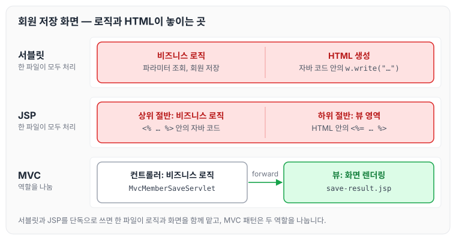
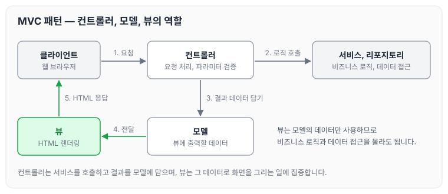
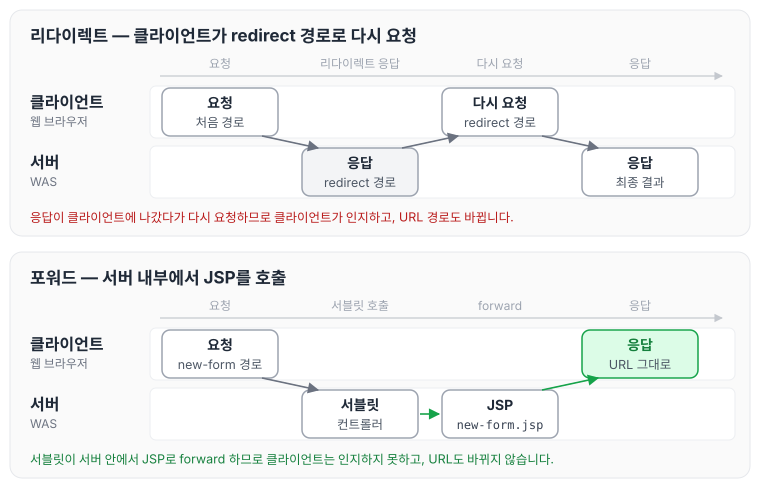
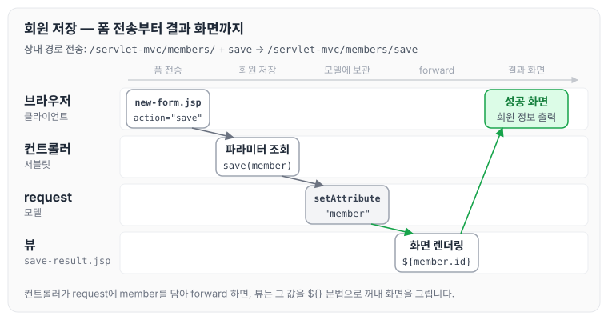
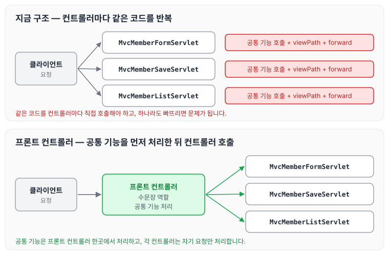

이전에 [서블릿](../spring-mvc-servlet/)에 대해 작성하였습니다. 이번에는 같은 회원 관리 웹 애플리케이션을 서블릿, JSP, MVC 패턴 순서로 만들어 보면서 각 방식에서 어떤 불편함이 생기는지, MVC 패턴이 왜 등장했는지, 그리고 MVC 패턴을 적용한 뒤에도 남는 한계에 대해 정리하도록 하겠습니다.

## 회원 관리 웹 애플리케이션 요구사항

회원 정보와 기능 요구사항은 아래와 같습니다.

- 회원 정보
    - 이름: `username`
    - 나이: `age`
- 기능 요구사항
    - 회원 저장
    - 회원 목록 조회

### 회원 도메인 모델

```java
package hello.servlet.domain.member;

import lombok.Getter;
import lombok.Setter;

@Getter @Setter
public class Member {

    private Long id;
    private String username;
    private int age;

    public Member() {

    }

    public Member(String username, int age) {
        this.username = username;
        this.age = age;
    }
}
```

`id`는 `Member`를 회원 저장소에 저장할 때 회원 저장소가 할당합니다.

### 회원 저장소

```java
package hello.servlet.domain.member;

import java.util.ArrayList;
import java.util.HashMap;
import java.util.List;
import java.util.Map;

/**
 * 동시성 문제가 고려되어 있지 않음, 실무에서는 ConcurrentHashMap, AtomicLong 사용 거려
 */
public class MemberRepository {
    private Map<Long, Member> store = new HashMap<>();
    private long sequence = 0L;

    private static final MemberRepository instance = new MemberRepository();

    public static MemberRepository getInstance() {
        return instance;
    }

    private MemberRepository() {

    }

    public Member save(Member member) {
        member.setId(++sequence);
        store.put(member.getId(), member);
        return  member;
    }

    public Member findById(Long id) {
        return store.get(id);
    }

    public List<Member> findAll() {
        return new ArrayList<>(store.values());
    }

    public void clearStore() {
        store.clear();
    }
}
```

회원 저장소에는 싱글톤 패턴을 적용했습니다. 스프링을 사용한다면 스프링 빈으로 등록하면 되지만, 지금은 스프링 없이 순수 서블릿만으로 구현하는 것이 목적입니다. 싱글톤 패턴은 객체를 단 하나만 생성해서 공유해야 하므로 생성자를 `private` 접근자로 막아 둡니다. 싱글톤 패턴은 [웹 애플리케이션과 싱글톤](../spring-core-singleton-web/)에 정리하였습니다.

### 회원 저장소 테스트 코드

```java
package hello.servlet.domain.member;

import org.junit.jupiter.api.AfterEach;
import org.junit.jupiter.api.Test;

import java.util.List;

import static org.assertj.core.api.Assertions.*;

class MemberRepositoryTest {
    MemberRepository memberRepository = MemberRepository.getInstance();

    @AfterEach
    void afterEach() {
        memberRepository.clearStore();
    }

    @Test
    void save() {
        // given
        Member member = new Member("Member1", 20);

        //when
        Member saveMember = memberRepository.save(member);

        //then
        Member findMember = memberRepository.findById(saveMember.getId());
        assertThat(saveMember).isEqualTo(findMember);
    }

    @Test
    void findAll() {
        // given
        Member member1 = new Member("member1", 20);
        Member member2 = new Member("member2", 30);

        memberRepository.save(member1);
        memberRepository.save(member2);

        //when
        List<Member> result = memberRepository.findAll();

        //then
        assertThat(result.size()).isEqualTo(2);
        assertThat(result).contains(member1,member2);
    }
}
```

회원을 저장하는 테스트와 목록을 조회하는 테스트를 작성했습니다. 한 테스트가 다음 테스트에 영향을 주지 않도록, 각 테스트가 끝날 때마다 `clearStore()`를 호출해서 저장소를 초기화합니다.

## 서블릿으로 회원 관리 웹 애플리케이션 만들기

먼저 서블릿만으로 회원 관리 웹 애플리케이션을 만들어 보겠습니다. 가장 먼저 회원 등록 HTML 폼을 서블릿으로 제공합니다.

### MemberFormServlet - 회원 등록 폼

```java
package hello.servlet.web.servlet;

import javax.servlet.ServletException;
import javax.servlet.annotation.WebServlet;
import javax.servlet.http.HttpServlet;
import javax.servlet.http.HttpServletRequest;
import javax.servlet.http.HttpServletResponse;
import java.io.IOException;
import java.io.PrintWriter;

@WebServlet(name = "memberFormServlet", urlPatterns = "/servlet/members/new-form")
public class MemberFormServlet extends HttpServlet {

    @Override
    protected void service(HttpServletRequest req, HttpServletResponse resp) throws ServletException, IOException {
        resp.setContentType("text/html");
        resp.setCharacterEncoding("utf-8");
        PrintWriter w = resp.getWriter();
        w.write("<!DOCTYPE html>\n" +
                "<html>\n" +
                "<head>\n" +
                " <meta charset=\"UTF-8\">\n" +
                " <title>Title</title>\n" +
                "</head>\n" +
                "<body>\n" +
                "<form action=\"/servlet/members/save\" method=\"post\">\n" +
                " username: <input type=\"text\" name=\"username\" />\n" +
                " age: <input type=\"text\" name=\"age\" />\n" +
                " <button type=\"submit\">전송</button>\n" +
                "</form>\n" +
                "</body>\n" +
                "</html>\n");
    }
}
```

`MemberFormServlet`은 회원 정보를 입력할 수 있는 HTML Form을 만들어서 응답합니다. HTML을 자바 코드로 작성해야 하므로 쉽지 않은 작업입니다.

실행해 보면 HTML Form 데이터를 POST로 전송했을 때 오류가 발생합니다. 아직 데이터를 전달받을 서블릿을 만들지 않았기 때문에 정상적인 결과입니다.

### MemberSaveServlet - 회원 저장

```java
package hello.servlet.web.servlet;

import hello.servlet.domain.member.Member;
import hello.servlet.domain.member.MemberRepository;

import javax.servlet.ServletException;
import javax.servlet.annotation.WebServlet;
import javax.servlet.http.HttpServlet;
import javax.servlet.http.HttpServletRequest;
import javax.servlet.http.HttpServletResponse;
import java.io.IOException;
import java.io.PrintWriter;

@WebServlet(name = "memberSaveServlet", urlPatterns = "/servlet/members/save")
public class MemberSaveServlet extends HttpServlet {

    private MemberRepository memberRepository = MemberRepository.getInstance();

    @Override
    protected void service(HttpServletRequest req, HttpServletResponse resp) throws ServletException, IOException {
        System.out.println("MemberSaveServlet.service");
        String username = req.getParameter("username");
        int age = Integer.parseInt(req.getParameter("age"));

        Member member = new Member(username, age);
        System.out.println("member = " + member);
        memberRepository.save(member);

        resp.setContentType("text/html");
        resp.setCharacterEncoding("utf-8");

        PrintWriter w = resp.getWriter();
        w.write("<html>\n" +
                "<head>\n" +
                " <meta charset=\"UTF-8\">\n" +
                "</head>\n" +
                "<body>\n" +
                "성공\n" +
                "<ul>\n" +
                " <li>id="+member.getId()+"</li>\n" +
                " <li>username="+member.getUsername()+"</li>\n" +
                " <li>age="+member.getAge()+"</li>\n" +
                "</ul>\n" +
                "<a href=\"/index.html\">메인</a>\n" +
                "</body>\n" +
                "</html>");
    }
}
```

`MemberSaveServlet`은 아래 순서로 동작합니다.

1. 파라미터를 조회해서 `Member` 객체를 만듭니다.
2. `Member` 객체를 `MemberRepository`를 통해 저장합니다.
3. `Member` 객체를 사용해서 결과 화면용 HTML을 동적으로 만들어 응답합니다.

실행하면 데이터가 전송되고, 저장 결과를 확인할 수 있습니다.

### MemberListServlet - 회원 목록

```java
package hello.servlet.web.servlet;

import hello.servlet.domain.member.Member;
import hello.servlet.domain.member.MemberRepository;

import javax.servlet.ServletException;
import javax.servlet.annotation.WebServlet;
import javax.servlet.http.HttpServlet;
import javax.servlet.http.HttpServletRequest;
import javax.servlet.http.HttpServletResponse;
import java.io.IOException;
import java.io.PrintWriter;
import java.util.List;

@WebServlet(name = "memberListServlet", urlPatterns = "/servlet/members")
public class MemberListServlet extends HttpServlet {
    MemberRepository memberRepository = MemberRepository.getInstance();

    @Override
    protected void service(HttpServletRequest req, HttpServletResponse resp) throws ServletException, IOException {
        resp.setContentType("text/html");
        resp.setCharacterEncoding("utf-8");

        List<Member> members = memberRepository.findAll();
        PrintWriter w = resp.getWriter();
        w.write("<html>");
        w.write("<head>");
        w.write(" <meta charset=\"UTF-8\">");
        w.write(" <title>Title</title>");
        w.write("</head>");
        w.write("<body>");
        w.write("<a href=\"/index.html\">메인</a>");
        w.write("<table>");
        w.write(" <thead>");
        w.write(" <th>id</th>");
        w.write(" <th>username</th>");
        w.write(" <th>age</th>");
        w.write(" </thead>");
        w.write(" <tbody>");
/*
 w.write(" <tr>");
 w.write(" <td>1</td>");
 w.write(" <td>userA</td>");
 w.write(" <td>10</td>");
 w.write(" </tr>");
*/
        for (Member member : members) {
            w.write(" <tr>");
            w.write(" <td>" + member.getId() + "</td>");
            w.write(" <td>" + member.getUsername() + "</td>");
            w.write(" <td>" + member.getAge() + "</td>");
            w.write(" </tr>");
        }
        w.write(" </tbody>");
        w.write("</table>");
        w.write("</body>");
        w.write("</html>");

    }
}
```

`MemberListServlet`은 아래 순서로 동작합니다.

1. `memberRepository.findAll()`로 모든 회원을 조회합니다.
2. 회원 목록 HTML을 for 루프로 회원 수만큼 동적으로 생성해서 응답합니다.

실행하면 저장된 회원 목록을 확인할 수 있습니다.

### 템플릿 엔진

지금까지 서블릿과 자바 코드만으로 HTML을 만들어 보았습니다. 서블릿 덕분에 원하는 HTML을 동적으로 만들 수 있었습니다. 정적인 HTML 문서로는 회원 저장 결과나 회원 목록처럼 내용이 계속 달라지는 화면을 만들 수 없습니다.

다만 위 코드처럼 자바 코드로 HTML을 만드는 방식은 복잡하고 비효율적입니다. 자바 코드로 HTML을 만드는 것보다, HTML 문서에서 동적으로 바뀌어야 하는 부분에만 자바 코드를 넣을 수 있다면 더 편리합니다. 이 때문에 템플릿 엔진이 나왔습니다. 템플릿 엔진을 사용하면 HTML 문서에서 필요한 곳에만 코드를 적용해서 동적으로 변경할 수 있습니다. 템플릿 엔진에는 JSP, Thymeleaf, Freemarker, Velocity 등이 있습니다.

> 참고: JSP는 성능과 기능 면에서 다른 템플릿 엔진과의 경쟁에서 밀리면서 점점 사장되어 가는 추세입니다.

### welcome 페이지 변경

앞으로 서블릿에서 JSP, MVC 패턴, 직접 만드는 MVC 프레임워크, 그리고 스프링까지 단계적으로 진행합니다. 각 단계의 화면을 편리하게 열어 볼 수 있도록 welcome 페이지를 아래와 같이 변경합니다.

```html
<!DOCTYPE html>
<html>
<head>
    <meta charset="UTF-8">
    <title>Title</title>
</head>
<body>
<ul>
    <li><a href="basic.html">서블릿 basic</a></li>
    <li>서블릿
        <ul>
            <li><a href="/servlet/members/new-form">회원가입</a></li>
            <li><a href="/servlet/members">회원목록</a></li>
        </ul>
    </li>
    <li>JSP
        <ul>
            <li><a href="/jsp/members/new-form.jsp">회원가입</a></li>
            <li><a href="/jsp/members.jsp">회원목록</a></li>
        </ul>
    </li>
    <li>서블릿 MVC
        <ul>
            <li><a href="/servlet-mvc/members/new-form">회원가입</a></li>
            <li><a href="/servlet-mvc/members">회원목록</a></li>
        </ul>
    </li>
    <li>FrontController - v1
        <ul>
            <li><a href="/front-controller/v1/members/new-form">회원가입</a></li>
            <li><a href="/front-controller/v1/members">회원목록</a></li>
        </ul>
    </li>
    <li>FrontController - v2
        <ul>
            <li><a href="/front-controller/v2/members/new-form">회원가입</a></li>
            <li><a href="/front-controller/v2/members">회원목록</a></li>
        </ul>
    </li>
    <li>FrontController - v3
        <ul>
            <li><a href="/front-controller/v3/members/new-form">회원가입</a></li>
            <li><a href="/front-controller/v3/members">회원목록</a></li>
        </ul>
    </li>
    <li>FrontController - v4
        <ul>
            <li><a href="/front-controller/v4/members/new-form">회원가입</a></li>
            <li><a href="/front-controller/v4/members">회원목록</a></li>
        </ul>
    </li>
    <li>FrontController - v5 - v3
        <ul>
            <li><a href="/front-controller/v5/v3/members/new-form">회원가입</a></li>
            <li><a href="/front-controller/v5/v3/members">회원목록</a></li>
        </ul>
    </li>
    <li>FrontController - v5 - v4
        <ul>
            <li><a href="/front-controller/v5/v4/members/new-form">회원가입</a></li>
            <li><a href="/front-controller/v5/v4/members">회원목록</a></li>
        </ul>
    </li>
    <li>SpringMVC - v1
        <ul>
            <li><a href="/springmvc/v1/members/new-form">회원가입</a></li>
            <li><a href="/springmvc/v1/members">회원목록</a></li>
        </ul>
    </li>
    <li>SpringMVC - v2
        <ul>
            <li><a href="/springmvc/v2/members/new-form">회원가입</a></li>
            <li><a href="/springmvc/v2/members">회원목록</a></li>
        </ul>
    </li>
    <li>SpringMVC - v3
        <ul>
            <li><a href="/springmvc/v3/members/new-form">회원가입</a></li>
            <li><a href="/springmvc/v3/members">회원목록</a></li>
        </ul>
    </li>
</ul>
</body>
</html>
```

## JSP로 회원 관리 웹 애플리케이션 만들기

### JSP 라이브러리 추가

JSP를 사용하려면 먼저 `build.gradle`에 아래 라이브러리를 추가해야 합니다.

```gradle
//JSP 추가 시작
implementation 'org.apache.tomcat.embed:tomcat-embed-jasper'
implementation 'javax.servlet:jstl'
//JSP 추가 끝
```

라이브러리를 추가한 뒤 Gradle을 refresh 합니다.

### 회원 등록 폼 JSP

`main/webapp/jsp/members/new-form.jsp`

```html
<%@ page contentType="text/html;charset=UTF-8" language="java" %>
<html>
<head>
    <title>Title</title>
</head>
<body>
<form action="/jsp/members/save.jsp" method="post">
    username: <input type="text" name="username" />
    age: <input type="text" name="age" />
    <button type="submit">전송</button>
</form>
</body>
</html>
```

- `<%@ page contentType="text/html;charset=UTF-8" language="java" %>`
    - 첫 줄은 JSP 문서라는 뜻입니다. JSP 문서는 이렇게 시작해야 합니다.

회원 등록 폼 JSP는 첫 줄을 제외하면 HTML과 똑같습니다. JSP는 서버 내부에서 서블릿으로 변환되는데, 앞서 만든 `MemberFormServlet`과 거의 비슷한 모습으로 변환됩니다.

### 회원 저장 JSP

`main/webapp/jsp/members/save.jsp`

```html
<%@ page import="hello.servlet.domain.member.MemberRepository" %>
<%@ page import="hello.servlet.domain.member.Member" %>
<%@ page contentType="text/html;charset=UTF-8" language="java" %>
<%
    // request, response 사용 가능
    MemberRepository memberRepository = MemberRepository.getInstance();
    System.out.println("save.jsp");
    String username = request.getParameter("username");
    int age = Integer.parseInt(request.getParameter("age"));
    Member member = new Member(username, age);
    System.out.println("member = " + member);
    memberRepository.save(member);
%>
<html>
<head>
    <meta charset="UTF-8">
</head>
<body>
성공
<ul>
    <li>id=<%=member.getId()%></li>
    <li>username=<%=member.getUsername()%></li>
    <li>age=<%=member.getAge()%></li>
</ul>
<a href="/index.html">메인</a>
</body>
</html>
```

JSP에서는 자바 코드를 그대로 사용할 수 있습니다.

- `<%@ page import="hello.servlet.domain.member.MemberRepository" %>`
    - 자바의 import 문과 같습니다.
- `<% ~ %>`
    - 자바 코드를 입력할 수 있습니다.
- `<%= ~ %>`
    - 자바 코드의 결과를 출력할 수 있습니다.

회원 저장 JSP의 로직은 회원 저장 서블릿 코드와 같습니다. 다른 점은 HTML을 중심으로 작성하고, 자바 코드를 필요한 부분에만 넣었다는 것입니다. `<% ~ %>`로 회원을 저장하는 자바 코드를 실행하고, `<%= ~ %>`로 HTML 중간에 결과를 출력하고 있습니다.

### 회원 목록 JSP

`members.jsp`

```html
<%@ page import="java.util.List" %>
<%@ page import="hello.servlet.domain.member.MemberRepository" %>
<%@ page import="hello.servlet.domain.member.Member" %>
<%@ page contentType="text/html;charset=UTF-8" language="java" %>
<%
    MemberRepository memberRepository = MemberRepository.getInstance();
    List<Member> members = memberRepository.findAll();
%>
<html>
<head>
    <meta charset="UTF-8">
    <title>Title</title>
</head>
<body>
<a href="/index.html">메인</a>
<table>
    <thead>
    <th>id</th>
    <th>username</th>
    <th>age</th>
    </thead>
    <tbody>
    <%
        for (Member member : members) {
            out.write(" <tr>");
            out.write(" <td>" + member.getId() + "</td>");
            out.write(" <td>" + member.getUsername() + "</td>");
            out.write(" <td>" + member.getAge() + "</td>");
            out.write(" </tr>");
        }
    %>
    </tbody>
</table>
</body>
</html>
```

회원 리포지토리에서 먼저 회원 목록을 조회하고, 결과 List를 사용해서 중간의 `<tr><td>` HTML 태그를 반복해서 출력합니다.

### 서블릿과 JSP의 한계

서블릿으로 개발할 때는 뷰(View) 화면을 위한 HTML을 만드는 작업이 자바 코드에 섞여서 지저분하고 복잡했습니다.

JSP를 사용하면서 뷰를 생성하는 HTML 작업은 깔끔해졌고, 동적으로 바뀌어야 하는 부분에만 자바 코드를 적용할 수 있었습니다. 다만 이렇게 해도 해결되지 않는 문제가 남습니다.

회원 저장 JSP를 보면 코드의 상위 절반은 회원을 저장하기 위한 비즈니스 로직이고, 나머지 하위 절반만 결과를 HTML로 보여 주기 위한 뷰 영역입니다. 회원 목록 JSP도 마찬가지입니다.

자바 코드, 데이터를 조회하는 리포지토리 등 다양한 코드가 모두 JSP에 노출되어 있어서 JSP가 너무 많은 역할을 하고 있습니다. 이렇게 작은 프로젝트에서도 코드가 복잡한데, 수백, 수천 줄이 넘어가는 JSP라면 유지보수가 훨씬 어려워질 것입니다.

### MVC 패턴의 등장

비즈니스 로직은 서블릿처럼 다른 곳에서 처리하고, JSP는 목적에 맞게 HTML로 화면(view)을 그리는 일에 집중하도록 나누어야 합니다. 과거 개발자들도 같은 고민을 했고, 그래서 MVC 패턴이 등장했습니다.

지금까지 만든 두 방식과 이어서 적용할 MVC 패턴에서 자바 코드와 HTML이 어디에 놓이는지 비교하면 아래와 같습니다.



서블릿과 JSP를 각각 단독으로 쓰면 한 파일이 로직과 화면을 함께 맡고, MVC 패턴에서는 서블릿이 로직을, JSP가 화면을 맡습니다.

## MVC 패턴 개요

### 너무 많은 역할

하나의 서블릿이나 JSP만으로 비즈니스 로직과 뷰 렌더링까지 모두 처리하면 너무 많은 역할을 맡게 되고, 결과적으로 유지보수가 어려워집니다. 비즈니스 로직을 호출하는 부분에 변경이 생겨도 해당 파일을 수정해야 하고, UI를 변경할 때도 비즈니스 로직이 함께 있는 파일을 수정해야 합니다. HTML 코드 하나만 수정하면 되는 상황에서도 수백 줄의 자바 코드가 함께 있는 파일을 열어야 합니다.

### 변경의 라이프 사이클

더 중요한 문제는 둘 사이에 변경의 라이프 사이클이 다르다는 점입니다. 예를 들어 UI를 일부 수정하는 일과 비즈니스 로직을 수정하는 일은 각각 다른 시점에 발생할 가능성이 높고, 대부분 서로에게 영향을 주지 않습니다. 이렇게 변경의 라이프 사이클이 다른 부분을 하나의 코드로 관리하는 것은 유지보수하기 좋지 않습니다.

### 기능 특화

JSP 같은 뷰 템플릿은 화면을 렌더링하는 데 최적화되어 있기 때문에, 이 부분의 업무만 담당하는 것이 가장 효과적입니다.

### Model View Controller

MVC 패턴은 지금까지 하나의 서블릿이나 JSP로 처리하던 것을 컨트롤러(Controller)와 뷰(View)라는 영역으로 역할을 나눈 것을 말합니다. 웹 애플리케이션은 보통 이 MVC 패턴을 사용합니다.

- 컨트롤러: HTTP 요청을 받아서 파라미터를 검증하고, 비즈니스 로직을 실행합니다. 그리고 뷰에 전달할 결과 데이터를 조회해서 모델에 담습니다.
- 모델: 뷰에 출력할 데이터를 담아 둡니다. 뷰가 필요한 데이터를 모두 모델에 담아서 전달해 주기 때문에, 뷰는 비즈니스 로직이나 데이터 접근을 몰라도 되고 화면을 렌더링하는 일에 집중할 수 있습니다.
- 뷰: 모델에 담겨 있는 데이터를 사용해서 화면을 그리는 일에 집중합니다. 여기서는 HTML을 생성하는 부분을 말합니다.

> 참고: 컨트롤러에 비즈니스 로직을 둘 수도 있지만, 이렇게 되면 컨트롤러가 너무 많은 역할을 담당합니다. 그래서 일반적으로 비즈니스 로직은 서비스(Service)라는 계층을 별도로 만들어서 처리하고, 컨트롤러는 비즈니스 로직이 있는 서비스를 호출하는 역할을 담당합니다. 참고로 비즈니스 로직을 변경하면 비즈니스 로직을 호출하는 컨트롤러의 코드도 변경될 수 있습니다. 앞에서는 이해를 돕기 위해 비즈니스 로직을 호출한다는 표현보다는 비즈니스 로직이라고 설명했습니다.

요청이 컨트롤러, 모델, 뷰를 거쳐 응답이 되는 흐름은 아래와 같습니다.



컨트롤러가 파라미터를 검증하고 비즈니스 로직을 처리한 뒤 모델에 데이터를 담아 뷰에 전달하고, 뷰는 그 데이터로 화면을 그리기 때문에 컨트롤러와 뷰의 역할이 명확하게 구분됩니다.

## MVC 패턴 적용

서블릿을 컨트롤러로 사용하고, JSP를 뷰로 사용해서 MVC 패턴을 적용해 보겠습니다.

`Model`로는 `HttpServletRequest` 객체를 사용합니다. request는 내부에 데이터 저장소를 가지고 있는데, `request.setAttribute()`, `request.getAttribute()`를 사용하면 데이터를 보관하고 조회할 수 있습니다.

### 회원 등록 폼 - 컨트롤러

`MvcMemberFormServlet`

```java
package hello.servlet.web.servletmvc;

import javax.servlet.RequestDispatcher;
import javax.servlet.ServletException;
import javax.servlet.annotation.WebServlet;
import javax.servlet.http.HttpServlet;
import javax.servlet.http.HttpServletRequest;
import javax.servlet.http.HttpServletResponse;
import java.io.IOException;

@WebServlet(name = "mvcMemberFormServlet", urlPatterns = "/servlet-mvc/members/new-form")
public class MvcMemberFormServlet extends HttpServlet {

    @Override
    protected void service(HttpServletRequest request, HttpServletResponse response) throws ServletException, IOException {
        String viewPath = "/WEB-INF/views/new-form.jsp";
        RequestDispatcher dispatcher = request.getRequestDispatcher(viewPath);
        dispatcher.forward(request, response);
    }
}
```

`dispatcher.forward()`는 다른 서블릿이나 JSP로 이동하는 기능입니다. 서버 내부에서 다시 호출이 발생합니다.

> WEB-INF: 이 경로 안에 JSP가 있으면 외부에서 직접 JSP를 호출할 수 없습니다. 우리가 기대하는 것은 항상 컨트롤러를 통해 JSP를 호출하는 것입니다.

### redirect와 forward

리다이렉트는 실제 클라이언트(웹 브라우저)에 응답이 나갔다가, 클라이언트가 redirect 경로로 다시 요청합니다. 따라서 클라이언트가 인지할 수 있고, URL 경로도 실제로 변경됩니다. 반면에 포워드는 서버 내부에서 일어나는 호출이기 때문에 클라이언트가 전혀 인지하지 못합니다. 두 방식을 비교하면 아래와 같습니다.



`MvcMemberFormServlet`이 사용하는 것은 포워드이므로, 브라우저 주소창에는 `/servlet-mvc/members/new-form`이 그대로 남습니다.

### 회원 등록 폼 - 뷰

`new-form.jsp`

```html
<%@ page contentType="text/html;charset=UTF-8" language="java" %>
<html>
<head>
    <meta charset="UTF-8">
    <title>Title</title>
</head>
<body>
<!-- 상대경로 사용, [현재 URL이 속한 계층 경로 + /save] -->
<form action="save" method="post">
    username: <input type="text" name="username" />
    age: <input type="text" name="age" />
    <button type="submit">전송</button>
</form>
</body>
</html>
```

form의 action을 보면 절대 경로(`/`로 시작)가 아니라 상대 경로인 것을 확인할 수 있습니다. 이렇게 상대 경로를 사용하면 폼을 전송할 때 현재 URL이 속한 계층 경로 + save가 호출됩니다.

- 현재 계층 경로: `/servlet-mvc/members/`
- 결과: `/servlet-mvc/members/save`

> 주의: 이후 코드에서 해당 JSP를 계속 사용하기 때문에 상대 경로를 사용한 부분을 그대로 유지해야 합니다.

### 회원 저장 - 컨트롤러

`MvcMemberSaveServlet`

```java
package hello.servlet.web.servletmvc;

import hello.servlet.domain.member.Member;
import hello.servlet.domain.member.MemberRepository;

import javax.servlet.RequestDispatcher;
import javax.servlet.ServletException;
import javax.servlet.annotation.WebServlet;
import javax.servlet.http.HttpServlet;
import javax.servlet.http.HttpServletRequest;
import javax.servlet.http.HttpServletResponse;
import java.io.IOException;

@WebServlet(name = "mvcMemberSaveServlet", urlPatterns = "/servlet-mvc/members/save")
public class MvcMemberSaveServlet extends HttpServlet {

    private MemberRepository memberRepository = MemberRepository.getInstance();

    @Override
    protected void service(HttpServletRequest req, HttpServletResponse resp) throws ServletException, IOException {
        String username = req.getParameter("username");
        int age = Integer.parseInt(req.getParameter("age"));
        Member member = new Member(username, age);
        System.out.println("member = " + member);
        memberRepository.save(member);

        req.setAttribute("member", member);

        String viewPath = "/WEB-INF/views/save-result.jsp";
        RequestDispatcher dispatcher = req.getRequestDispatcher(viewPath);
        dispatcher.forward(req, resp);
    }
}
```

`HttpServletRequest`를 Model로 사용합니다. request가 제공하는 `setAttribute()`를 사용하면 request 객체에 데이터를 보관해서 뷰에 전달할 수 있고, 뷰는 `request.getAttribute()`를 사용해서 데이터를 꺼내면 됩니다.

### 회원 저장 - 뷰

`save-result.jsp`

```html
<%@ page contentType="text/html;charset=UTF-8" language="java" %>
<html>
<head>
    <meta charset="UTF-8">
</head>
<body>
성공
<ul>
    <li>id=${member.id}</li>
    <li>username=${member.username}</li>
    <li>age=${member.age}</li>
</ul>
<a href="/index.html">메인</a>
</body>
</html>
```

`<%= request.getAttribute("member")%>`로 모델에 저장한 member 객체를 꺼낼 수도 있지만, 코드가 복잡해집니다. JSP는 `${}` 문법을 제공하는데, 이 문법을 사용하면 request의 attribute에 담긴 데이터를 편리하게 조회할 수 있습니다.

폼 전송부터 결과 화면까지 회원 저장 요청이 처리되는 흐름은 아래와 같습니다.



MVC 패턴 덕분에 컨트롤러 로직과 뷰 로직이 분리된 것을 확인할 수 있습니다. 이후 화면에 수정이 생기면 뷰 로직만 변경하면 됩니다.

### 회원 목록 조회 - 컨트롤러

`MvcMemberListServlet`

```java

package hello.servlet.web.servletmvc;

import hello.servlet.domain.member.Member;
import hello.servlet.domain.member.MemberRepository;

import javax.servlet.RequestDispatcher;
import javax.servlet.ServletException;
import javax.servlet.annotation.WebServlet;
import javax.servlet.http.HttpServlet;
import javax.servlet.http.HttpServletRequest;
import javax.servlet.http.HttpServletResponse;
import java.io.IOException;
import java.util.List;

@WebServlet(name = "mvcMemberListServlet", urlPatterns = "/servlet-mvc/members")
public class MvcMemberListServlet extends HttpServlet {
    private MemberRepository memberRepository = MemberRepository.getInstance();

    @Override
    protected void service(HttpServletRequest request, HttpServletResponse response) throws ServletException, IOException {
        System.out.println("MvcMemberListServlet.service");
        List<Member> members = memberRepository.findAll();
        request.setAttribute("members", members);
        String viewPath = "/WEB-INF/views/members.jsp";
        RequestDispatcher dispatcher = request.getRequestDispatcher(viewPath);
        dispatcher.forward(request, response);
    }
}
```

request 객체를 사용해서 `List<Member> members`를 모델에 보관했습니다.

### 회원 목록 조회 - 뷰

`members.jsp`

```html
<%@ page contentType="text/html;charset=UTF-8" language="java" %>
<%@ taglib prefix="c" uri="http://java.sun.com/jsp/jstl/core"%>
<html>
<head>
    <meta charset="UTF-8">
    <title>Title</title>
</head>
<body>
<a href="/index.html">메인</a>
<table>
    <thead>
    <th>id</th>
    <th>username</th>
    <th>age</th>
    </thead>
    <tbody>
    <c:forEach var="item" items="${members}">
        <tr>
            <td>${item.id}</td>
            <td>${item.username}</td>
            <td>${item.age}</td>
        </tr>
    </c:forEach>
    </tbody>
</table>
</body>
</html>
```

모델에 담아 둔 members를 JSP가 제공하는 taglib 기능으로 반복하면서 출력했습니다. `members` 리스트에서 `member`를 순서대로 꺼내 `item` 변수에 담고, 출력하는 과정을 반복합니다.

`<c:forEach>` 기능을 사용하려면 아래와 같이 선언해야 합니다.

`<%@ taglib prefix="c" uri="http://java.sun.com/jsp/jstl/core"%>`

이 기능을 사용하지 않고 아래와 같이 출력해도 되지만, 코드가 매우 지저분해집니다.

```html
<%
	 for (Member member : members) {
	 out.write(" <tr>");
	 out.write(" <td>" + member.getId() + "</td>");
	 out.write(" <td>" + member.getUsername() + "</td>");
	 out.write(" <td>" + member.getAge() + "</td>");
	 out.write(" </tr>");
	 }
%>
```

JSP 같은 뷰 템플릿은 이렇게 화면을 렌더링하는 데 특화된 다양한 기능을 제공합니다.

## MVC 패턴의 한계

MVC 패턴을 적용한 덕분에 컨트롤러의 역할과 뷰를 렌더링하는 역할을 명확하게 구분할 수 있었습니다. 특히 뷰는 화면을 그리는 역할에 충실한 덕분에 코드가 깔끔하고 직관적입니다. 모델에서 필요한 데이터를 꺼내 화면을 만들기만 하면 됩니다.

다만 컨트롤러에는 중복이 많고, 필요하지 않은 코드도 많이 보입니다. MVC 컨트롤러의 단점은 아래와 같습니다.

### 포워드 중복

View로 이동하는 코드가 항상 중복으로 호출되어야 합니다. 이 부분을 메서드로 공통화할 수도 있지만, 그 메서드도 항상 직접 호출해야 합니다.

```java
RequestDispatcher dispatcher = request.getRequestDispatcher(viewPath);
dispatcher.forward(request, response);
```

### ViewPath 중복

```java
String viewPath = "/WEB-INF/views/new-form.jsp";
```

모든 viewPath에 아래 prefix와 suffix가 반복됩니다.

- prefix: `/WEB-INF/views/`
- suffix: `.jsp`

그리고 JSP가 아닌 Thymeleaf 같은 다른 뷰로 변경한다면 전체 코드를 다 변경해야 합니다.

### 사용하지 않는 코드

아래 코드는 사용할 때도 있고, 사용하지 않을 때도 있습니다. 특히 response는 현재 코드에서 사용되지 않습니다.

```java
HttpServletRequest request, HttpServletResponse response
```

그리고 이런 `HttpServletRequest`, `HttpServletResponse`를 사용하는 코드는 테스트 케이스를 작성하기도 어렵습니다.

### 공통 처리의 어려움

기능이 복잡해질수록 컨트롤러에서 공통으로 처리해야 하는 부분이 점점 늘어납니다. 공통 기능을 메서드로 뽑으면 될 것 같지만, 결과적으로 해당 메서드를 항상 호출해야 하고, 실수로 호출하지 않으면 문제가 됩니다. 그리고 호출하는 것 자체도 중복입니다.

### 프론트 컨트롤러 패턴의 필요성

정리하면 MVC 컨트롤러에는 공통 처리가 어렵다는 문제가 있습니다. 이 문제를 해결하려면 컨트롤러를 호출하기 전에 공통 기능을 먼저 처리해야 합니다. 소위 수문장 역할을 하는 기능이 필요하고, **프론트 컨트롤러(Front Controller) 패턴**을 도입하면 이런 문제를 깔끔하게 해결할 수 있습니다.



위쪽은 지금까지 만든 세 컨트롤러가 각자 같은 코드를 반복하는 구조이고, 아래쪽은 프론트 컨트롤러가 수문장으로 앞에 서서 공통 기능을 처리한 뒤 컨트롤러를 호출하는 구조입니다.

## 마무리

오늘은 회원 관리 웹 애플리케이션을 서블릿, JSP, MVC 패턴 순서로 만들어 보면서 각 방식의 한계와 MVC 패턴이 등장한 이유, 그리고 MVC 패턴을 적용한 뒤에도 컨트롤러에 남는 포워드·viewPath 중복과 공통 처리 문제에 대해 정리하였습니다. 같은 기능을 세 가지 방식으로 만들어 보니 역할을 나누는 것만으로도 화면 코드가 훨씬 단순해지는 것을 확인할 수 있었습니다.

다음 글에서는 [MVC 프레임워크 만들기](../spring-mvc-framework/)에 대해 정리하도록 하겠습니다.

> 이 글은 인프런 김영한 님의 [스프링 MVC 1편 — 백엔드 웹 개발 핵심 기술](https://www.inflearn.com/course/스프링-mvc-1)을 들으며 정리한 노트입니다.
