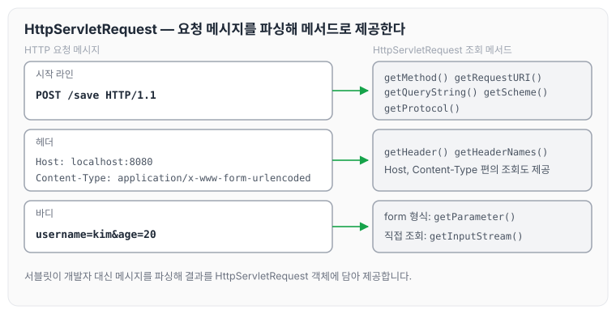
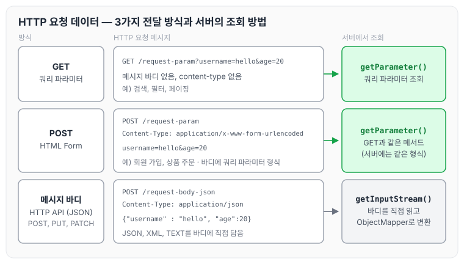
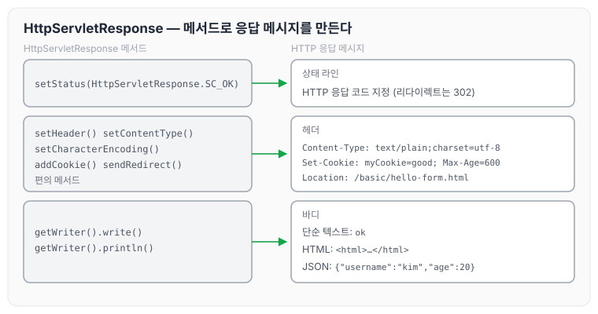

이전에 [웹 애플리케이션 이해](../spring-mvc-web-app/)에 대해 작성하였습니다. 앞 글에서는 서블릿이 비즈니스 로직을 제외한 HTTP 처리를 대신 맡아 준다는 것을 정리하였습니다. 오늘은 스프링 부트 환경에서 서블릿을 직접 등록해 보고, `HttpServletRequest`와 `HttpServletResponse`로 HTTP 요청과 응답을 다루는 방법을 정리하도록 하겠습니다.

## Hello 서블릿

스프링 부트 환경에서 서블릿을 등록하고 사용해 보겠습니다.

> 참고
>
> 서블릿은 톰캣 같은 웹 애플리케이션 서버를 직접 설치하고, 그 위에 서블릿 코드를 클래스 파일로 빌드해서 올린 다음, 톰캣 서버를 실행하면 됩니다. 하지만 이 과정은 매우 번거롭습니다. 스프링 부트는 톰캣 서버를 내장하고 있으므로, 톰캣 서버 설치 없이 편리하게 서블릿 코드를 실행할 수 있습니다.

### 스프링 부트 서블릿 환경 구성

스프링 부트는 서블릿을 직접 등록해서 사용할 수 있도록 `@ServletComponentScan`을 지원합니다. 아래와 같이 추가합니다.

```java
package hello.servlet;

import org.springframework.boot.SpringApplication;
import org.springframework.boot.autoconfigure.SpringBootApplication;
import org.springframework.boot.web.servlet.ServletComponentScan;

@ServletComponentScan  // 서브릿 자동 등록
@SpringBootApplication
public class ServletApplication {

	public static void main(String[] args) {
		SpringApplication.run(ServletApplication.class, args);
	}

}
```

### 서블릿 등록하기

처음으로 실제 동작하는 서블릿 코드를 등록해 보겠습니다.

```java
package hello.servlet.basic;

import javax.servlet.ServletException;
import javax.servlet.annotation.WebServlet;
import javax.servlet.http.HttpServlet;
import javax.servlet.http.HttpServletRequest;
import javax.servlet.http.HttpServletResponse;
import java.io.IOException;

@WebServlet(name = "helloServlet", urlPatterns = "/hello")
public class HelloServlet extends HttpServlet {

    @Override
    protected void service(HttpServletRequest request, HttpServletResponse response) throws ServletException, IOException {

        System.out.println("HelloServlet.service");
        System.out.println("request = " + request);
        System.out.println("response = " + response);

        String username = request.getParameter("username");
        System.out.println("username = " + username);

        response.setContentType("text/plain");
        response.setCharacterEncoding("utf-8");
        response.getWriter().write("hello " + username);

    }
}
```

- `@WebServlet`: 서블릿 애노테이션
    - name: 서블릿 이름
    - urlPatterns: URL 매핑

HTTP 요청을 통해 매핑된 URL이 호출되면 서블릿 컨테이너는 아래 메서드를 실행합니다.

`protected void service(HttpServletRequest request, HttpServletResponse response)`

웹 브라우저에서 `http://localhost:8080/hello?username=world`를 실행하면 화면에 `hello world`가 출력됩니다. 콘솔 실행 결과는 아래와 같습니다.

```text
HelloServlet.service
request = org.apache.catalina.connector.RequestFacade@4df4140
response = org.apache.catalina.connector.ResponseFacade@c8240e7
username = world
```

### HTTP 요청 메시지 로그 확인

HTTP 요청 메시지를 로그로 확인하려면 `application.properties`에 아래 설정을 추가합니다.

```properties
logging.level.org.apache.coyote.http11=debug
```

### 서블릿 컨테이너 동작 방식

스프링 부트가 내장 톰캣 서버를 생성하고, 그 위에서 서블릿 컨테이너가 HTTP 요청과 응답 메시지를 처리하는 흐름으로 동작합니다. 요청마다 request, response 객체를 만들고 서블릿을 호출하는 순서는 [웹 애플리케이션 이해](../spring-mvc-web-app/)에서 정리한 서블릿 동작 순서와 같습니다.

### welcome 페이지 추가

지금부터 개발할 내용을 편리하게 참고할 수 있도록 welcome 페이지를 만듭니다. `webapp` 경로에 `index.html`을 두면 `http://localhost:8080` 호출 시 `index.html` 페이지가 열립니다.

`main/webapp/index.html`

```html
<!DOCTYPE html>
<html>
<head>
    <meta charset="UTF-8">
    <title>Title</title>
</head>
<body>
<ul>
    <li><a href="basic.html">서블릿 basic</a></li>
</ul>
</body>
</html>
```

이번 글에서 다룰 내용은 아래 `basic.html`에 정리되어 있습니다.

`main/webapp/basic.html`

```html
<!DOCTYPE html>
<html>
<head>
    <meta charset="UTF-8">
    <title>Title</title>
</head>
<body>
<ul>
    <li>hello 서블릿
        <ul>
            <li><a href="/hello?username=servlet">hello 서블릿 호출</a></li>
        </ul>
    </li>
    <li>HttpServletRequest
        <ul>
            <li><a href="/request-header">기본 사용법, Header 조회</a></li>
            <li>HTTP 요청 메시지 바디 조회
                <ul>
                    <li><a href="/request-param?username=hello&age=20">GET -
                        쿼리 파라미터</a></li>
                    <li><a href="/basic/hello-form.html">POST - HTML Form</a></li>
                    <li>HTTP API - MessageBody -> Postman 테스트</li>
                </ul>
            </li>
        </ul>
    </li>
    <li>HttpServletResponse
        <ul>
            <li><a href="/response-header">기본 사용법, Header 조회</a></li>
            <li>HTTP 응답 메시지 바디 조회
                <ul>
                    <li><a href="/response-html">HTML 응답</a></li>
                    <li><a href="/response-json">HTTP API JSON 응답</a></li>
                </ul>
            </li>
        </ul>
    </li>
</ul>
</body>
</html>
```

## HttpServletRequest 개요

### HttpServletRequest의 역할

HTTP 요청 메시지를 개발자가 직접 파싱해서 사용해도 되지만, 매우 불편합니다. 그래서 서블릿은 개발자가 HTTP 요청 메시지를 편리하게 사용할 수 있도록 **개발자 대신 HTTP 요청 메시지를 파싱**하고, 그 결과를 `HttpServletRequest` 객체에 담아서 제공합니다.

`HttpServletRequest`를 사용하면 아래와 같은 HTTP 요청 메시지를 편리하게 조회할 수 있습니다.

```text
POST /save HTTP/1.1
Host: localhost:8080
Content-Type: application/x-www-form-urlencoded
username=kim&age=20
```

- START LINE
    - HTTP 메소드
    - URL
    - 쿼리 스트링
    - 스키마, 프로토콜
- 헤더
    - 헤더 조회
- 바디
    - form 파라미터 형식 조회
    - message body 데이터 직접 조회

요청 메시지의 각 부분을 `HttpServletRequest`의 어떤 메서드로 조회하는지 그리면 아래와 같습니다. 메서드 이름은 이 글의 예제 코드에서 사용하는 것입니다.



### HttpServletRequest의 부가 기능

`HttpServletRequest` 객체는 추가로 여러 가지 부가 기능도 함께 제공합니다.

- 임시 저장소 기능
    - 해당 HTTP 요청이 시작부터 끝날 때까지 유지되는 임시 저장소 기능입니다.
    - 저장: `request.setAttribute(name, value)`
    - 조회: `request.getAttribute(name)`
- 세션 관리 기능
    - `request.getSession(create: true)`

> 중요
>
> HttpServletRequest, HttpServletResponse를 사용할 때 가장 중요한 점은 이 객체들이 HTTP 요청 메시지, HTTP 응답 메시지를 편리하게 사용하도록 도와주는 객체라는 점입니다. 따라서 이 기능을 깊이 있게 이해하려면 HTTP 스펙이 제공하는 요청, 응답 메시지 자체를 이해해야 합니다.

HTTP 메시지의 구조는 [HTTP 기본](../http-basics/)에서 정리하였습니다.

## HttpServletRequest 기본 사용법

`HttpServletRequest`가 제공하는 기본 기능들을 확인해 보겠습니다. start line 정보, 모든 헤더, 헤더 편의 조회, 기타 정보를 차례로 출력하는 서블릿입니다.

```java
package hello.servlet.basic.request;

import javax.servlet.ServletException;
import javax.servlet.annotation.WebServlet;
import javax.servlet.http.Cookie;
import javax.servlet.http.HttpServlet;
import javax.servlet.http.HttpServletRequest;
import javax.servlet.http.HttpServletResponse;
import java.io.IOException;

@WebServlet(name = "requestHeaderServlet", urlPatterns = "/request-header")
public class RequestHeaderServlet extends HttpServlet {

    @Override
    protected void service(HttpServletRequest request, HttpServletResponse resp) throws ServletException, IOException {
        printStartLine(request);
        printHeaders(request);
        printHeaderUtils(request);
        printEtc(request);
    }

    //start line 정보
    private void printStartLine(HttpServletRequest request) {
        System.out.println("--- REQUEST-LINE - start ---");
        System.out.println("request.getMethod() = " + request.getMethod()); //GET
        System.out.println("request.getProtocol() = " + request.getProtocol()); //HTTP/1.1
        System.out.println("request.getScheme() = " + request.getScheme()); //http

        // http://localhost:8080/request-header
        System.out.println("request.getRequestURL() = " + request.getRequestURL());

        // /request-header
        System.out.println("request.getRequestURI() = " + request.getRequestURI());

        //username=hi
        System.out.println("request.getQueryString() = " +
                request.getQueryString());
        System.out.println("request.isSecure() = " + request.isSecure()); //https 사용 유무
        System.out.println("--- REQUEST-LINE - end ---");
        System.out.println();
    }

    //Header 모든 정보
    private void printHeaders(HttpServletRequest request) {
        System.out.println("--- Headers - start ---");
        /*
         Enumeration<String> headerNames = request.getHeaderNames();
         while (headerNames.hasMoreElements()) {
         String headerName = headerNames.nextElement();
         System.out.println(headerName + ": " + request.getHeader(headerName));
         }
        */
        request.getHeaderNames().asIterator()
                .forEachRemaining(headerName -> System.out.println(headerName + ": " + request.getHeader(headerName)));
        System.out.println("--- Headers - end ---");
        System.out.println();
    }

    private void printHeaderUtils(HttpServletRequest request) {
        System.out.println("--- Header 편의 조회 start ---");
        System.out.println("[Host 편의 조회]");
        System.out.println("request.getServerName() = " + request.getServerName()); //Host 헤더
        System.out.println("request.getServerPort() = " + request.getServerPort()); //Host 헤더
        System.out.println();
        System.out.println("[Accept-Language 편의 조회]");
        request.getLocales().asIterator()
                .forEachRemaining(locale -> System.out.println("locale = " + locale));
        System.out.println("request.getLocale() = " + request.getLocale());
        System.out.println();
        System.out.println("[cookie 편의 조회]");
        if (request.getCookies() != null) {
            for (Cookie cookie : request.getCookies()) {
                System.out.println(cookie.getName() + ": " + cookie.getValue());
            }
        }
        System.out.println();
        System.out.println("[Content 편의 조회]");
        System.out.println("request.getContentType() = " + request.getContentType());
        System.out.println("request.getContentLength() = " + request.getContentLength());
        System.out.println("request.getCharacterEncoding() = " + request.getCharacterEncoding());
        System.out.println("--- Header 편의 조회 end ---");
        System.out.println();
    }

    private void printEtc(HttpServletRequest request) {
        System.out.println("--- 기타 조회 start ---");
        System.out.println("[Remote 정보]");
        System.out.println("request.getRemoteHost() = " + request.getRemoteHost()); //
        System.out.println("request.getRemoteAddr() = " + request.getRemoteAddr()); //
        System.out.println("request.getRemotePort() = " + request.getRemotePort()); //
        System.out.println();
        System.out.println("[Local 정보]");
        System.out.println("request.getLocalName() = " + request.getLocalName()); //
        System.out.println("request.getLocalAddr() = " + request.getLocalAddr()); //
        System.out.println("request.getLocalPort() = " + request.getLocalPort()); //
        System.out.println("--- 기타 조회 end ---");
        System.out.println();
    }
}
```

지금까지 `HttpServletRequest`를 통해 HTTP 메시지의 start-line, header 정보를 조회하는 방법을 확인하였습니다. 이제 HTTP 요청 데이터를 어떻게 조회하는지 정리하겠습니다.

## HTTP 요청 데이터

### HTTP 요청 데이터 개요

HTTP 요청 메시지를 통해 클라이언트에서 서버로 데이터를 전달하는 방법은 주로 아래 3가지입니다.

- GET - 쿼리 파라미터
    - `/url?username=hello&age=20`
    - 메시지 바디 없이, URL의 쿼리 파라미터에 데이터를 포함해서 전달합니다.
    - 예) 검색, 필터, 페이징 등에서 많이 사용하는 방식입니다.
- POST - HTML Form
    - content-type: `application/x-www-form-urlencoded`
    - 메시지 바디에 쿼리 파라미터 형식으로 전달합니다. `username=hello&age=20`
    - 예) 회원 가입, 상품 주문 등 HTML Form에서 사용합니다.
- HTTP message body에 데이터를 직접 담아서 요청
    - HTTP API에서 주로 사용하며, JSON, XML, TEXT 형식을 씁니다.
    - 데이터 형식은 주로 JSON을 사용합니다.
    - POST, PUT, PATCH

세 방식이 데이터를 메시지의 어디에 담고, 서버에서 무엇으로 읽는지 비교하면 아래와 같습니다.



앞의 두 방식은 서버에서 같은 메서드로 조회하고, 메시지 바디에 직접 담은 데이터는 InputStream으로 읽습니다. 클라이언트에서 서버로 데이터를 전송하는 방식은 [HTTP 메서드 활용](../http-method-usage/)에서도 정리하였습니다. 아래에서 하나씩 확인해 보겠습니다.

### GET 쿼리 파라미터

아래 데이터를 클라이언트에서 서버로 전송해 보겠습니다.

- username=hello
- age=20

메시지 바디 없이, URL의 **쿼리 파라미터**를 사용해서 데이터를 전달합니다. 검색, 필터, 페이징 등에서 많이 사용하는 방식입니다.

쿼리 파라미터는 URL에 아래와 같이 `?`를 시작으로 보낼 수 있고, 추가 파라미터는 `&`로 구분합니다.

- `http://localhost:8080/request-param?username=hello&age=20`

서버에서는 `HttpServletRequest`가 제공하는 아래 메서드를 통해 쿼리 파라미터를 편리하게 조회할 수 있습니다.

쿼리 파라미터 조회 메서드

```java
String username = request.getParameter("username"); // 단일 파라미터 조회
Enumeration<String> parameterName = request.getParameterNames(); // 파라미터 이름들 모두 조회
Map<String, String[]> parameterMap = request.getParameterMap(); // 파라미터를 Map 으로 조회
String [] usernames = request.getParameterValues("username"); // 복수 파라미터 조회
```

RequestParamServlet

```java
package hello.servlet.basic.request;

import javax.servlet.ServletException;
import javax.servlet.annotation.WebServlet;
import javax.servlet.http.HttpServlet;
import javax.servlet.http.HttpServletRequest;
import javax.servlet.http.HttpServletResponse;
import java.io.IOException;

/**
 * 1. 파라미터 전송 기능
 * http://localhost:8080/request-param?username=hello&age=20
 *
 * 2. 동일한 파라미터 전송 기능
 * http://localhost:8080/request-param?username=hello&username=kim&age=20
 */

@WebServlet(name = "requestParamServlet", urlPatterns = "/request-param")
public class RequestParamServlet extends HttpServlet {

    @Override
    protected void service(HttpServletRequest request, HttpServletResponse response) throws ServletException, IOException {
        System.out.println("[전체 파라미터 조회] - start");

        request.getParameterNames().asIterator()
                .forEachRemaining(paramName -> System.out.println(paramName + "=" + request.getParameter(paramName)));
        System.out.println("[전체 파리미터 조회] - end");
        System.out.println("");

        System.out.println("[단일 파라미터 조회]");
        String username = request.getParameter("username");
        System.out.println("request.getParameter(username) = " + username);

        String age = request.getParameter("age");
        System.out.println("request.getParameter(age) = " + age);
        System.out.println();

        System.out.println("[이름이 같은 복수 파라미터 조회]");
        System.out.println("reuqest.getParameterValues(username)");
        String [] usernames = request.getParameterValues("username");
        for (String name : usernames) {
            System.out.println("username = " + name);
        }

        response.getWriter().write("ok");
    }
}
```

`http://localhost:8080/request-param?username=hello&age=20`으로 파라미터를 전송한 결과는 아래와 같습니다.

```text
[전체 파라미터 조회] - start
username=hello
age=20
[전체 파리미터 조회] - end

[단일 파라미터 조회]
request.getParameter(username) = hello
request.getParameter(age) = 20

[이름이 같은 복수 파라미터 조회]
reuqest.getParameterValues(username)
username = hello
```

같은 이름의 파라미터를 두 번 보내는 `http://localhost:8080/request-param?username=hello&username=kim&age=20`의 결과는 아래와 같습니다.

```text
[전체 파라미터 조회] - start
username=hello
age=20
[전체 파리미터 조회] - end

[단일 파라미터 조회]
request.getParameter(username) = hello
request.getParameter(age) = 20

[이름이 같은 복수 파라미터 조회]
reuqest.getParameterValues(username)
username = hello
username = kim
```

`username=hello&username=kim`처럼 파라미터 이름은 하나인데 값이 중복될 수 있습니다. `request.getParameter()`는 하나의 파라미터 이름에 대해 단 하나의 값만 있을 때 사용해야 하고, 지금처럼 중복일 때는 `request.getParameterValues()`를 사용해야 합니다.

참고로 이렇게 중복일 때 `request.getParameter()`를 사용하면 `request.getParameterValues()`의 첫 번째 값을 반환합니다.

### POST HTML Form

이번에는 HTML의 Form을 사용해서 클라이언트에서 서버로 데이터를 전송해 보겠습니다. 주로 회원 가입, 상품 주문 등에서 사용하는 방식이며, 특징은 아래와 같습니다.

- content-type: `application/x-www-form-urlencoded`
- 메시지 바디에 쿼리 파라미터 형식으로 데이터를 전달합니다. `username=hello&age=20`

`src/main/webapp/basic/hello-form.html`을 생성합니다.

```html
<!DOCTYPE html>
<html>
<head>
	<meta charset="UTF-8">
	<title>Title</title>
</head>
<body>
<form action="/request-param" method="post">
	 username: <input type="text" name="username" />
	 age: <input type="text" name="age" />
	 <button type="submit">전송</button>
</form>
</body>
</html>
```

`http://localhost:8080/basic/hello-form.html`에서 실행해 봅니다.

POST의 HTML Form을 전송하면 웹 브라우저는 아래 형식으로 HTTP 메시지를 만듭니다(웹 브라우저 개발자 모드에서 확인할 수 있습니다).

- 요청 URL: `http://localhost:8080/request-param`
- content-type: `application/x-www-form-urlencoded`
- message body: `username=hello&age=20`

`application/x-www-form-urlencoded` 형식은 앞서 GET에서 살펴본 쿼리 파라미터 형식과 같습니다. 따라서 **쿼리 파라미터 조회 메서드를 그대로 사용**하면 됩니다.

클라이언트(웹 브라우저) 입장에서는 두 방식에 차이가 있지만, 서버 입장에서는 형식이 동일하므로 `request.getParameter()`로 구분 없이 편리하게 조회할 수 있습니다. 정리하면 `request.getParameter()`는 GET URL 쿼리 파라미터 형식도, POST HTML Form 형식도 모두 지원합니다.

> 참고
>
> content-type은 HTTP 메시지 바디의 데이터 형식을 지정합니다. GET URL 쿼리 파라미터 형식으로 클라이언트에서 서버로 데이터를 전달할 때는 HTTP 메시지 바디를 사용하지 않기 때문에 content-type이 없습니다.
>
> POST HTML Form 형식으로 데이터를 전달하면 HTTP 메시지 바디에 해당 데이터를 포함해서 보내기 때문에, 바디에 포함된 데이터가 어떤 형식인지 content-type을 꼭 지정해야 합니다. 이렇게 폼으로 데이터를 전송하는 형식을 `application/x-www-form-urlencoded`라 합니다.

### API 메시지 바디 — 단순 텍스트

HTTP message body에 데이터를 직접 담아서 요청하는 방식입니다.

- HTTP API에서 주로 사용하며, JSON, XML, TEXT 형식을 씁니다.
- 데이터 형식은 주로 JSON을 사용합니다.
- POST, PUT, PATCH

먼저 가장 단순한 텍스트 메시지를 HTTP 메시지 바디에 담아서 전송하고 읽어 보겠습니다. HTTP 메시지 바디의 데이터는 InputStream을 사용해서 직접 읽을 수 있습니다.

```java
package hello.servlet.basic.request;

import org.springframework.util.StreamUtils;

import javax.servlet.ServletException;
import javax.servlet.ServletInputStream;
import javax.servlet.annotation.WebServlet;
import javax.servlet.http.HttpServlet;
import javax.servlet.http.HttpServletRequest;
import javax.servlet.http.HttpServletResponse;
import java.io.IOException;
import java.nio.charset.StandardCharsets;

@WebServlet(name = "requestBodyStringServlet", urlPatterns = "/request-body-string")
public class RequestBodyStringServlet extends HttpServlet {

    @Override
    protected void service(HttpServletRequest req, HttpServletResponse resp) throws ServletException, IOException {
        ServletInputStream inputStream = req.getInputStream();
        String messageBody = StreamUtils.copyToString(inputStream, StandardCharsets.UTF_8);

        System.out.println("messageBody = " + messageBody);

        resp.getWriter().write("ok");
    }
}
```

문자를 전송한 결과는 아래와 같습니다.

- POST `http://localhost:8080/request-body-string`
- content-type: `text/plain`
- message body: `hello`
- 결과: `messageBody = hello`

### API 메시지 바디 — JSON

이번에는 HTTP API에서 주로 사용하는 JSON 형식으로 데이터를 전달해 보겠습니다.

- POST `http://localhost:8080/request-body-json`
- content-type: `application/json`
- message body: `{"username" : "hello", "age":20}`
- 결과: `messageBody = {"username" : "hello", "age":20}`

JSON 형식으로 파싱할 수 있도록 객체를 하나 생성합니다.

`hello.servlet.basic.HelloData`

```java
package hello.servlet.basic;

import lombok.Getter;
import lombok.Setter;

@Getter @Setter
public class HelloData {

    private String username;
    private int age;

}
```

RequestBodyJsonServlet

```java
package hello.servlet.basic.request;

import com.fasterxml.jackson.databind.ObjectMapper;
import hello.servlet.basic.HelloData;
import org.springframework.util.StreamUtils;

import javax.servlet.ServletException;
import javax.servlet.ServletInputStream;
import javax.servlet.annotation.WebServlet;
import javax.servlet.http.HttpServlet;
import javax.servlet.http.HttpServletRequest;
import javax.servlet.http.HttpServletResponse;
import java.io.IOException;
import java.nio.charset.StandardCharsets;

@WebServlet(name = "RequestBodyJsonServlet", urlPatterns = "/request-body-json")
public class RequestBodyJsonServlet extends HttpServlet {

    private ObjectMapper objectMapper = new ObjectMapper();

    @Override
    protected void service(HttpServletRequest req, HttpServletResponse resp) throws ServletException, IOException {
        ServletInputStream inputStream = req.getInputStream();
        String messageBody = StreamUtils.copyToString(inputStream, StandardCharsets.UTF_8);
        System.out.println("messageBody = " + messageBody);

        HelloData helloData = objectMapper.readValue(messageBody, HelloData.class);
        System.out.println("helloData.getUsername = " + helloData.getUsername());
        System.out.println("helloData.getAge = " + helloData.getAge());

        resp.getWriter().write("ok");
    }
}
```

Postman으로 아래와 같이 요청합니다.

- POST `http://localhost:8080/request-body-json`
- content-type: `application/json` (Body → raw, 가장 오른쪽에서 JSON 선택)
- message body: `{"username" : "hello", "age":20}`

출력 결과는 아래와 같습니다.

```text
messageBody={"username": "hello", "age": 20}
data.username=hello
data.age=20
```

> 참고
>
> JSON 결과를 파싱해서 사용할 수 있는 자바 객체로 변환하려면, Jackson, Gson 같은 JSON 변환 라이브러리를 추가해서 사용해야 합니다. 스프링 부트로 Spring MVC를 선택하면 기본으로 Jackson 라이브러리(ObjectMapper)를 함께 제공합니다.

> 참고
>
> HTML form 데이터도 메시지 바디를 통해 전송되므로 직접 읽을 수 있습니다. 하지만 편리한 파라미터 조회 기능(`request.getParameter(…)`)을 이미 제공하기 때문에 파라미터 조회 기능을 사용하면 됩니다.

## HttpServletResponse 기본 사용법

### HttpServletResponse의 역할

`HttpServletResponse`는 HTTP 응답 메시지를 생성하고, 편의 기능을 제공합니다.

- HTTP 응답 메시지 생성
    - HTTP 응답 코드 지정
    - 헤더 생성
    - 바디 생성
- 편의 기능 제공
    - Content-Type, 쿠키, Redirect

응답 메시지의 각 부분을 어떤 메서드로 만드는지 그리면 아래와 같습니다. 메서드 이름은 아래 예제 코드에서 사용하는 것입니다.



### ResponseHeaderServlet

상태 코드, 헤더, 메시지 바디를 차례로 지정하는 서블릿입니다.

```java
@WebServlet(name = "responseHeaderServlet", urlPatterns = "/response-header")
public class ResponseHeaderServlet extends HttpServlet {

    @Override
    protected void service(HttpServletRequest req, HttpServletResponse resp) throws ServletException, IOException {
        //[status-line]
        resp.setStatus(HttpServletResponse.SC_OK);

        //[response-headers]
        resp.setHeader("Content-Type", "text/plain;charset=utf-8");
        resp.setHeader("Cache-Control", "no-cache, no-store, must-revalidate");
        resp.setHeader("Pragma", "no-cache");
        resp.setHeader("my-header", "hello");

        //[Header 편의 메서드]
        content(resp);
        cookie(resp);
        redirect(resp);

        //[message body]
        PrintWriter writer = resp.getWriter();
        writer.println("ok");
    }
}
```

Content 편의 메서드

```java
private void content(HttpServletResponse response) {
        //Content-Type: text/plain;charset=utf-8
        //Content-Length: 2
        //response.setHeader("Content-Type", "text/plain;charset=utf-8");
        response.setContentType("text/plain");
        response.setCharacterEncoding("utf-8");
        //response.setContentLength(2); //(생략시 자동 생성)
    }
```

쿠키 편의 메서드

```java
private void cookie(HttpServletResponse response) {
        //Set-Cookie: myCookie=good; Max-Age=600;
        //response.setHeader("Set-Cookie", "myCookie=good; Max-Age=600");
        Cookie cookie = new Cookie("myCookie", "good");
        cookie.setMaxAge(600); //600초
        response.addCookie(cookie);
    }
```

리다이렉트 편의 메서드

```java
private void redirect(HttpServletResponse response) throws IOException {
        //Status Code 302
        //Location: /basic/hello-form.html
        //response.setStatus(HttpServletResponse.SC_FOUND); //302
        //response.setHeader("Location", "/basic/hello-form.html");
        response.sendRedirect("/basic/hello-form.html");
    }
```

## HTTP 응답 데이터

### 단순 텍스트, HTML

HTTP 응답 메시지는 주로 아래 내용을 담아서 전달합니다.

- 단순 텍스트 응답
    - 앞에서 살펴본 것처럼 `writer.println("ok")` 형태로 응답합니다.
- HTML 응답
- HTTP API - MessageBody JSON 응답

HTML로 응답하는 `ResponseHtmlServlet`은 아래와 같습니다.

```java
package hello.servlet.basic.reponse;

import javax.servlet.ServletException;
import javax.servlet.annotation.WebServlet;
import javax.servlet.http.HttpServlet;
import javax.servlet.http.HttpServletRequest;
import javax.servlet.http.HttpServletResponse;
import java.io.IOException;
import java.io.PrintWriter;

@WebServlet(name = "responseHtmlServlet", urlPatterns = "/response-html")
public class ResponseHtmlServlet extends HttpServlet {
    @Override
    protected void service(HttpServletRequest req, HttpServletResponse resp) throws ServletException, IOException {
        resp.setContentType("text/html");
        resp.setCharacterEncoding("utf-8");

        PrintWriter writer = resp.getWriter();
        writer.println("<html>");
        writer.println("<body>");
        writer.println("<div>안녕?</div>");
        writer.println("</body>");
        writer.println("</html>");
    }
}
```

### API JSON

ResponseJsonServlet

```java
package hello.servlet.basic.reponse;

import com.fasterxml.jackson.core.JsonProcessingException;
import com.fasterxml.jackson.databind.ObjectMapper;
import hello.servlet.basic.HelloData;

import javax.servlet.ServletException;
import javax.servlet.annotation.WebServlet;
import javax.servlet.http.HttpServlet;
import javax.servlet.http.HttpServletRequest;
import javax.servlet.http.HttpServletResponse;
import java.io.IOException;

@WebServlet(name = "responseJsonServlet", urlPatterns = "/response-json")
public class ResponseJsonServlet extends HttpServlet {
    private ObjectMapper objectMapper = new ObjectMapper();

    @Override
    protected void service(HttpServletRequest request, HttpServletResponse response) throws ServletException, IOException, IOException {
        //Content-Type: application/json
        response.setHeader("content-type", "application/json");
        response.setCharacterEncoding("utf-8");
        HelloData data = new HelloData();
        data.setUsername("kim");
        data.setAge(20);
        //{"username":"kim","age":20}
        String result = objectMapper.writeValueAsString(data);
        response.getWriter().write(result);
    }
}
```

HTTP 응답으로 JSON을 반환할 때는 content-type을 `application/json`으로 지정해야 합니다. Jackson 라이브러리가 제공하는 `objectMapper.writeValueAsString()`을 사용하면 객체를 JSON 문자열로 변경할 수 있습니다.

> 참고
>
> `application/json`은 스펙상 UTF-8 형식을 사용하도록 정의되어 있습니다. 그래서 스펙에서 charset=utf-8과 같은 추가 파라미터를 지원하지 않습니다. 따라서 `application/json`이라고만 사용해야지 `application/json;charset=utf-8`이라고 전달하는 것은 의미 없는 파라미터를 추가한 것이 됩니다. `response.getWriter()`를 사용하면 추가 파라미터가 자동으로 추가되어 버립니다. 이때는 `response.getOutputStream()`으로 출력하면 그런 문제가 없습니다.

## 마무리

오늘은 스프링 부트 환경에서 서블릿을 등록하고, `HttpServletRequest`로 쿼리 파라미터·HTML Form·메시지 바디 데이터를 조회하는 방법과 `HttpServletResponse`로 텍스트·HTML·JSON을 응답하는 방법을 정리하였습니다. GET 쿼리 파라미터와 POST HTML Form이 서버 입장에서는 같은 형식이라 `request.getParameter()` 하나로 조회할 수 있다는 점이 인상 깊었습니다. 다음 글에서는 [서블릿, JSP, MVC 패턴](../spring-mvc-servlet-jsp-pattern/)에 대해 정리하도록 하겠습니다.

> 이 글은 인프런 김영한 님의 [스프링 MVC 1편 — 백엔드 웹 개발 핵심 기술](https://www.inflearn.com/course/스프링-mvc-1)을 들으며 정리한 노트입니다.
