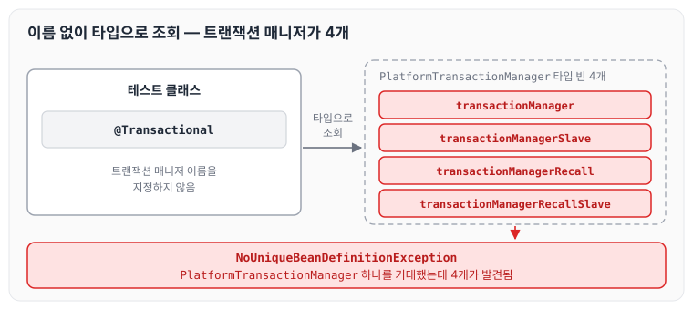
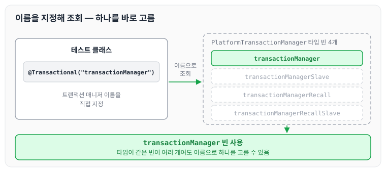

테스트 코드를 작성하면서 발생한 `NoUniqueBeanDefinitionException`에 대해 정리하려고 합니다.

## 상황 설명

테스트 코드를 작성하던 중 트랜잭션과 관련해서 아래와 같은 에러가 발생하는 것을 확인했습니다.

```text
2022-10-14 17:43:26.877 [main] DEBUG o.s.t.c.t.TestContextTransactionUtils.logBeansException(215) - Caught exception while retrieving PlatformTransactionManager for test context [DefaultTestContext@2bea5ab4 testClass = UserRoleTaskTest, testInstance = com.example.batch.task.UserRoleTaskTest@166fa74d, testMethod = testUserBan@UserRoleTaskTest, testException = [null], mergedContextConfiguration = [MergedContextConfiguration@3d8314f0 testClass = UserRoleTaskTest, locations = '{classpath*:context/applicationContext*.xml}', classes = '{}', contextInitializerClasses = '[]', activeProfiles = '{}', propertySourceLocations = '{}', propertySourceProperties = '{}', contextCustomizers = set[[empty]], contextLoader = 'org.springframework.test.context.support.DelegatingSmartContextLoader', parent = [null]]]
org.springframework.beans.factory.NoUniqueBeanDefinitionException: No qualifying bean of type 'org.springframework.transaction.PlatformTransactionManager' available: expected single matching bean but found 4: transactionManagerSlave,transactionManagerRecallSlave,transactionManager,transactionManagerRecall
```

로그를 보면 `PlatformTransactionManager` 타입의 빈을 하나 기대했는데, `transactionManagerSlave`, `transactionManagerRecallSlave`, `transactionManager`, `transactionManagerRecall` 4개가 발견되었다고 알려 줍니다.

## 문제점

`tx:annotation-driven` 기반으로 여러 트랜잭션 매니저를 설정한 것이 원인이었습니다.

더 조사를 해 봐야겠지만, 현재 파악한 내용으로는 아래 설정처럼 트랜잭션 매니저 빈을 2개 이상 등록해 두었기 때문에, 테스트 코드에서 어떤 빈을 사용할지 선택하지 못해서 발생하는 것으로 보입니다. 이 부분은 좀 더 명확하게 파악해서 수정하겠습니다.

```xml
<tx:annotation-driven transaction-manager="transactionManager"/>
<bean id="transactionManager" class="org.springframework.orm.jpa.JpaTransactionManager">
      <property name="dataSource" ref="datasource1" />
</bean>
<bean id="transactionManager" class="org.springframework.orm.jpa.JpaTransactionManager">
      <property name="dataSource" ref="datasource2" />
</bean>
```

테스트 컨텍스트가 트랜잭션 매니저를 타입으로 찾을 때 어떤 일이 생기는지 그리면 아래와 같습니다.



같은 타입의 빈이 2개 이상일 때 생기는 충돌과 해결 방법은 [조회 빈이 2개 이상 충돌할 때](../spring-core-bean-conflict/)에서 정리하였습니다. 여기서는 그 대상이 `PlatformTransactionManager`였습니다.

## 해결 방법

테스트 코드에서 어떤 트랜잭션 매니저를 사용할지 직접 지정해서, Spring이 사용할 트랜잭션 매니저를 명시적으로 알려 주는 방법으로 해결했습니다.

```java
@RunWith(SpringJUnit4ClassRunner.class)
@Transactional("transactionManager")
@Slf4j
public class testCode {
```

`@Transactional`에 트랜잭션 매니저 이름을 적으면, 테스트 컨텍스트가 타입이 아니라 이름으로 빈을 찾기 때문에 하나를 바로 고를 수 있습니다.



## 오류를 발견하기 어려웠던 점

아래의 동작 때문에 트랜잭션이 잘 작동한다고 착각했습니다. 트랜잭션이 잘 작동한 것이 아니라, RuntimeException으로 인한 롤백이었던 것입니다. 오류가 발생했는데도 잘 작동하는 것처럼 보여서 원인을 찾는 데 많이 헤맸습니다.

- RuntimeException 때문에 트랜잭션을 롤백할지 결정되며, 따로 지정한 롤백 규칙이 없어서 기본 규칙으로 롤백됩니다.
- RuntimeException 혹은 Error의 경우 롤백하지만, checked exception은 롤백하지 않습니다.

```text
If no custom rollback rules apply,
the transaction will roll back on {@link RuntimeException} and {@link Error}
but not on checked exceptions.
```

checked exception에도 롤백하도록 지정하는 `rollbackFor`는 [[JAVA] @Transactional 이란? 트랜잭션 성질 (1)](../transactional-basics/)에서 정리하였습니다.

## 마무리

오늘은 트랜잭션 매니저 빈이 여러 개 등록된 환경에서 테스트 코드가 `NoUniqueBeanDefinitionException`을 남긴 원인과, `@Transactional`에 트랜잭션 매니저 이름을 지정해 해결한 방법에 대해 정리하였습니다.

참조 : [응? 이게 왜 롤백되는거지? | 우아한형제들 기술블로그](https://techblog.woowahan.com/2606/), [tx:annotation-driven기반 Mulitiple Transaction 설정](https://beyondj2ee.wordpress.com/2013/06/15/txannotation-driven%EA%B8%B0%EB%B0%98-mulitiple-transaction-%EC%84%A4%EC%A0%95/)
