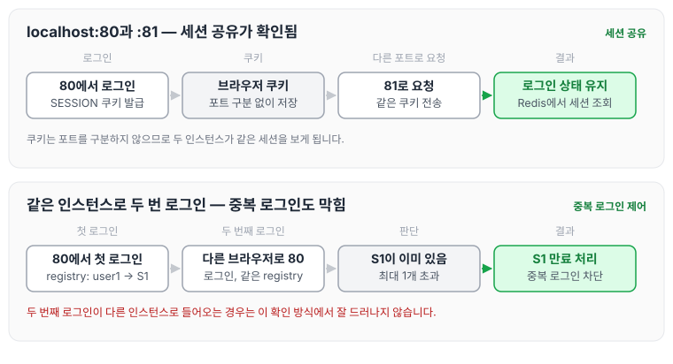
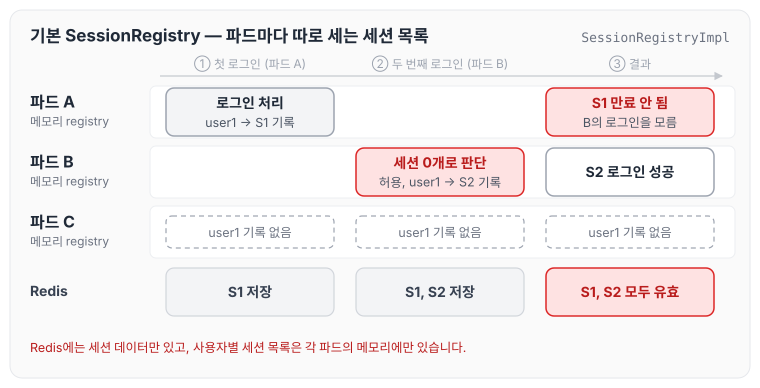
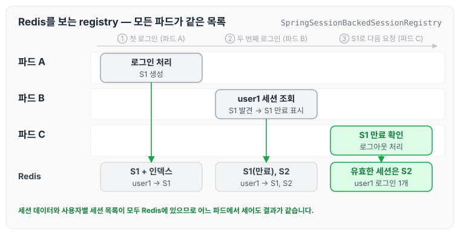
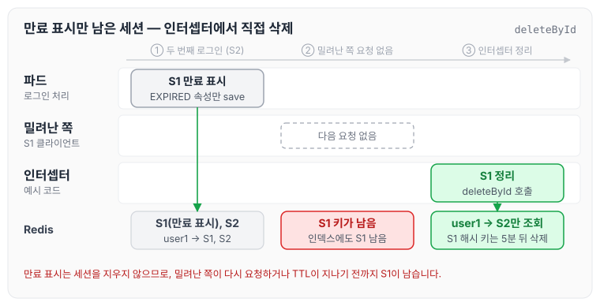

Spring Security의 `maximumSessions(1)`로 중복 로그인을 막고, 세션은 Spring Session과 Redis로 공유하고 있었습니다. 로컬에서 확인했을 때는 문제가 없어 보였는데, 서버에 올리자 중복 로그인이 막히지 않는 문제가 있었습니다. 오늘은 그 원인과 `SpringSessionBackedSessionRegistry`로 해결한 방법, 그리고 해결한 뒤에도 밀려난 세션이 Redis에 남아 인터셉터로 지운 내용까지 정리하도록 하겠습니다.

## 문제 발생

상황을 정리하면 아래와 같습니다.

- Spring Security의 `maximumSessions(1)`로 중복 로그인을 막고 있었습니다.
- 세션은 Spring Session + Redis로 공유하고 있었습니다.
- SessionRegistry는 따로 설정하지 않고 기본 SessionRegistry를 그대로 사용하였습니다.
- 로컬에서 애플리케이션을 80 포트와 81 포트로 두 개 띄워 확인했을 때는 세션 클러스터링이 잘 되는 것처럼 보였습니다.
- 서버(k8s, 파드 3개, 멀티 클러스터 환경)에 올리자 중복 로그인이 막히지 않았습니다.
- `SpringSessionBackedSessionRegistry`로 바꿔 해결한 뒤에도, 중복 로그인으로 밀려난 세션 데이터가 Redis 저장소에서 삭제되지 않았습니다. 그래서 인터셉터에서 중복 로그인으로 밀려난 세션 데이터를 직접 삭제하였습니다.

문제가 있던 설정은 아래와 같은 형태입니다. 이 글의 코드는 실제 프로젝트 코드가 아니라 Spring Boot 3 / Spring Security 6 기준으로 작성한 예시입니다.

```java
http
    .sessionManagement(session -> session
        .maximumSessions(1));   // sessionRegistry 미지정 → 기본 SessionRegistryImpl(메모리)
```

## 세션 공유와 중복 로그인 제어는 다른 문제

원인을 보기 전에, 세션 공유와 중복 로그인 제어가 서로 다른 곳에서 처리된다는 점을 먼저 정리하겠습니다.

- Spring Session + Redis는 세션 데이터(로그인 정보)를 Redis에 저장합니다. 그래서 어느 파드로 요청이 가더라도 로그인 상태가 유지됩니다.
- 중복 로그인 제어(`maximumSessions`)는 SessionRegistry가 가진 "이 사용자의 세션 목록"을 보고 판단합니다.
- 기본 SessionRegistry인 `SessionRegistryImpl`은 사용자별 세션 목록을 JVM 메모리(`ConcurrentHashMap`)에 저장합니다. Spring Security 문서에서도 기본 SessionRegistry 구현이 메모리의 Map을 사용한다고 설명하고 있습니다.

즉 세션 데이터는 Redis에서 공유되지만, 사용자별 세션 목록은 애플리케이션 인스턴스마다 따로 가지고 있게 됩니다.

## 로컬에서는 잘 되는 것처럼 보인 이유

로컬에서 80 포트와 81 포트로 띄워 확인할 때 문제가 드러나지 않는 이유는 일반적인 원리로 설명할 수 있습니다.

- 쿠키는 포트를 구분하지 않습니다. `localhost:80`과 `localhost:81`은 같은 세션 쿠키(Spring Session의 기본 쿠키 이름은 `SESSION`)를 함께 사용합니다.
- 세션은 Redis에 있으므로, 80에서 로그인한 뒤 81로 요청해도 로그인 상태가 보입니다. 이때 "세션 클러스터링이 된다"고 확인한 것은 세션 공유가 된 것입니다.
- 다른 브라우저로 같은 80 포트에 다시 로그인하는 것처럼 같은 인스턴스로 두 번 로그인하면 그 인스턴스의 메모리 registry가 앞 세션을 알고 있으므로 중복 로그인도 막힙니다.

이를 그림으로 보면 아래와 같습니다.



두 경우 모두 정상적으로 동작하기 때문에, 이런 확인 방식으로는 "다른 인스턴스로 들어온 두 번째 로그인"이 잘 드러나지 않습니다.

## 서버에서 중복 로그인이 막히지 않은 이유

k8s에서는 Service나 Ingress가 로그인 요청을 여러 파드로 나눠 보냅니다. 첫 번째 로그인이 파드 A로 가면 파드 A의 메모리 registry에만 기록되고, 두 번째 로그인이 파드 B로 가면 파드 B의 registry에만 기록됩니다. 파드 B의 registry에는 이 사용자의 세션이 없으므로, 최대 세션 수 1을 넘지 않는다고 판단하고 로그인을 허용합니다.

파드 3개에서 같은 사용자가 두 번 로그인하는 흐름은 아래와 같습니다.



Redis에는 S1과 S2 세션 데이터가 모두 저장되지만, 세션 수를 세는 쪽은 각 파드의 메모리이기 때문에 앞 세션이 만료되지 않습니다.

또한 파드가 재시작되거나 재배포되면 메모리 registry가 비워지므로, 이미 로그인한 사용자의 세션도 알지 못하게 됩니다.

## 해결: SpringSessionBackedSessionRegistry

`SpringSessionBackedSessionRegistry`는 Spring Session이 제공하는 SessionRegistry 구현입니다. `FindByIndexNameSessionRepository`를 사용해 Redis에서 사용자(principal name)별 세션을 찾기 때문에, 모든 파드가 같은 세션 목록을 보게 됩니다.

설정 예시는 아래와 같습니다. Spring Session 문서의 Spring Security 연동 예시와 같은 구성입니다.

```java
@Configuration
@EnableWebSecurity
public class SecurityConfig<S extends Session> {

    private final FindByIndexNameSessionRepository<S> sessionRepository;

    public SecurityConfig(FindByIndexNameSessionRepository<S> sessionRepository) {
        this.sessionRepository = sessionRepository;
    }

    @Bean
    public SpringSessionBackedSessionRegistry<S> sessionRegistry() {
        return new SpringSessionBackedSessionRegistry<>(sessionRepository);
    }

    @Bean
    public SecurityFilterChain filterChain(HttpSecurity http) throws Exception {
        http
            .sessionManagement(session -> session
                .maximumSessions(1)
                .sessionRegistry(sessionRegistry()));
        return http.build();
    }
}
```

여기서 주의할 점은 `FindByIndexNameSessionRepository` 빈이 있어야 한다는 것입니다. Redis 세션 저장소에는 두 가지 구현이 있습니다.

| 구현 | 특징 |
|------|------|
| `RedisSessionRepository` | 세션 ID로만 세션을 저장·조회합니다. Spring Boot에서 별도 설정이 없을 때 사용됩니다 |
| `RedisIndexedSessionRepository` | principal name 같은 인덱스를 Redis에 추가로 두고, `FindByIndexNameSessionRepository`를 구현합니다 |

`SpringSessionBackedSessionRegistry`를 사용하려면 indexed 방식인 `RedisIndexedSessionRepository`를 사용해야 합니다. Spring Boot 3.0부터는 `spring.session.redis.repository-type` 속성으로 선택할 수 있고, 기본값은 `default`입니다. 또는 `@EnableRedisIndexedHttpSession`으로 설정할 수도 있습니다.

```yaml
spring:
  session:
    redis:
      repository-type: indexed
      # 관리형 Redis에서 CONFIG 명령이 막혀 있다면
      # configure-action: none
```

Spring Boot 4에서는 이 속성들의 이름이 `spring.session.data.redis.repository-type`, `spring.session.data.redis.configure-action`으로 바뀌었으므로 사용하는 버전에 맞춰 적어야 합니다.

indexed 저장소는 세션 데이터 외에 principal name 인덱스 키(`spring:session:index:org.springframework.session.FindByIndexNameSessionRepository.PRINCIPAL_NAME_INDEX_NAME:<사용자명>`)를 Redis에 추가로 둡니다. `SpringSessionBackedSessionRegistry`는 이 인덱스로 사용자의 세션을 찾습니다.

바꾼 뒤의 흐름은 아래와 같습니다.



두 번째 로그인이 어느 파드로 가더라도 Redis에서 앞 세션을 찾을 수 있고, 만료 표시도 Redis의 세션에 남기 때문에 앞 세션의 다음 요청이 다른 파드로 가더라도 만료된 세션으로 처리됩니다.

참고로 Spring Session 문서에 따르면 `SpringSessionBackedSessionRegistry`는 `getAllPrincipals` 메서드를 지원하지 않습니다. Spring Security가 이 메서드를 호출하지는 않으므로, SessionRegistry를 직접 사용하는 코드가 있을 때만 확인하면 됩니다.

## 밀려난 세션이 Redis에서 바로 지워지지 않는 문제

`SpringSessionBackedSessionRegistry`로 바꾼 뒤 중복 로그인은 막혔지만, 중복 로그인으로 밀려난 세션 데이터가 Redis 저장소에서 삭제되지 않았습니다.

원인은 "만료 표시"와 "삭제"가 따로 일어나기 때문입니다. 소스를 따라가 보면 아래와 같습니다.

1. 두 번째 로그인에서 `ConcurrentSessionControlAuthenticationStrategy`가 최대 세션 수를 넘은 앞 세션에 `expireNow()`를 호출합니다.
2. `SpringSessionBackedSessionInformation.expireNow()`는 Redis에서 앞 세션을 찾아 만료 속성(`EXPIRED_ATTR`)을 넣고 `save`할 뿐, 세션을 지우지 않습니다.
3. 실제 삭제는 밀려난 쪽 클라이언트가 다음 요청을 보냈을 때 일어납니다. `ConcurrentSessionFilter`가 만료된 세션을 발견하면 로그아웃 처리를 하고, 기본 `SecurityContextLogoutHandler`가 세션을 invalidate하고, Spring Session이 저장소의 `deleteById()`를 호출합니다.
4. 또는 `maxInactiveInterval`(TTL)이 지나 세션이 만료될 때 정리됩니다.

그래서 밀려난 사용자가 다시 요청하지 않으면, TTL이 지나기 전까지 세션 키와 principal 인덱스 항목이 Redis에 그대로 남습니다.

이를 해결하기 위해 인터셉터에서 밀려난 세션 데이터를 직접 삭제하였습니다. 아래 코드는 실제 프로젝트 코드가 아니라, 같은 사용자의 세션 중 만료 표시된 세션을 찾아 지우는 방식으로 작성한 `HandlerInterceptor` 예시입니다.

```java
import java.util.Map;

import jakarta.servlet.http.HttpServletRequest;
import jakarta.servlet.http.HttpServletResponse;
import jakarta.servlet.http.HttpSession;

import org.springframework.security.authentication.AnonymousAuthenticationToken;
import org.springframework.security.core.Authentication;
import org.springframework.security.core.context.SecurityContextHolder;
import org.springframework.session.FindByIndexNameSessionRepository;
import org.springframework.session.Session;
import org.springframework.stereotype.Component;
import org.springframework.web.servlet.HandlerInterceptor;

@Component
public class ExpiredSessionCleanupInterceptor implements HandlerInterceptor {

    // SpringSessionBackedSessionInformation.EXPIRED_ATTR 값 (패키지 외부에서 접근할 수 없어 문자열로 둔다)
    private static final String EXPIRED_ATTR =
            "org.springframework.session.security.SpringSessionBackedSessionInformation.EXPIRED";

    private final FindByIndexNameSessionRepository<? extends Session> sessionRepository;

    public ExpiredSessionCleanupInterceptor(FindByIndexNameSessionRepository<? extends Session> sessionRepository) {
        this.sessionRepository = sessionRepository;
    }

    @Override
    public boolean preHandle(HttpServletRequest request, HttpServletResponse response, Object handler) {
        Authentication authentication = SecurityContextHolder.getContext().getAuthentication();
        HttpSession currentSession = request.getSession(false);
        if (authentication == null || authentication instanceof AnonymousAuthenticationToken || currentSession == null) {
            return true;
        }

        Map<String, ? extends Session> sessions = sessionRepository.findByPrincipalName(authentication.getName());
        for (Map.Entry<String, ? extends Session> entry : sessions.entrySet()) {
            String sessionId = entry.getKey();
            Boolean expired = entry.getValue().getAttribute(EXPIRED_ATTR);
            if (!sessionId.equals(currentSession.getId()) && Boolean.TRUE.equals(expired)) {
                sessionRepository.deleteById(sessionId);   // principal 인덱스 항목은 바로 제거, 세션 해시 키는 약 5분 뒤 삭제
            }
        }
        return true;
    }
}
```

인터셉터는 `WebMvcConfigurer`의 `addInterceptors`로 등록합니다.

```java
import org.springframework.context.annotation.Configuration;
import org.springframework.web.servlet.config.annotation.InterceptorRegistry;
import org.springframework.web.servlet.config.annotation.WebMvcConfigurer;

@Configuration
public class WebConfig implements WebMvcConfigurer {

    private final ExpiredSessionCleanupInterceptor expiredSessionCleanupInterceptor;

    public WebConfig(ExpiredSessionCleanupInterceptor expiredSessionCleanupInterceptor) {
        this.expiredSessionCleanupInterceptor = expiredSessionCleanupInterceptor;
    }

    @Override
    public void addInterceptors(InterceptorRegistry registry) {
        registry.addInterceptor(expiredSessionCleanupInterceptor);
    }
}
```

`RedisIndexedSessionRepository.deleteById()`는 principal 인덱스 항목과 expires 키(`spring:session:sessions:expires:<id>`)는 바로 지웁니다. 세션 해시 키(`spring:session:sessions:<id>`)는 `maxInactiveInterval`을 0으로 저장해 더 이상 조회되지 않게 만들고, 만료 이벤트를 처리할 수 있도록 약 5분 뒤에 Redis에서 지워지게 둡니다. 그래서 `deleteById()`를 호출한 직후에도 해시 키는 잠시 보일 수 있지만, 세션으로 조회되거나 사용자의 세션 목록에 잡히지는 않습니다. 만료 표시된 세션을 인터셉터가 지우는 흐름은 아래와 같습니다.



예시처럼 모든 요청에 인터셉터를 걸면 요청마다 Redis 조회가 한 번씩 더 일어나므로, 적용할 경로를 좁히는 것이 좋습니다. 로그인 성공 시점에 한 번만 정리하고 싶다면 `AuthenticationSuccessHandler` 같은 자리에서 같은 처리를 할 수도 있습니다.

또한 밀려난 세션을 먼저 지우면, 밀려난 쪽이 다음 요청을 보낼 때 `ConcurrentSessionFilter`의 만료 처리 대신 세션이 없는 요청으로 처리됩니다. 만료 안내 화면을 따로 보여 주고 있다면 이 차이도 함께 확인해야 합니다.

## 관리형 Redis를 쓴다면 확인할 점

indexed 저장소는 세션 만료·삭제 이벤트를 받기 위해 Redis의 keyspace 알림(`notify-keyspace-events`)을 사용하고, Spring Boot는 기본적으로 애플리케이션 기동 시 `CONFIG` 명령으로 이 설정을 적용합니다. AWS ElastiCache 같은 관리형 Redis는 `CONFIG` 명령을 막아 두는 경우가 있어, 기동 시 이 설정에서 에러가 날 수 있습니다.

이때는 위 설정의 주석처럼 `spring.session.redis.configure-action: none`으로 애플리케이션이 설정하지 않게 하고, Redis 쪽(ElastiCache라면 파라미터 그룹)에서 `notify-keyspace-events`를 직접 설정하면 됩니다.

## 마무리

오늘은 Spring Session과 Redis로 세션을 공유하는데도 파드가 여러 개인 서버에서 중복 로그인이 막히지 않은 원인과 해결 방법, 그리고 밀려난 세션이 Redis에 남는 문제에 대해 정리하였습니다.

- 로컬에서 포트 두 개로 확인하는 것만으로는 인스턴스마다 따로 가진 상태가 잘 드러나지 않습니다.
- 세션을 Redis로 공유하더라도, 세션을 세는 쪽(SessionRegistry)까지 공유 저장소를 보게 해야 합니다.
- `SpringSessionBackedSessionRegistry`는 밀려난 세션에 만료 표시만 하므로, 밀려난 쪽이 다시 요청하지 않으면 TTL이 지날 때까지 Redis에 남습니다. 바로 지우려면 직접 삭제해야 합니다.

세션 데이터만 공유되면 충분하다고 생각하기 쉬운데, 인스턴스가 여러 개일 때는 메모리에 남아 있는 상태가 없는지 함께 확인해야 할 것 같습니다.

## 참고 자료

- [Spring Session — Spring Security Integration (Concurrent Session Control)](https://docs.spring.io/spring-session/reference/spring-security.html#spring-security-concurrent-sessions)
- [Spring Session — Redis Configuration](https://docs.spring.io/spring-session/reference/configuration/redis.html)
- [Spring Session — RedisIndexedSessionRepository](https://docs.spring.io/spring-session/reference/api.html)
- [Spring Security — Concurrent Session Control](https://docs.spring.io/spring-security/reference/servlet/authentication/session-management.html#ns-concurrent-sessions)
- [Spring Security API — SessionRegistryImpl](https://docs.spring.io/spring-security/site/docs/current/api/org/springframework/security/core/session/SessionRegistryImpl.html)
- [Spring Boot 3.5 Application Properties (spring.session.redis.*)](https://docs.spring.io/spring-boot/3.5/appendix/application-properties/index.html)
- [Spring Session 소스 — SpringSessionBackedSessionInformation](https://github.com/spring-projects/spring-session/blob/main/spring-session-core/src/main/java/org/springframework/session/security/SpringSessionBackedSessionInformation.java)
- [Spring Session 소스 — RedisIndexedSessionRepository](https://github.com/spring-projects/spring-session/blob/main/spring-session-data-redis/src/main/java/org/springframework/session/data/redis/RedisIndexedSessionRepository.java)
- [Spring Security 소스 — ConcurrentSessionControlAuthenticationStrategy](https://github.com/spring-projects/spring-security/blob/main/web/src/main/java/org/springframework/security/web/authentication/session/ConcurrentSessionControlAuthenticationStrategy.java)
- [Spring Security 소스 — ConcurrentSessionFilter](https://github.com/spring-projects/spring-security/blob/main/web/src/main/java/org/springframework/security/web/session/ConcurrentSessionFilter.java)
- [Spring Security 소스 — SecurityContextLogoutHandler](https://github.com/spring-projects/spring-security/blob/main/web/src/main/java/org/springframework/security/web/authentication/logout/SecurityContextLogoutHandler.java)
- [Spring Session 소스 — SessionRepositoryFilter](https://github.com/spring-projects/spring-session/blob/main/spring-session-core/src/main/java/org/springframework/session/web/http/SessionRepositoryFilter.java)
- [Spring Session Redis를 이용한 세션 중복 처리 삽질기 with AWS ElastiCache](https://velog.io/@solst_ice/Spring-Session-Redis%EB%A5%BC-%EC%9D%B4%EC%9A%A9%ED%95%9C-%EC%84%B8%EC%85%98-%EC%A4%91%EB%B3%B5-%EC%B2%98%EB%A6%AC-%EC%82%BD%EC%A7%88%EA%B8%B0-with-AWS-ElastiCache)
