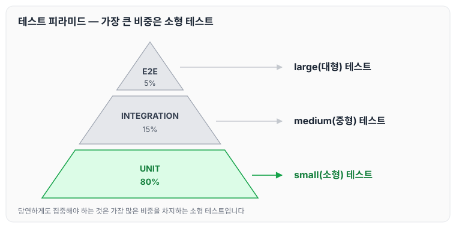
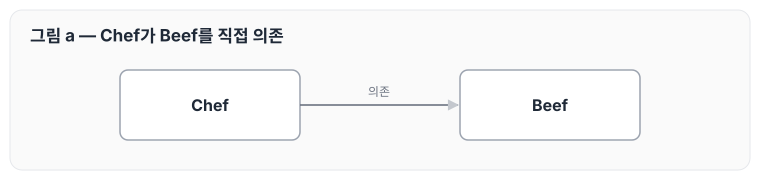
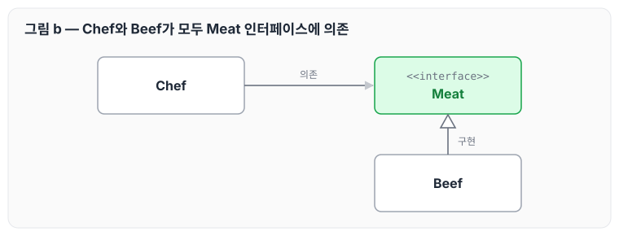
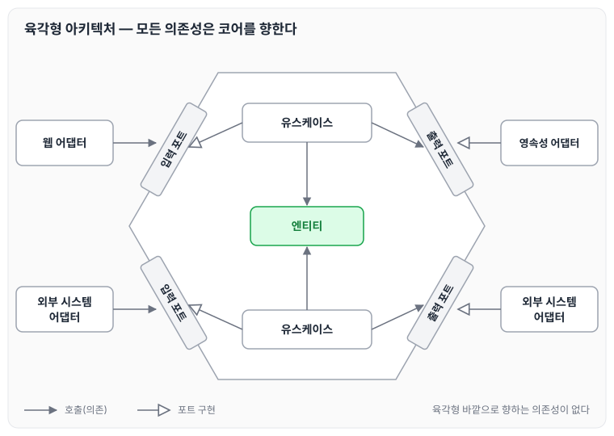

오늘은 인프런의 Java/Spring 테스트를 추가하고 싶은 개발자들의 오답노트 강의를 들으며 인상 깊었던 부분과, 실무에 적용하면 좋을 것 같은 부분을 정리하도록 하겠습니다.

## 강의를 수강하게 된 계기

링크드인에서 이동욱 인프런 CTO님을 팔로우했는데, Java/Spring 테스트를 추가하고 싶은 개발자들의 오답노트 강의에 대한 평가를 너무 좋게 작성해서 놀랐다는 글을 보았습니다.

넥스트스텝에서 객체지향적으로 설계하는 방법과 TDD 작성을 배웠지만([Set 컬렉션으로 배우는 학습 테스트 — 1단계](../ccj-02-learning-test/) 등), 실무에 적용하려고 했을 때 유연하게 활용하지 못했던 경험이 있어서 좀 더 공부하고 싶은 마음에 강의를 수강하게 되었습니다.

5월 12일 현재 섹션 1까지 들었는데, 저에게 가장 인상 깊었던 부분과 실무에도 적용하면 좋을 것 같다고 생각되는 부분을 작성하도록 하겠습니다.

## 테스트에서 가장 중요한 부분

테스트에서 가장 중요한 것은 소형 테스트입니다. 테스트를 비중에 따라 나누면 아래와 같습니다.



E2E는 대형 테스트, INTEGRATION은 중형 테스트, UNIT은 소형 테스트에 해당하고, 가장 많은 비중을 차지하는 소형 테스트에 집중해야 합니다. 소형 테스트를 진행하기 위해서는 행위보다는 상태를 테스트하는 것이 좋습니다.

## 테스트에서 사용하는 개념

- SUT : System Under Test(테스트하려는 대상)

```java
@Test
void 유저테스트() {
	//given
	User sut = User.builder()
		.bookmark(new ArrayList<>())
		.build(); // 테스트 하려는 대상
}
```

- 테스트 픽스처 : 테스트에 필요한 자원을 생성하는 것

```java
private User sut;

@BeforeEach
void 사용자는_미리_할당합니다() {
	sut = User.builder()
		.bookmark(new ArrayList<>())
		.build(); // 테스트 하려는 대상
}
```

- 더미(Dummy) : 아무런 동작도 하지 않고, 정상적으로 돌아가기 위해 전달하는 객체

```java
@Test
public void 이메일_회원가입을_할_수있다() {
	//given
	UserCreateRequest userCreateRequest = UserCreateRequest.builder()
			.email("foo@localhost.com")
			.password("123456")
			.build();
			
	UserService sut = UserService.builder()
			.registerEmailSender(new DummyRegisterEmailSender())
			.userRepository(userRepository)
			.build();
	sut.register(userCreateRequest);
}

//더미 객체가 되는 것.
class DummyRegisterEmailSender implements RegisterEmailSender {

		@Override
		public void send(String email, String message) {
		}
}
```

- 속임(Fake) : Local에서 사용하거나 테스트에서 사용하기 위해 만들어진 가짜 객체

```java
@Test
public void 이메일_회원가입을_할_수있다() {
	//given
	UserCreateRequest userCreateRequest = UserCreateRequest.builder()
			.email("foo@localhost.com")
			.password("123456")
			.build();
			
	UserService sut = UserService.builder()
			.registerEmailSender(new FakeRegisterEmailSender())
			.userRepository(userRepository)
			.build();
	sut.register(userCreateRequest);
}

//속임(Fake) 객체가 되는 것.
class FakeRegisterEmailSender implements RegisterEmailSender {

		private final Map<String, List<String>> latestMessages = new HashMap<>();
		
		@Override
		public void send(String email, String message) {
				List<String> records = latestMessages.getOrDefault(email, new ArrayList<>());
				records.add(message);
				latestMessages.put(email, records);
		}
		
		public Optional<String> findLatestMessage(String email) {
				return latestMessages.getOrDefault(email, new ArrayList<>()).stream().findFirst();
		}
}
```

- 스텁(Stub) : 미리 준비된 값을 출력하는 객체

```java
class StubUserRepository implements UserRepository {
	
		public User getByEmail(String email) {
				if (email.equals("foo@bar.com")) {
						return User.builder()
								.email("foo@bar.com")
								.status("PENDING")
								.build();
				}
				throw new UsernameNotFoundException(email);
		}
}
```

## 의존성

강의를 들으면서 가장 좋았던 부분은 의존성 주입과 의존성 역전을 통해서 유연하게 테스트를 진행할 수 있고, 소스 코드 관리도 더 잘할 수 있다는 내용이었습니다. 이 부분은 소스 코드를 남기고 차후에도 볼 수 있도록 정리하였습니다.

- 의존성 주입(DI) : 인스턴스를 직접 만드는 것이 아니라, 상위에서 생성한 객체를 생성자의 매개변수로 받습니다.



- 의존성 역전(DIP) : 인터페이스나 추상 클래스 같은 추상적인 선언을 참조해서 사용합니다.



그림 a에서는 Chef가 Beef라는 구체 클래스에 직접 의존하지만, 그림 b에서는 Chef가 Meat 인터페이스에 의존하고 Beef가 Meat를 구현합니다. 의존성 역전의 원칙 자체는 [SOLID](../solid/)에 정리하였습니다.

테스트를 잘하려면 의존성 주입과 의존성 역전을 잘 다룰 수 있어야 합니다. 아래 두 예제로 이 부분을 정리하겠습니다.

## User 객체의 마지막 로그인 시간 테스트

User 객체는 아래와 같습니다.

```java
class User {
		private long lastLoginTimestamp;
		
		public void login() {
				//..
				this.lastLoginTimestamp = Clock.systemUTC().millis();
		}
}
```

- 내부 로직은 Clock에 의존합니다.
- 외부에서 보면 login이 시간에 의존하고 있는지 알 수 없습니다.

### 문제

User의 로그인 시간을 테스트하려면 어떻게 해야 하는지가 문제입니다.

```java
class UserTest {
		
		@Test
		public void login_테스트() {
			User user = new User();
			
			user.login();
			
			assertThat(user.getLastLoginTimestamp()).isEqualTo(???); // 😭🥳 어떻게 테스트 해야 될 지 모른다.
		}
}
```

`login()` 내부에서 `Clock.systemUTC()`에 직접 의존하도록 코드를 작성했기 때문에 테스트를 진행할 수 없습니다.

### 해결 방법

의존성 주입으로 해결할 수 있습니다. `Clock`을 `login()`의 매개변수로 받도록 바꿉니다.

```java
class User {
		private long lastLoginTimestamp;
		
		public void login(Clock clock) {
				//..
				this.lastLoginTimestamp = clock.millis();
		}
}
```

User 테스트 코드는 아래와 같습니다. 고정된 시간을 가진 `Clock`을 넘기기 때문에 기대값을 정할 수 있습니다.

```java
class UserTest {
		
		@Test
		public void login_테스트() {
			User user = new User();
			Clock clock = Clock.fixed(Instant.parse("2000-01-01T00:00:00.00Z"), ZoneOffset.UTC);
			
			user.login(clock);
			
			assertThat(user.getLastLoginTimestamp()).isEqualTo(946684800000L); 
		}
}
```

## UserService 테스트

UserService 클래스는 아래와 같습니다.

```java
class UserService {
		public void login(User user) {
				user.login(Clock.systemUTC());
		}
}
```

### 문제

UserService를 테스트하는 코드는 아래와 같습니다.

```java
class UserServiceTest {
		@Test
		public void login_테스트() {
				User user = new User();
				UserService userService = new UserService();
				
				userService.login(user);
				
				assertThat(user.getLastLoginTimestamp()).isEqualTo(???);
		}
}
```

UserService에서 테스트를 진행하려면 의존성 주입으로 고정값을 지정해 줘야 합니다. 결국 User에서처럼 내부의 값을 어딘가에 숨겼기 때문에 테스트하기 어려워지는 것입니다. 이를 해결하려면 DIP(의존성 역전)를 사용해야 합니다.

### 해결 방법

먼저 시간을 제공하는 인터페이스 `ClockHolder`를 만듭니다.

```java
interface ClockHolder {

		long getMillis();

}
```

테스트에서 사용할 `TestClockHolder`는 생성자로 받은 `Clock`의 시간을 반환합니다.

```java
@AllArgsConstructor
class TestClockHolder implements ClockHolder {
		
		private Clock clock;
		
		public long getMillis() {
			return clock.millis();
		}
}
```

UserService는 `ClockHolder` 인터페이스에 의존하도록 바꿉니다.

```java
@Service
@RequiredArgsConstructor
class UserService {
		
		private final ClockHolder clockHolder;
		
		public void login(User user) {
				user.login(clockHolder);
		}
}
```

UserServiceTest에서는 고정된 `Clock`을 가진 `TestClockHolder`를 넘깁니다.

```java
class UserServiceTest {

		@Test
		public void 로그인_테스트() {
				Clock clock = Clock.fixed(Instant.parse("2000-01-01T00:00:00.00Z"), ZoneOffset.UTC);
				User user = new User();
				UserService userService = new UserService(new TestClockHolder(clock));
				
				//when 
				userService.login(user);
				
				//then
				assertThat(user.getLastLoginTimestamp()).isEqualTo(946684800000L);
		}
}
```

이렇게 하면 항상 일관된 테스트 코드를 작성할 수 있고, 테스트가 쉽게 깨지지 않습니다. 같은 방식으로 Controller도 DIP를 사용해서 테스트를 진행합니다.

코드를 바꾸다 보니 어느새 만들면서 배우는 클린 아키텍처에서 본 헥사고날 아키텍처(육각형 아키텍처)가 되어 가고 있었고, 기존에 읽었던 책들을 다시 한번 생각하는 계기가 되었습니다. 책의 [의존성 역전하기](../clean-arch-02-dependency-inversion/)에서 정리한 육각형 아키텍처는 아래와 같습니다.



육각형 아키텍처에서는 육각형에서 외부로 향하는 의존성이 없고, 모든 의존성이 코어를 향합니다.

## 마무리

오늘은 Java/Spring 테스트를 추가하고 싶은 개발자들의 오답노트 강의를 들으며 소형 테스트의 중요성과 테스트에서 사용하는 개념, 그리고 의존성 주입과 의존성 역전으로 테스트하기 어려운 코드를 바꾸는 방법에 대해 정리하였습니다. 자바나 스프링을 시작한 지 얼마 되지 않았다면 어려울 수도 있겠지만, 현업에서 Spring을 사용하고 있다면 충분히 이해할 수 있는 내용이었고 테스트하는 데 큰 도움이 된 강의였습니다.

핵심은 DI와 DIP를 이용해 Spring, Mock, DB에 의존하지 않게 테스트하고, 단위 테스트를 잘 작성해야 한다는 것 같습니다. 정말 많은 도움이 된 강의라서 추천드립니다.

참조 : [Java/Spring 테스트를 추가하고 싶은 개발자들의 오답노트 | 김우근 - 인프런](https://www.inflearn.com/course/자바-스프링-테스트-개발자-오답노트/dashboard)
