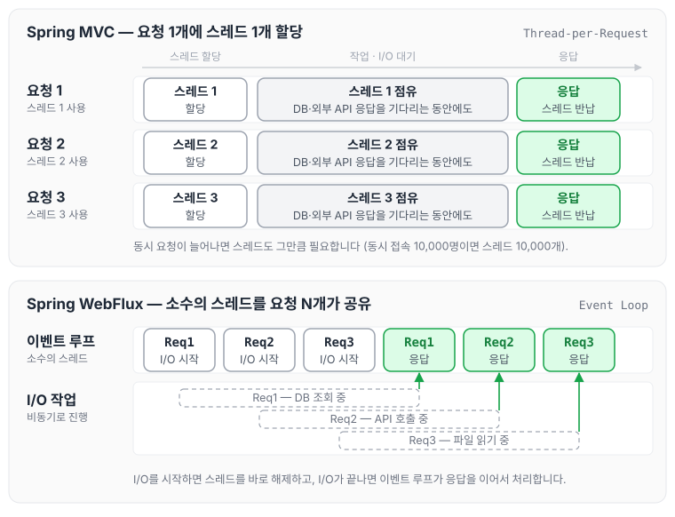
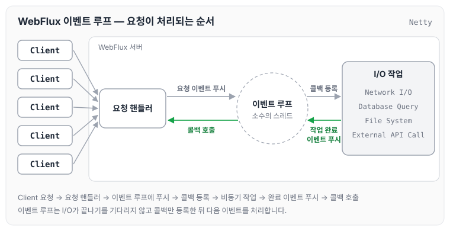
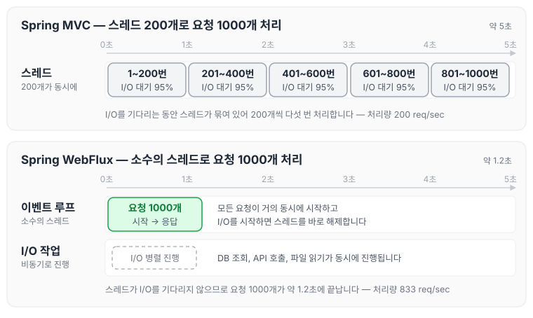

오늘은 골든크로스, 데드크로스 돌파에 따라 매수·매도하는 프로젝트를 구성하면서 어떤 고민을 하였고, 왜 해당 기술을 사용했는지 정리하도록 하겠습니다.

이 프로젝트에 필요한 API는 아래와 같습니다.

1. 실시간 시세 수집
2. 주문 처리
3. 텔레그램 알림 API 등

이처럼 다양한 API를 활용해야 했고, 자료를 찾던 중 `WebFlux`를 알게 되었습니다. WebFlux는 리액티브 웹 애플리케이션을 만들기 위한 프레임워크로, Spring 5.0부터 지원되는 Reactive Web Framework입니다.

## Thread-per-Request 모델과 Event Loop 모델

Spring MVC는 Thread-per-Request 모델로, 보통 요청 1개에 스레드 1개를 할당합니다.

```text
요청 1개 → 스레드 1개 할당 → 작업 완료까지 스레드 점유
```

반면 Spring WebFlux는 Event Loop 모델로, 요청 N개가 소수의 스레드를 공유하고 작업을 기다리는 동안에는 스레드를 해제합니다.

```text
요청 N개 → 소수의 스레드 공유 → 작업 대기시 스레드 해제
```

두 모델이 요청을 스레드에 배정하는 방식을 나란히 그리면 다음과 같습니다.



MVC에서는 동시 요청 수만큼 스레드가 필요하고, WebFlux에서는 I/O를 기다리는 동안 스레드가 다른 요청을 처리합니다.

## WebFlux가 등장한 이유

WebFlux가 등장한 이유로는 아래 네 가지가 가장 크다고 생각합니다.

1. Spring MVC의 한계

    ```text
    동시 접속자 10,000명이 접속하면?
    
    Spring MVC:
    - 10,000개의 스레드 필요
    - 1개 스레드 = 약 1MB 메모리
    - 10,000 × 1MB = 10GB 메모리 필요!
    - 스레드 생성/관리 비용 증가
    - 컨텍스트 스위칭 오버헤드 급증
    ```

2. I/O 대기 시간 낭비

    ```text
    Spring MVC 요청 처리 시간 분석:
    
    총 1000ms 중:
    ├─ 실제 비즈니스 로직: 50ms (5%)
    ├─ DB 조회 대기: 500ms (50%) 스레드 점유
    ├─ 외부 API 호출 대기: 400ms (40%) 스레드 점유
    └─ 기타: 50ms (5%)
    
    95%의 시간을 대기하면서 스레드를 점유
    ```

3. 마이크로서비스 아키텍처의 부상

    ```text
    모놀리식 → 마이크로서비스 전환
    
    특징:
    - 서비스간 빈번한 HTTP 통신
    - 다수의 외부 API 호출
    - 네트워크 I/O 대기 시간 증가
    
    Spring MVC:
    각 API 호출마다 스레드가 블로킹되어 대기
    → 성능 병목 현상 발생
    ```

4. 실시간 스트리밍 데이터 처리 요구

    ```text
    최근 애플리케이션 트렌드:
    
    - 실시간 채팅
    - 실시간 알림 (Server-Sent Events)
    - 스트리밍 데이터 처리
    - WebSocket 통신
    
    Spring MVC:
    전통적인 요청-응답 모델에 최적화
    → 실시간 처리에 비효율적
    ```

요청마다 스레드를 점유하는 문제를 코드의 블로킹 방식은 그대로 두고 줄이는 방법으로는 Virtual Thread도 있으며, [Java 21의 Virtual Thread: 운영체제 개념과 효율성, 장단점 정리](../virtual-thread/)에서 정리하였습니다.

## WebFlux의 이벤트 루프 동작 방식

WebFlux는 이러한 문제를 서버 엔진에서 해결하였습니다. Spring Boot에서 WebFlux를 사용하면 기본 서버로 Netty를 사용하며, 요청을 소수의 이벤트 루프 스레드가 논블로킹 방식으로 처리합니다.

요청이 들어와서 응답이 나가기까지의 흐름은 다음과 같습니다.



동작 순서는 Client 요청 → 요청 핸들러 → 이벤트 루프에 푸시 → 콜백 등록 → 비동기 작업 → 완료 이벤트 푸시 → 콜백 호출 순입니다. 이벤트 루프는 I/O 작업이 끝나기를 기다리지 않고 콜백만 등록한 뒤 다음 이벤트를 처리합니다.

## CPU 집약적 작업과 I/O 집약적 작업

그렇다면 왜 다중 스레드를 활용하는 MVC보다 적은 스레드를 사용하는 WebFlux가 더 효율적인지 궁금해졌습니다. 이를 확인하기 위해 작업을 CPU 집약적 작업과 I/O 집약적 작업으로 나누어 보았습니다.

### CPU 집약적 작업 (CPU-bound)

계산이 많고 I/O 대기가 적은 작업입니다.

```java
// 복잡한 계산, 이미지 처리, 암호화 등
@GetMapping("/calculate")
public Result heavyCalculation() {
    // CPU만 사용하는 연산
    for (int i = 0; i < 100000000; i++) {
        // 복잡한 계산...
    }
    return result;
}
```

- 특징: CPU를 계속 사용
- 대기 시간: 거의 없음
- 스레드 상태: 항상 실행 중

### I/O 집약적 작업 (I/O-bound)

```java
// DB 조회, 외부 API 호출, 파일 읽기 등
@GetMapping("/order")
public Order getOrder(String id) {
    Order order = orderRepository.findById(id);      // DB I/O 100ms
    Payment payment = paymentApi.getPayment(id);    // API I/O 200ms
    Delivery delivery = deliveryApi.getStatus(id);  // API I/O 150ms
    return combine(order, payment, delivery);
}
```

- 특징: I/O를 기다림
- 대기 시간: 전체 시간의 80~95%
- 스레드 상태: 대부분 대기(블로킹) 중

## 작업 유형별 처리량 비교

### CPU 집약적 작업의 경우

먼저 CPU 연산이 대부분인 작업을 1000개 처리하는 시나리오입니다.

```text
시나리오
작업 내용: 복잡한 수학 계산, 이미지 처리
총 처리 시간: 1000ms
├─ CPU 연산: 950ms (95%)
└─ I/O 대기: 50ms (5%)

-----------
Spring MVC
-----------
8코어 CPU 환경:
- 동시에 8개 스레드가 CPU 사용
- 나머지 192개는 대기
- CPU 활용률: 100%

1000개 요청 처리:
1000개 ÷ 8 = 125라운드
125 × 1초 = 125초

-----------
Spring WebFlux
-----------
8코어 CPU 환경:
- 동시에 8개 스레드가 CPU 사용
- 나머지 8개는 대기
- CPU 활용률: 100%

1000개 요청 처리:
1000개 ÷ 8 = 125라운드
125 × 1초 = 125초
```

즉, CPU 집약적 작업에서는 컨텍스트 스위칭 비용 정도만 차이가 날 뿐 처리 시간에는 큰 차이가 없습니다.

### I/O 집약적 작업의 경우

하지만 최근 프로젝트에서 많이 다루는, I/O가 많은 작업이라면 결과가 달라집니다.

```text
작업 내용: DB 조회, 외부 API 호출
총 처리 시간: 1000ms
├─ CPU 연산: 50ms (5%)
└─ I/O 대기: 950ms (95%)  ← 대부분이 대기!

-----------
Spring MVC
-----------
Thread 1: [CPU 5%][I/O 대기 95%🔒] ← 스레드 블로킹!
Thread 2: [CPU 5%][I/O 대기 95%🔒] ← 스레드 블로킹!
Thread 3: [CPU 5%][I/O 대기 95%🔒] ← 스레드 블로킹!
...
Thread 200: [CPU 5%][I/O 대기 95%🔒] ← 스레드 블로킹!

95%의 시간동안 스레드는 아무것도 안 하고 메모리만 차지
1000개 요청 처리:
200개씩 5번 = 5초
처리량: 200 req/sec

-----------
Spring WebFlux
-----------
Thread 1: [Req1-CPU][Req2-CPU][Req3-CPU]...[Req100-CPU]
          └ I/O 시작 → 즉시 해제 
          
I/O 작업들은 백그라운드에서 동시 진행:
Request 1: DB 조회 중... (비동기)
Request 2: API 호출 중... (비동기)
Request 3: 파일 읽기 중... (비동기)

I/O 완료되면:
Thread 2: [Req1-완료][Req2-완료][Req3-완료]...

1000개 요청 처리:
모든 요청이 거의 동시에 시작
→ I/O는 병렬로 진행
→ 약 1.2초에 완료

처리량: 833 req/sec
```

위 시나리오를 같은 시간 축에 놓으면 다음과 같습니다.



MVC는 스레드가 I/O를 기다리는 동안 다음 요청을 받지 못해 200개씩 차례로 처리하고, WebFlux는 I/O를 기다리는 동안 스레드를 해제해 요청을 거의 동시에 시작합니다.

위 결과로 알 수 있듯이, WebFlux는 비동기 처리 방식 덕분에 여러 I/O 작업이 동시에 진행되면서 처리량이 약 4배 가량 증가한 것을 확인할 수 있었고, CPU 사용률 또한 MVC에 비해 월등히 좋은 것을 알 수 있었습니다.

## Spring MVC와 WebFlux 선택 기준

이를 바탕으로 어떤 관점에서 WebFlux를 사용해야 할지, MVC를 사용해야 할지 정리하면 아래와 같을 것 같습니다.

### Spring MVC를 사용해야 하는 경우

1. CPU 집약적 작업이 많은 경우
2. 간단한 CRUD 애플리케이션
3. 블로킹 라이브러리를 많이 사용하는 경우

### Spring WebFlux를 사용해야 하는 경우

1. I/O 집약적 작업이 많은 경우
2. 높은 동시성이 필요한 경우
3. 마이크로서비스 아키텍처

## 마무리

오늘은 자동매매 프로젝트를 구성하면서 Spring MVC와 WebFlux의 스레드 모델 차이와, 작업 유형에 따라 두 방식을 고르는 기준에 대해 정리하였습니다.

현재 저는 실시간 알림 서비스와 시세를 받아서 처리하는 로직을 구현해야 하기 때문에 WebFlux가 좀 더 부합한다고 생각하게 되었고, 이를 기반으로 소스 코드를 구현하며 학습하도록 하겠습니다. 또한 WebFlux에서도 동기적인 라이브러리를 사용할 수 있다고 보았는데, 비동기 방식의 WebFlux에서 동기적인 라이브러리를 사용하면 MVC와 동일한 성능을 내지 않을까 싶습니다. 이 부분에 대해서는 추가로 정리하려고 합니다.
