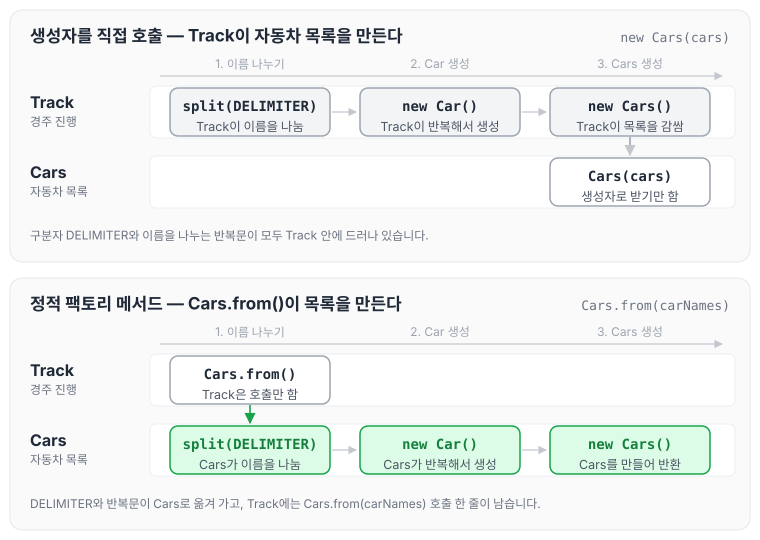

오늘은 정적 팩토리 메소드 패턴에 대해 정리하도록 하겠습니다.

정적 팩토리 메서드는 객체 생성의 역할을 하는 클래스 메서드라는 의미로 요약할 수 있습니다. 자동차 경주 코드에서 `Cars` 객체를 만드는 부분에 적용해 보았고, 이 코드는 [자동차 경주 리팩터링 — 5단계](../ccj-12-racing-refactor/) 미션에서 리뷰를 받고 바꾼 코드입니다.

## 정적 팩토리 메서드를 사용하지 않을 때

아래 `Track`에서는 `Cars` 객체를 생성할 때 for문을 돌면서 `Car`를 하나씩 추가하고 있습니다.

```java
public class Track {
    private static final String DELIMITER = ",|:";

    private int attemptCount;
    private Cars cars;

    public Track(final String carNames, final int attemptCount) {
        this.attemptCount = attemptCount;
        createCars(carNames);
    }

    private void createCars(final String carNames) {
        List<Car> cars = new ArrayList<>();
        for (String carName : carNames.split(DELIMITER)) {
            cars.add(new Car(carName));
        }
        this.cars = new Cars(cars);
    }
```

이렇게 작성하면 이름을 나누고 자동차를 만드는 과정이 `Track` 안에 그대로 드러나 있어서, 한눈에 보기에도 불편하다고 생각됩니다.

## 정적 팩토리 메서드를 사용할 때

다음과 같이 변경합니다.

```java
public class Track {
    private int attemptCount;
    private Cars cars;

    public Track(final String carNames, final int attemptCount) {
        this.attemptCount = attemptCount;
        createCars(carNames);
    }

    private void createCars(final String carNames) {
        this.cars = Cars.from(carNames);
    }
```

```java
public class Cars {
    private static final String DELIMITER = ",|:";

    private List<Car> cars;

    public Cars(List<Car> cars) {
        this.cars = cars;
    }

    public static Cars from(final String carNames) {
        List<Car> cars = new ArrayList<>();
        for (String carName : carNames.split(DELIMITER)) {
            cars.add(new Car(carName));
        }
        return new Cars(cars);
    }
```

정적 팩토리 메서드를 사용하면 생성할 때 진행해야 할 로직이 `Cars` 내부로 숨겨지고, `from`이라는 이름을 통해 문자열로부터 `Cars`가 만들어진다는 것을 의미적으로도 파악할 수 있습니다. 변경 전후에 생성 로직이 어디에 있는지 비교하면 아래와 같습니다.



변경 전에는 `Track`이 구분자로 이름을 나누고 `Car`와 `Cars`를 직접 생성했지만, 변경 후에는 `Track`이 `Cars.from(carNames)`만 호출하고 나머지는 `Cars` 안에서 처리됩니다. 참고로 `Cars`처럼 컬렉션 하나만 감싼 클래스를 일급 컬렉션이라고 하며, [일급컬렉션](../first-class-collection/)에 따로 정리하였습니다.

이외에도 장점이 더 있지만, 직접 사용해 보고 느낀 점이 생기면 추가로 적어 보겠습니다. 이후 책을 읽으며 정리한 장점은 [이펙티브 자바 2장: 객체 생성과 파괴](../effective-java-ch2/)에 있습니다.

## 정적 팩토리 메서드 네이밍 컨벤션

정적 팩토리 메서드에 자주 쓰는 이름은 아래와 같습니다.

- `from` : 하나의 매개 변수를 받아서 객체를 생성
- `of` : 여러 개의 매개 변수를 받아서 객체를 생성
- `getInstance` | `instance` : 인스턴스를 생성. 이전에 반환했던 것과 같을 수 있음.
- `newInstance` | `create` : 새로운 인스턴스를 생성
- `get[OtherType]` : 다른 타입의 인스턴스를 생성. 이전에 반환했던 것과 같을 수 있음.
- `new[OtherType]` : 다른 타입의 새로운 인스턴스를 생성.

## 마무리

오늘은 정적 팩토리 메서드로 객체 생성 로직을 감추는 방법과 네이밍 컨벤션에 대해 정리하였습니다. 생성 과정이 메서드 이름으로 드러나서 코드를 읽을 때 의도를 파악하기 쉬워지는 것 같습니다.

참조 : [https://tecoble.techcourse.co.kr/post/2020-05-26-static-factory-method/](https://tecoble.techcourse.co.kr/post/2020-05-26-static-factory-method/)
