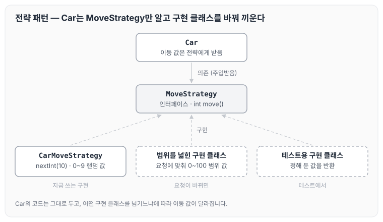

오늘은 전략 패턴에 대해 정리하도록 하겠습니다.

전략 패턴은 알고리즘들의 패밀리를 정의하고, 각 패밀리를 별도의 클래스에 넣은 후 그들의 객체들을 상호교환할 수 있도록 하는 행동 디자인 패턴입니다. 자동차 경주 코드에서 자동차의 이동 값을 만드는 부분에 전략 패턴을 적용해 보았고, 그 과정을 코드와 함께 정리하겠습니다. 이 코드는 [자동차 경주 리팩터링 — 5단계](../ccj-12-racing-refactor/) 미션에서 리뷰를 받고 바꾼 코드입니다.

## 변경 전 코드

아래 소스코드를 살펴보겠습니다.

- 현재 상황: `move`에 전달되는 `randomInt` 값은 0부터 9 사이의 값입니다.
- 클라이언트 요청사항: 예를 들어 랜덤 값의 범위를 0~100으로 늘려 달라는 요청이 들어올 수 있습니다.

이런 요청을 반영하려면 수정해야 할 영역이 많아집니다. 이때 전략 패턴을 사용하면 다음과 같이 개선할 수 있습니다.

```java
public class Car implements Comparable<Car> {
    private static final int STARTING_CONDITION = 4;
    private Position position;
    private Name name;

    public Car(final String name) {
        this.name = new Name(name);
        this.position = new Position();
    }

    public void move(int randomInt) {
        moveCar(isMove(randomInt));
    }
```

## 전략 패턴 적용

다음과 같이 변경하였습니다.

- 자동차에서는 이동 값을 인터페이스로 정의하고, DI(의존성 주입)로 구현 클래스를 받습니다.
- 외부에서 해당 인터페이스를 구현해 `move`의 값을 전달합니다.
- 이제 이동 값을 바꿔야 할 때는 인터페이스를 구현한 클래스를 만들어 언제든지 유연하게 대응할 수 있습니다.

먼저 이동 값을 돌려주는 `MoveStrategy` 인터페이스를 정의합니다.

```java
package study.step5.domain.strategy;

public interface MoveStrategy {

    int move();
}
```

랜덤 값을 만드는 구현 클래스는 아래와 같습니다.

```java
package study.step5.domain.strategy;

import java.util.Random;

public class CarMoveStrategy implements MoveStrategy {
    private static final int RANDOM_RANGE = 10;
    private static final Random RANDOM = new Random();

    @Override
    public int move() {
        return RANDOM.nextInt(RANDOM_RANGE);
    }
}
```

`Car`는 `MoveStrategy`를 전달받아 이동 값을 꺼냅니다.

```java
public class Car implements Comparable<Car> {
    private static final int STARTING_CONDITION = 4;

    private Position position;
    private Name name;

    public Car(final String name) {
        this.name = new Name(name);
        this.position = new Position();
    }

    public void move(MoveStrategy moveStrategy) {
        moveCar(isMove(moveStrategy.move()));
    }
```

`Car`와 `MoveStrategy`, 구현 클래스의 관계를 그림으로 나타내면 아래와 같습니다.



`Car`는 `MoveStrategy` 인터페이스만 알고 있기 때문에, 범위를 0~100으로 늘려 달라는 요청이 오면 그 범위로 값을 만드는 구현 클래스를 새로 만들어 넘기면 됩니다. 이때 `Car`의 코드는 바뀌지 않습니다. 테스트에서도 정해 둔 값을 돌려주는 구현을 넘기면, 자동차가 이동하는 경우와 멈추는 경우를 원하는 대로 확인할 수 있습니다.

## 마무리

오늘은 전략 패턴을 이용해 클래스에서 중요한 역할을 하는 이동 값 생성 부분을 유연하게 바꾸는 방법에 대해 정리하였습니다. 전략 패턴을 사용하면 테스트 코드도 유연하게 작성할 수 있을 뿐만 아니라, 클라이언트 요청이 바뀌어도 유연하게 대응할 수 있을 것 같습니다. 이 점을 잘 인지하고 핵심 기능에 적용하면 좋을 것 같다는 생각이 들었습니다.
