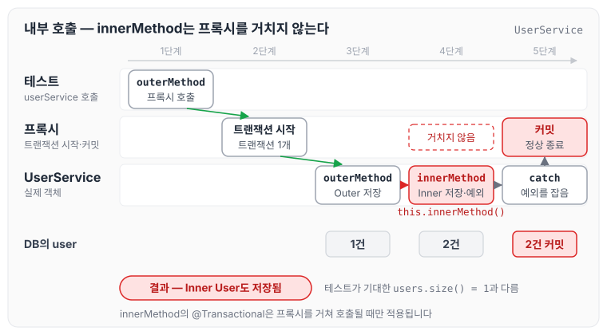
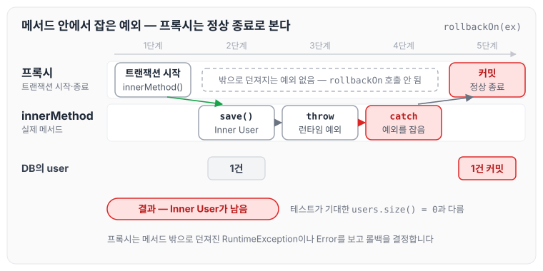
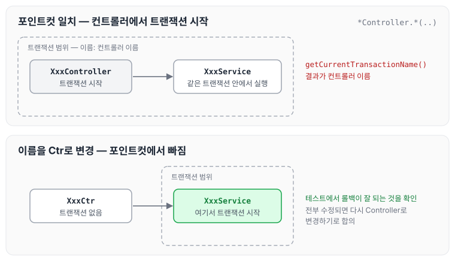

오늘은 프로젝트를 진행하면서 잘못 사용하고 있던 `Transaction` 때문에 발생한 문제에 대해 정리하려고 합니다. 실무에서 직접 겪은 내용으로, 생각보다 `Transaction`의 특성과 성질을 모른 채 습관처럼 작성하는 경우가 많았습니다.

또한 메서드 위에 `Transaction`을 걸었다고 해서 무조건 롤백이 된다고 믿고 진행하는 경우도 많아, 아래 내용을 정리하게 되었습니다.

## 프로젝트에서 잘못 사용하고 있던 트랜잭션

프로젝트를 처음 접하였을 때, 모든 트랜잭션이 아래와 같은 방법으로 사용되고 있었습니다.

```java
 @Transactional(propagation = Propagation.REQUIRES_NEW)
```

해당 옵션은 전파 옵션으로, 아래와 같은 성격을 갖고 있습니다. 전파 옵션은 이전에 [@Transactional 이란? 트랜잭션 성질](../transactional-basics/)에서도 정리하였습니다.

### propagation 전파 옵션

트랜잭션이 동작하는 도중 다른 트랜잭션을 호출(실행)하는 상황에서 선택할 수 있는 옵션입니다.

- `REQUIRED`
    - 기본 속성입니다. 부모 트랜잭션 안에서 실행하며, 부모 트랜잭션이 없으면 새로운 트랜잭션을 생성합니다.
- `SUPPORTS`
    - 이미 시작된 트랜잭션이 있으면 참여하고, 그렇지 않으면 트랜잭션 없이 진행합니다.
- `REQUIRES_NEW`
    - 부모 트랜잭션과 상관없이 새로운 트랜잭션을 생성합니다.
    - 항상 새로운 트랜잭션을 생성합니다.
    - 이미 진행 중인 트랜잭션이 있으면 그 트랜잭션을 잠시 보류시킵니다.
- `MANDATORY`
    - `REQUIRED`와 비슷하게 이미 시작된 트랜잭션이 있으면 참여합니다.
    - 시작된 트랜잭션이 없으면 새로 시작하는 대신 예외를 발생시킵니다.
    - 혼자서 독립적으로 트랜잭션을 진행하면 안 되는 경우에 사용합니다.
- `NOT_SUPPORTED`
    - 트랜잭션을 사용하지 않게 합니다.
    - 이미 진행 중인 트랜잭션이 있으면 보류시킵니다.
- `NESTED`
    - 이미 진행 중인 트랜잭션이 있으면 중첩 트랜잭션을 시작합니다.
    - 중첩 트랜잭션은 트랜잭션 안에서 다시 트랜잭션을 만드는 것입니다.

그렇다면 왜 프로젝트 전반의 트랜잭션에 `REQUIRES_NEW`가 걸려 있었는지 동료들에게 물어보았고, 아래와 같은 답변을 받았습니다.

- 롤백이 안 돼서 걸었다
- 하이버네이트를 너무 신뢰하지 말고 서비스를 운영해야 한다

프로젝트 전반에 이렇게 전파 옵션을 주는 것이 맞는지 의문이 들어 프로젝트 전반에 걸려 있는 트랜잭션을 분석하게 되었고, 아래와 같은 문제를 갖고 사용하고 있었습니다.

## 1. Spring Transaction의 프록시 패턴을 이해하지 않고 사용하는 문제점

Spring Transaction은 프록시 패턴으로 구현되어 있습니다.

Spring은 AOP(Aspect-Oriented Programming, 관점 지향 프로그래밍)를 사용하여 트랜잭션 관리 기능을 프록시 패턴으로 구현합니다. 구체적으로는 트랜잭션이 적용된 메서드를 호출할 때, 실제 메서드를 호출하기 전에 프록시 객체가 트랜잭션을 시작하고, 메서드 호출이 끝나면 트랜잭션을 커밋하거나 롤백하는 방식으로 동작합니다.

> **프록시 패턴이란?**
>
> 프록시 패턴(Proxy Pattern)은 실제 객체에 대한 접근을 제어하거나 추가 기능을 부여하기 위해 그 객체를 감싸는 대리 객체를 사용하는 디자인 패턴입니다. 프록시 객체는 클라이언트가 실제 객체를 호출하는 것처럼 보이게 하면서, 중간에 로직을 삽입할 수 있습니다.

그렇다면 같은 클래스 안에서 트랜잭션 메서드가 다른 트랜잭션 메서드를 호출하는 경우에도 롤백이 잘 될지 의문을 가질 수 있습니다. 이 내용은 이전에 [@Transactional 롤백 안 되는 원인 [프록시]](../transaction-rollback-proxy/)에서도 다루었습니다. 확인을 위한 코드는 아래와 같습니다.

```java
@Service
@RequiredArgsConstructor
public class UserService {

    private final UserRepository userRepository;

    @Transactional
    public void outerMethod() {
        User outerUser = User.builder()
                .name("Outer User")
                .build();

        userRepository.save(UserEntity.of(outerUser));
        try {
            innerMethod();
        } catch (Exception e) {
            System.out.println("Exception caught in outerMethod: " + e.getMessage());
        }
    }

    @Transactional
    public void innerMethod() {
        User innerUser = User.builder()
                .name("Inner User")
                .build();

        userRepository.save(UserEntity.of(innerUser));
        throw new RuntimeException("Error in innerMethod");
    }
}
```

```java
@Test
    public void testTransactionRollback() {
        try {
            userService.outerMethod();
        } catch (Exception e) {
           
        }

        // Outer User는 저장되어 있어야 하고 Inner User는 저장되지 않아야 함
        List<User> users = new UserEntities(userRepository.findAll())
                .toModels();

        assertEquals(1, users.size());
        assertEquals("Outer User", users.get(0).getName());
    }
```

테스트 코드의 흐름은 아래와 같습니다.

1. `outerMethod`를 호출합니다.
2. 내부에서 try-catch로 `innerMethod`를 호출합니다.
3. `innerMethod`에서 `throw new RuntimeException`이 발생하므로, user가 1개만 등록될 것이라고 생각할 수 있습니다.

하지만 결과는 예상과 다르게 Inner User도 롤백되지 않습니다. 클래스 내부에서 내부 메서드를 호출하면 프록시를 거치지 않기 때문에, `innerMethod`에 붙은 트랜잭션이 적용되지 않은 것입니다. 호출 흐름을 그리면 아래와 같습니다.



그림에서 프록시를 거치는 것은 테스트가 `outerMethod`를 부를 때 한 번뿐입니다. `innerMethod`는 `this`로 호출되어 프록시를 거치지 않고, 던진 예외도 `outerMethod`의 catch에서 잡히기 때문에 트랜잭션은 그대로 커밋됩니다.

이를 통해 트랜잭션은 프록시 패턴을 사용하고 있고, 프록시를 거치려면 다른 클래스(빈)에서 호출해야 한다는 것을 알 수 있습니다.

## 2. Spring Transaction의 롤백 시점을 이해하지 않고 사용하는 문제

Spring Transaction은 기본적으로 RuntimeException이나 Error가 발생할 때 롤백을 실행합니다.

트랜잭션 내부 코드를 직접 확인해 보겠습니다. `DefaultTransactionAttribute.java`의 `rollbackOn` 메서드는 아래와 같습니다.

```java
@Override
public boolean rollbackOn(Throwable ex) {
   return (ex instanceof RuntimeException || ex instanceof Error);
}
```

이 코드로 트랜잭션은 RuntimeException 또는 Error가 발생할 때 롤백된다는 것을 알 수 있습니다.

따라서 트랜잭션 메서드 내부에서 try-catch로 예외를 잡아 버리면 롤백이 되지 않습니다. 이 내용은 [@Transactional try ~ catch 롤백 안 되는 원인](../transactional-try-catch-rollback/)에서 내부 동작과 함께 정리하였습니다. 확인을 위한 코드는 아래와 같습니다.

```java
    @Transactional
    public void innerMethod() {
        User innerUser = User.builder()
                .name("Inner User")
                .build();
        try {
            userRepository.save(UserEntity.of(innerUser));
            throw new RuntimeException("Error in innerMethod");
        } catch (RuntimeException e) {
            System.out.println("Exception caught in innerMethod: " + e.getMessage());
        }
    }
```

```java
@Test
    public void testTransactionRollback() {
        try {
            userService.innerMethod();
        } catch (Exception e) {
            // Outer method should catch the exception and prevent propagation
        }

        // Inner User는 throw로 인해 롤백되어 user.size = 0이 되어야된다.
        List<User> users = new UserEntities(userRepository.findAll())
                .toModels();

        assertEquals(0, users.size());
    }
```

테스트 코드의 흐름은 아래와 같습니다.

1. `innerMethod()`를 호출합니다.
2. `@Transactional` 메서드 안의 try-catch에서 `save`를 호출합니다.
3. `throw new RuntimeException`이 발생합니다.
4. try-catch가 예외를 잡아 버립니다.
5. 이로 인해 롤백이 되지 않습니다.

이 과정을 프록시와 `innerMethod`로 나누어 그리면 아래와 같습니다.



프록시는 메서드 밖으로 던져진 예외를 보고 `rollbackOn`으로 롤백 여부를 판단합니다. 예외를 메서드 안에서 잡으면 프록시 입장에서는 정상 종료이므로, 저장한 Inner User가 그대로 커밋됩니다.

## REQUIRES_NEW를 사용했던 이유

이제 처음으로 돌아가서 `@Transactional(propagation = Propagation.REQUIRES_NEW)`을 주고 사용했던 이유를 정리하겠습니다.

먼저 모든 서비스에서 사용하는 트랜잭션을 직접 확인해 보았습니다. 현재 트랜잭션의 이름은 아래 메서드로 확인할 수 있습니다.

```java
String transactionName = TransactionSynchronizationManager.getCurrentTransactionName();
```

트랜잭션 이름을 확인해 본 결과 컨트롤러의 이름으로 트랜잭션이 잡혀 있었고, 왜 이렇게 잡혀 있는지 분석하기 시작하였습니다.

확인한 결과, 아래와 같이 AOP 설정으로 Controller 전체에 트랜잭션이 걸려 있었습니다.

```xml
<aop:config>
        <aop:pointcut id="txPointcut" expression="execution(.... *Controller.*(..))" />
        <aop:advisor advice-ref="txAdvice" pointcut-ref="txPointcut" />
    </aop:config>
```

설정 전후의 트랜잭션 범위를 비교하면 아래와 같습니다.



컨트롤러 이름이 포인트컷에 걸리면 트랜잭션이 컨트롤러에서 시작되고, 서비스는 그 트랜잭션 안에서 실행됩니다. 그래서 트랜잭션 이름도 컨트롤러 이름으로 잡혀 있었습니다.

이에 따라 해당 프로젝트의 컨트롤러 이름을 `Ctr`로 변경한 뒤 테스트해 본 결과 롤백이 잘 되는 것을 확인하였습니다. 당분간은 `Ctr`로 변경해 두고, 전부 수정되었을 때 다시 Controller로 변경하기로 합의하였습니다.

## 마무리

오늘은 `@Transactional(propagation = Propagation.REQUIRES_NEW)`에서 시작하여, 프로젝트에서 잘못 사용하고 있던 트랜잭션을 확인한 내용을 정리하였습니다. 현재는 올바르게 사용하고 있으며, 트랜잭션을 당연하게 사용하기보다 어떻게 동작하는지 알고 있으면 문제가 발생했을 때 도움이 될 것 같습니다. 같은 클래스 안의 내부 호출 문제와 해결 방법은 이후 [self-invocation](../self-invocation/)에서 더 자세히 정리하였습니다.
