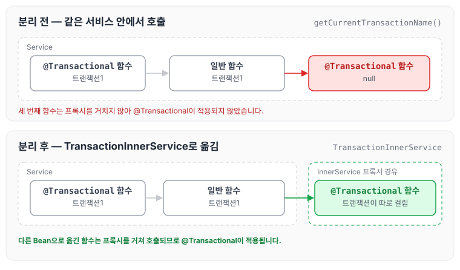

이전에 [[Java] @Transactional 롤백 안 되는 원인 [프록시]](../transaction-rollback-proxy/)에 대해 작성하였습니다. 그런데 오늘 그 글에서 정리했던 프록시 문제가 실제로 발생했습니다.

지난주에 글을 써두고도 이렇게 문제가 다시 생기다니, 너무 가볍게 생각했나 봅니다.

다시 한번 같은 실수를 하지 않기 위해 기록해두려고 합니다.

## 문제 상황

제가 맡고 있던 웹 서비스를 유지 보수하고 있었는데, 일괄 처리하는 기능을 API로 연동하기로 했습니다. 기존에는 내부적으로만 처리하고 API로 연동하지 않고 있어서 이 부분을 추가로 작업하게 되었는데, Service 레이어에서 [`@Transactional` 함수 → 일반 함수 → `@Transactional` 함수]를 호출하는 구조가 되어 있었습니다. 기존에 잘 동작한다고 생각해서 기능을 덧붙였는데, 그게 화근이 된 것 같습니다. 좀 더 분석하고 깔끔하게 처리하려고 합니다.

## 해결 방법

현재 DDD로 구현되어 있지 않기 때문에 빠르게 대응하기 위해 TransactionInnerService를 만들어 프록시로 동작하는 함수로 분리할 생각입니다. 트랜잭션이 어떻게 걸리는지 직접 눈으로 확인하고, 다음 주에 작업 후 잘 동작하는지 다시 확인하려고 합니다.

참고로 트랜잭션을 확인하는 함수는 다음과 같습니다.

```java
String transactionName = TransactionSynchronizationManager.getCurrentTransactionName();
```

## 트랜잭션을 직접 확인해본 결과

`@Transactional` 함수 → 일반 함수 → `@Transactional` 함수 구조일 경우, [트랜잭션1 → 트랜잭션1 → null] 순서로 진행됩니다.

때문에 세 번째 함수는 트랜잭션1과 상관없이 일반 함수처럼 동작하게 됩니다. 이를 해결하기 위해 TransactionInnerService 레이어를 하나 더 만들고 세 번째 함수를 그 안으로 옮기니, 트랜잭션이 따로 걸리는 것을 확인했습니다.

분리하기 전과 후의 호출 구조와 확인한 트랜잭션은 아래와 같습니다.



세 번째 함수를 다른 Bean으로 옮기면 호출이 TransactionInnerService의 프록시를 거치게 되므로, 그 함수의 `@Transactional`이 적용됩니다.

## 마무리

오늘은 트랜잭션 프록시에 대해 다시 한번 정리하게 되었습니다.

역시 같은 클래스 안에서 호출하다 보니 프록시를 거치지 않고 일반 함수로 동작하는 문제였고, 아직 깔끔하게 해결하지는 못했지만 그래도 트랜잭션이 각각 잘 동작했습니다.

다만 소스 코드 분리와 명시적으로 처리하는 방법에 대해 좀 더 찾아보고, 좋은 방법이 있다면 추가로 정리하려고 합니다.
