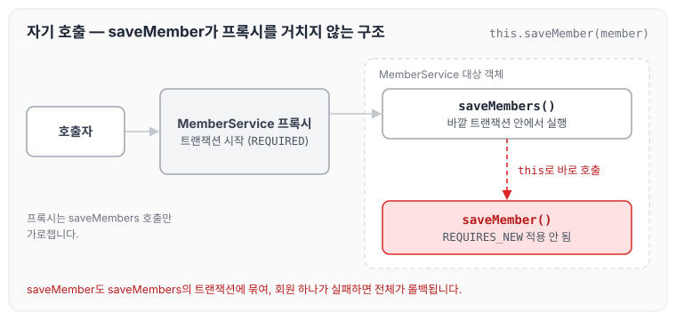
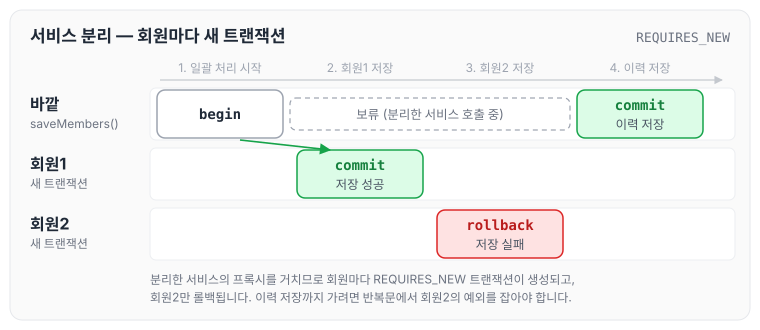

이전에 [[Java] @Transactional try ~ catch 롤백 안 되는 원인](../transactional-try-catch-rollback/)에 대해 작성하였습니다. 오늘은 회사 동료분이 트랜잭션이 동작하지 않는 원인을 공유해 주셨는데, 좋은 내용이라 정리하도록 하겠습니다.

## 요청사항

- 회원 전체 데이터를 일괄로 수정
- 수정 도중 실패한다면 실패한 회원만 롤백
- 회원 수정 이력에는 실패와 성공에 대한 데이터를 저장

## 구현 방법

- 일괄로 회원 정보를 수정하는 함수를 `@Transactional`로 구현
- 단일 회원 정보를 수정하는 함수를 `@Transactional`로 구현하고, 전파 속성을 `propagation = Propagation.REQUIRES_NEW`로 설정
- 단일 회원 정보 함수를 빠져나온 뒤, 일괄 처리에서 실패와 성공한 케이스에 대해 저장하는 로직 구현

```java
@Slf4j
@Service
@RequiredArgsConstructor
public class MemberService{
    
    private final MemberRepository memberRepository;
    private final MemberHistoryRepository memberHistoryRepository;
    
    
    @Transactional
    public void saveMembers(List<Member> members) {
        for (Member member : members) {
            this.saveMember(member);
        }
        memberHistoryRepository.save(members);
    }

    @Transactional(propagation = Propagation.REQUIRES_NEW)
    public void saveMember(Member member) {
        memberRepository.save(member);
    }

}
```

`REQUIRES_NEW`는 진행 중인 트랜잭션을 보류시키고 새로운 트랜잭션을 생성하는 전파 옵션입니다. 전파 옵션은 [[JAVA] @Transactional 이란? 트랜잭션 성질 (1)](../transactional-basics/)에서 정리하였습니다.

## 문제 발생

- 회원 하나에서 exception이 발생하면 트랜잭션이 전부 롤백되는 현상이 발생합니다.

## 문제 원인

- 스프링의 `@Transactional`은 프록시로 동작하기 때문에, 프록시를 거쳐 들어온 외부 호출에만 트랜잭션이 적용됩니다. 하나의 Bean 안에서 `this.saveMember()`로 `@Transactional` 함수를 호출하면 프록시를 거치지 않으므로, 결국 일반 함수를 호출하는 것처럼 동작합니다.
- 이 때문에 `saveMember`의 `REQUIRES_NEW`가 적용되지 않고 `saveMembers`의 트랜잭션 안에서 실행되어, 일괄 롤백이 진행됩니다.

호출 구조를 그림으로 나타내면 아래와 같습니다.



트랜잭션은 프록시에서 시작되는데, `saveMember`는 대상 객체 안에서 바로 호출되기 때문에 프록시가 끼어들 기회가 없습니다.

프록시와 관련된 설명은 [프록시의 동작 원리](../jpa-proxy/)와 [11장 시스템 (2)](../clean-code-ch12-systems-2/)에 정리하였습니다.

## 문제 해결 방법

- 서비스를 분리하여 호출하면 트랜잭션이 제대로 동작합니다. 다만 서비스에서 서비스를 호출하게 되면 복잡도가 올라가기 때문에 이 부분에 대해 질문을 하였습니다.

`saveMember`를 다른 서비스로 분리하면 `saveMembers`에서 분리한 서비스의 프록시를 거쳐 호출하게 되므로, 회원마다 `REQUIRES_NEW`로 새로운 트랜잭션이 생성됩니다.



다만 분리한 뒤에도 `saveMember`에서 던진 예외를 `saveMembers`에서 잡지 않으면 예외가 바깥 트랜잭션까지 전파되어, 이력 저장 없이 바깥 트랜잭션이 롤백됩니다. 실패한 회원만 롤백하고 이력을 남기려면 반복문 안에서 예외를 잡아 실패 건을 기록해야 합니다.

## 답변 내용

> 서비스에서 서비스를 호출하는 구조는 피하고 도메인 레이어에 도메인 서비스를 둬서 처리하는 것을 최범균님이 쓰신 '도메인 주도 개발 시작하기(DDD Start)'에서 본 적이 있습니다.
>
> 그리고 여러 건 처리를 할 때와 단건 처리를 할 때 트랜잭션을 명시적으로 처리하면 부분 실패와 성공에 대해 읽고 수정하기가 더 좋을 것 같습니다.

도메인 주도 개발 시작하기를 읽어 보고 후기를 작성하도록 하겠습니다. (이후 [도메인 서비스](../ddd-domain-service/)에서 도메인 서비스에 대해 정리하였습니다.)

## 마무리

오늘은 같은 서비스 레이어에서 `@Transactional` 함수가 다른 `@Transactional` 함수를 호출하면 일반 함수처럼 동작하는 원인에 대해 정리하였습니다. 이를 방지하기 위해서는 서비스 레이어를 분리해야 하지만 복잡도가 올라가기 때문에, 이를 해결하기 위해 도메인 주도 개발에 대해 알아보고 정리하도록 하겠습니다.
