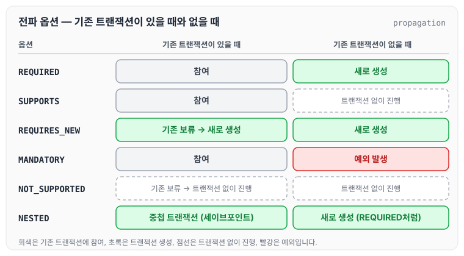
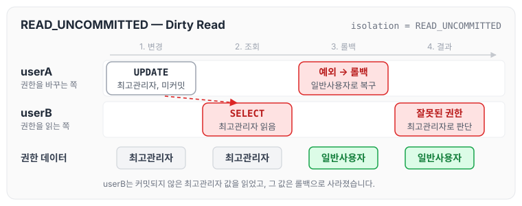
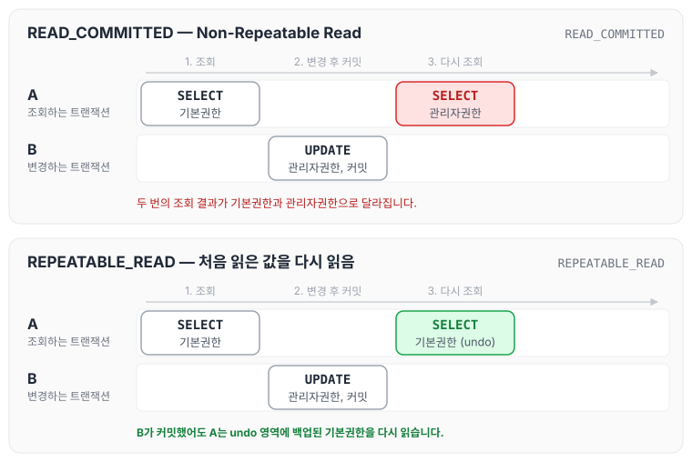
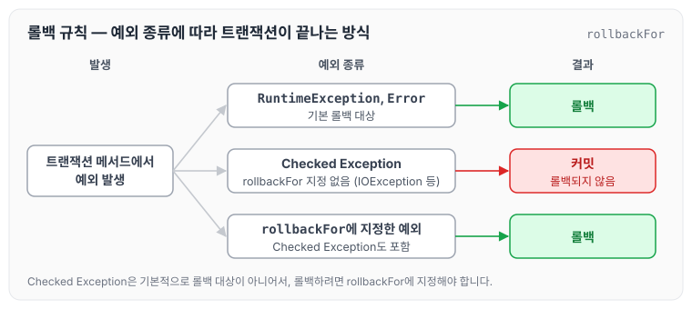

오늘은 트랜잭션의 성질과, 스프링에서 트랜잭션을 선언적으로 정의하는 `@Transactional`의 주요 옵션에 대해 정리하도록 하겠습니다.

## 트랜잭션이란

트랜잭션(Transaction)은 데이터베이스의 상태를 변환시키는 하나의 논리적 기능을 수행하기 위한 작업의 단위, 또는 한꺼번에 모두 수행되어야 할 일련의 연산들을 의미합니다.

모든 트랜잭션이 같은 방식으로 동작하지는 않습니다. 전체가 함께 성공하거나 함께 실패하는 하나의 작업으로 묶인다는 점은 같지만, 세밀하게 따지면 차이점이 존재합니다.

트랜잭션이 끝나면 `Commit` 또는 `RollBack` 되어야 합니다.

## 트랜잭션 성질

- Atomicity(원자성)
    - 하나의 트랜잭션이 더 작게 나눌 수 없는 최소의 단위라는 뜻입니다. 트랜잭션이 모두 반영되거나, 아니면 전혀 반영되지 않아야 하는 특징을 나타냅니다.
- Consistency(일관성)
    - 트랜잭션이 완료된 결괏값이 일관적인 데이터베이스 상태를 유지하는 것을 말합니다. 예를 들어 고객 정보가 담긴 데이터베이스에 새로운 고객이 등록되면, 그 데이터베이스를 참조하는 다른 하위 계층의 데이터베이스도 같은 고객의 세부 정보를 가져와야 합니다.
- Isolation(독립성)
    - 트랜잭션이 수행되고 있을 때, 다른 트랜잭션의 연산 작업이 중간에 끼어들어 기존 작업에 영향을 주지 못하도록 하는 것을 말합니다. 독립성이 보장된다면 계좌 이체 작업을 진행하는 도중에 계좌의 잔액을 조회하는 작업을 동시에 수행할 수 없게 됩니다.
- Durability(지속성)
    - 트랜잭션이 성공한 후 데이터베이스에 반영된 내용은 영원히 반영되어 있어야 한다는 것을 의미합니다.

## @Transactional(선언적 트랜잭션)

- TransactionTemplate과 달리 트랜잭션 처리를 코드에서 직접 수행하지 않고, 설정 파일이나 어노테이션을 이용하여 트랜잭션의 범위, 롤백 규칙 등을 정의합니다.
- 다음과 같은 2가지 방식으로 정의합니다.
    - `<tx:advice>` 태그를 이용한 트랜잭션 설정
    - `@Transactional` 어노테이션을 이용한 트랜잭션 설정

현재 제가 진행하는 프로젝트는 `@Transactional`을 많이 사용하고 있어서, 이 방식을 기준으로 정리하도록 하겠습니다.

## @Transactional 옵션

### propagation: 전파 옵션

트랜잭션이 동작하는 도중에 다른 트랜잭션을 호출(실행)하는 상황에서 어떻게 처리할지 선택하는 옵션입니다.

- REQUIRED
    - 기본 속성입니다. 부모 트랜잭션 내에서 실행하며, 부모 트랜잭션이 없을 경우 새로운 트랜잭션을 생성합니다.
- SUPPORTS
    - 이미 시작된 트랜잭션이 있으면 참여하고, 그렇지 않으면 트랜잭션 없이 진행합니다.
- REQUIRES_NEW
    - 부모 트랜잭션에 참여하지 않고 새로운 트랜잭션을 생성합니다.
    - 항상 새로운 트랜잭션을 생성합니다.
    - 이미 진행 중인 트랜잭션이 있으면 그 트랜잭션을 잠시 보류시킵니다.
- MANDATORY
    - REQUIRED와 비슷하게 이미 시작된 트랜잭션이 있으면 참여합니다.
    - 시작된 트랜잭션이 없으면 새로 시작하는 대신 예외를 발생시킵니다.
    - 혼자서 독립적으로 트랜잭션을 진행하면 안 되는 경우에 사용합니다.
- NOT_SUPPORTED
    - 트랜잭션을 사용하지 않게 합니다.
    - 이미 진행 중인 트랜잭션이 있으면 보류시킵니다.
- NESTED
    - 이미 진행 중인 트랜잭션이 있으면 중첩 트랜잭션을 시작합니다.
    - 중첩 트랜잭션은 트랜잭션 안에서 다시 트랜잭션을 만드는 것입니다. 스프링은 하나의 물리 트랜잭션 안에 세이브포인트를 두어 안쪽 범위만 롤백할 수 있게 합니다.
    - 진행 중인 트랜잭션이 없으면 REQUIRED처럼 새로운 트랜잭션을 생성합니다.

옵션별로 이미 진행 중인 트랜잭션이 있을 때와 없을 때 어떻게 동작하는지 나누어 보면 아래와 같습니다.

기존 트랜잭션이 있을 때 참여하는 옵션은 REQUIRED, SUPPORTS, MANDATORY이고, 기존 트랜잭션을 보류시키는 옵션은 REQUIRES_NEW와 NOT_SUPPORTED입니다. 기존 트랜잭션이 없을 때 예외를 발생시키는 옵션은 MANDATORY 하나입니다.

### isolation: 격리 수준

트랜잭션 격리 수준(isolation)은 동시에 여러 사용자가 데이터에 접근할 때 어디까지 허용할지 정하는 옵션입니다.

트랜잭션의 격리 수준과 데이터의 일관성은 비례합니다. 격리 수준이 낮으면 데이터 접근과 수정이 자유롭지만 일관성이 낮아지고, 격리 수준이 높으면 데이터 접근과 수정이 어렵지만 일관성이 높아집니다. 격리 수준 단계와 단계별로 막히는 현상은 [트랜잭션 스케줄과 격리 수준](../transaction-schedule-isolation/)에서 흐름도와 함께 따로 정리하였습니다.

- DEFAULT
    - 별도로 정의하지 않으면 DB의 isolation level을 따릅니다.
- READ_UNCOMMITTED(Level 0)
    - 트랜잭션이 처리 중인, 커밋되지 않은 데이터를 다른 트랜잭션이 읽을 수 있어서 정합성 때문에 권장되지 않습니다.
    - Dirty Read: DB에 커밋하지 않은(존재하지 않는) 데이터를 읽는 현상입니다.
    - 예시는 아래와 같습니다.
        1. userA의 트랜잭션이 권한 데이터를 조회하여 최고관리자로 변경하고, 아직 커밋하지 않았습니다.
        2. userB의 트랜잭션이 같은 권한 데이터를 조회해서 최고관리자 권한 데이터를 받습니다. 여기서 Dirty Read가 발생합니다.
        3. userA의 트랜잭션에서 예외가 발생하여 데이터를 롤백합니다. (최고관리자 → 일반사용자로 롤백)
        4. 실제 데이터는 일반사용자이지만, 2번에서 최고관리자 권한으로 읽은 문제가 발생합니다.
- READ_COMMITTED(Level 1)
    - 트랜잭션은 커밋된 데이터만 읽습니다.
    - Oracle DB, SQL Server에서 기본으로 사용하는 isolation level입니다.
    - Non-Repeatable Read가 발생할 수 있습니다.
        - 한 트랜잭션에서 같은 쿼리를 두 번 수행할 때, 그 사이에 다른 트랜잭션이 값을 수정 또는 삭제하면 두 쿼리의 결과가 다르게 나타나는 현상입니다.
    - 예시는 아래와 같습니다.
        1. A 트랜잭션에서 userA의 권한을 조회합니다: 기본권한
        2. B 트랜잭션에서 userA의 권한을 관리자권한으로 변경하고 커밋합니다.
        3. A 트랜잭션에서 userA의 권한을 다시 조회합니다: 관리자권한
- REPEATABLE_READ(Level 2)
    - 트랜잭션 범위 내에서 조회한 데이터 내용이 항상 동일함을 보장합니다.
    - 락으로 구현하는 방식에서는 트랜잭션이 완료될 때까지 SELECT 문장이 사용하는 모든 데이터에 Shared Lock을 걸어, 다른 사용자가 해당 데이터를 수정할 수 없게 합니다.
    - MySQL(InnoDB)에서 기본으로 사용합니다. InnoDB는 일반 SELECT에 락을 걸지 않고, undo 영역에 백업된 이전 버전을 읽는 방식으로 같은 결과를 보장합니다. 그래서 다른 트랜잭션은 그 사이에 데이터를 수정하고 커밋할 수 있습니다. undo 영역을 이용해 이전 버전을 읽는 과정은 [[DB] MVCC (multiversion concurrency control)](../mvcc/)에서 정리하였습니다.
    - Non-Repeatable Read가 발생하지 않습니다.
    - 예시는 아래와 같습니다.
        1. A 트랜잭션이 userA의 권한을 조회합니다.
        2. B 트랜잭션이 userA의 권한을 변경하고 커밋합니다.
        3. A 트랜잭션이 userA의 권한을 다시 조회합니다: undo 영역에 백업된 데이터를 반환합니다.
    - Phantom Read가 발생할 수 있습니다.
        - 한 트랜잭션 안에서 일정 범위의 레코드를 두 번 이상 읽었을 때, 첫 번째 쿼리에서 없던 레코드가 두 번째 쿼리에서 나타나는 현상입니다.
        - 트랜잭션 도중 새로운 레코드의 삽입을 허용하기 때문에 나타납니다. (MySQL은 갭 락으로 이 현상도 대부분 막습니다.)
- SERIALIZABLE(Level 3)
    - 트랜잭션이 완료될 때까지 SELECT 문장이 사용하는 모든 데이터에 Shared Lock이 걸리는 단계입니다.
    - 가장 엄격한 격리 수준으로, 완벽한 읽기 일관성 모드를 제공합니다.
    - 다른 사용자는 트랜잭션 영역에 해당하는 데이터를 수정하거나 입력할 수 없습니다.

READ_UNCOMMITTED의 Dirty Read 예시를 두 트랜잭션의 시간 흐름으로 펼치면 아래와 같습니다.

userB는 끝내 존재하지 않게 된 최고관리자 값을 읽었습니다. 커밋되지 않은 값을 읽을 수 있기 때문에 생기는 문제입니다.

READ_COMMITTED와 REPEATABLE_READ의 예시는 같은 순서로 진행되지만, 3번에서 A 트랜잭션이 다시 읽는 값이 다릅니다.

READ_COMMITTED에서는 B가 커밋한 값이 바로 보여서 두 번의 조회 결과가 달라지고, REPEATABLE_READ에서는 A가 처음 읽은 버전을 undo 영역에서 다시 읽기 때문에 결과가 같습니다.

### rollbackFor

기존에 트랜잭션을 작성할 때는 `@Transactional`만 사용했습니다. 실무에서 이렇게 작성하였는데, "익셉션이 터질 때 과연 롤백이 제대로 실행되는가?"라는 피드백을 받았습니다. 롤백을 시킬 것이라면 rollbackFor를 작성해 달라는 내용이었고, 이를 계기로 `rollbackFor`가 어떤 역할을 하는지 분석하게 되었습니다.

rollbackFor는 지정한 예외가 발생했을 때 롤백을 시킬지 정하는 `@Transactional`의 속성입니다.

스프링 프레임워크의 `@Transactional`은 기본적으로 RuntimeException과 Error가 발생하면 롤백하고, Checked Exception이 발생하면 롤백하지 않도록 설계되어 있습니다. 스프링 프레임워크가 EJB의 관례를 따르기 때문입니다.

때문에 IOException, Exception 같은 Checked Exception이 발생하면 트랜잭션은 롤백되지 않고 커밋됩니다.

Checked Exception에서도 롤백되도록 하려면 rollbackFor에 해당 예외를 지정합니다.

예외 종류와 rollbackFor 지정 여부에 따라 트랜잭션이 어떻게 끝나는지 나누어 보면 아래와 같습니다.

### noRollbackFor

보통 Service에서 `@Transactional`을 사용해 여러 메서드를 하나의 트랜잭션으로 동작시킵니다.

이렇게 사용하면 `@Transactional`이 다른 `@Transactional`을 호출할 때 호출된 트랜잭션이 호출한 트랜잭션에 병합되고, 호출한 트랜잭션에서 에러가 발생하면 호출된 쪽의 작업도 함께 롤백 처리됩니다. 이때 특정 예외가 발생해도 롤백하지 않도록 하려면 `noRollbackFor`에 그 예외 타입을 지정합니다.

### timeout

지정한 시간 내에 해당 메서드 수행이 완료되지 않은 경우 `JpaSystemException`을 발생시킵니다.

- 기본값: -1
- 사용 방법: `@Transactional(timeout = 1)`

`JpaSystemException`은 `RuntimeException`을 상속받기 때문에 롤백 처리됩니다.

초 단위로 지정할 수 있으며, -1인 경우 트랜잭션 시스템(DB 등)의 기본 timeout을 따르고 시스템이 timeout을 지원하지 않으면 timeout 없이 동작합니다.

### readOnly

기본값은 false입니다. true로 설정하면 트랜잭션을 읽기 전용으로 설정합니다. 다만 readOnly는 실제 트랜잭션 시스템에 전달하는 힌트이기 때문에, insert, update, delete를 반드시 막아 주지는 않습니다. 쓰기를 실제로 막는지는 트랜잭션 매니저와 DB에 따라 다릅니다.

## 마무리

오늘은 트랜잭션의 ACID 성질과 `@Transactional`의 propagation, isolation, rollbackFor, noRollbackFor, timeout, readOnly 옵션에 대해 정리하였습니다. `@Transactional`만 붙여 두면 Checked Exception에서는 롤백되지 않기 때문에, 롤백이 필요한 예외는 rollbackFor로 지정해야 한다는 점을 알 수 있었습니다.

참조 : [https://dar0m.tistory.com/225](https://dar0m.tistory.com/225), [https://starkying.tistory.com/entry/Transactional의-noRollbackFor-속성](https://starkying.tistory.com/entry/Transactional%EC%9D%98-noRollbackFor-%EC%86%8D%EC%84%B1), [https://bcp0109.tistory.com/322](https://bcp0109.tistory.com/322)
