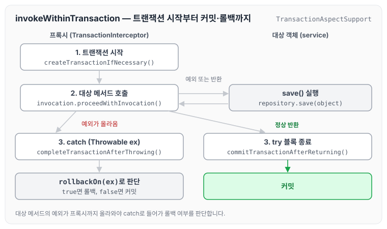
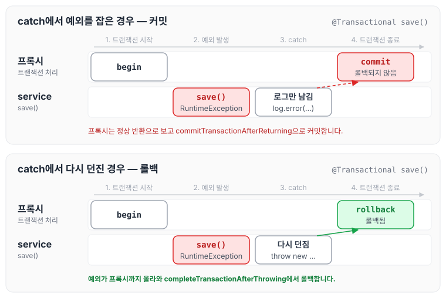

이전에 [[JAVA] @Transactional 이란? 트랜잭션 성질 (1)](../transactional-basics/)에 대해 작성하였습니다. 그 글에서는 `@Transactional`이 RuntimeException과 Error가 발생하면 롤백한다고 정리하였는데, 작업을 하면서 `@Transactional` 안의 try ~ catch에서 예외가 발생했을 때 롤백이 되지 않는 문제가 있었습니다. 오늘은 그 원인을 `TransactionAspectSupport` 내부 동작으로 분석하고, 해결 방법을 정리하도록 하겠습니다.

## 문제 발생

`@Transactional` 안에 try ~ catch로 감싼 코드는 다음과 같습니다.

```java
@Transactional
public Long save(Object object) {
		Long saveId = null;
    try {
			saveId = repository.save(object);
    } catch (RuntimeException re ) {
			log.error("save fail, message: {},", re.getMessage());
    }
    return saveId;
}
```

try ~ catch 안에서 예외가 발생했을 때 롤백이 동작하지 않는 것이 문제였습니다. 이를 계기로 `@Transactional`이 어떻게 동작하는지 찾아보게 되었습니다.

## @Transactional의 동작 순서

`@Transactional`이 붙은 메서드는 프록시를 거쳐 호출되며, 예외가 발생하면 아래 순서로 동작합니다.

1. 프록시가 `TransactionAspectSupport.java`의 `invokeWithinTransaction` 함수를 실행하고, 트랜잭션을 시작한 뒤 `service` 레이어의 메서드를 호출합니다.
2. `service` 레이어에서 `Exception`이 발생합니다.
3. `invokeWithinTransaction`의 try ~ catch에서 예외를 잡아 `completeTransactionAfterThrowing`을 실행합니다.

```java
protected Object invokeWithinTransaction(Method method, Class<?> targetClass, final InvocationCallback invocation)
			throws Throwable {

		// If the transaction attribute is null, the method is non-transactional.
		final TransactionAttribute txAttr = getTransactionAttributeSource().getTransactionAttribute(method, targetClass);
		final PlatformTransactionManager tm = determineTransactionManager(txAttr);
		final String joinpointIdentification = methodIdentification(method, targetClass, txAttr);

		if (txAttr == null || !(tm instanceof CallbackPreferringPlatformTransactionManager)) {
			// Standard transaction demarcation with getTransaction and commit/rollback calls.
			TransactionInfo txInfo = createTransactionIfNecessary(tm, txAttr, joinpointIdentification);
			Object retVal = null;
			try {
				// This is an around advice: Invoke the next interceptor in the chain.
				// This will normally result in a target object being invoked.
				retVal = invocation.proceedWithInvocation();
			}
			catch (Throwable ex) {
				// target invocation exception
				completeTransactionAfterThrowing(txInfo, ex);
				throw ex;
			}
			finally {
				cleanupTransactionInfo(txInfo);
			}
			commitTransactionAfterReturning(txInfo);
			return retVal;
		}
		....
```

코드의 흐름을 그림으로 나타내면 아래와 같습니다. 대상 메서드에서 예외가 올라오면 catch에서 롤백 여부를 판단하고, 정상적으로 반환되면 커밋합니다.



`TransactionAspectSupport.java`에서는 이어서 아래 순서로 동작합니다.

1. `completeTransactionAfterThrowing` 함수를 실행합니다.
2. `txInfo.transactionAttribute.rollbackOn(ex)`로 롤백 여부를 판단합니다.

```java
protected void completeTransactionAfterThrowing(TransactionInfo txInfo, Throwable ex) {
		if (txInfo != null && txInfo.hasTransaction()) {
			if (logger.isTraceEnabled()) {
				logger.trace("Completing transaction for [" + txInfo.getJoinpointIdentification() +
						"] after exception: " + ex);
			}
			if (txInfo.transactionAttribute.rollbackOn(ex)) {
				...
```

구현체인 `RuleBasedTransactionAttribute.java`의 `rollbackOn`은 rollbackFor, noRollbackFor로 지정한 규칙 중 맞는 규칙을 찾고, 맞는 규칙이 없으면(`winner == null`) `super.rollbackOn(ex)`를 실행합니다.

```java
@Override
	public boolean rollbackOn(Throwable ex) {
		if (logger.isTraceEnabled()) {
			logger.trace("Applying rules to determine whether transaction should rollback on " + ex);
		}

		RollbackRuleAttribute winner = null;
		int deepest = Integer.MAX_VALUE;

		if (this.rollbackRules != null) {
			for (RollbackRuleAttribute rule : this.rollbackRules) {
				int depth = rule.getDepth(ex);
				if (depth >= 0 && depth < deepest) {
					deepest = depth;
					winner = rule;
				}
			}
		}

		if (logger.isTraceEnabled()) {
			logger.trace("Winning rollback rule is: " + winner);
		}

		// User superclass behavior (rollback on unchecked) if no rule matches.
		if (winner == null) {
			logger.trace("No relevant rollback rule found: applying default rules");
			return super.rollbackOn(ex);
		}

		return !(winner instanceof NoRollbackRuleAttribute);
	}
```

상위 클래스인 `DefaultTransactionAttribute.java`의 `rollbackOn`을 보면 아래 두 가지 예외에 대해 롤백을 처리하는 것을 확인할 수 있습니다.

- RuntimeException
- Error

```java
@Override
public boolean rollbackOn(Throwable ex) {
   return (ex instanceof RuntimeException || ex instanceof Error);
}
```

이를 통해 `@Transactional`은 RuntimeException과 Error를 롤백 대상으로 본다는 것을 확인하였습니다.

## try ~ catch에서 롤백되지 않는 이유

RuntimeException은 롤백 대상인데도 `@Transactional` 안의 try ~ catch에서 롤백이 되지 않는 이유는, 서비스 레이어에서 try ~ catch로 예외를 잡으면 `TransactionAspectSupport.java`의 `invokeWithinTransaction`까지 예외가 올라오지 않기 때문입니다. 프록시 입장에서는 대상 메서드가 정상적으로 반환된 것이므로 catch로 들어가지 않고 `commitTransactionAfterReturning`으로 커밋합니다.

예외를 서비스에서 잡았을 때와 catch에서 다시 던졌을 때를 나누어 보면 아래와 같습니다.



다만 catch로 잡은 예외가 다른 `@Transactional` 메서드의 프록시를 거쳐 던져진 경우(예를 들어 `repository`가 `@Transactional`이 붙은 Spring Data JPA 리포지터리이고, 같은 트랜잭션에 참여한 상태에서 예외가 발생한 경우)에는 그 시점에 트랜잭션이 rollback-only로 표시됩니다. 이때는 서비스에서 예외를 잡더라도 커밋 시점에 `UnexpectedRollbackException`이 발생하면서 롤백됩니다.

## 해결 방법

- try ~ catch로 감싼 후 예외가 발생했을 때, throw로 Unchecked Exception을 다시 발생시킵니다.

```java
@Transactional
public Long save(Object object) {
		Long saveId;
    try {
			saveId = repository.save(object);
    } catch (RuntimeException re ) {
			log.error("save fail, message: {},", re.getMessage());
			throw new RuntimeException("UnChecked Exception");
    }
    return saveId;
}
```

## 마무리

오늘은 `@Transactional` 안에서 try ~ catch로 예외를 잡았을 때 롤백이 되지 않는 원인에 대해 정리하였습니다. 트랜잭션은 기본적으로 RuntimeException과 Error에 대해 롤백이 진행되고, Checked Exception은 catch에서 RuntimeException을 발생시켜 롤백시킬 수 있다는 것을 알 수 있었습니다. 추가로 try ~ catch에서 왜 롤백이 되지 않는지 내부 코드로 명확하게 확인할 수 있는 기회였습니다.
