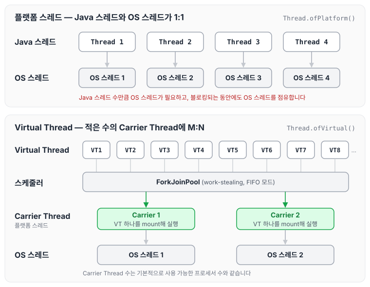
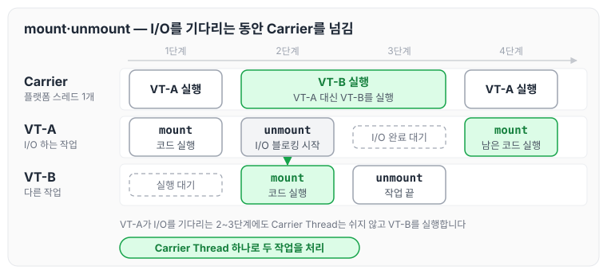
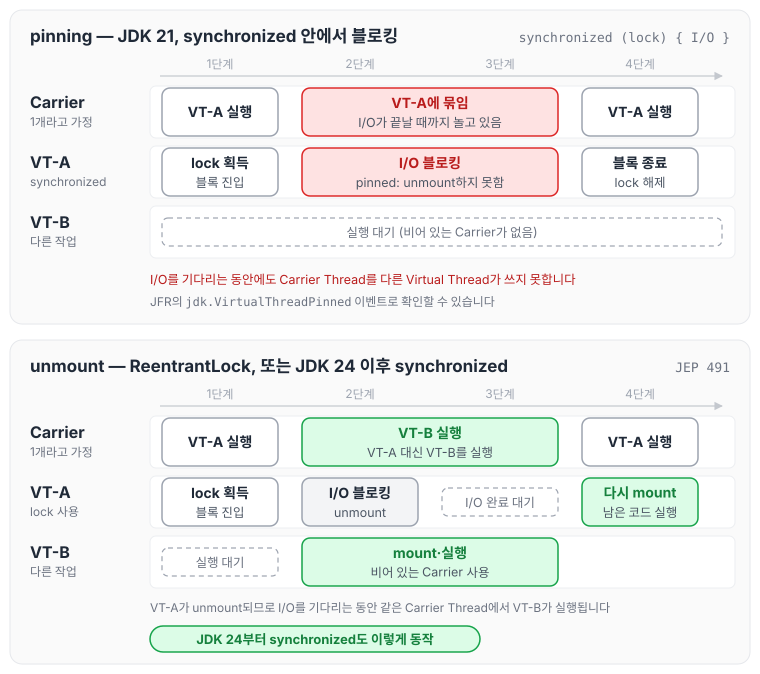
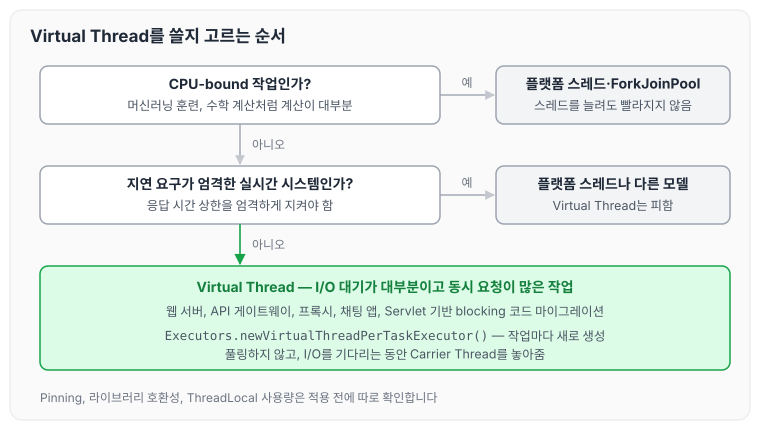

이전에 [Java 기준 멀티스레드와 레이스 컨디션](../multithread-race-condition/)에 대해 작성하였습니다. 그 글에서는 여러 스레드가 공유 자원을 다룰 때 생기는 문제를 정리하였는데, 병렬 처리와 동시성은 Java 개발에서 계속 마주치는 주제입니다. 오늘은 Java 21에서 정식으로 도입된 Virtual Thread에 대해 정리하도록 하겠습니다.

Virtual Thread는 기존 플랫폼 스레드(OS 수준 스레드)의 한계를 줄여 대규모 동시성을 지원하는 기능입니다. 운영체제의 개념(멀티프로그래밍, 멀티태스킹, 멀티스레딩, 멀티프로세싱)을 바탕으로 Virtual Thread가 효율적인 이유를 살펴보고, 장단점과 트레이드오프, 효율적으로 사용하는 시기, 코드 예제를 순서대로 정리하겠습니다.

## Virtual Thread란

Virtual Thread는 Java 21(JDK 21)에서 정식으로 도입된 경량 스레드 모델로, Project Loom에서 나온 기능입니다. 플랫폼 스레드는 OS 커널 스레드에 1:1로 매핑되어 자원을 많이 사용합니다. 반면 Virtual Thread는 JVM이 관리하는 M:N 매핑 모델을 사용하기 때문에 수백만 개의 스레드를 적은 비용으로 생성하고 실행할 수 있습니다. 이 특성은 웹 서버나 데이터베이스 쿼리처럼 I/O-bound 작업에서 효과가 큽니다.

두 매핑 방식을 나란히 놓으면 다음과 같습니다.



Virtual Thread가 실제로 실행될 때 올라타는 플랫폼 스레드를 Carrier Thread라고 합니다. Carrier Thread의 수는 기본적으로 사용 가능한 프로세서 수와 같기 때문에, 많은 Virtual Thread가 적은 수의 OS 스레드를 나누어 사용하게 됩니다.

### 기본 사용 예제

Virtual Thread는 아래와 같이 간단하게 생성할 수 있습니다.

```java
public class VirtualThreadBasic {
    public static void main(String[] args) throws InterruptedException {
        Thread virtualThread = Thread.ofVirtual().start(() -> {
            System.out.println("Hello from Virtual Thread: " + Thread.currentThread().getName());
            try {
                Thread.sleep(1000); // I/O 블로킹 시뮬레이션
            } catch (InterruptedException e) {
                e.printStackTrace();
            }
        });
        virtualThread.join(); // 메인 스레드 대기
    }
}
```

`Thread.ofVirtual().start()`로 만든 스레드는 JVM의 Carrier Thread에 매핑되어 실행됩니다.

## 운영체제 개념으로 본 Virtual Thread의 효율성

운영체제는 단일 프로세스 시스템에서 멀티프로그래밍, 멀티태스킹, 멀티스레딩, 멀티프로세싱으로 발전하면서 CPU 이용률, 응답 시간, 자원 효율을 개선해 왔습니다. Virtual Thread는 이 개념들을 확장해 기존 스레드의 한계를 줄입니다. 아래에서 운영체제 개념과 연결해 효율성의 근거를 정리하겠습니다.

### CPU 이용률 극대화 (멀티프로그래밍·멀티태스킹)

단일 프로세스 시스템에서는 파일 읽기·쓰기나 네트워크 통신 같은 I/O 작업 중에 CPU가 idle 상태로 낭비됩니다. 멀티프로그래밍은 I/O를 기다리는 동안 다른 프로세스로 전환해 CPU 이용률을 높였고, 멀티태스킹은 CPU 시간을 quantum 단위로 나누어 응답 시간을 줄였습니다.

플랫폼 스레드는 I/O로 블로킹되는 동안에도 OS 스레드를 점유합니다. Virtual Thread는 블로킹이 발생하면 JVM이 해당 스레드를 Carrier Thread에서 unmount하고, 비어 있는 Carrier Thread에서 다른 Virtual Thread를 실행합니다. 이 때문에 적은 수의 Carrier Thread로 CPU idle 시간을 줄일 수 있습니다. 멀티프로그래밍의 CPU 이용률 개선과 멀티태스킹의 빠른 응답을 결합한 방식으로, 웹 서버가 10만 건 같은 많은 동시 요청을 처리할 때 throughput을 높여 줍니다.

Carrier Thread 하나 위에서 Virtual Thread 두 개가 mount, unmount되는 순서를 그리면 다음과 같습니다.



VT-A가 I/O를 기다리는 동안 Carrier Thread는 놀지 않고 VT-B를 실행합니다. 플랫폼 스레드였다면 2~3단계 동안 그 OS 스레드는 VT-A의 I/O가 끝나기만 기다렸을 것입니다.

근거로 자주 언급되는 수치는 다음과 같습니다. 플랫폼 스레드는 생성할 때마다 1MB 이상의 스택 메모리를 사용하지만, Virtual Thread는 수 KB 수준입니다(JDK 문서 기준). 이 차이가 자원 낭비를 줄이고 응답 시간을 개선하는 데 도움이 됩니다.

### 컨텍스트 스위칭 비용 최소화 (멀티스레딩)

프로세스 사이의 컨텍스트 스위칭은 프로세스마다 독립된 메모리 공간을 가지기 때문에 비용이 큽니다. 멀티스레딩은 같은 프로세스 안에서 Heap 메모리를 공유해 스위칭을 가볍게 하고, 스레드마다 Program Counter와 Stack Pointer를 따로 가지면서도 데이터를 쉽게 주고받을 수 있게 합니다.

플랫폼 스레드는 생성과 스위칭에 OS 커널 호출이 필요해 비용이 높고, 수천 개 정도가 한계입니다. Virtual Thread는 JVM의 Work-Stealing ForkJoinPool에서 M:N 매핑으로 관리되고, 블로킹될 때 Continuation을 통해 OS 스위칭 없이 상태를 저장합니다. 이 때문에 수백만 개의 스레드에서도 스위칭 오버헤드가 적습니다.

Oracle 벤치마크에 따르면 Virtual Thread의 컨텍스트 스위칭은 플랫폼 스레드보다 10배 이상 빠르며, I/O-bound 작업에서 throughput이 증가한다고 합니다.

### 메모리 공유와 자원 효율 (멀티스레딩·멀티프로세싱)

멀티스레딩에서 스레드는 Heap을 공유해 데이터를 쉽게 주고받고, Stack은 스레드마다 독립적으로 가집니다. 멀티프로세싱은 여러 코어로 병렬 처리를 지원하지만, 프로세스 사이의 메모리 공유는 복잡합니다.

Virtual Thread도 프로세스 안에서 Heap을 공유하는 구조를 따르며, JVM이 관리하기 때문에 메모리 사용량이 적습니다. 다중 코어 환경에서는 여러 Carrier Thread에 나뉘어 실행되므로 병렬성도 활용할 수 있습니다. I/O-bound 작업에서는 메모리 공유로 데이터 일관성을 유지하면서도 플랫폼 스레드보다 메모리 효율이 높습니다.

Tomcat 서버 테스트에서는 Virtual Thread가 10~100배 높은 동시성을 제공하고, 메모리 사용량은 기존 스레드의 1/100 수준으로 줄었다고 합니다.

### 대규모 동시성 지원

멀티태스킹은 응답 시간을 줄여 여러 작업이 동시에 실행되는 것처럼 보이게 하고, 멀티스레딩은 프로세스 안에서 병렬 작업을 가능하게 했습니다. 멀티프로세싱은 여러 코어로 실제 병렬 실행을 제공합니다.

플랫폼 스레드는 OS 자원의 제한 때문에 10만 개의 웹 연결 같은 대규모 요청을 처리하기 어렵습니다. Virtual Thread는 생성과 스위칭이 가벼워 이 문제를 줄이고, 멀티태스킹의 응답 시간 단축과 멀티스레딩의 병렬성을 결합해 대규모 동시성을 지원합니다.

## Virtual Thread의 장점

Virtual Thread는 기존 스레드와 비교해 다음과 같은 장점이 있습니다.

- 저비용 생성과 실행: 플랫폼 스레드는 생성할 때마다 1MB 이상의 스택 메모리를 사용하지만, Virtual Thread는 수 KB 수준이라 수백만 개를 생성할 수 있습니다. 서버의 확장성이 좋아집니다.
- 효율적인 I/O 처리: I/O로 블로킹되면 Carrier Thread를 놓아주기 때문에 CPU idle 시간이 줄어듭니다. 스레드 풀이 고갈되는 문제가 없습니다.
- 기존 코드 호환성: Runnable, Callable과 호환되어 레거시 코드를 옮기기 쉽습니다. Reactor 같은 비동기 프로그래밍의 복잡성 없이 성능을 높일 수 있습니다.
- 확장성: M:N 매핑으로 다중 코어를 활용해 throughput이 10~100배 증가합니다.

## Virtual Thread의 단점과 트레이드오프

Virtual Thread에도 트레이드오프가 있습니다. 단점과 그 이유는 아래와 같습니다.

- Pinning 문제 (가벼움 vs 안정성): JDK 21에서는 `synchronized` 블록·메서드 안에 있거나 `native` 메서드를 실행하는 동안 블로킹되면, Virtual Thread가 Carrier Thread에 고정(pinning)되어 unmount되지 못합니다. 그동안 Carrier Thread를 다른 Virtual Thread가 쓰지 못해 성능이 떨어지고, 가벼운 스위칭의 이점이 줄어듭니다. 해결책으로는 ReentrantLock 같은 Lock API를 사용합니다. JDK 24부터는 [JEP 491](https://openjdk.org/jeps/491)로 `synchronized` 안에서 블로킹되어도 unmount되도록 바뀌었고, native 코드나 클래스 초기화 중에 블로킹되는 경우에는 여전히 pinning이 일어납니다.
- 디버깅과 모니터링 복잡성 (대규모 vs 가시성): 수백만 개의 스레드를 생성하면 스택 추적과 프로파일링이 복잡해집니다. 멀티스레딩에서 경합을 디버깅할 때처럼 시간이 오래 걸릴 수 있습니다. 해결책으로는 JFR(Java Flight Recorder)이나 VisualVM을 활용합니다.
- 호환성 이슈 (호환성 vs 최적화): 일부 오래된 라이브러리(예: JDBC 드라이버)는 Virtual Thread를 지원하지 않아 블로킹 문제가 생길 수 있습니다. ThreadLocal을 과하게 사용하면 메모리 누수 위험도 있습니다. 라이브러리 호환성 테스트가 꼭 필요합니다.
- CPU-bound 작업 비효율 (I/O 최적화 vs CPU 최적화): Virtual Thread는 I/O-bound 작업에 맞춰져 있어, 복잡한 계산이나 반복문 같은 CPU-intensive 작업에는 플랫폼 스레드나 ForkJoinPool이 더 적합합니다. 해결책으로 CPU-bound 작업은 Project Reactor 같은 reactive 프로그래밍을 고려합니다.
- 자원 관리 필요: 풀링이 필요 없어 편리하지만, 힙 메모리 관리와 모니터링이 더 중요해집니다.

pinning이 생길 때와 생기지 않을 때를 Carrier Thread가 하나뿐인 상황으로 비교하면 다음과 같습니다.



위쪽에서는 VT-A가 I/O를 기다리는 동안에도 Carrier Thread를 붙잡고 있어 VT-B가 실행되지 못합니다. 아래쪽에서는 VT-A가 unmount되므로 앞의 mount, unmount 그림과 같은 흐름이 됩니다.

## Virtual Thread를 효율적으로 사용하는 시기

Virtual Thread는 아래와 같은 상황에서 효과가 큽니다.

- I/O-bound 애플리케이션: 웹 서버(Tomcat, Spring WebFlux), API 게이트웨이, 데이터베이스 연결 풀처럼 동시 요청이 많을 때 사용합니다. 예를 들어 수만 개의 HTTP 요청을 처리할 때 블로킹 걱정 없이 확장할 수 있습니다.
- 대규모 동시성이 필요할 때: 프록시 서버, 채팅 앱, 실시간 스트리밍처럼 수천~수백만 개의 연결을 유지해야 할 때 사용합니다. 멀티태스킹의 응답 시간 단축 효과를 얻을 수 있습니다.
- 레거시 코드 마이그레이션: Servlet 기반의 blocking 코드를 비동기로 바꾸지 않고 개선할 때 사용합니다. Reactive 프로그래밍의 복잡성을 피할 수 있습니다.
- 피해야 할 때: 머신러닝 훈련이나 수학 계산 같은 CPU-bound 작업, 지연 요구가 엄격한 실시간 시스템에서는 플랫폼 스레드나 다른 모델을 고려해야 합니다.

위 기준을 순서대로 따라가면 다음과 같이 고를 수 있습니다.



## Virtual Thread 사용 예제

아래는 Virtual Thread 10만 개로 I/O-bound 작업(네트워크 호출)을 시뮬레이션하는 예제입니다. 플랫폼 스레드로 같은 작업을 하면 메모리 초과가 발생하지만, Virtual Thread로는 효율적으로 처리할 수 있습니다.

```java
import java.util.concurrent.Executors;
import java.net.HttpURLConnection;
import java.net.URL;

public class VirtualThreadIOBound {
    public static void main(String[] args) {
        try (var executor = Executors.newVirtualThreadPerTaskExecutor()) {
            for (int i = 0; i < 100_000; i++) {
                executor.submit(() -> {
                    try {
                        URL url = new URL("https://example.com"); // I/O-bound 네트워크 호출
                        HttpURLConnection conn = (HttpURLConnection) url.openConnection();
                        conn.getResponseCode(); // 블로킹 I/O
                        System.out.println("Request completed on: " + Thread.currentThread().getName());
                    } catch (Exception e) {
                        e.printStackTrace();
                    }
                });
            }
        } // 자동 종료, CPU idle 최소화
    }
}
```

`newVirtualThreadPerTaskExecutor()`는 작업마다 새 Virtual Thread를 만들고, `getResponseCode()`에서 응답을 기다리는 동안 Carrier Thread를 놓아줍니다. 이렇게 I/O를 기다리는 시간에 다른 작업을 실행해 CPU 이용률을 높이고, 멀티태스킹처럼 응답 시간을 줄이는 효과를 얻을 수 있습니다.

## Virtual Thread를 사용할 때 주의할 점

Virtual Thread를 사용할 때는 앞에서 정리한 트레이드오프를 고려해야 합니다.

- Pinning 피하기: JDK 21~23에서는 자주 실행되면서 오래 걸리는 I/O를 감싸는 `synchronized`를 ReentrantLock으로 바꿉니다. JDK 24 이후에는 `synchronized`로 인한 pinning은 없어졌습니다.
- 호환성 테스트: JDBC 등 네이티브 라이브러리의 호환성을 확인합니다.
- 디버깅 도구 활용: JFR로 대규모 스레드를 모니터링합니다.
- 성능 벤치마킹: JMH로 I/O-bound와 CPU-bound 작업의 성능을 비교합니다.
- CPU-bound 대안: ForkJoinPool이나 reactive 라이브러리를 고려합니다.

## 마무리

정리한 내용을 요약하자면 아래와 같습니다.

- Virtual Thread는 CPU 이용률 개선(멀티프로그래밍), 응답 시간 단축(멀티태스킹), 가벼운 스위칭과 메모리 공유(멀티스레딩), 다중 코어 활용(멀티프로세싱)이라는 운영체제 개념을 바탕으로 기존 스레드의 한계를 줄입니다.
- I/O로 블로킹되면 Carrier Thread에서 unmount되기 때문에, I/O-bound 작업에서 CPU 낭비와 컨텍스트 스위칭 오버헤드를 줄이고 대규모 동시성을 지원합니다.
- 다만 pinning, 호환성, 디버깅 복잡성 같은 트레이드오프가 있으므로 웹 서버, API, 채팅 앱 같은 I/O-bound 상황에서 사용하는 것이 적절합니다.

오늘은 Java 21의 Virtual Thread가 동작하는 방식과 장단점, 사용 시기에 대해 정리하였습니다. 특히 pinning은 사용하는 JDK 버전에 따라 주의할 점이 달라지기 때문에, 적용하기 전에 버전을 먼저 확인하는 것이 좋을 것 같습니다.

참조 : [JEP 444: Virtual Threads](https://openjdk.org/jeps/444), [JEP 491: Synchronize Virtual Threads without Pinning](https://openjdk.org/jeps/491)
