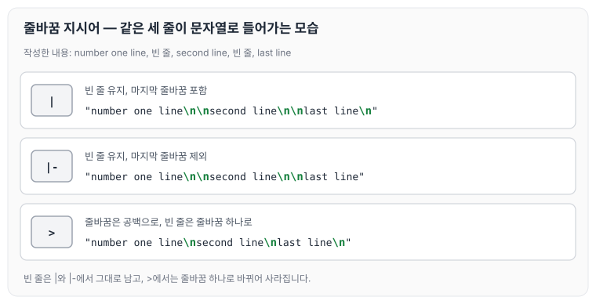

이전에 [쿠버네티스 알아보기](../kubernetes-intro/)에 대해 작성하였습니다. 그 글에서 원하는 상태(Desired State)를 오브젝트로 정의하고, API 서버에 YAML 형식으로 전달한다고 정리하였습니다. 오늘은 이때 사용하는 YAML의 기본 문법과 작성할 때의 주의사항에 대해 정리하도록 하겠습니다.

## 기본 문법

### 들여쓰기(indent)

들여쓰기는 보통 2칸 또는 4칸을 사용합니다.

2칸 들여쓰기를 추천하며, 아래와 같이 작성합니다.

```yaml
person:
  name: Coby
  job: Developer
  skills: 
    - docker
    - kubernetes
```

4칸 들여쓰기는 아래와 같습니다.

```yaml
person:
    name: Coby
    job: Developer
    skills: 
        - docker
        - kubernetes
```

### 데이터 정의(map)

데이터는 `key: value` 형식으로 정의합니다.

```yaml
apiVersion: v1
kind: Pod
metadata:
  name: echo
  labels:
    type: app
```

### 배열 정의(array)

배열은 `-`로 표시합니다.

```yaml
person:
  name: Coby
  job: Developer
  skills:
    - docker
    - kubernetes
```

### 주석(comment)

주석은 `#`으로 표시합니다.

라인 전체를 주석 처리할 때는 아래와 같이 작성합니다.

```yaml
# comment
person:
  name: Coby
  job: Developer
  skills:
    - docker
    - kubernetes
```

라인의 일부만 주석 처리할 때는 아래와 같이 작성합니다.

```yaml
person: 
  name: Coby # subicura
  job: Developer
  skills:
    - docker
    - kubernetes
```

### 참/거짓, 숫자 표현

참/거짓은 `true`, `false` 외에 `yes`, `no`도 지원합니다.

```yaml
study_hard: yes
give_up: no
hello: true
world: TRUE
manual: false
```

정수 또는 실수를 따옴표(`"`) 없이 사용하면 숫자로 인식하고, 따옴표로 감싸면 문자열로 인식합니다.

```yaml
# number
version: 1.2

# String
version: "1.2"
```

### 줄바꿈(newline)

여러 줄을 표현하는 방법은 아래와 같습니다.

`|` 지시어는 작성한 줄바꿈을 그대로 유지하고, 마지막 줄바꿈도 포함합니다.

```yaml
newlines_sample: |
            number one line
            
            second line

            last line
```

`|-` 지시어는 `|`와 같지만 마지막 줄바꿈을 제외합니다.

```yaml
newlines_sample: |-
            number one line

            second line

            last line
```

`>` 지시어는 줄바꿈을 공백으로 바꾸고, 빈 줄은 줄바꿈 하나로 바꿉니다. 그래서 이 예제처럼 중간에 들어간 빈 줄이 사라집니다.

```yaml
newlines_sample: >
            number one line

            second line

            last line
```

세 지시어로 같은 내용을 작성했을 때 실제로 들어가는 문자열을 비교하면 아래와 같습니다.



빈 줄을 그대로 남기려면 `|`나 `|-`를, 마지막 줄바꿈까지 빼려면 `|-`를 사용합니다.

## 주의사항

### 띄어쓰기

key와 value 사이에는 반드시 빈칸이 필요합니다. 빈칸이 없으면 key-value가 아니라 하나의 문자열로 인식합니다.

```yaml
# error (not key-value, string)
key:value

# ok
key: value
```

### 문자열 따옴표

대부분의 문자열은 따옴표 없이 사용할 수 있지만, `c:`처럼 `:`로 끝나거나 `:` 뒤에 빈칸이 오는 문자열은 key-value 구분자로 읽히므로 반드시 따옴표가 필요합니다.

```yaml
# error
windows_drive: c:

# ok
windows_drive: "c:"
windows_drive: 'c:'
```

## 참고

JSON을 YAML로 변환해 주는 사이트입니다.

[https://www.json2yaml.com/](https://www.json2yaml.com/)

YAML 문법을 체크해 주는 사이트입니다.

[http://www.yamllint.com/](http://www.yamllint.com/)

## 마무리

오늘은 쿠버네티스 오브젝트를 작성할 때 사용하는 YAML의 들여쓰기, 맵과 배열, 주석, 참/거짓과 숫자, 여러 줄 문자열 지시어와 작성할 때의 주의사항에 대해 정리하였습니다. 들여쓰기와 `:` 뒤 빈칸처럼 사소해 보이는 부분에서 오류가 나기 쉬우니, 작성한 뒤에는 문법 체크 사이트로 한 번 확인해 보는 것이 좋을 것 같습니다.

> 이 글은 인프런의 [초보를 위한 쿠버네티스 안내서](https://www.inflearn.com/course/쿠버네티스-입문)을 들으며 정리한 노트입니다.
